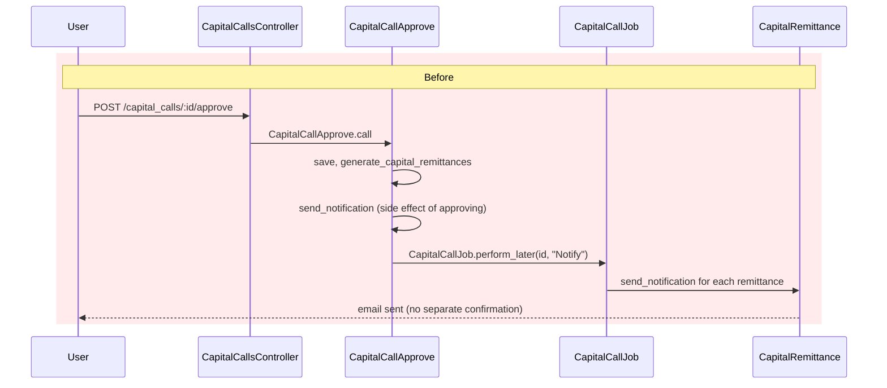
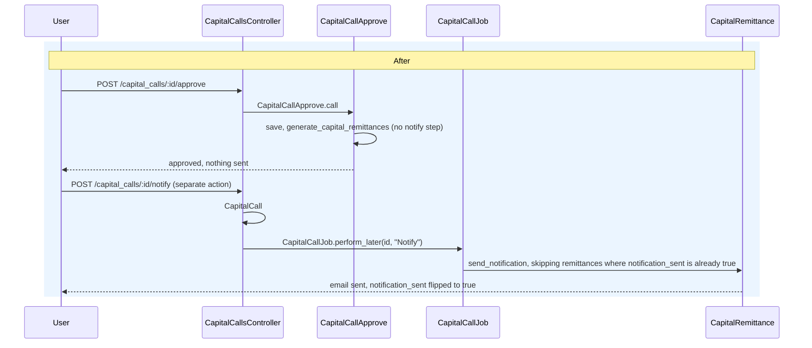

# Decoupling Capital Call Notifications from Approval

## Context

Previously, approving a capital call (`CapitalCallsController#approve` → `CapitalCallApprove`
Trailblazer op) automatically sent the "notify capital remittance" email to every investor on the
call, via a `send_notification` step shared by `CapitalCallAction` (the base class for
`CapitalCallApprove`, `CapitalCallCreate`, and `CapitalCallUpdate`). This conflated two distinct
actions — approving the call and notifying investors — into one irreversible click, with no way to
approve first (e.g. to double-check attached documents) and notify separately once ready.

Of the three call-related notification types — `notify_capital_remittance`,
`reminder_capital_remittance`, `notify_capital_remittance_payment` — only the first two (when sent
from the remittance-level UI action) were actually guarded on `capital_call.approved`. The
call-level reminder action and the payment notifier were not.

There was also no sandbox warning anywhere in the capital-call/remittance UI, even though
`EntitySetting#sandbox` already transparently redirects mailer sends to `sandbox_emails`
(`ApplicationMailer#setup_defaults`, `app/packs/core/base/mailers/application_mailer.rb`).

Finally, `capital_remittances.notification_sent` — the flag that switches the remittance-level
button between "Send Call Notification" and "Send Call Reminder" — was display-only, with no way
for staff to correct it.

**Existing precedent**: `capital_distributions` already separates "Approve" from a distinct "Send
Payment Notifications" action, policy-gated on `record.approved`. This change mirrors that pattern
for capital calls.

## Before / After

## Changes

**Decoupling** — `step :send_notification` removed from `CapitalCallApprove`, `CapitalCallCreate`,
and `CapitalCallUpdate` (all three shared it via `CapitalCallAction`). A new `notify` member action
was added (route, controller, policy `notify? = update? && record.approved`), mirroring
`CapitalDistributionsController#send_payment_notifications`. `CapitalCall#send_notification`'s
guard changed from `saved_change_to_approved?` (only meaningful mid-save) to `approved?`, since
it's now invoked from an independent request rather than as an approval side effect.

**Idempotency** — because the Notify action is now repeatable (unlike the old one-shot side
effect), `CapitalCallJob#notify` skips remittances where `notification_sent` is already `true`, so
clicking "Send Notification" twice doesn't re-email already-notified investors.

**Approval gating** — of the three notification types:

| Notification | Trigger | Approval guard |
|---|---|---|
| `notify_capital_remittance` | `CapitalRemittance#send_notification` | already checked `capital_call.approved` |
| `reminder_capital_remittance` (remittance-level button) | same method, `reminder: true` | already covered |
| `reminder_capital_remittance` (call-level reminder action) | `CapitalCall#reminder_capital_call` | added — previously missing |
| `notify_capital_remittance_payment` | `CapitalRemittancePayment#notify_capital_remittance_payment`, called from `CapitalRemittanceVerify` | added — previously missing |

`CapitalCallPolicy#reminder?` was also tightened to `update? && record.approved` (previously just
`update?`). Note the call-level "Reminder" action has no UI button anywhere today — the guard
protects the route/action, wiring up a button is a separate follow-up.

**Sandbox warning** — a shared partial (`app/packs/core/base/views/shared/_sandbox_notice.html.erb`)
renders "Sandbox is enabled, so the notification will go to the sandbox email IDs and NOT to the
investor" when `entity.entity_setting&.sandbox` is true. It's rendered inside the same confirmation
popup as each notify action (call-level "Send Notification" and remittance-level "Send
Notification"/"Send Call Reminder"), not as a separate dialog.

**Manual notification flag** — `capital_remittances.notification_sent` (pre-existing column, no
migration needed) is now a permitted, editable field on the remittance edit form, so staff can
correct it if an email bounced or was sent outside the system.

## Test coverage

`features/fund/capital_call_notify_decoupling.feature` covers the new behavior directly:
approving alone sends nothing; sending the notification twice doesn't double-email; the sandbox
warning appears in the confirmation modal when sandbox mode is on; manually editing a remittance's
`notification_sent` flag flips its button label; and the reminder/payment-notification methods are
no-ops before the call is approved. The pre-existing suites (`capital_calls.feature`,
`custom_notifications.feature`, `kyc_level_doc_gen.feature`) were updated to insert the new
explicit notify step where they previously relied on approval auto-sending.

## Follow-up / known gaps (not addressed here)

- `CapitalCall#notify_capital_call` (a separate, currently unwired, legacy method that doesn't
  apply the same `send_call_notice_flag`/`skip_doc_gen?` checks as `CapitalCallJob#notify`) still
  exists as dead code — candidate for removal.
- The call-level "Reminder" action has no UI trigger yet.
