# Evergreen: management fees booked after a NAV is approved

**The question:** what should happen when management-fee entries are dated inside a period whose NAV is
already approved?

**Decision (11/10/2026), built the same day in OpenSpec change `evergreen-late-management-fees`:** prevent the common cause, and make the GP decide everything else. NAVs can't
be approved until the fee is accrued, and a fee booked late is never silently lost or silently caught up.
The next NAV asks the GP to **include** it (option A) or **exclude** it (option B), and records the answer.
Section 4 has the full design.

This came up while looking at fund 343 (Alpha Long-Short Fund), whose Class A NAVs (31/07, 31/08,
30/09/2026) show Payable ₹0.00. **Correction (11/10/2026):** those three NAVs turned out to be
**uploaded** from an administrator, not drafted from the ledger. An upload has no fee lines, and the
administrator's figure already has the fee deducted, so nothing is missing on fund 343. The problem in
this doc is real for **drafted** NAVs. The fund 343 figures below are kept as a worked example of a fund
whose NAVs had been drafted and approved before the fee formula existed.

If you're new to fund fees, read the background first. It assumes no prior knowledge. Sections 1–5 then
explain the problem and the decision.

---

## Background: fees from scratch

### B1. Who's who


- **Fund:** a pool of investors' money that the manager invests.
- **Investor (LP):** someone who put money in. In return they hold **units**, which are like shares in the pool.
- **Manager (GP):** the firm that runs the fund. It is paid a **fee** out of the fund for doing so.

### B2. What an evergreen (open-ended) fund is

A traditional fund takes money once and returns it years later. An **evergreen** fund is open:
investors can **come in (subscribe)** and **go out (redeem)** on regular **dealing dates**, for example
every month.

Because people join and leave at different times, the fund needs a fair **price per unit** on each
dealing date. That price is the **NAV per unit**.

### B3. NAV and NAV per unit

**NAV** (Net Asset Value) = everything the fund owns − everything it owes.

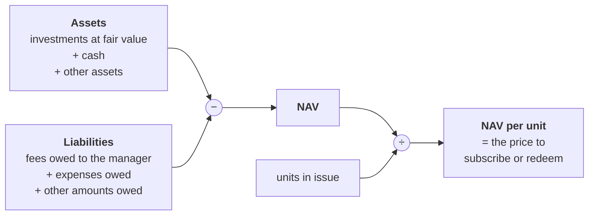

- A new investor pays **NAV per unit** for each unit they buy.
- A redeeming investor receives **NAV per unit** for each unit they sell back.

So **anything that should be in the NAV but isn't makes the price wrong** for everyone who deals at it.

### B4. The management fee

The manager charges a yearly percentage of the fund's value, for example **1.5% a year on NAV**. It
isn't charged once a year in one lump. It **builds up day by day**:

> fee for a period = value × fee % × days in the period ÷ 365

In CapHive, the "Management Fee on NAV" formula does this calculation **per investor folio** (each
investor's holding in a class):

> NAV per unit at the start of the period × units the folio holds × class fee % × days ÷ 365

Worked example for one folio:

| | |
|---|---|
| Units held | 1,000 |
| NAV per unit at the start of August | ₹10,000 |
| Value of the holding | 1,000 × ₹10,000 = **₹1,00,00,000** (₹1 crore) |
| Fee rate | 1.5% a year |
| Days in August | 31 |
| **August fee** | ₹1,00,00,000 × 1.5% × 31 ÷ 365 = **₹12,740** |

Different share classes can have different rates. On fund 343, Class A pays 1.5% and Class B pays 1%.

### B5. Three words: accrued, payable, paid

The fee goes through three states. Think of an electricity bill: you use power all month (it
**accrues**), you owe it (it's **payable**), then you pay the bill (it's **paid**).

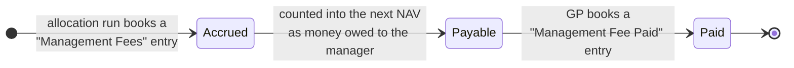

| Word | Meaning | Where it lives in CapHive |
|---|---|---|
| **Accrued** | The fee has been earned for a period and recorded | "Management Fees" account entries, written by the formula in an **allocation run** |
| **Payable** | Earned but not yet paid out, so the fund **owes** it to the manager. It is a **liability** | The `mgmt_fee_payable` line on each NAV, which is the **Payable** column on the Fees tab |
| **Paid** | Money has actually left the fund to the manager | "Management Fee Paid" account entries, booked by the GP |
| **Accrued to** | The last date the fee has been recorded up to | The latest "Management Fees" entry date, shown on the Fees tab |

**Allocation run:** a CapHive process that applies the fund's formulas (fees, expenses and so on) to every
folio for a date range and writes the resulting account entries. The fee isn't recorded until a run
includes the formula.

### B6. How the fee changes the NAV, and why paying it doesn't

This is the key idea. **The NAV falls when the fee accrues, not when it is paid.**

Toy fund: 1,00,000 units, ₹10,00,00,000 (₹10 crore) of investments and cash, fee 1.5% a year, 30-day month.

| Moment | Assets | Fee payable (liability) | **NAV** | **NAV per unit** |
|---|---|---|---|---|
| Start of month | ₹10,00,00,000 | ₹0 | ₹10,00,00,000 | **₹1,000.00** |
| Month's fee accrues: ₹10 cr × 1.5% × 30 ÷ 365 = ₹1,23,288 | ₹10,00,00,000 | ₹1,23,288 | ₹9,98,76,712 | **₹998.77** ⬇ |
| GP is paid ₹1,23,288 | ₹9,98,76,712 (cash left) | ₹0 | ₹9,98,76,712 | **₹998.77** (no change) |

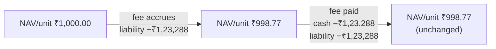

When the fee is paid, cash goes down and the amount owed goes down by the same amount, so the NAV
doesn't move. This is why **payable** is the number that matters on each NAV.

### B7. Why the timing has to be right in an evergreen fund

**The rule:** each month's fee should be paid by the people who were invested **that month**. The NAV
per unit is the only tool that makes this happen. When someone leaves the fund, they are paid the
NAV per unit, so whatever fee is already deducted from it is the fee they bore. Anything deducted
**after** they leave is borne by whoever is still there.

The easiest way to see this is one small story played out three ways.

#### The story

A toy fund with 1,00,000 units at ₹1,000 each (₹10 crore). To keep the arithmetic simple, the
investments don't gain or lose value, and the fee is **₹1.25 per unit per month** (1.5% a year of
₹1,000 ÷ 12, rounded), which is ₹1,25,000 a month for the whole fund.

| Investor | What they do |
|---|---|
| **Asha** | Holds 60,000 units for August and September |
| **Ravi** | Holds 40,000 units in August, then **redeems all of them** at the 31 August NAV |
| **Meera** | **Subscribes** at the 31 August NAV, buying Ravi's 40,000 units' worth, and holds them in September |

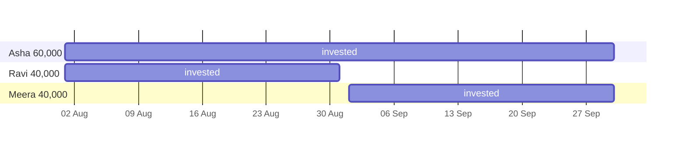

So the fair answer is:

- **August fee ₹1,25,000:** Asha pays 60,000 × ₹1.25 = **₹75,000**, Ravi pays 40,000 × ₹1.25 = **₹50,000**.
- **September fee ₹1,25,000:** Asha pays **₹75,000**, Meera pays **₹50,000**.

Now look at what each way of handling the August fee actually does.

#### Way 1: the August fee is in the August NAV (correct)

| Date | Fee deducted | NAV per unit | What happens |
|---|---|---|---|
| 31 Aug | Aug | ₹1,000 − ₹1.25 = **₹998.75** | Ravi receives 40,000 × ₹998.75 = ₹3,99,50,000. Meera pays the same and gets 40,000 units |
| 30 Sep | Sep | ₹998.75 − ₹1.25 = **₹997.50** | |

Every investor bears exactly their own months. ✓

#### Way 2: the August fee is never put in any NAV (this is option B)

| Date | Fee deducted | NAV per unit | What happens |
|---|---|---|---|
| 31 Aug | nothing | **₹1,000.00** | Ravi receives ₹4,00,00,000, which is **₹50,000 more** than Way 1. Meera pays ₹4,00,00,000 |
| 30 Sep | Sep only | ₹1,000 − ₹1.25 = **₹998.75** | |

Nobody pays anyone else's fee. The **manager** simply doesn't get the August fee of ₹1,25,000. Asha
and Ravi are each better off by their August share.

#### Way 3: the August fee is charged late, in the September NAV (this is option A)

| Date | Fee deducted | NAV per unit | What happens |
|---|---|---|---|
| 31 Aug | nothing | **₹1,000.00** | Ravi receives ₹4,00,00,000, which is **₹50,000 more** than Way 1. Meera pays ₹4,00,00,000 |
| 30 Sep | Aug **+** Sep | ₹1,000 − ₹2.50 = **₹997.50** | The whole ₹2,50,000 comes out of the people holding units **now**: Asha and Meera |

Ravi has already left with his August fee still in his pocket. That ₹50,000 doesn't disappear: it is
now deducted from **Meera**, who wasn't even in the fund in August.

#### Side by side: fee each person ends up bearing

| | Asha | Ravi | Meera | Manager receives |
|---|---|---|---|---|
| **Fair share** | ₹1,50,000 | ₹50,000 | ₹50,000 | ₹2,50,000 |
| Way 1: on time | ₹1,50,000 ✓ | ₹50,000 ✓ | ₹50,000 ✓ | ₹2,50,000 ✓ |
| Way 2: never charged (**B**) | ₹75,000 ⬇ | ₹0 ⬇ | ₹50,000 ✓ | ₹1,25,000 ⬇ |
| Way 3: charged late (**A**) | ₹1,50,000 ✓ | ₹0 ⬇ | **₹1,00,000** ⬆ | ₹2,50,000 ✓ |

How Meera's ₹1,00,000 in Way 3 is worked out: she paid ₹4,00,00,000 for 40,000 units, which are worth
40,000 × ₹997.50 = ₹3,99,00,000 on 30 September. Her loss is ₹1,00,000, which is her own September fee
plus Ravi's August fee.

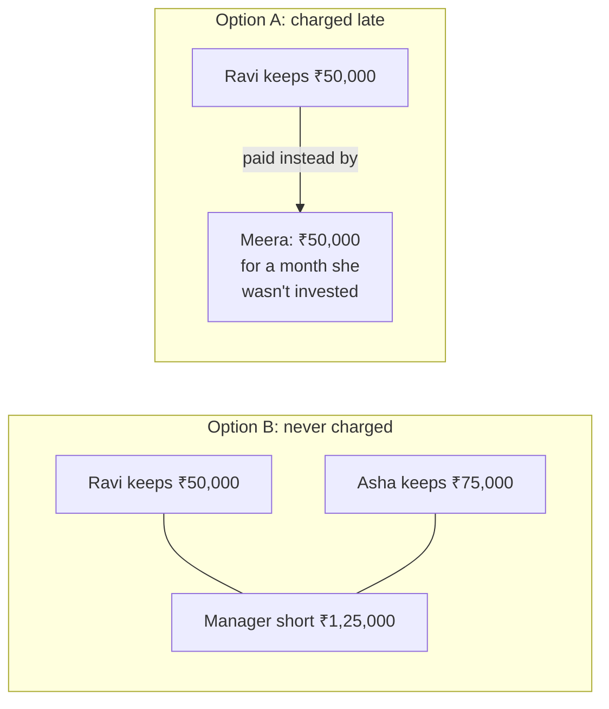

**The trade-off in one line:**

- **Option A:** the manager is paid in full, but a newcomer pays a leaver's fee.
- **Option B:** no investor pays for anyone else, but the manager loses the missed fee unless it is
  settled outside the NAV.
- **Way 1** is the only fully correct outcome. Today it is reachable only by reopening the old NAV,
  which is blocked once a dealing date has been priced at it (see section 3).

### B8. The performance fee, in one paragraph

Some classes also pay a **performance fee**: a share of the gain, charged only when NAV per unit rises
above its previous best (the **high-water mark**), so the manager is never paid twice for the same
gain. It appears in the lower half of the Fees tab. **This document is only about the management
fee**. The performance fee is calculated inside each NAV draft from the NAV per unit and the mark, not from entries an allocation run books, so it can't fall into this gap.

### Glossary

| Term | One-line meaning |
|---|---|
| NAV | Fund's assets − liabilities |
| NAV per unit | NAV ÷ units, the price for subscribing and redeeming |
| Class | A group of units with its own fee terms (Class A, Class B) |
| Folio | One investor's holding in one class |
| Dealing date | A date on which investors subscribe or redeem at the NAV per unit |
| Approved NAV | A NAV the GP has signed off. It can price a dealing date |
| Accrued / Payable / Paid | Earned and recorded / owed but unpaid / paid out (see B5) |
| Allocation run | Applies fund formulas to folios and writes account entries |
| High-water mark | The best NAV per unit a performance fee was already charged on |

---

## 1. How the fee normally reaches a NAV

There are three steps, and each one is a separate thing in CapHive:

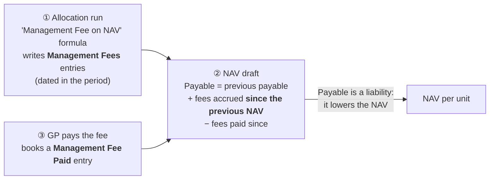

The key words are **"since the previous NAV"**. When the NAV builder adds up accruals, it counts only
entries dated **after the previous approved NAV's date and on or before this NAV's date**:

```ruby
# app/packs/funds/evergreen/services/nav_inputs.rb:97-103  (mgmt_fee_accrued_cents)
scope = AccountEntry.where(..., entry_type: "Management Fees", reporting_date: ..nav_date, ...)
scope = scope.where("account_entries.reporting_date > ?", from_exclusive) if from_exclusive  # from_exclusive = previous NAV date
```

Each NAV therefore looks at its own window and nothing earlier:

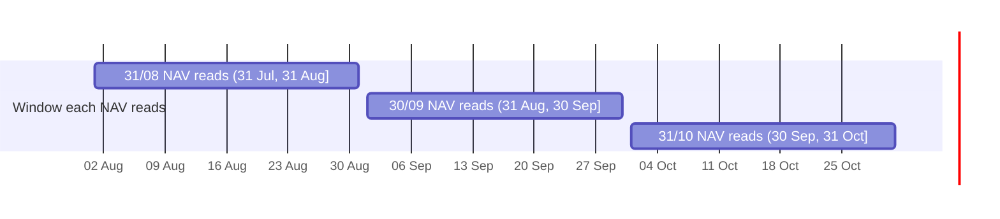

---

## 2. What goes wrong when the fee is booked late

Here is what would happen on such a fund (fund 343's figures, as if its NAVs had been drafted) if you add the formula **today** and run an allocation for August to
October:

| Step | What happens |
|---|---|
| 11 Oct | Add the formula, run the allocation 01/08 → 31/10 |
| | It writes Management Fees entries dated in **August**, **September** and **October** |
| 31 Oct | Draft the October NAV. Its window is (30 Sep, 31 Oct], so it counts **only the October entries** |
| | The August and September entries are dated **inside windows of NAVs that are already approved**, so **no NAV ever counts them** |

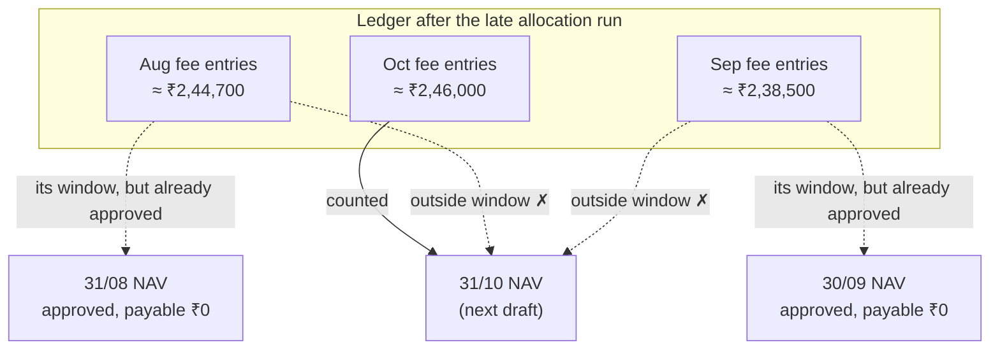

The amounts are rough, worked out as NAV × 1.5% × days ÷ 365. For August that is
₹19,20,90,000 × 1.5% × 31 ÷ 365 ≈ ₹2,44,700. The formula actually uses NAV per unit at the start of the
period × units held, so the real figures will differ slightly.

**Result today:** about ₹4.8 lakh of fees sits in the ledger but is never deducted from any NAV. Investors
are priced as if the fee were never charged, and nothing on screen says so.

A side effect: approved NAVs fingerprint the Management Fees entries dated up to their NAV date
(`NavStaleness.common_parts`). After the late run, the 31/08 and 30/09 NAVs show the red **"inputs
changed since this NAV was built"** banner.

---

## 3. The options for a late fee

### Option A: the next NAV catches up

The rule changes from "accruals **since the previous NAV**" to "**every accrual up to this NAV date that
no earlier NAV has counted yet**". The October NAV would then deduct August, September and October together.

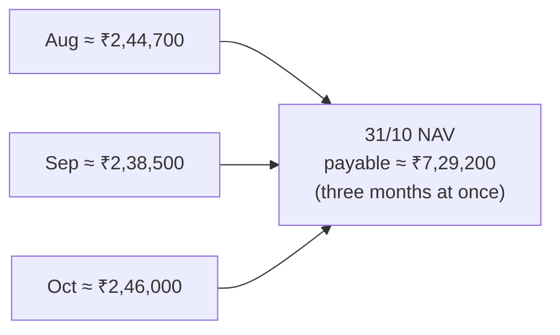

| | |
|---|---|
| ✓ The fund's books end up right | The liability for all three months appears in the NAV |
| ✗ The wrong investors pay | Everyone holding units on 31/10 bears the August and September fees, **including investors who subscribed on 01/10**. Investors who redeemed in August or September never bore their share. |
| ✗ The NAV per unit jumps | October's NAV per unit drops by about three months of fees in one go |
| Code change | `mgmt_fee_accrued_cents` in `nav_inputs.rb`, the `mgmt_owed` split in `fund_nav_builder.rb`, and new worked examples |

In B7 terms, this is **Way 3**: investors who redeemed in August or September keep their fee, and October's holders, including the 01/10 subscribers (the "Meeras"), pay it for them.

### Option B: leave the old NAVs and say the fee was missed

Nothing changes in the maths. Each NAV still counts only its own window. The Fees tab shows the gap
honestly on each affected row:

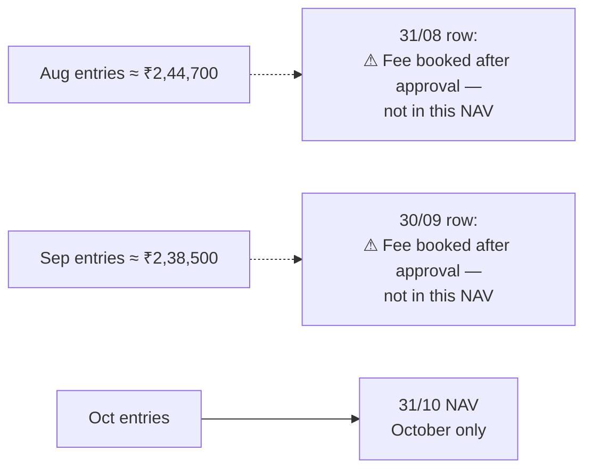

| | |
|---|---|
| ✓ Fair to investors | Nobody pays fees for a period they weren't invested in |
| ✓ No change to NAV maths | Only the Fees tab changes |
| ✗ The fee is not recovered through the NAV | The GP either writes it off or deals with it outside CapHive, for example by charging it directly or reversing the entries |
| What the row says to do | "Reopen and recalculate this NAV if no dealing date was priced at it; otherwise reverse these entries or settle the fee outside the NAV" |

In B7 terms, this is **Way 2**: nobody pays another investor's fee, and the manager doesn't receive the August and September fee through the NAV.

### There is already a third path, but it only works sometimes

An approved NAV can be **reopened** (`FundNavReopen`), **recalculated** (it then reads the new entries)
and approved again. However, a NAV that has **already been used to price a dealing date cannot be
reopened** (`fund_nav.used_by_dealing?`). The 30/09 NAV priced the 01/10 dealing date, so it is locked.
The 31/07 and 31/08 NAVs can be fixed this way only if no dealing date used them.

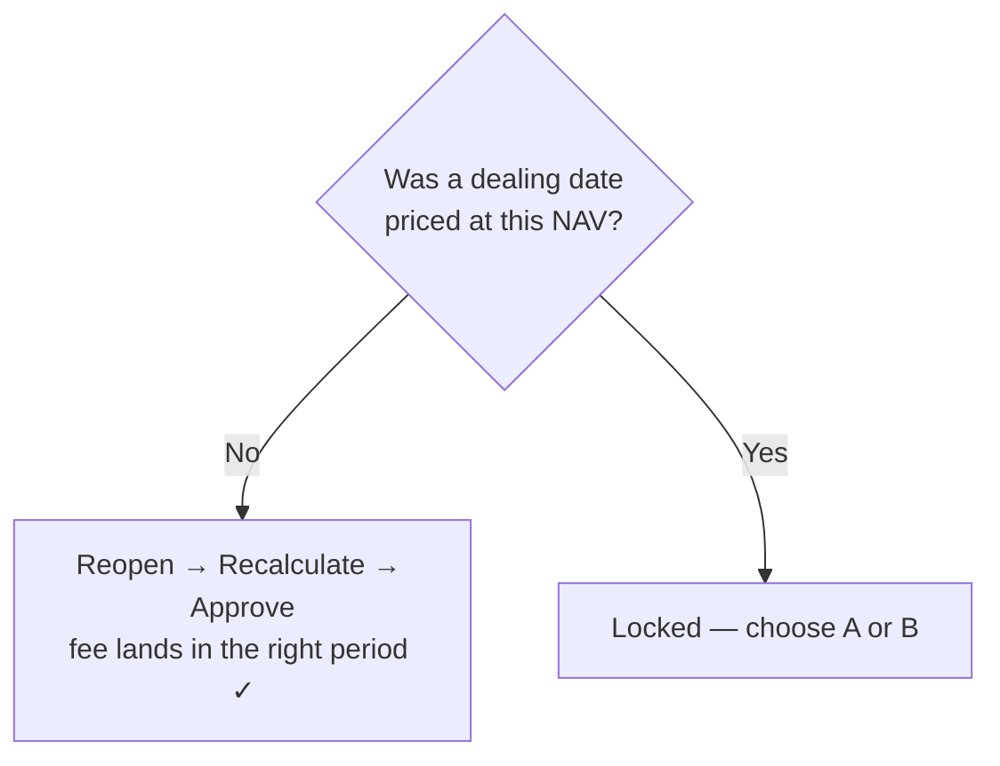

---

### Option C: never allow a late fee

Block it in two places:

| Guard | Where | What it stops |
|---|---|---|
| **1. Can't approve a NAV until its fee is accrued** | NAV approval (`FundNavApprove`) | Today a NAV whose fee isn't accrued to the NAV date only shows a warning (`evergreen_mgmt_fee_warning`, E35) and **can still be approved**. That is how a drafted NAV can end up approved with a ₹0 fee. |
| **2. Can't book a fee into an approved period** | Allocation runs, entry uploads, manual entries | Any "Management Fees" or "Management Fee Paid" entry dated on or before the class's latest approved NAV |

With both guards in place, Way 1 (fee on time) would be the only possible outcome.

**Why strict C fails in a real fund:**

1. **Late fees are often legitimate.** For example:
   - A side-letter fee discount for one investor is found after the NAV.
   - An LPA amendment backdates a rate change.
   - The administrator or auditor corrects a fee calculation months later.
   - A seed-investor waiver is agreed after the fact.

   With Guard 2 as a hard block, the only route is reopening the NAV, and that is impossible once a
   dealing date has been priced at it. The fund simply couldn't record the correction.
2. **NAV deadlines are fixed.** Investors expect to deal on the dealing date. Holding up approval over a
   fee correction delays every subscription and redemption, which is worse than a small timing difference.
3. **The industry already corrects after the fact.** Administrators work to a NAV error policy with a
   materiality threshold set per fund, often a fraction of a percent of NAV:
   - Below the threshold, the correction goes into the next NAV, which is option A.
   - Above it, NAVs are restated and affected investors compensated.

   In the worked example the missed fees (about ₹4.8 lakh) are about 0.25% of a ₹19 crore NAV.

Guard 1 has none of these problems. Running the fee formula is a CapHive action the GP controls, so
it's kept. Guard 2 is the one that is too rigid.

---

## 4. Decision: prevent where we can, decide case by case where we can't

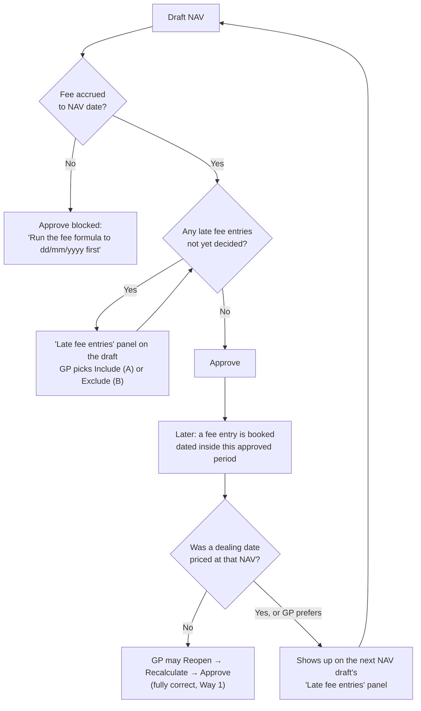

### 4.1 Guard 1: no approval without the fee (hard block)

- A drafted NAV can't be approved while its class has a fee % above 0 and the fee isn't accrued up to
  the NAV date. Today's warning becomes the reason the Approve button is disabled, the same way a stale
  draft already can't be approved (review fix 2).
- **Exempt:** uploaded NAVs (the administrator's figure already includes the fee) and classes with a 0% fee.

### 4.2 Late entries are allowed, but always surfaced

A **late fee entry** is a "Management Fees" or "Management Fee Paid" entry dated on or before the
previous approved NAV of its class that no NAV has counted yet.

- **On the NAV draft:** a "Late fee entries" panel per class. It sits next to the existing
  `unclaimed_class_entries` notice, which already lists class entries no NAV has claimed, so this is a
  sibling of an existing concept rather than a new one. For each class it shows:
  - the amount and the period it belongs to ("₹2,44,700 dated in August, booked 11/10/2026")
  - its size as a **% of this NAV**
  - **how many investors redeemed** since that period (the people who would escape the fee under A)
  - the choice **Include in this NAV (A)** or **Exclude, settled outside the NAV (B)**, where B needs a reason
- **Approve stays disabled** until every late entry on the draft has a decision.
- **No default:** neither choice is pre-selected and there is no fund setting for it. The GP must
  actively pick A or B for every late amount (decided 11/10/2026), because the choice decides who
  bears the fee.

### 4.3 The decision is recorded

- The NAV stores the amount included or excluded, who decided, when and why, in its audit trail.
- **Excluded amounts are remembered**, so they don't reappear on the next draft.
- **Fees tab:** the row says what happened, for example "Includes ₹2,44,700 of August fees booked late
  (GP decision, 11/10/2026)" or "Excludes ₹2,44,700, settled outside the NAV: <reason>".

### 4.4 How "not yet counted" is worked out

The check uses aggregates only, never individual `account_entries` rows (CLAUDE.md large-table rules).
Each NAV stores the **running total of fee accruals and payments it has counted or excluded**. A
draft's late amount is:

> ledger total dated on or before the previous NAV date − what the previous NAV says was counted or excluded

NAVs approved before this change don't have the running total. They are treated as having counted
exactly their own window, which is what the builder did, so nothing is double-counted.

### 4.5 Out of scope for now

- **Compensating investors who already left** (the full restatement route for large errors): it's a cash
  payment to an ex-investor and rare. It stays a manual process.
- **Blocking late entries (Guard 2):** deliberately not done, for the reasons in section 3.

### 4.6 The worked example (fund 343's figures, if its NAVs had been drafted)

Fund 343 itself needs nothing: its NAVs are uploaded. **A period covered by an uploaded NAV is never treated
as late**, because the administrator's NAV already includes the fee. Running the fee formula over such a
period would charge the fee twice.

| NAV | Dealing priced at it? | Route |
|---|---|---|
| 31/07, 31/08 | Check each one | If not: Reopen → run the fee formula → Recalculate → Approve (Way 1) |
| 30/09 | Yes (01/10 dealing date) | Locked, so its fee shows on the 31/10 draft's late panel: Include (A) or Exclude (B) |

---

## 5. What the Fees tab shows

| Row state | Badge | What to do (shown on the row) |
|---|---|---|
| Fee accrued to the NAV date | ✓ Accrued to 30/09/2026 | — |
| Approved before Guard 1 existed, no fee | No fee in this NAV | Reopen and recalculate if no dealing date was priced at it; otherwise the fee appears on the next draft to include or exclude |
| Includes late fees | Includes late fees | Shows the amount, the period and who decided |
| Late fees excluded | Late fees excluded | Shows the amount and the reason |
