# Evergreen (Open-Ended) Funds — Business Rules and Flows

**For business review.** This document describes what CapHive does for evergreen funds, in plain
language, with no technical detail. Every rule has a number (for example **R4.2**) so reviewers can
comment on it directly. Examples use one running fund, *Alpha Long-Short Fund*, in Indian rupees.

**How to review:** read each section, and for each numbered rule note *Agree*, *Change* (with what)
or *Question*. The sign-off table at the end lists the sections.

**How each section is laid out:** it opens with **the idea** in plain words, a diagram and a worked
example, then the numbered rules. If you only want to understand how evergreen funds work, read the
idea and the example in each section; the rules are for checking the detail.

---

## Contents

1. [What an evergreen fund is](#1-what-an-evergreen-fund-is)
2. [Setting a fund up](#2-setting-a-fund-up)
3. [Dealing dates, cut-offs and notice](#3-dealing-dates-cut-offs-and-notice) — including [every date on one timeline](#every-date-in-a-dealing-cycle)
4. [Subscriptions](#4-subscriptions)
5. [Redemptions](#5-redemptions)
6. [Lock-ups and early-redemption fees](#6-lock-ups-and-early-redemption-fees)
7. [Order approvals (journeys)](#7-order-approvals-journeys)
8. [The NAV](#8-the-nav)
9. [Fees: management and performance](#9-fees-management-and-performance)
10. [Redemption gates](#10-redemption-gates)
11. [Running a dealing date](#11-running-a-dealing-date)
12. [Settlement: money and units](#12-settlement-money-and-units)
13. [Contract notes and redemption advices](#13-contract-notes-and-redemption-advices)
14. [Notifications](#14-notifications)
15. [What investors and advisors see and can do](#15-what-investors-and-advisors-see-and-can-do)
16. [Who can do what](#16-who-can-do-what)
17. [Closed-ended funds are unchanged](#17-closed-ended-funds-are-unchanged)
18. [Sign-off](#18-sign-off)

---

## 1. What an evergreen fund is

A closed-ended fund raises commitments once, calls capital over time and returns it at the end. An
**evergreen fund** stays open: investors can come in and go out on regular **dealing dates**, buying
and selling **units** at the fund's **NAV per unit** (its value per unit) on that date.

### The idea: the same pot, entered and left at today's price

Think of the fund as one pot of investments cut into equal slices — **units**. The pot's value
divided by the number of slices is the **NAV per unit**. A new investor buys new slices at that
price, which adds money and slices in the same proportion, so nobody else's slice changes value. A
leaving investor hands slices back and is paid the same price.

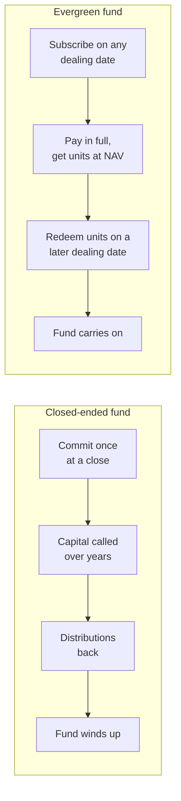

*Example:* Alpha is worth ₹100 crore with 1,00,000 units, so NAV per unit is **₹10,000**.

| | Fund value | Units | NAV per unit | Existing investor with 1,000 units |
|---|---|---|---|---|
| Before | ₹100 crore | 1,00,000 | ₹10,000 | ₹1,00,00,000 |
| P subscribes ₹5 crore at ₹10,000 → 5,000 new units | ₹105 crore | 1,05,000 | ₹10,000 | ₹1,00,00,000 — unchanged |
| Q redeems 2,000 units at ₹10,000 → paid ₹2 crore | ₹103 crore | 1,03,000 | ₹10,000 | ₹1,00,00,000 — unchanged |

That is the whole point of dealing at NAV: money coming in or going out never moves value between
investors. Everything else in this document — cut-offs, the NAV build, gates, the money held aside
for orders not yet dealt — exists to keep that true.

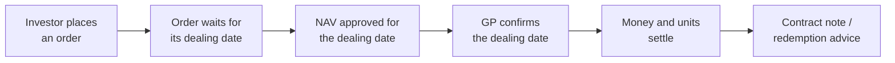

| Term | Meaning |
|---|---|
| **Unit** | A share of the fund. An investor's holding is a number of units. |
| **NAV per unit** | The fund's value divided by the units in issue. Everyone deals at it. |
| **Dealing date** | A date on which orders are priced and filled. |
| **Folio** | An investor's account in the fund, one per class (for example F-101). |
| **Class** | A group of units with its own fees, terms and **its own NAV per unit** (Class A, Class B). See section 8. |
| **Subscription** | Buying units. **Redemption**: selling units back to the fund. |

---

## 2. Setting a fund up

### The idea: the fund's rulebook, chosen once and changed forward

An evergreen fund's offering documents say when investors may deal, how much notice they give, how
long they are locked in and how much can leave at once. CapHive keeps that rulebook as the fund's
**evergreen settings**, set up in the New Fund wizard. Each class can have its own version of the
investor-facing terms.

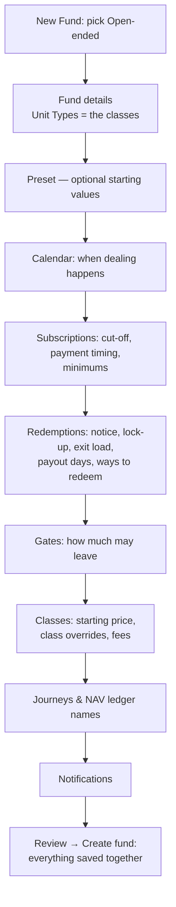

### Two deadlines: subscription cut-off and redemption notice

Every dealing date has a deadline in front of it. Which deadline applies depends on the kind of order:

| | Subscription **cut-off** | Redemption **notice** (notice period) |
|---|---|---|
| What it is | How many days before a subscription date an investor must subscribe — and, if the fund is pre-funded, pay | How many days before a redemption date an investor must ask to redeem |
| Why the fund needs it | Time to collect the money and check the investor | Time to raise the cash: sell assets, or stay within the gate |
| Set for | The whole fund | The fund, and each class may override it (R2.4) |
| Deadline | Dealing date − cut-off days, 23:59 | Dealing date − the class's notice days, 23:59 |
| Order arrives later | It goes to the next subscription date (R3.3) | It goes to the next redemption date (R3.3) — never rejected |

"Giving notice" means placing the redemption order. The investor does not send a separate letter
first: the order itself is the notice, and the date it is received is what the deadline is checked
against.

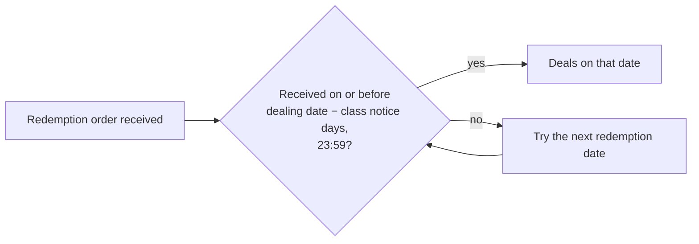

*Example:* Alpha deals subscriptions and redemptions monthly on the first business day, with a 5-day
cut-off, 30 days' notice, a 12-month soft lock-up at 2% and a 5% quarterly gate. Class B overrides
the notice to 2 days. A Class A investor and a Class B investor both place a redemption on
**Fri 20 November 2026**:

| Class | Notice | Deadline for Tue 1 Dec 2026 | Met? | Redeems on |
|---|---|---|---|---|
| A | 30 days | Sun 1 Nov 2026, 23:59 | No — 19 days late | **Fri 1 Jan 2027** (its deadline is Wed 2 Dec, met) |
| B | 2 days | Sun 29 Nov 2026, 23:59 | Yes | **Tue 1 Dec 2026** |

Same request, same day; the class's notice period alone puts them a month apart. A subscription
placed the same day meets the 1 December cut-off (Thu 26 Nov) regardless of class, because cut-off
is not per class.

**R2.1** A fund is closed-ended or open-ended from the day it is created. The type is chosen on **New
Fund**, offered only when evergreen funds and units are switched on for the entity, and can't be changed
afterwards in either direction. Moving a fund with activity is a support task.

**R2.1a** An open-ended fund is created complete: the New Fund wizard carries on into the evergreen
steps, every unit type gets a class with a **starting price** (required), and **Create fund** saves the
fund and its terms together, or nothing.

**R2.2** The evergreen steps are a step-by-step wizard (also used later to edit the terms). A starting template ("typical setup") can pre-fill sensible
values, which can then be changed.

**R2.3** Every setting in the wizard: its choices, its default, what it changes, and an example.
They are grouped in the order the wizard asks for them. Examples use Alpha from the start of this
section, with Class A and Class B, a ₹102.2 crore NAV and NAV per unit ₹10,220 unless stated.

#### Calendar — when dealing happens

| Setting | Choices · default | What it changes | Example | Rules |
|---|---|---|---|---|
| **Subscription calendar** | Monthly, quarterly, half-yearly, annual, custom · **Monthly** | Which days are subscription dealing dates. Investors can buy units only on these days, so a less frequent calendar means new money waits longer to be invested. | Monthly: subscriptions deal on 2 Nov, 1 Dec, 1 Jan… With quarterly instead, a subscription placed on 2 Oct waits until Fri 1 Jan. | R3.1 |
| **Redemption calendar** | Same choices · **Quarterly** | Which days are redemption dealing dates: how often investors can get out. It is often less frequent than subscriptions, so the fund isn't forced to sell assets every month. Quarterly periods start in January, April, July and October; half-yearly in January and July; annual in January. | Quarterly, first business day: redemptions deal on Fri 1 Jan, Thu 1 Apr, Thu 1 Jul and Fri 1 Oct 2027. A date where both calendars fall deals both kinds. | R3.1 |
| **Custom dates** | A list of dates (YYYY-MM-DD), required when a calendar is Custom | Replaces the calendar with exactly these dates. Weekend dates move to the next business day. This is the only way to avoid a public holiday. | `2027-01-04, 2027-04-05` deals only on those two days. A date that is a Saturday deals on the Monday after. | R3.5 |
| **Dealing day** | First business day, last business day, or a set day (1–28) · **First** | Where in each period the dealing date falls. A weekend moves to the **next** business day, or to the **previous** one for "last". Public holidays are not skipped. | First: Sun 1 Nov → Mon 2 Nov. Last: Sat 31 Oct → Fri 30 Oct. Set day 15: Sun 15 Nov → Mon 16 Nov. | R3.1, R3.5 |

#### Subscriptions — money in

| Setting | Choices · default | What it changes | Example | Rules |
|---|---|---|---|---|
| **Subscription cut-off** | 0–30 days before the dealing date · **5 days** | The last moment (23:59) to subscribe for a dealing date, and in a pre-funded fund the last moment for the money to arrive. A later subscription waits for the next date. It applies to the whole fund, not per class. | Cut-off for Tue 1 Dec is Thu 26 Nov, 23:59. A subscription placed on 27 Nov deals on 1 Jan. | R3.2, R3.3 |
| **Payment timing** | Before dealing (pre-funded) or after dealing · **Before** | **Before:** money must be in by the cut-off, and units are allotted when the dealing date is confirmed, so the fund never deals an unpaid order. **After:** the order is priced on the dealing date, and units are issued only when the money arrives, so the lock-up starts on that day too. | ₹1 crore at ₹10,220. **Before:** paid 20 Nov, 978.4736 units allotted on 1 Dec. **After:** priced on 1 Dec at the same 978.4736 units, paid 7 Dec, units issued 7 Dec. | R4.5–R4.7, R3.8 |
| **Days to pay** | 1–30 calendar days after the dealing date (only with "after") · **7 days** | The due date given in the payment-instructions email. After that date Fund ops get a *Settlement overdue* alert. | 1 Dec dealing date + 7 = due Tue 8 Dec; still unpaid on 9 Dec → alert. | R4.6 |
| **Not paid or not ready by the cut-off** | Roll or cancel · **Roll** | What confirming a dealing date does with an order that isn't ready, i.e. a pre-funded subscription not fully paid, or an order whose journey (below) isn't finished. **Roll:** it moves to the next date of its kind, keeping its received time and so its place in the queue. **Cancel:** it is cancelled and the investor is told. An order with money already received always rolls, whatever the setting. | P subscribes ₹1 crore for 1 Dec but has paid nothing by 26 Nov. **Roll:** P's order is on the 1 Jan date. **Cancel:** P's order is cancelled when 1 Dec is confirmed. P paid ₹50 lakh: rolls either way. | §7, §11 |
| **Minimum first subscription** | Amount; 0 = none · **None** | A first subscription in a class below this amount is refused as the order is placed. A class can override it. | Minimum ₹1 crore: a ₹50 lakh first subscription is refused with "Minimum subscription is ₹1,00,00,000". | R4.2 |
| **Minimum top-up** | Amount; 0 = none · **None** | The same check for an investor who already holds units in the class. | Minimum ₹10 lakh: an existing Class A holder's ₹5 lakh top-up is refused. | R4.2 |
| **Payment instructions** | Free text · blank | Bank details and payment reference shown to subscribers on the order confirmation page and in the acknowledgement, payment-instructions and payment-reminder emails. It changes no figures. | "Pay to Alpha Fund, HDFC A/c 1234…, reference: your folio number". | — |

#### Redemptions — money out

| Setting | Choices · default | What it changes | Example | Rules |
|---|---|---|---|---|
| **Ways to redeem** | By units, by amount, all units; at least one · **All three** | The forms an investor may use to ask to redeem, one per order. A form that isn't allowed is refused. With **by amount**, the units are worked out at the dealing date's NAV, so the investor doesn't know the unit count in advance. With **all units**, the count is fixed on the dealing date. | Only units and all units allowed: a ₹50 lakh request is refused with "This fund accepts redemptions in units or all units only". | R5.1, R5.4, R5.5 |
| **Notice** | 0–180 days before the dealing date; per-class override · **30 days** | How far ahead an investor must place a redemption (see *Two deadlines* above). Longer notice gives the fund time to raise cash; investors wait longer. | 30 days: a request on 20 Nov misses 1 Dec (deadline 1 Nov) and deals on 1 Jan. | R3.2, R3.3 |
| **Paid within** | 1–90 business days after the dealing date · **10 business days** | When redemption money is due. It only sets the due date — nothing is paid automatically — and Fund ops get a *Settlement overdue* alert the day after an unpaid payout falls due. | 1 Dec + 10 business days = due Tue 15 Dec; unpaid on 16 Dec → alert. | R5.6 |
| **Lock-up length** | 0–60 months; 0 = none; per-class override · **None** | How long each purchase's units are locked, counted from that purchase's issue date. Every purchase has its own clock, and a redemption uses the oldest units first. | 12 months: units issued 1 Dec 2026 are free from 1 Dec 2027; units bought 1 Mar 2027 stay locked until 1 Mar 2028. | R6.1, R6.3 |
| **Lock-up type** | Hard or soft; per-class override · **Hard** | **Hard:** a redemption of locked units is refused, and the message names the unlock date. **Soft:** the redemption goes ahead and the early-redemption fee comes off the payout. Locking is judged on the dealing date, not the day the order is placed. | Hard: "1,200 of these units are locked until 1 Dec 2027." Soft: the same redemption is accepted with a 2% fee. | R6.2, R6.4 |
| **Early-redemption fee** | One rate, or a rate by unit age (`3:0-12, 2:12-24`); 0–10%; per-class override · **None** | Used only with a soft lock-up. It is charged on the value of the **locked** units redeemed, each purchase at the rate for its own age. Free units are never charged. It is worked out again if the order moves to a later date. | 2%, redeeming 1,000 locked units at ₹10,220 = ₹1,02,20,000 → fee ₹2,04,400. With `3:0-12, 2:12-24`, a 6-month-old purchase pays 3% and an 18-month-old one 2%. | R6.5–R6.7 |
| **Minimum holding** | Amount; 0 = none; per-class override · **None** | A **part** redemption that would leave less than this, valued at the latest approved NAV, is refused. A full redemption is always allowed. | Minimum ₹25 lakh; holding 300 units (₹30.66 lakh). Redeeming 100 units would leave ₹20.44 lakh, so it is refused with "Redeem all units instead". | R5.3 |

#### Gates — how much may leave at once

| Setting | Choices · default | What it changes | Example | Rules |
|---|---|---|---|---|
| **Gate (share of NAV)** | 0–100%; 0 = no gate · **None** | The most that can be paid out in redemptions per gate period. Anything above it is **not refused**: it is carried to the next redemption date, at the front of the queue, and the investor gets a *Redemption partly filled* email. | 5% of ₹102.2 crore = ₹5.11 crore. Requests of ₹8 crore: ₹5.11 crore paid; ₹2.89 crore carried to the next date. | R10.1, R10.3 |
| **Who is paid first** | FIFO (first-come) or pro-rata · **Pro-rata** | How the gate is shared when requests exceed it. **FIFO:** whole orders, oldest received first, until the gate runs out. **Pro-rata:** every order is filled by the same percentage. | Gate ₹5 crore; X ₹4 Cr, Y ₹3 Cr, Z ₹1 Cr. FIFO: X ₹4 Cr, Y ₹1 Cr, Z nothing. Pro-rata (62.5%): X ₹2.5 Cr, Y ₹1.875 Cr, Z ₹0.625 Cr. | R10.2 |
| **Gate period** | Each dealing date, quarter or year · **Each dealing date** | How long one gate has to last. **Each dealing date:** every redemption date may pay out up to the full gate on its own, so with monthly dates a 5% gate lets up to 15% leave in a quarter. **Each quarter / each year:** all the redemption dates in that calendar quarter or year share **one** gate. What earlier dates paid out is taken off, and a new quarter or year starts with the full gate. The gate is always the % of the NAV on the date being dealt, less what earlier dates in the period paid. With quarterly redemption dates, "each quarter" and "each dealing date" behave the same. | 5% gate, NAV ₹100 crore, monthly dates, ₹4 crore asked for on each of 1 Oct, 2 Nov and 1 Dec. **Each dealing date:** ₹4 crore paid every time, ₹12 crore in the quarter. **Each quarter:** 1 Oct pays ₹4 crore (₹1 crore left), 2 Nov pays ₹1 crore and carries ₹3 crore, 1 Dec pays nothing. On 1 Jan a new quarter starts with ₹5 crore. See the full table under R10.6. | R10.6 |
| **Gate applies to** | Whole fund or each class · **Whole fund** | **Fund:** one gate, the % of all classes' NAV added together, which any class's redemptions can use up. **Class:** a separate gate per class on that class's own NAV, so heavy Class A redemptions don't block Class B. | Class A NAV ₹80 crore, Class B ₹22.2 crore, 5%. Fund: one ₹5.11 crore gate shared. Class: ₹4 crore for A and ₹1.11 crore for B. | R10.1 |
| **Per-investor cap** | 0–100% of the investor's holding; 0 = none · **None** | A personal limit applied **before** the gate. No investor can redeem more than this share of the units they held at the start of the gate period, less what they already redeemed in it. The rest is carried forward like a gated amount. It stops one large holder using up the whole gate. | 25% cap, quarterly. Q held 4,000 units on 1 Oct and asks for 2,000 → 1,000 filled, 1,000 carried. Q already redeemed 400 on 1 Oct → only 600 more on 1 Dec. | R10.5 |

#### Classes

| Setting | Choices · default | What it changes | Example | Rules |
|---|---|---|---|---|
| **Starting price** (each class) | Amount above 0 · required | Price per unit for the class's subscriptions until it has an approved NAV, and the NAV per unit shown while it has no units. | ₹10,000: a ₹10 crore first subscription gets 10,000 units. | R2.1a, R8.16 |
| **What investors hold** | Firm's wording, Units or Shares · Firm's wording | Wording only, on screens, emails and documents. It changes no figures. | "Shares": the folio and contract note say "1,000 shares" instead of "1,000 units". | — |
| **Performance fee** | None or above high-water mark · **None** | Whether the class charges a share of gains above the highest NAV per unit it has already charged on. | — | R9.3, R9.4 |
| **Fee %** | 0–50% · 0 | The share of those gains taken as the fee. | 20%, mark ₹10,000, NAV ₹10,220 → ₹44 a unit; with 1,00,000 units, ₹44,00,000. | R9.3 |
| **Hurdle %** | 0–50% a year · 0 | The yearly return the class must beat before any performance fee. The mark grows by this rate over time. | 8% hurdle: after a year a ₹10,000 mark becomes ₹10,800, so NAV ₹10,500 earns no fee. | R9.8 |
| **Hurdle type** | Hard or soft · **Hard** | **Hard:** the fee is charged only on gains above the hurdle. **Soft:** once the hurdle is beaten, the fee is charged on the whole gain above the mark. | Mark ₹10,000, hurdle level ₹10,800, NAV ₹11,000, 20%. Hard: 20% × ₹200 = ₹40 a unit. Soft: 20% × ₹1,000 = ₹200 a unit. | R9.8 |
| **Crystallises** | Quarterly, half-yearly or annual · **Annual** | When the estimated fee becomes final: approving the NAV dated on the period end books it per folio and raises the mark. Between those dates the fee is only an estimate in each NAV. | Quarterly: the 31 Dec NAV books ₹44,00,000, and the mark moves to ₹10,176. The 31 Oct NAV only estimated it. | R9.5–R9.7 |
| **Class overrides** | Notice, lock-up length and type, early-redemption fee, minimum holding, minimum subscriptions · blank = fund value | The class's own version of those fund terms. A blank field follows the fund. | Class B notice 2 days: a Class B redemption on 20 Nov makes 1 Dec, while Class A's misses it. | R2.4 |
| **Class expenses entry** / **paid entry** | Ledger entry names · blank | Expenses (e.g. a servicing fee) that come off this class's NAV only, never the other classes'. The *paid* entry records paying them. | "Class B Servicing Fee" of ₹2 lakh reduces Class B's NAV by ₹2 lakh; Class A is unaffected. | R8.19 |

#### Journeys & NAV sources

| Setting | Choices · default | What it changes | Example | Rules |
|---|---|---|---|---|
| **Per-order journeys** | Off, subscriptions only, or subscriptions and redemptions · **Off** | Whether each order must clear a checklist before it can deal: KYC, signed form, signatory check, GP acceptance and, if pre-funded, the money. **Off:** an order is ready once placed (and paid, if pre-funded). **On:** an order with an unfinished journey at confirmation is rolled or cancelled as set in *Not paid or not ready by the cut-off*. | Subscriptions only: P's subscription is not ready on 26 Nov because the signed form is missing, so it rolls to 1 Jan. Redemptions deal without a journey. | §7 |
| **Cash** | Ledger entry name · `Cash In Hand` | The latest balance of this entry is the NAV's cash line. The name must match the fund's account entries exactly, or the line is zero. | — | R8.1 |
| **Other assets** | Ledger entry name · `Net Current Assets` | The latest balance is added to the NAV. | — | R8.1 |
| **Other liabilities** | Ledger entry name · `Other Liabilities` | The latest balance is deducted from the NAV. | — | R8.1 |
| **Management fee paid** / **Performance fee paid** | Ledger entry names · `Management Fee Paid` / `Performance Fee Paid` | Entries with these names between two NAVs reduce the fee payable in the NAV, and come off the classes that owed the fee. | A ₹1,23,288 "Management Fee Paid" entry on 5 Dec reduces the payable on the next NAV by that amount. | R9.9 |

#### Notifications

| Setting | Choices · default | What it changes | Example | Rules |
|---|---|---|---|---|
| **Optional emails and alerts** | One switch each · see §14 | Turns optional investor emails (*Units free to redeem*, *Monthly NAV update*, …) and team alerts on or off. Everyday investor emails — acknowledgements, contract notes, redemption advices — always go. | — | §14 |
| **Remind investors** | 1–30 days before the cut-off · **2 days** | When *Payment reminder* and *Action needed* emails go to investors with unpaid or unfinished orders. | Cut-off 26 Nov, 2 days → reminders on 24 Nov. | §14 |
| **Large redemption** | Above 0, up to 100% of the class NAV · **2%** | A redemption at or above this share of its class's NAV alerts Compliance and the relationship manager. | Class A NAV ₹80 crore, 2% → a request of ₹1.6 crore or more raises the alert. | §14 |

**R2.4** Each class can override the lock-up, early-redemption fee, notice period, fees and initial
unit price.

**R2.5** Changing a setting applies **going forward only**. Dealing dates already confirmed keep the
settings they were confirmed with.

**R2.6** There is no switching back: an open-ended fund stays open-ended (R2.1). A fund created with
the wrong type is created again; one with activity is moved by support.

---

## 3. Dealing dates, cut-offs and notice

### The idea: a timetable, and a deadline for each kind of order

A **dealing date** is a day on which the fund deals: every order waiting for it is priced at the
same approved NAV per unit, units are issued or cancelled, and money moves. The fund's **calendar**
generates the dates — one for subscriptions and one for redemptions, which may differ (monthly
subscriptions, quarterly redemptions). A date on which both kinds fall deals both.

Each dealing date has deadlines in front of it, so the fund has time to collect money, prepare the
NAV and raise cash for redemptions:

- **Subscription cut-off** — the last moment to place a subscription (and, in a pre-funded fund, to
  pay for it) for that date. One per fund.
- **Redemption notice deadline** — the last moment to place a redemption for that date. Each class
  can have its own notice period.

Deadlines end at **23:59** on their day. An order that misses one goes to the **next** dealing date
of its kind.

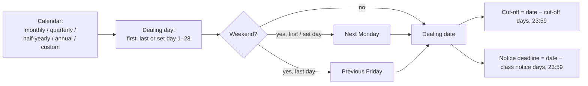

*Example:* Alpha's subscription calendar is monthly on the first business day, cut-off 5 days.

| Month | Calculated day | Dealing date | Subscription cut-off |
|---|---|---|---|
| November 2026 | Sun 1 Nov | **Mon 2 Nov** (next business day) | Wed 28 Oct, 23:59 |
| December 2026 | Tue 1 Dec | **Tue 1 Dec** | Thu 26 Nov, 23:59 |

A subscription received on 28 October at 23:59 deals on 2 November; one received on 29 October at
00:00 deals on 1 December.


**R3.1** Dealing dates come from the calendar. If the calculated day falls on a weekend it moves to
the nearest business day — the **last** business day for month-end dealing (Saturday 31 October →
Friday 30 October), the **next** one otherwise (Sunday 15 November → Monday 16 November).

**R3.2** A **subscription** must be received by the cut-off (default 5 days before the dealing
date). A **redemption** must be received by the notice deadline (default 30 days before).

**R3.3** An order received after the cut-off or notice deadline goes to the **next** dealing date,
and the investor is told which date that is.

*Example:* for the 2 November dealing date, a subscription received 28 October 23:59 is dealt on
2 November; one received 29 October 00:00 is dealt on 1 December.

**R3.4** An order entered by the GP with an earlier "received" time keeps that time, but is never
put on a dealing date that has already been confirmed.

**R3.5** Only weekends are skipped; public holidays are not known to the calendar. A fund that must
avoid a holiday uses custom dates.

**R3.6** Dealing dates for the coming year are generated every night from the calendar (and the
first order for a date creates it if needed). Changing the calendar or the cut-off affects dates
generated afterwards; dates already generated keep the cut-off they were created with.

### Every date in a dealing cycle

A dealing date is not a single day. It sits in the middle of a run of dates, which fall into three
stages:

1. **Before the dealing date — deadlines.** They decide *which* dealing date an order joins.
2. **Around the dealing date — pricing.** The NAV fixes *the price*; confirming the date fixes the
   figures.
3. **After the dealing date — settlement.** Money and units actually *move*.

This section follows one dealing date, Alpha's **Tuesday 1 December 2026**, and two investors:
**P**, who subscribes ₹1 crore, and **Q**, who redeems 1,000 Class A units. Alpha deals both kinds
monthly, takes money before dealing (pre-funded), has a 5-day cut-off, 30 days' notice for Class A and 2 for Class B,
reminders 2 days before the cut-off, and pays redemptions within 10 business days.

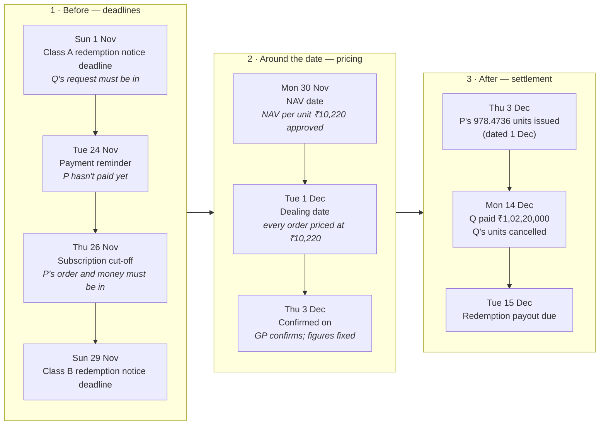

#### Stage 1 — before the dealing date: which date does an order join?

Each order is checked against **its own** deadline, worked out back from the dealing date. Every
deadline ends at 23:59. Missing it doesn't reject the order; it joins the next dealing date of its
kind (R3.3).

| Date | Deadline | Who it applies to | Worked out as | If missed |
|---|---|---|---|---|
| **Sun 1 Nov** | Class A redemption notice | Class A redemptions | 1 Dec − 30 days | Deals on 1 Jan |
| **Thu 26 Nov** | Subscription cut-off — order placed **and**, pre-funded, paid | All subscriptions | 1 Dec − 5 days | Rolls to 1 Jan, or is cancelled (setting) |
| **Sun 29 Nov** | Class B redemption notice | Class B redemptions | 1 Dec − 2 days | Deals on 1 Jan |

Two days before the cut-off (**Tue 24 Nov**), investors with unpaid or unfinished orders are reminded
by email.

*In the example:* Q placed the Class A redemption on 25 October, before the 1 November deadline, so
it joins 1 December. P placed the subscription on 20 November and paid on 25 November, before the
26 November cut-off, so it joins too. Had Q waited until 20 November, the redemption would deal on
1 January instead.

#### Stage 2 — around the dealing date: what price?

| Date | What happens | Worked out as |
|---|---|---|
| **Mon 30 Nov** — NAV date | The GP drafts and approves a NAV per class. | Each class's latest **approved** NAV dated on or before the dealing date (R11.2) |
| **Tue 1 Dec** — dealing date | Every order on the date, subscriptions and redemptions alike, is priced at that NAV per unit: ₹10,220. Nobody gets a different price. | From the calendar (R3.1) |
| **Thu 3 Dec** — confirmed on | The GP reviews the preview and clicks **Confirm dealing date**. Units, fills and gate results are fixed. Orders that aren't ready roll or are cancelled. | The day it is clicked; it can only happen once the NAV is approved and the **last** deadline (here Class B's notice, 29 Nov) has passed (R11.2b) |

*In the example:* P's ₹1 crore ÷ ₹10,220 = **978.4736 units**. Q's 1,000 units × ₹10,220 =
**₹1,02,20,000** to be paid (less any early-redemption fee).

The NAV date and the dealing date need not be the same day. The NAV can be from earlier, here the
day before. Confirming can be later, here two days after, because the GP waits for the NAV to be
approved.

#### Stage 3 — after the dealing date: when do money and units move?

| | Subscription (P) | Redemption (Q) |
|---|---|---|
| **Money** | Already received by the cut-off (pre-funded) | Due within 10 business days: by **Tue 15 Dec**. Fund ops get an alert on 16 Dec if it is still unpaid. |
| **Units** | Issued when the date is confirmed, dated **1 Dec** | Cancelled on the payment date entered on **Mark paid**: **Mon 14 Dec** |
| **Investor gets** | Contract note | Redemption advice |
| **In the NAV** | From 1 Dec | Q's units stop counting from 1 Dec; until 14 Dec the payout sits in the NAV as money owed to Q (R3.7) |

*Pay-after variant:* if Alpha took money **after** dealing, P would be priced on 1 Dec at the same
978.4736 units, be asked to pay by **Tue 8 Dec** (1 Dec + 7 days to pay), and get the units on the
day the money arrived, e.g. **Mon 7 Dec**.

#### Later dates that start from this one

| Date | What it is | In the example |
|---|---|---|
| **Lock-up end** | P's units become free to redeem: issue date + lock-up months | 12-month lock-up → **1 Dec 2027** (pay-after variant: 7 Dec 2027) |
| **Crystallisation date** | The performance fee estimated in each NAV is booked: end of the class's quarter, half-year or year (R9.6) | Quarterly → **Thu 31 Dec 2026** |
| **Gate period** | The span a quarterly or yearly gate is shared over: the calendar quarter or year the dealing date falls in | Quarterly → **1 Oct – 31 Dec 2026**: what the October and November dates paid out reduces what 1 December can pay |

#### Reference: every date, where it shows

| Date | How it is worked out | In the example | Where it shows |
|---|---|---|---|
| **Received at** | The moment the order was placed; the GP may enter an earlier time (R3.4) | P: 20 Nov · Q: 25 Oct | Order page, Received column |
| **Redemption notice deadline** | Dealing date − the class's notice days, 23:59 | A: Sun 1 Nov · B: Sun 29 Nov | Check screen, acknowledgement |
| **Payment reminder** | Cut-off − reminder days (default 2) | Tue 24 Nov | Investor email |
| **Subscription cut-off** | Dealing date − cut-off days, 23:59 | Thu 26 Nov | Dealing Dates list, Check screen, emails |
| **NAV date** | Each class's latest approved NAV on or before the dealing date | Mon 30 Nov | Dealing date preview, contract note |
| **Dealing date** | From the calendar (R3.1) | Tue 1 Dec | Everywhere |
| **Confirmed on** | The day **Confirm dealing date** is clicked — only after the last deadline (R11.2b) and with a NAV newer than the previous date's (R11.2a) | Thu 3 Dec | Dealing date page |
| **Pay-after money due** | Dealing date + days to pay (calendar days) | Tue 8 Dec | Payment instructions email |
| **Unit issue date** | The later of the dealing date and the day the last payment arrived | Pre-funded: 1 Dec · pay-after: 7 Dec | Folio **Unit History** |
| **Unit cancellation date** | The payment date entered on **Mark paid** | 14 Dec | Folio **Unit History** |
| **Redemption payout due** | Dealing date + payout days, Monday–Friday only | Tue 15 Dec | Settlement records; overdue alert the day after |
| **Crystallisation date** | End of the class's quarter / half-year / year | Thu 31 Dec | Fees tab |
| **Gate period** | The calendar quarter or year of the dealing date | 1 Oct – 31 Dec 2026 | Gate card |
| **Lock-up end** | Issue date + lock-up months | 1 Dec 2027 | Holding, unit register |

**R3.7** From the dealing date the redeemed units no longer count in the NAV, even though they leave
the folio only when paid: a NAV dated between the dealing date and the payment holds the payout as
money owed to the investor (R8.8).

**R3.8** A pay-after subscriber's units are issued on the day their money arrives, so their lock-up
clock starts then, not on the dealing date.

*Why the dates matter together:* the cut-off and notice decide **which** dealing date an order
belongs to; the NAV date decides **its price**; the confirmed-on date is when the price is fixed;
the payment and issue dates decide **when money and units actually move**; and the lock-up,
crystallisation and gate dates decide what **later** orders may do.

---

## 4. Subscriptions

### The idea: pay an amount, receive units at the dealing date's price

A subscription is for an **amount of money**, not a number of units, because the price isn't known
until the dealing date's NAV is approved. The fund decides **when** the money comes:

- **Pre-funded (pay before dealing):** the money must be in by the cut-off. On the dealing date the
  units are issued at once, because the money is already there.
- **Pay after dealing:** the order is priced on the dealing date, the investor is told the exact
  units and amount, and pays within the days allowed. Units are issued when the money arrives.

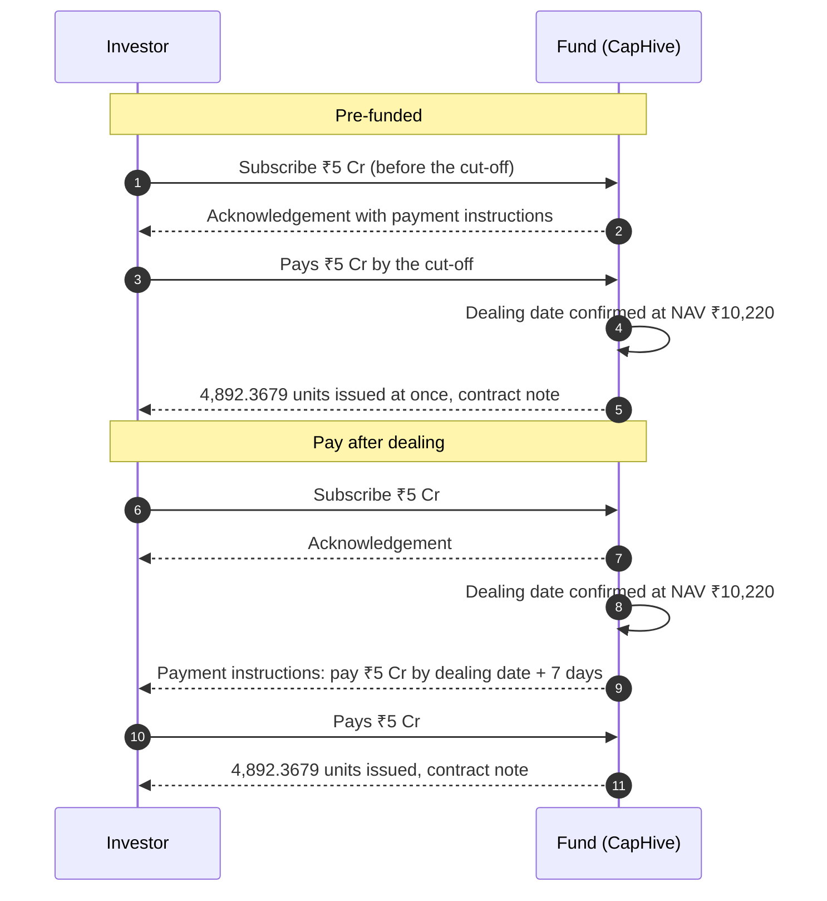

*Example:* ₹5,00,00,000 at ₹10,220 a unit = **4,892.3679 units**. A first subscription in Class A
opens folio F-107; a later ₹1 crore top-up adds 978.4736 units to the same F-107.

**R4.1** An investor subscribes an **amount**. Units are worked out at the dealing date's NAV per
unit: units = amount ÷ NAV per unit, kept to 8 decimal places and shown to 4.

*Example:* ₹5,00,00,000 at ₹10,220 a unit = 4,892.3679 units.

**R4.2** A subscription below the minimum is refused: first subscription "Minimum subscription is
₹25,00,000"; a top-up by an existing holder uses the top-up minimum. A zero or negative amount is
refused.

**R4.3** A subscription must be in the fund's currency and in a class that has an initial price.

**R4.4** An investor's first subscription in a class opens a new **folio**, numbered after the
highest existing one (never below F-101). Further subscriptions top up the same folio.

**What a folio is.** A folio is an investor's account in **one class** of the fund — the evergreen
name for a commitment. It holds the units, and inside it every purchase is kept as its own **lot**
with its own issue date and price, because lock-ups and exit loads are judged per lot (section 6).

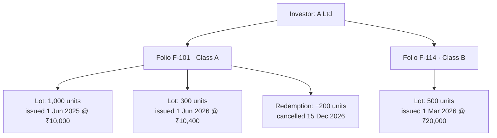

A pre-funded subscription opens (or tops up) the folio when it is placed; a pay-after one when its
dealing date is confirmed. Cancelling the order before dealing removes a folio it opened, if the
folio holds nothing else.

**R4.5 Paying before dealing (pre-funded).** The money must arrive by the cut-off. If it has, units
are issued on the dealing date. If it hasn't, the order is not ready (see R11.4).

**R4.6 Paying after dealing.** The order is priced on the dealing date; the investor receives
payment instructions and pays within the set number of days. Units are issued when the money is
recorded.

**R4.7 Units are issued only when the subscription is paid in full** (to within 10 paise), the
payment is verified and the dealing date is confirmed.

**R4.8 Part payments.** If an investor pays only part — say ₹50 lakh of ₹1 crore — the GP can
**accept the amount received** as the whole subscription. The order, the amount due and the folio's
subscribed amount all drop to ₹50 lakh, and units are issued for ₹50 lakh at the dealing date's NAV
per unit. The original amount and who reduced it are kept on record. This cannot be undone; money
arriving later is refunded.

**R4.9** Money that has been received cannot be cancelled away: an order with money received can't
be cancelled ("refund it before cancelling").

---

## 5. Redemptions

### The idea: hand units back, wait in the queue, get paid later

A redemption asks the fund to buy units back on a dealing date. The investor asks in **units**, in
an **amount**, or for **all units** (as the fund allows). The request joins a **queue** in the order
received; on the dealing date the gate (section 10) decides how much of the queue is paid now and
how much is carried to the next redemption date. The money follows within the payout period, and
the units leave the folio when the payment is recorded.

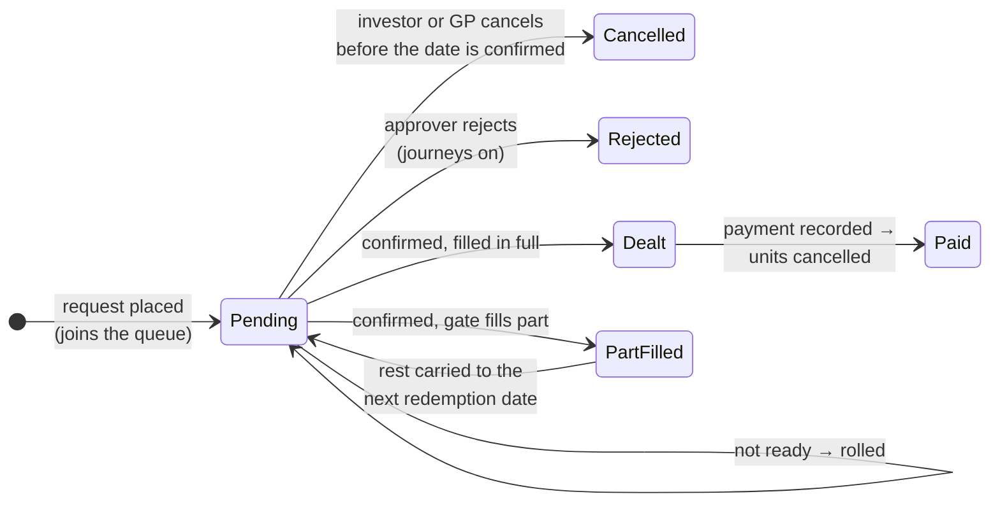

*Example:* Q holds 3,000 units and redeems 2,000 for the 1 December date at ₹10,000. The gate has
room for ₹1.5 crore, so Q is paid ₹1,50,00,000 for 1,500 units (minus any exit load) by 15 December,
and the other 500 units are carried to the next redemption date, still ahead of later requests.

**R5.1** An investor can redeem **a number of units**, **an amount**, or **all units** — whichever
forms the fund allows — and exactly one of them per request. Zero or negative requests are refused.

**R5.2** A redemption can't exceed the investor's **free units**: units held, less units already
asked for in other open redemptions. *"You hold 4,892.37 units; 2,000 are already queued for
redemption."*

**R5.3** A partial redemption may not leave less than the **minimum holding**: *"This would leave
₹40,00,000, below the ₹50,00,000 minimum holding. Redeem all units instead."* Redeeming everything
is always allowed.

**R5.4** An amount redemption is turned into units at the dealing date's NAV per unit. If no NAV has
been approved yet, it is refused and the investor is asked to give units instead.

**R5.5** An "all units" redemption is worked out on the dealing date, after any units still being
paid out from earlier dealing dates.

**R5.6** Redemption money is paid within the payout period (default 10 business days). Units are
cancelled when the payment is recorded.

---

## 6. Lock-ups and early-redemption fees

### The idea: each purchase has its own clock

A lock-up keeps new money in the fund long enough to be invested. The clock starts **per purchase**
(lot), not per investor, so an investor who bought twice has two clocks. A redemption takes the
oldest units first. A **hard** lock-up refuses locked units; a **soft** lock-up lets them go with an
**exit load** (early-redemption fee) that stays in the fund for the remaining investors.

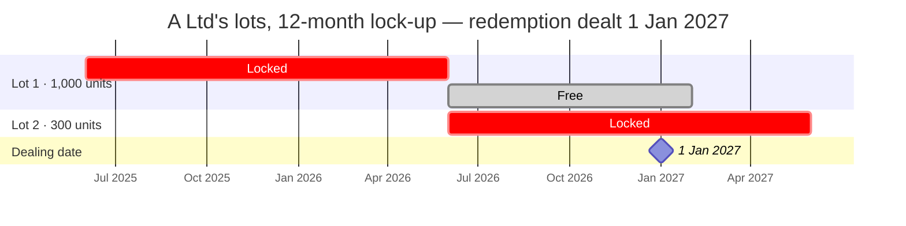

*Example:* A Ltd redeems 1,100 units on 1 January 2027. Lot 1's 1,000 units are free; the other
100 come from Lot 2, locked until 1 June 2027. Hard lock-up: refused — *"100 of these units are
locked until 01 June 2027."* Soft lock-up at 2%: allowed, with 2% charged on those 100 units only.

**R6.1** A lock-up is a minimum holding period, counted **separately for every purchase** from the
date its units were issued.

**R6.2** A **hard** lock-up refuses redemptions of locked units: *"1,200 of these units are locked
until 15 March 2027."* A **soft** lock-up allows them, with an **early-redemption fee** deducted
from the payout.

**R6.3** A redemption uses the **oldest units first**, after netting units already redeemed.

**R6.4** Whether a unit is locked is judged on the **dealing date**, not the day the order is
placed. Units unlocking **on** the dealing date are free.

**R6.5** With a fee schedule (for example 3% in the first year, 2% in the second), **each purchase
pays the rate for its own age.**

*Example:* 100 units 18 months old and 100 units 3 months old, at ₹10,000 a unit:
2% × ₹10,00,000 + 3% × ₹10,00,000 = **₹50,000**.

**R6.6** If a redemption moves to a later dealing date, its fee is worked out again on that date —
units that unlocked in between pay nothing.

**R6.7** The fee is shown when the order is placed, deducted from the payout, and shown on the
redemption advice.

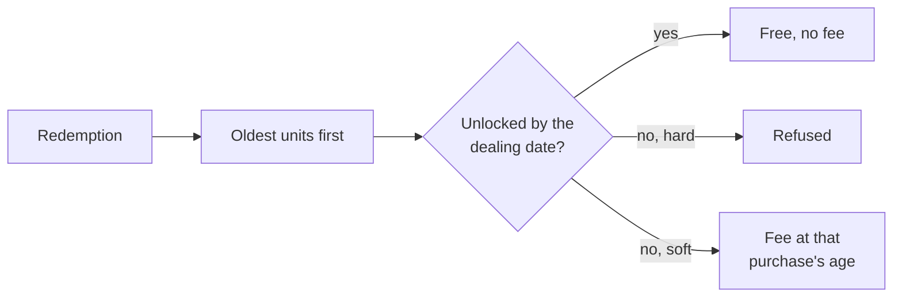

---

## 7. Order approvals (journeys)

### The idea: a checklist each order must clear before it can deal

Some funds need more than a form and money before they will deal an order: KYC approved, a signed
subscription form, the signatory verified, the GP's acceptance. With order approvals on, each order
carries its own step bar, works out which step it is on from its own data, and is **ready** only when
every step before dealing is done. An order that isn't ready by the cut-off is rolled or cancelled.

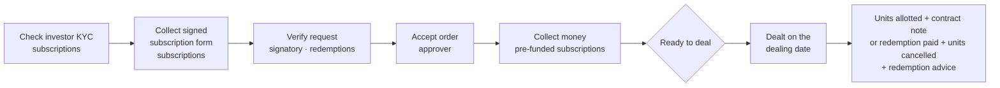

Steps that don't apply to an order are skipped (a redemption has no signed subscription form). The
GP can remove steps from the fund's journey; readiness counts only the steps that are left.

*Example:* P's ₹5 crore subscription is accepted and paid, but P's signed form is missing on the
26 November cut-off. On confirm it shows *"Not ready — waiting on: Collect signed subscription
form"* and rolls to the January date (or is cancelled, if the fund cancels). P was emailed *Action
needed* on 24 November.

**R7.1** If order approvals are on, each order runs its own approval journey: check the investor's
KYC and collect the signed subscription form (subscriptions), verify the signatory (redemptions),
accept the order (approver), and collect the money (pre-funded subscriptions).

**R7.2** An order can be dealt only when its journey is complete and, for a pre-funded subscription,
its money is in. Such an order is **ready**.

**R7.3** An order can be rejected with a reason (or "Rejected" if none is given); its units become
free again.

**R7.4** Investors see each step of their request's progress.

---

## 8. The NAV

### The idea: what one unit of each class is worth on a date

The NAV (net asset value) is everything the fund owns minus everything it owes, on a date. Divided
by the units in issue it gives the **NAV per unit** — the one price every order on a dealing date
uses. Because that price moves money between investors if it is wrong, a NAV goes through a draft,
can be corrected with reasons, and is used only once an approver approves it.

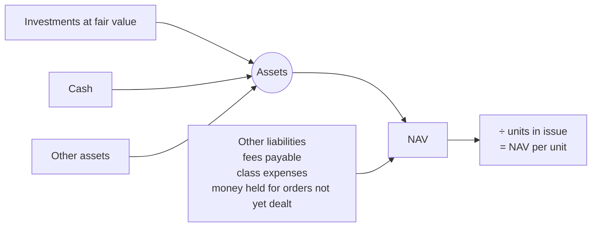

*Example:* investments ₹105 crore + cash ₹6 crore − other liabilities ₹1 crore = ₹110 crore; less
fees of ₹14 lakh = ₹109.86 crore. With 1,07,500 units, NAV per unit = ₹10,219.53.

**R8.1** The GP drafts a NAV for each class for a date. CapHive builds it from the fund's data:

| Line | Comes from |
|---|---|
| Investments at fair value | The portfolio valuations on or before the date |
| Cash, other assets, other liabilities | The fund's ledger balances |
| Management fee payable | Previous payable + accruals − payments |
| Performance fee payable and accrued | See section 9 |
| Money received for orders not yet dealt | See R8.8 |
| Class expenses payable | Previous payable + the class's own expenses − their payments (R8.19) |

**R8.2** Each class gets its **own NAV and NAV per unit**. Fund-wide amounts are shared between
classes by each class's stake (R8.14), and each class's own fees and expenses come off that class only. The full rules and a worked
example are in [How each class gets its own NAV](#how-each-class-gets-its-own-nav) below.

**R8.3** A NAV can be **uploaded** instead, from an administrator's spreadsheet. Each row's NAV ÷
units must equal its NAV per unit (to within 0.01). A file listing the same class and date twice is
refused as a whole. Drafting from the ledger is refused for a date that has an uploaded draft, so the
administrator's figures are never replaced silently (delete the upload first). An uploaded NAV shows
no management-fee accrual warning: its figures already include the fee.

**R8.4** A line can be **overridden** with a reason (up to 255 characters). Overrides are kept if
the NAV is drafted again. An uploaded NAV has no lines to override.

**R8.5** A NAV must be **approved** before it is used for dealing or shown to investors. Only users
with the **approver** role can approve; who drafted or changed it doesn't matter — the role is the
control, and the audit trail records who drafted, changed and approved it. A draft whose inputs
changed after drafting (R8.10) can't be approved until it is recalculated. Nor can a draft whose management fee isn't accrued to the NAV date (R9.2), or one with an undecided late fee amount (R9.13).

**R8.6** An approved NAV can be **reopened** only if no confirmed dealing date has used it. Reopening
reverses any performance-fee crystallisation it caused.

**R8.7** A **negative NAV** (liabilities above assets) is refused — on drafting, override or upload.

**R8.8 Money for orders not yet dealt.**

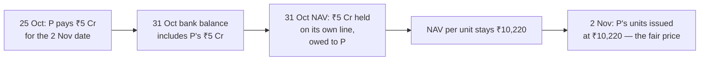

 Money that has arrived for subscriptions not yet dealt is
the incoming investor's, not the fund's existing investors'. It is held on its own line until the
units are issued, charged to that order's class. The same line holds the payout of redemptions that
have been dealt but not yet paid, and those units stop counting.

*Example:* the fund is worth ₹102.2 crore with 1,00,000 units. ₹5 crore arrives on 25 October for
the 2 November dealing date. The 31 October NAV keeps the ₹5 crore aside, so NAV per unit stays
₹10,220 (not ₹10,720) and the new investor gets 4,892.3679 units.

**R8.9** If the cash balance entered is older than money received for orders not yet dealt, the NAV
page warns that the cash balance should be updated.

**R8.10** A NAV whose inputs dated on or before its NAV date changed after it was drafted is flagged
as out of date ("Stale") and can't be approved until it is recalculated. Dealing on later dates
doesn't make an earlier NAV stale.

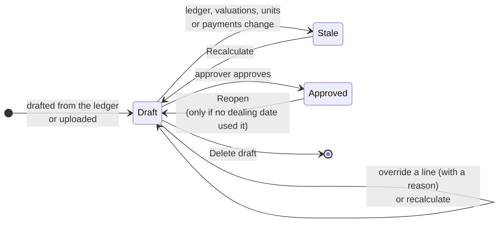

**R8.11** Investors only ever see approved NAVs.

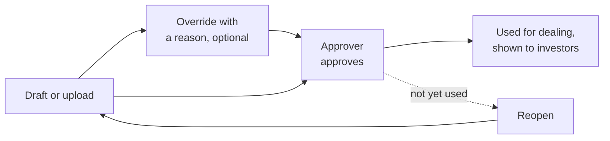

### How each class gets its own NAV

A fund can have several classes, for example Class A for large investors (lower fee) and Class B
for others (higher fee, performance fee). All classes own **one shared portfolio**, but each class
pays its own fees. So each class needs its own NAV and its own NAV per unit, and an investor always
deals at **their class's** price.

**R8.12** Every NAV date has one NAV per class. A class's investors subscribe and redeem only at
that class's NAV per unit, and see only that class's NAV.

**R8.13** Each NAV line is either **shared** or **the class's own**:

| Shared by all classes | The class's own |
|---|---|
| Investments at fair value | Management fee payable (at the class's rate) |
| Cash | Performance fee payable and accrued (the class's own high-water mark) |
| Other assets | Money received for orders not yet dealt in that class (R8.8) |
| Other liabilities | Class expenses payable — expenses charged to this class only (R8.19) |

**R8.14 Sharing.** Shared lines are split by each class's **stake**, not by its number of units.
A class's stake is:
- its previous approved NAV,
- **plus** its own fees and class expenses still owed at that NAV (management fee payable,
  performance fee payable and accrued, class expenses payable), because that money is still in the
  shared pool;
- scaled for units issued or cancelled since (units now ÷ units then);
- **minus** the fees and class expenses paid for it since, because that money has left the shared
  pool.

For a class's first NAV, the stake is its units × its starting price. A stake is never below zero.
Because of this, an unpaid fee in one class never moves value to another class, and neither does
paying it.

*Example:* Class A and Class B each have 50,000 units and a ₹100 Cr shared pool. Class A owes a
₹1 Cr fee it hasn't paid, so its NAV is ₹49 Cr but its stake is ₹50 Cr; Class B's is ₹50 Cr.
- **Next NAV, nothing changes:** the split is 50 : 50. A is ₹50 Cr − ₹1 Cr owed = ₹49 Cr, and B
  is ₹50 Cr. Splitting by NAV instead (49 : 50) would have given A ₹48.49 Cr and B ₹50.51 Cr.
- **The fee is paid:** the pool falls to ₹99 Cr and A's stake to ₹49 Cr. A is still ₹49 Cr and B
  ₹50 Cr.

**R8.14a** A fee over-payment, or a payment when no class owes anything, is shared by each class's
value at the previous NAV (R9.9).

**R8.15** The class's own lines are then taken off its share. NAV per unit = the class's NAV ÷ the
class's units.

**R8.16** A class with no units yet shows its starting price as its NAV per unit ("No units
outstanding — initial price"). A fund with one class gives that class 100% of everything.

**R8.17** Each class's NAV is uploaded, overridden, approved and reopened on its own. A dealing
date can be confirmed only when every class with orders on that date has an approved NAV (R11.2).

**R8.18** A fee payment comes off the class that owed it (R9.9), so one class's fee never reduces
another class's NAV.

**R8.19 Class-only expenses.** A class can have expenses that belong to it alone, such as a
servicing fee for one class.
- **Setting up:** the GP names two ledger entries on the class: a **class expenses entry** (the
  expenses) and a **class expenses paid entry** (their payments). Both or neither.
- **Rules for the names:** each name belongs to one class only, can't be one of the fund's own
  ledger settings (such as Cash In Hand), and the two names must differ.
- **On the NAV:** the class's NAV shows **Class expenses payable** = the previous payable + the
  expenses booked since − the payments since. It comes off that class only, before the performance
  fee, so no performance fee is charged on money the class spent.
- **When paid:** the payment leaves the shared cash, and the class's stake (R8.14) falls by the same
  amount, so no other class is touched. Paying more than owed leaves the class in credit (a negative
  payable).
- **Removing the entries** is refused while the class's latest NAV still shows class expenses
  payable.
- **Warning:** a ledger entry whose name starts with "Class " that no class has named is flagged on
  the NAV, so an expense is never silently ignored.
- **Uploaded NAVs** are taken as given; no line is added.

*Example:* Class B names "Class B Servicing Fee" and "Class B Servicing Fee Paid". ₹40,00,000 is
booked on 20 October.
- **31 October NAV:** Class B shows ₹40,00,000 payable, and its NAV per unit falls from ₹10,000 to
  ₹9,920. Class A is unchanged.
- **When it is paid in November:** Class B's payable goes to ₹0 and both classes' NAVs stay where
  they were.

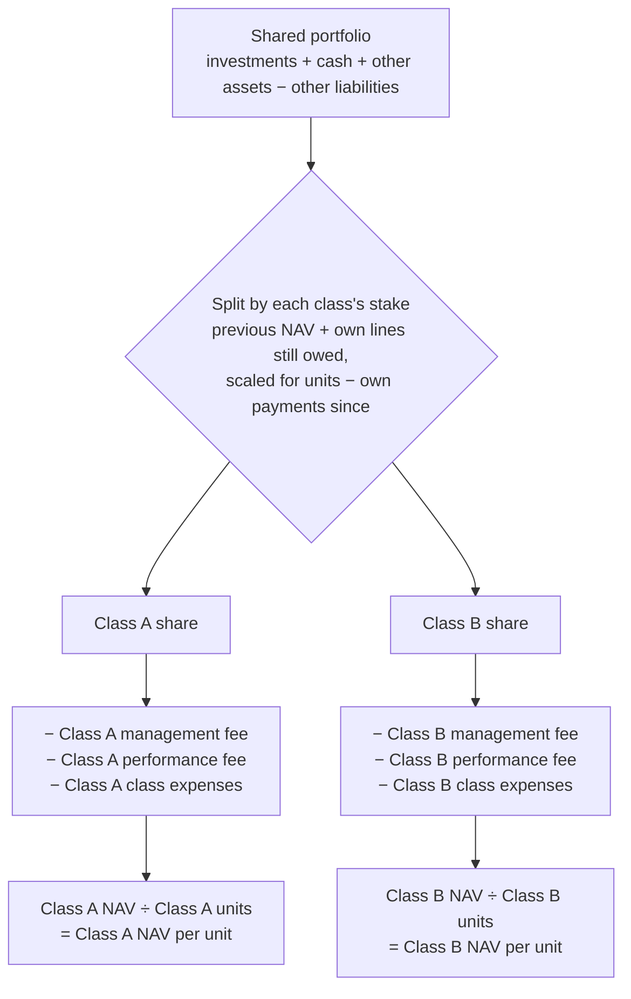

*Example: Alpha has two classes on 31 October.*

| | Class A | Class B |
|---|---|---|
| Units | 60,000 | 20,000 |
| NAV per unit at the previous NAV (30 Sep) | ₹10,000 | ₹20,000 |
| Stake (units × previous price; nothing owed or paid since) | ₹60 crore | ₹40 crore |
| **Share of the shared lines** | **60%** | **40%** |

Class A has three times as many units but gets 60%, not 75%, because the split is by stake (value), not by units.

Shared lines on 31 October: investments ₹105 crore + cash ₹6 crore − other liabilities ₹1 crore =
**₹110 crore**.

| | Class A | Class B |
|---|---|---|
| Share of ₹110 crore | ₹66,00,00,000 | ₹44,00,00,000 |
| Management fee for October | − ₹10,00,000 | − ₹4,00,000 |
| Performance fee accrued (B only: 20% of the gain above its mark of ₹21,500) | — | − ₹19,20,000 |
| **Class NAV** | **₹65,90,00,000** | **₹43,76,80,000** |
| **NAV per unit** | **₹10,983.33** | **₹21,884.00** |

Class B's performance fee comes from its own gain: ₹21,980 a unit before the fee, ₹480 above its
mark, × 20,000 units × 20% = ₹19,20,000. Class A's investors don't bear any of it.

**What classes can't differ on yet:** a class in a different currency (R4.3), a class that pays out
income, and a separate high-water mark per investor. These are TBD; the plan document covers each.

---

## 9. Fees: management and performance

### The idea: two different fees, two different clocks

- The **management fee** is a % a year of what each investor holds. It builds up day by day and is
  owed whatever the fund's performance.
- The **performance fee** is a share of **new** gains only — gains above the highest level the class
  has already paid a fee on (the **high-water mark**). It is estimated in every NAV and only becomes
  final (**crystallised**) on set dates.

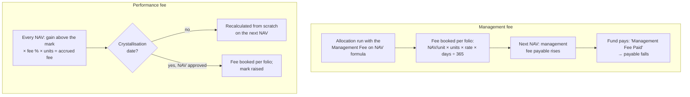

*Example (management fee):* Class A charges 1.5%. A folio holds 10,000 units at ₹10,000 for the
30 days of November: ₹10,00,00,000 × 1.5% × 30 ÷ 365 = **₹1,23,288**.

### Management fee

**R9.1** Each class has its own management-fee rate. It accrues day by day on NAV, whenever an
allocation run includes the fund's management-fee formula:
NAV per unit × units held × class rate × days ÷ 365.

**R9.2** Accrued fees reduce the NAV until paid. A drafted NAV **can't be approved** until the class's
fee is accrued up to the NAV date: the Approve button is disabled and a direct request is refused with
"Management fee accrued only to 31 October 2026 — run the fee formula to 30 November 2026, then
recalculate" (or "No management fee accrued yet — …"). The accounting team's "Fee accrual behind" alert
says the same. **Exempt:** an uploaded NAV (R8.3, the administrator's figure includes the fee), a class
whose rate is 0, and a NAV with no units outstanding (a class's first NAV). *(Decided 11/10/2026.)*

### Performance fee

**R9.3** A class may charge a performance fee (a % of gains), only on gains above its
**high-water mark**, optionally above a **hurdle**.

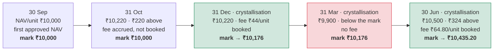

*Reading it (Class A, 20% fee):* a fee is earned only on NAV per unit above the mark. The mark moves
only on a crystallisation date when a fee is booked (green), and then to the NAV per unit **after**
the fee (₹10,220 − ₹44 = ₹10,176). It never comes down: after the fall in March (red) no fee is due
until NAV per unit climbs back above ₹10,176.

**R9.4** The high-water mark is the NAV per unit up to which investors have already paid a
performance fee. It starts at the class's first approved NAV per unit. There is **one mark per
class**, shared by everyone in it.

**R9.5** Every NAV **accrues** the fee the manager would earn if the period ended then; it is
recalculated from scratch each time, so it shrinks if performance falls.

**R9.6** On the class's **crystallisation date** (end of each quarter, half-year or year; the last
business day if that is a weekend), approving the NAV **books** the fee per folio and raises the mark
to that NAV per unit **after** the fee.

**R9.7** The mark only rises when a fee is actually booked. It never falls. A crystallisation date
with no fee leaves it unchanged.

**R9.8 Hurdles.** The mark grows by the hurdle rate for the days since it was set. A **hard**
hurdle charges only on gains above that; a **soft** hurdle, once beaten, charges on the whole gain
above the mark.

*Example (20% fee, mark ₹10,000, 1,00,000 units):*

| NAV date | Before fee | What happens | Mark after |
|---|---|---|---|
| 31 Oct (not a crystallisation date) | ₹10,220 | ₹44,00,000 accrued | ₹10,000 |
| 31 Dec (crystallisation) | ₹10,220 | ₹44,00,000 booked | ₹10,176 |
| 31 Mar | ₹9,900 | Below the mark: nothing | ₹10,176 |
| 30 Jun | ₹10,500 | 20% × ₹324 × 1,00,000 = ₹64,80,000 booked | ₹10,435.20 |

### Fees booked late

> **Decided 11/10/2026, built in the OpenSpec change `evergreen-late-management-fees`.** The full reasoning, with a from-scratch explanation of fees, is in
> [evergreen_backdated_management_fees.md](evergreen_backdated_management_fees.md).

**The idea.** Each NAV deducts the management fee for **its own period**: the fee entries dated
after the previous NAV, up to this NAV's date. That is what makes each month's fee fall on the people
who were invested that month. A fee entry dated inside a period whose NAV is **already approved** is
"booked late". No NAV would ever count it, so it would be silently lost.

For example, a fund drafts and approves its July, August and September NAVs before adding the fee
formula, so each has a payable of ₹0. Running the formula afterwards for August and September would
book about ₹4.8 lakh (1.5% on a ₹19 crore class) that no NAV picks up. An **uploaded** NAV never has
this problem: the administrator's figure already has the fee deducted.

**Why the treatment matters (worked example).** A fund has 1,00,000 units at ₹1,000 and a fee of ₹1.25
per unit per month. Asha holds 60,000 units in August and September. Ravi holds 40,000 units in
August, then redeems at the 31 August NAV. Meera buys 40,000 units at that NAV and holds them in
September. The August fee was missed in the August NAV.

| Fee each person ends up bearing | Asha | Ravi | Meera | Manager receives |
|---|---|---|---|---|
| Fair share | ₹1,50,000 | ₹50,000 | ₹50,000 | ₹2,50,000 |
| On time (August fee in the August NAV) | ✓ | ✓ | ✓ | ✓ |
| **Include** late: August fee taken in the September NAV | ₹1,50,000 ✓ | ₹0 | **₹1,00,000** (pays Ravi's August fee) | ₹2,50,000 ✓ |
| **Exclude**: August fee never taken through the NAV | ₹75,000 | ₹0 | ₹50,000 ✓ | ₹1,25,000 |

Neither choice is right every time. A small late fee is normally included, which is how fund
administrators correct small NAV errors. A large one, or one where many investors have left in the
meantime, may be better excluded and settled outside the NAV. So CapHive prevents the avoidable
case and asks the GP to decide the rest.

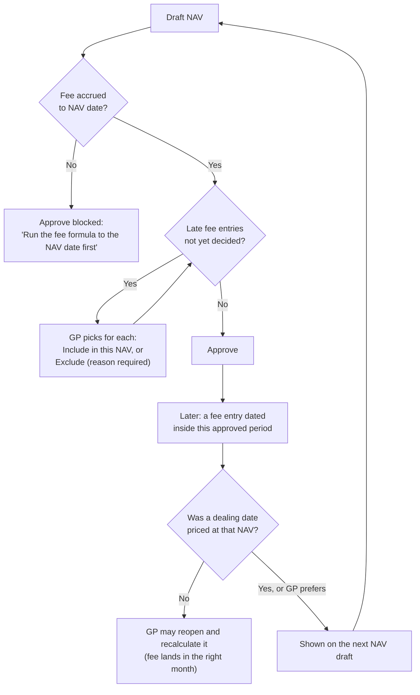

**R9.10** A **late fee entry** is a management-fee entry, or a management-fee payment, dated on or
before a class's previous approved NAV that no NAV has counted or excluded yet. A period covered by an **uploaded** NAV
is never late: the administrator's figure already includes the fee.

**R9.11** Late fee entries are **allowed**. CapHive never refuses to record one, because real late fees
happen: a side-letter discount found after the NAV, a backdated rate change, an auditor's correction.

**R9.12** The next NAV draft for the class lists its late fee entries in a **Late management fees** panel,
above the Approve button, with:

- the amount and the period they belong to
- the amount as a **% of this NAV**
- **how many of the class's investors redeemed** since that period, who would escape the fee if it is
  included (other classes never bear this class's fee, so they aren't counted)
- whether that period's NAV can still be reopened (R9.16)

Differences below one currency unit are rounding between the ledger and the NAV, not a late fee.

**R9.13** For each late **fee** amount the GP chooses **Include in this NAV** (it is added to the management fee
payable now) or **Exclude** (it is never taken through the NAV, and a reason is required). The draft
can't be approved until every late fee amount has a choice; the refusal reads "Decide the late management
fee for class A first".

**R9.14** There is **no default**. Neither choice is pre-selected, and the GP must actively pick one for
every late amount, every time. This is deliberate: the choice decides who bears the fee, so it is never
made by a setting.

**R9.15** The choice, the amount, who made it, when and why are recorded on the NAV (its audit trail and
the panel) and on the Fees tab row. An included or excluded amount never reappears on a later draft;
only fees booked late after it do. While the NAV is a draft, **Change decision** clears the choices so
they can be made again. If a decided late entry is reversed before approval, the decision is dropped and
the audit trail says so.

**R9.16** If no dealing date has been priced at the NAV the late entry belongs to, the GP may instead
reopen that NAV and recalculate it (R8.6), so the fee falls in the right month. The Fees tab shows
this route on the row.

**R9.17** A late **payment** (a "Management Fee Paid" entry dated in an already-approved period) is
**always included** in the next NAV, with no choice. It is split between classes like any other payment
(R9.9). *Why:* the NAV's cash line already shows the money gone, so leaving the payment out would count
the fee as still owed and understate the NAV by the payment. It is listed on the draft as "always
included". (Decided 11/10/2026; narrows R9.10–R9.13, whose choice applies to fees only.)

**R9.18** NAVs approved **before** these rules existed are treated as having taken in exactly their own
period's fee entries, as they were drafted. Late entries that already exist when this ships are
therefore not raised; the switch-over logs any NAV whose ledger differs from what it was drafted with,
so it can be checked by hand. (Decided 11/10/2026.)

*Example (1.5% on a ₹19 crore Class A):* the fee formula is run on 11 Oct for August to October.

| NAV | Dealing priced at it? | What happens |
|---|---|---|
| 31/07, 31/08 | If no | GP may reopen and recalculate each one; the fee lands in its own month |
| 30/09 | Yes (01/10 dealing date) | Locked. Its ₹2,38,500 appears on the 31/10 draft: about **0.12% of NAV**, plus the number of investors who redeemed since. The GP chooses Include or Exclude |
| 31/10 | — | Payable = October's fee + the included ₹2,38,500 |

**Out of scope:** paying back investors who already left (a full restatement for a large error). This
is rare and stays a manual process.

### Paying fees

**R9.9** When the fund pays a fee, the payment comes off **the classes that owed it**, in proportion
to what each owed. A class that owed nothing is never charged. Any over-payment, or a payment when
nothing is owed, is shared by each class's value.

---

## 10. Redemption gates

### The idea: a cap on how much may leave at once

If many investors redeem together, the fund would have to sell investments quickly and cheaply,
hurting those who stay. A **gate** caps redemptions at a % of NAV per dealing date, quarter or year.
Requests within the cap are paid; the rest is **carried** to the next redemption date, keeping its
place ahead of newer requests. Who is paid first is either **first-come** (FIFO) or **pro-rata**.

```mermaid
flowchart TD
    Q[Redemption requests for the date,<br/>in the order received] --> P[Gate pool = gate % × NAV<br/>− already paid earlier in the period]
    P --> I[Per-investor cap first,<br/>if the fund has one]
    I --> M{Method}
    M -- FIFO --> F[Fill each request in turn<br/>until the pool runs out]
    M -- Pro-rata --> R[Fill every request by the<br/>same % = pool ÷ requested]
    F --> C[Unfilled part carried to the<br/>next redemption date,<br/>front of the queue]
    R --> C
    C --> N[Gate notice to each<br/>part-filled investor]
```

*Example:* gate ₹5 crore; requests X ₹4 crore, Y ₹3 crore, Z ₹1 crore (₹8 crore in all).

| | X ₹4 Cr | Y ₹3 Cr | Z ₹1 Cr | Carried |
|---|---|---|---|---|
| **FIFO** | ₹4 Cr paid | ₹1 Cr paid, ₹2 Cr carried | ₹1 Cr carried | ₹3 Cr |
| **Pro-rata** (62.5%) | ₹2.5 Cr paid | ₹1.875 Cr paid | ₹0.625 Cr paid | ₹3 Cr |

*Quarterly gate:* if ₹2 crore was already paid on the October date in the same quarter, the December
date's pool is ₹3 crore, not ₹5 crore.

**R10.1** A gate limits how much can be redeemed: a % of NAV per dealing date, quarter or year, for
the whole fund or per class.

*Example:* 5% of ₹102.2 crore = ₹5.11 crore may be redeemed.

**R10.2** When redemptions exceed the gate they are filled either **first-come** (in the order
received) or **pro-rata** (everyone gets the same share).

**R10.3** What isn't filled is **carried forward** to the next dealing date, at the front of the
queue, and the investor gets a "Redemption partly filled" notice.

**R10.4** If there is no later redemption date, the unfilled part closes and the investor is told it
was not carried.

**R10.5** A per-investor gate caps any one investor at a % of their holding per gate period, less
what they were already paid in that period.

**R10.6** A quarterly or yearly gate is shared across the dealing dates in that period; a new period
starts afresh. The gate card shows what is **left** and how much earlier dates already used.

**R10.7** A request's queue number is its place among the open requests on the **same dealing date**
(and the same class when the gate is per class), in the order received.

*Example — the same requests under each gate period.* Gate 5%, NAV ₹100 crore throughout (so the
gate is ₹5 crore), monthly redemption dates, ₹4 crore of new requests on each date. Whatever isn't
paid is carried to the next date, ahead of new requests.

| Redemption date | Asked (new + carried) | **Each dealing date**: gate left → paid · carried | **Each quarter**: gate left → paid · carried | **Each year**: gate left → paid · carried |
|---|---|---|---|---|
| Thu 1 Oct | ₹4 Cr | ₹5 Cr → ₹4 Cr · ₹0 | ₹5 Cr → ₹4 Cr · ₹0 | ₹5 Cr → ₹4 Cr · ₹0 |
| Mon 2 Nov | ₹4 Cr | ₹5 Cr → ₹4 Cr · ₹0 | ₹1 Cr → ₹1 Cr · ₹3 Cr | ₹1 Cr → ₹1 Cr · ₹3 Cr |
| Tue 1 Dec | ₹4 Cr + ₹3 Cr carried (quarter/year) | ₹5 Cr → ₹4 Cr · ₹0 | ₹0 → ₹0 · ₹7 Cr | ₹0 → ₹0 · ₹7 Cr |
| Fri 1 Jan | ₹4 Cr + ₹7 Cr carried (quarter/year) | ₹5 Cr → ₹4 Cr · ₹0 | **new quarter:** ₹5 Cr → ₹5 Cr · ₹6 Cr | **new year:** ₹5 Cr → ₹5 Cr · ₹6 Cr |
| Paid Oct–Dec | | **₹12 Cr** (12% of NAV) | **₹5 Cr** (5%) | **₹5 Cr** (5%) |

The quarter and year columns match here only because the example starts in October. A yearly gate
starting in January would allow ₹5 crore across all twelve monthly dates of the year, not ₹5 crore
a quarter. If the NAV changes, the gate on each date is the % of *that* date's NAV, less what the
period has already paid.

---

## 11. Running a dealing date

### The idea: preview, confirm, settle, close

Until the GP clicks **Confirm**, a dealing date is only a **preview**: it shows what each order would
get at the approved NAV, what the gate would do and what would happen to orders that aren't ready,
but nothing moves. Confirming fixes those figures. Settlement then moves the money and units row by
row, and the date is **closed** when every row is settled and every investor has their document.

```mermaid
stateDiagram-v2
    direction LR
    [*] --> Open: generated from<br/>the calendar
    Open --> Open: orders arrive<br/>(preview only)
    Open --> Confirmed: Confirm — prices fixed,<br/>gate applied, not-ready<br/>orders rolled or cancelled
    Confirmed --> Open: Undo — only while nothing<br/>has settled
    Confirmed --> Closed: every row settled,<br/>every document sent
    Closed --> [*]
```

```mermaid
flowchart TD
    A[Cut-off passes] --> B[NAV approved]
    B --> C[GP reviews the preview:<br/>prices, gate, orders not ready]
    C --> D[Confirm]
    D --> E[Orders priced and filled]
    D --> F[Not-ready orders<br/>rolled or cancelled]
    D --> G[Over-gate redemptions<br/>carried forward]
    E --> H[Money and units settle]
    H --> I[Documents sent]
    I --> J[Close]
```

**R11.1** Each dealing date shows a step bar from cut-off to close, with what is needed next.

**R11.2** The dealing date is priced at each class's **latest approved NAV on or before** the dealing
date. Confirm is blocked while a class with ready orders has no approved NAV (*"Approve the NAV for
Class B dated 31 October 2026 first"*).

**R11.2a** (Decision 4) A class's NAV must also be **newer than the NAV its previous dealing date
used**, so two dealing dates never deal at the same NAV per unit: *"Class A's 31 October 2026 NAV
already priced 02 November 2026 — draft and approve a newer NAV first"*. A class's first dealing date
accepts any approved NAV; undoing the previous date frees its NAV again.

**R11.2b** (Decision 3) A dealing date can be confirmed only after its **last deadline** has passed —
the subscription cut-off and every class's redemption notice deadline: *"Cut-off is 26 November 2026
— confirm after it"*. The Ready to confirm alert follows the same rule.

**R11.3** Before confirming, the GP sees a **preview** of every order's price and fill, the gate, and
what will happen to orders that are not ready. Confirming stores exactly what the preview showed; if
anything changed, it asks the GP to review again.

**R11.4 Orders not ready** at confirmation are rolled to the next dealing date or cancelled, as the
fund is set up — except that **an order with money already received is always rolled**, never
cancelled. If there is no later dealing date, an order is cancelled, unless money has been received,
in which case it stays for a refund. The preview always states each order's real outcome.

**R11.5** A dealing date with **only** not-ready orders can still be confirmed: nothing is priced
and the orders are rolled or cancelled, so none is left behind on a past date.

**R11.6** A confirmed dealing date can be **undone** only while no units have been issued or
cancelled and no payment recorded, and only if orders it moved on haven't since been dealt on a
later date.

**R11.7** A dealing date can be **closed** once every subscription and redemption is settled and
every contract note and redemption advice has been sent. Until then Close is shown disabled with
the reason. A closed date is final: no payment, verify or resend actions are offered or accepted.

---

## 12. Settlement: money and units

### The idea: money first, then units — automatically

Confirming a dealing date creates two settlement records for it — a **subscription settlement** (the
money due in) and a **redemption settlement** (the money due out) — with one row per order. The GP
then records what actually happens to the money; CapHive moves the units on its own as soon as the
money is right. There is no "allot units" button: units always follow the money, at the dealing
date's NAV per unit.

```mermaid
flowchart LR
    subgraph In["Subscription row"]
        A1[Awaiting money] --> A2[Record payment] --> A3[Verify] --> A4[Units allotted<br/>at the dealing NAV] --> A5[Contract note]
    end
    subgraph Out["Redemption row"]
        B1[Awaiting payment] --> B2[Mark paid<br/>date + reference] --> B3[Units cancelled] --> B4[Redemption advice:<br/>gross − exit load = net]
    end
```

*Example:* on 1 December, P's ₹5 crore pre-funded subscription was already paid, so its units are
allotted at confirmation. Q's ₹1.5 crore redemption shows *Awaiting payment* until the GP marks it
paid on 14 December; Q's 1,500 units are then cancelled and Q receives the redemption advice
(₹1,50,00,000 − ₹0 exit load = ₹1,50,00,000).

**R12.1** The dealing date's settlement tracker shows each order's money and units: awaiting money,
part paid, money received, units issued; awaiting payment, paid, units cancelled.

**R12.2** Recording a payment: a zero payment, or a payment when nothing is owed, is refused.
Marking a redemption paid a second time is refused, keeping the first date and bank reference.

**R12.3** Units are issued automatically when a subscription is fully paid and verified on a
confirmed dealing date, and cancelled automatically when a redemption payment is recorded.

**R12.4** An early-redemption fee is deducted from the payout and recorded in the fund's accounts.

---

## 13. Contract notes and redemption advices

### The idea: a confirmation for every completed order

When units are issued the investor gets a **contract note** (units, NAV per unit, amount); when a
redemption is paid, a **redemption advice** (units, gross amount, exit load, net paid). A fund
without a template sends these as emails straight away. A fund with a Word template sends a PDF, and
an approver checks every PDF before it goes.

```mermaid
flowchart LR
    A[Units issued /<br/>redemption paid] --> B{Fund has a<br/>template?}
    B -- No --> C[Email with the figures<br/>sent at once]
    B -- Yes --> D[Generate documents:<br/>one PDF per order,<br/>hidden from investors]
    D --> E[Approver checks;<br/>Regenerate if needed]
    E --> F[Approve & send:<br/>email with the PDF]
```

*Example:* the 1 December date settles 12 subscriptions and 4 redemptions. Alpha has both templates,
so the GP clicks **Generate documents (16)**, the approver reviews them and clicks **Approve & send
(16)**, and the date can then be closed.

**R13.1** Investors receive a **contract note** for each subscription (when units are issued) and a
**redemption advice** for each redemption (when paid).

**R13.2** If the fund has **no template**, the email goes out immediately with the figures in it.

**R13.3** If the fund has a template (a folio can use its own version by holding a template of the
same name), documents are
**generated** for the dealing date, then an **approver** reviews them and clicks **Approve & send**;
each investor's email then carries their document. Generated documents stay hidden from investors
until approved.

**R13.4** An unapproved document can be regenerated; an approved one cannot. A document is only
generated once its order is settled.

**R13.5** If a template is removed after settlement, the investors concerned still get the plain
email, so the dealing date can close.

---

## 14. Notifications

### The idea: investors hear about their own orders; the team hears what needs doing

Investor emails follow each order from placement to completion. Team alerts go to **named roles**,
so the right person is told when something needs action — an approval, a cut-off, an overdue
payment.

```mermaid
flowchart TD
    E[Event] --> T{About an investor's<br/>order or holding?}
    T -- yes --> I[Investor's users with<br/>approved access<br/>+ approved advisors]
    T -- no, team work --> R{Which role?}
    R --> Ap[Approvers:<br/>NAV, documents,<br/>ready to confirm]
    R --> RM[Relationship manager<br/>'Managed by', else Fund ops:<br/>new orders]
    R --> Ops[Fund ops: cut-off summary,<br/>overdue, NAV approved]
    R --> Acc[Fund accounting:<br/>fee accrual behind]
    R --> Co[Compliance: gate applied,<br/>large redemption]
```

### To investors (and approved advisors)

| Email | When | Can be switched off? |
|---|---|---|
| Subscription / redemption received | The order is placed | No — always sent |
| Payment instructions | A pay-after subscription is priced | No — always sent |
| Payment reminder | A few days (default 2) before the cut-off, if a pre-funded subscription is unpaid | Yes (on by default) |
| Action needed | Before the cut-off, if the order's approval journey isn't finished | Yes (on by default) |
| Payment received | A subscription payment is recorded | Yes (on by default) |
| Request moved / cancelled | At confirmation, for orders not ready | No — always sent |
| Redemption partly filled | A gate fills only part of a redemption | No — always sent |
| Contract note / redemption advice | Units issued / redemption paid (section 13) | No — always sent |
| Units free to redeem | The day a lock-up ends | Yes (off by default) |
| NAV update | Each approved NAV | Yes (off by default) |

**R14.1** Each investor email can be reworded per fund (custom notifications), and the wording can
be copied from another evergreen fund of the same entity. A template can add the request summary
("Show details") and the "View your request" link ("Show details link"), and its WhatsApp text is sent
on WhatsApp to investors who have it switched on.

### To the GP team

| Alert | To | When |
|---|---|---|
| New order received | The investor's relationship manager, else Fund ops | An investor places an order on the portal |
| NAV awaiting approval | Approvers (not the person who drafted it) | A NAV is drafted or uploaded |
| NAV approved | The preparer and Fund ops | A NAV is approved |
| Cut-off summary | Fund ops | The day after a cut-off |
| Ready to confirm | Fund ops and approvers | NAV approved and cut-off passed |
| Gate applied | Compliance and Fund ops | Redemptions carried forward |
| Large redemption | Compliance and the relationship manager | A redemption at or above a % of class NAV (default 2%) |
| Settlement overdue | Fund ops | The day after a payment falls due, then weekly |
| Documents awaiting approval | Approvers | Documents generated |
| Fee accrual behind | Fund accounting | NAV drafted before the fee is accrued |

**R14.2** The reminders, the two optional investor updates and every team alert can be switched on
or off per fund; the core order emails are always sent. Each is sent once per event, even if the
daily check runs again.

**R14.3** Recipients are named roles: approvers; the investor's relationship manager ("Managed by");
users tagged Fund ops, Fund accounting or Compliance. A relationship manager from another entity, or
one who is deactivated, falls back to Fund ops.

---

## 15. What investors and advisors see and can do

### The idea: value, units and price — never commitments

An evergreen investor thinks in **what my units are worth today**, not in commitments and calls.
Their screens show only that, and only for their own folios.

```mermaid
flowchart LR
    H[Portal home: fund card<br/>value · units · gain ·<br/>next dealing date] --> FP[Fund page]
    FP --> Ho[Holding: units, NAV/unit,<br/>value, cost, gain,<br/>locked and free units]
    FP --> Tr[Transactions: allotments,<br/>redemptions + documents]
    FP --> Rq[Requests: each order<br/>and its progress]
    FP --> NH[NAV history:<br/>approved NAVs only]
    FP --> Do[Documents]
    Ho --> Sub[Subscribe more]
    Ho --> Red[Redeem — disabled<br/>with the reason if<br/>nothing is free]
```

**R15.1** On the portal home, each evergreen folio shows its value, units, gain, next dealing date
and cut-off, with Subscribe and Redeem (Redeem is disabled with the reason when nothing is free).

**R15.2** The fund page shows, for the investor's own folios only: **Holding** (units, NAV per unit,
value, cost, gain, locked and free units), **Transactions** (allotments and redemptions with their
approved documents), **Requests** (each order and its progress), **NAV history** and **Documents**.

**R15.3** Investors never see committed or called amounts for an evergreen fund, draft NAVs,
unapproved documents, or anything belonging to another investor.

**R15.4** An investor can place subscriptions and redemptions on their own folios and cancel their
own pending orders.

**R15.5** An **advisor** approved for an investor, once switched into that investor, sees and does
exactly what the investor can. An advisor for several investors acts for one at a time. An advisor
whose access is not approved, revoked, or missing the fund access sees nothing.

**R15.6** Each section of the investor's fund page opens with its own title and a line saying what
its rows are, so an open section is never an unlabelled table.

### Wording

**R15.7** Evergreen screens, emails and confirmations use the investor's market's words. India
English: Folio, Dealing date, Contract note, Redemption advice, Carried, Exit load. US English:
Account, Transaction date (Calendar for the tab), Trade confirmation, Redemption confirmation,
Deferred, Early redemption fee. A screen about one kind of order names the date by kind:
Subscription date or Redemption date.

**R15.8** A firm can set its own words on its Company Profile (Units or Shares, and its own word for
the listed terms); a fund can choose Units or Shares for itself, which wins over the firm's choice.

```mermaid
flowchart LR
    A[Fund: what investors hold] --> B[Firm's own words]
    B --> C[Language: India / US English]
    C --> D[Word shown]
```

*Example:* the firm says Shares and "Account"; Fund X says Units → Fund X shows "NAV per unit" and
"Account: F-101", every other fund shows "NAV per share".

**R15.9** Wording never changes a figure, and documents already generated keep their words.

---

## 16. Who can do what

### The idea: fund editors run the fund, approvers sign off prices and documents

```mermaid
flowchart LR
    subgraph GP["GP team"]
        R[Read access on the fund] --> Rv[See every evergreen screen]
        U[Update access on the fund] --> Ue[Settings, orders on behalf,<br/>NAV drafts and overrides,<br/>confirm / undo / close,<br/>record payments, generate documents]
        A[Approver role<br/>+ update access] --> Ae[Approve / reopen NAVs,<br/>accept / reject orders,<br/>approve & send documents]
    end
    subgraph LP["Investor side"]
        Iu[Investor user with<br/>approved access] --> Ie[Own holdings: subscribe,<br/>redeem, cancel own pending orders]
        Ad[Approved advisor,<br/>switched into the investor] --> Ie
    end
```

| Action | Who |
|---|---|
| Make a fund evergreen, change settings | Fund editors |
| Place or enter orders, record payments, confirm and close dealing dates | Fund editors (investors place their own orders) |
| Approve NAVs, approve and send documents | Users with the **approver** role |
| Reopen a NAV | Approvers |
| Accept a part payment as the subscription | Fund editors |
| See the unit register and order book | The GP team only |

Every request is checked on the server, not only on screen: a direct request for something the
screen hides is refused.

---

## 17. Closed-ended funds are unchanged

**R17.1** Nothing changes for closed-ended funds: capital calls, distributions, commitments and their
screens and journeys work exactly as before, even in an entity with evergreen funds switched on.

**R17.2** If evergreen funds are switched off for an entity, its evergreen screens, alerts and
investor pages stop, and its funds show the closed-ended pages.

---

## 18. Sign-off

| Section | Reviewer | Agree / change / question | Notes |
|---|---|---|---|
| 1–2 Overview and setup | | | |
| 3 Dealing dates | | | |
| 4 Subscriptions | | | |
| 5 Redemptions | | | |
| 6 Lock-ups | | | |
| 7 Approvals | | | |
| 8 NAV | | | |
| 9 Fees | | | |
| 10 Gates | | | |
| 11 Dealing dates (running) | | | |
| 12 Settlement | | | |
| 13 Documents | | | |
| 14 Notifications | | | |
| 15 Investors and advisors | | | |
| 16 Permissions | | | |
| 17 Closed-ended funds | | | |

**Open for a future decision:** the performance-fee high-water mark is per class (R9.4). Many US
funds track it per investor; see `evergreen_design_decisions.md`.
