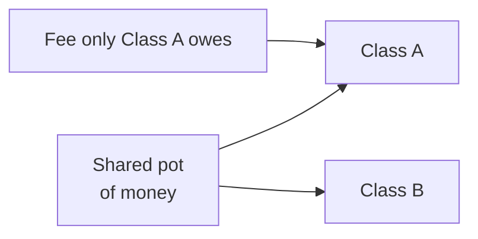
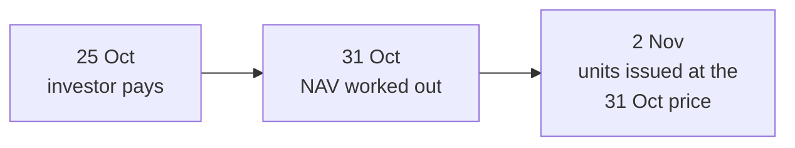
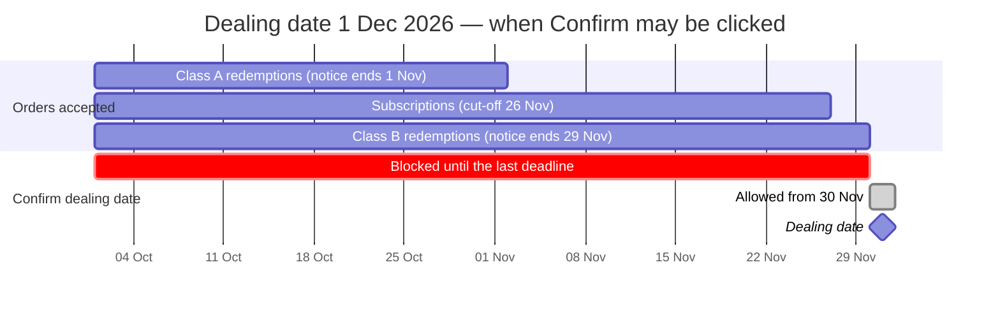
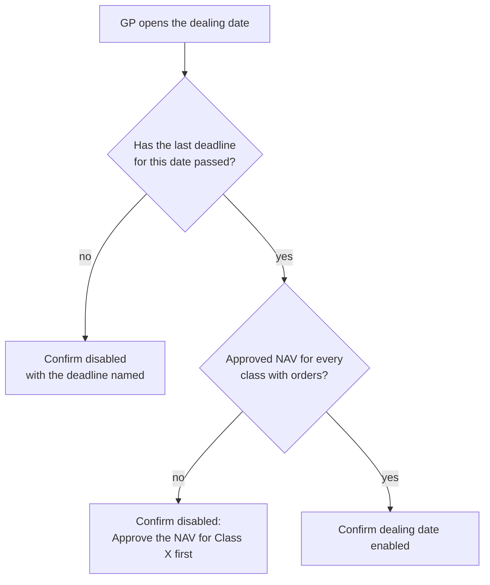
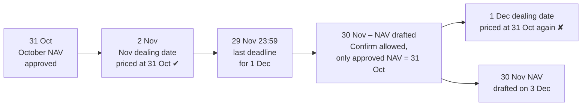
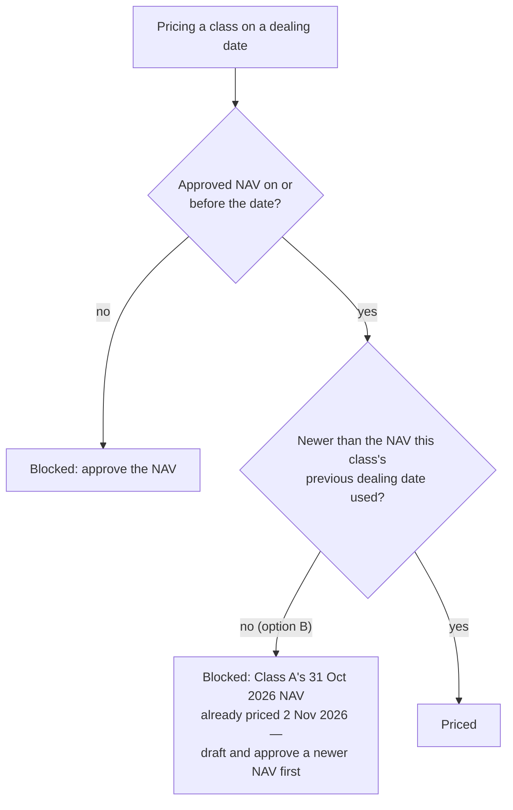

# Evergreen funds — decisions, simply explained

Small things in how CapHive works out an evergreen fund's NAV (its value per unit), and when it
deals at that NAV, can give some investors a wrong price. Each one is a **yes / no** (or pick-one)
question.

| # | Question | Recommended answer |
|---|---|---|
| 1 | When the fund pays a fee that only **one class** owed, should only that class pay it? | **Yes — decided** |
| 2 | Should money sent in **before** an investor gets their units be kept out of the fund's value until then? | **Yes — decided** |
| 3 | Should **Confirm dealing date** wait until every deadline for that date has passed? | **Yes — agreed and built 10 October 2026** |
| 4 | Should a dealing date refuse to price at a NAV that is **too old**? | **B — agreed and built 10 October 2026** |

**Decided and built 8 October 2026: 1 — yes, 2 — yes.** Both are in the design
(openspec/changes/open-ended-funds, NAV builder card, worked examples E197–E204), described in the
user guide, and tested in `features/fund/evergreen/nav_corrections.feature`.

---

## Decision 1 — A fee owed by one class should be paid by that class

### Think of it like this

Two flatmates share one bank account. Only Asha owes the electricity bill. When the bill is paid
from the shared account, it should come out of **Asha's** half — not be split between both of
them.

A fund with two classes (A and B) is the same: the classes share one pot of money, but each class
has its own fees.

### Example (round numbers)

- Class A is worth ₹50, Class B is worth ₹50.
- Class A owes the manager a ₹2 fee. Class B owes nothing.
- So Class A is really worth **₹48** and Class B **₹50**.

The fund then pays the ₹2 out of the shared pot. Paying a bill you already owed should not change
anything, so after paying: **A should still be ₹48, B still ₹50.**

| After the fee is paid | Class A | Class B |
|---|---|---|
| **What it should be** | ₹48 | ₹50 |
| **What CapHive shows today** | about ₹47 | about ₹51 |

**Today about ₹1 quietly moves from Class A investors to Class B investors**, because CapHive
splits the payment between both classes instead of taking it from the class that owed it. The fund
total is still right, which is why it is easy to miss.

### When it matters

Only when classes have **different fees** (for example, only Class A has a performance fee, or the
classes have different management-fee rates). A fund with one class, or classes with identical
fees, is not affected.

### The fix

When a fee is paid, CapHive takes it off **the class (or classes) that owed it**, in proportion to
what each owed. The GP keeps recording fee payments exactly as today.

**Recommended: Yes.** This is how US fund administrators keep fees — each class pays its own.

---

## Decision 2 — Money sent early shouldn't count until the units exist

### Think of it like this

A club is worth ₹100 and has 100 members, so each share is worth ₹1. A new member sends ₹50 to
join next week. Until they actually join, that ₹50 is **their** money waiting in the club's
account — the existing members shouldn't count it as the club's.

### Why the gap happens

In some evergreen funds investors pay **before** the dealing date. For a few days the money is in
the fund's bank account, but the investor's units are not issued yet — and those units will be
priced using a NAV worked out **during** that gap.

### Example (round numbers)

The fund is worth ₹100 with 100 units — **₹1.00 a unit**. A new investor sends ₹50 for units.

| | Counting the ₹50 early (today) | Keeping it aside (the fix) |
|---|---|---|
| Fund value used for the price | ₹150 | ₹100 |
| Price per unit | **₹1.50** — too high | **₹1.00** |
| Units the new investor gets for ₹50 | **33** | **50** |
| Result | The newcomer gets a third fewer units; existing investors gain from the newcomer's own money | Everyone pays and gets the fair price |

**Today**, the fund's cash comes from its bank balance, which already includes the new investor's
money, so the price comes out too high.

### When it matters

Only in funds where investors pay **before** dealing ("pre-funded"). The bigger the new money
compared with the fund, the bigger the error.

### The fix

CapHive automatically keeps money received for orders that haven't been dealt yet **out** of the
NAV, and shows it as its own line ("Money received for orders not yet dealt"), so you can see what
was set aside. The same line also handles the reverse case — a redemption that has been dealt but
not yet paid out. Nobody has to do anything extra.

**Recommended: Yes.** US fund accounting rules require exactly this.

---

## Decision 3 — Confirm only after the last deadline has passed

### Think of it like this

A shop announces "orders by Thursday ship on Tuesday". If the shop packs the Tuesday boxes on
Wednesday, anyone who ordered on Thursday — on time — misses the van, and anyone who had until
Thursday to pay is treated as a non-payer. The packing has to wait until the last order deadline
has passed.

### Why the gap happens

A dealing date has **more than one deadline**:

- **Subscription cut-off** — one per fund, e.g. 5 days before the dealing date.
- **Redemption notice** — set per class (0–180 days), so each class can have its own deadline.

Every deadline ends at **23:59** on its day. Today **Confirm dealing date** checks only that the NAV
is approved and that there is something to deal. It does **not** check any deadline, so a date can
be confirmed while investors are still allowed to place orders or pay for it.

### Example

Dealing date **Tuesday 1 December 2026**, subscription cut-off 5 days, Class A notice 30 days,
Class B notice 2 days:

| Deadline | Rule | Ends |
|---|---|---|
| Class A redemption notice | 30 days before | Sun 1 Nov 2026, 23:59 |
| Subscription cut-off | 5 days before | Thu 26 Nov 2026, 23:59 |
| Class B redemption notice | 2 days before | **Sun 29 Nov 2026, 23:59 — the last one** |

What goes wrong if the GP confirms **on 20 November** (today's behaviour):

| Investor | What they did | Should happen | Happens today |
|---|---|---|---|
| P | Subscribed ₹1 Cr on 18 Nov, pre-funded, paying on 25 Nov | Dealt on 1 Dec | Marked **Not paid by cut-off** at confirm → rolled to January or cancelled |
| Q | Subscribed ₹50 L on 22 Nov (cut-off is 26 Nov) | Dealt on 1 Dec | Moved to the **January** date — 1 Dec is already confirmed |
| R | Redeemed 500 Class B units on 28 Nov (notice ends 29 Nov) | Dealt on 1 Dec | Moved to the next redemption date |

All three met their deadline and were still pushed out.

### The fix

- **The last deadline** is the latest of: the subscription cut-off (if the date deals subscriptions)
  and **every class's** redemption notice deadline (if it deals redemptions) — every class, not only
  those with orders, because an order for any class can still arrive.
- The disabled button names it: *"Cut-off is 26 Nov 2026 — confirm after it"* or *"Redemption notice
  for Class B ends 29 Nov 2026 — confirm after it"*. The server refuses with the same message if the
  request is posted anyway.
- The **Ready to confirm** team alert and the date's **Review and confirm dealing** journey step
  follow the same rule, so nothing ever says "ready" while the button is blocked.
- Dates already confirmed are not touched.

**Agreed: Yes** (10 October 2026). Built: `DealingDate#last_deadline`, checked by `DealingConfirm`, the dealing date page, the Ready to confirm alert and the journey step; scenarios in `features/fund/evergreen/review_fixes.feature` (H101, H102, E301–E303).

---

## Decision 4 — Which NAV may price a dealing date?

### Think of it like this

A shop reprices its shelves at the end of every month. If the cashier rings up December sales with
October's price tags because November's tags haven't been printed yet, some customers pay too
little and others too much — even though every tag was correct when it was printed.

### What CapHive does today

Each class is priced at its **latest NAV dated on or before the dealing date**, and that NAV must be
approved. If a **newer draft** exists, Confirm is blocked until it is approved ("Approve the NAV for
Class A dated 30 November 2026 first"). Nothing checks **how old** the approved NAV is.

So the safety net only works once someone has **drafted** the newer NAV. Before that, there is no
newer draft to block on, and CapHive quietly uses the previous period's NAV.

### Why Decision 3 doesn't close it

Decision 3 stops a confirm before the last deadline. But the NAV for the period is normally drafted
**after** the period ends — often a few days after the dealing date. That leaves a window in which
Confirm is allowed and the only approved NAV is last period's:

### Example (round numbers)

Class A, 31 Oct NAV per unit **₹10,000**. By 30 Nov the portfolio has risen 4%, so the true NAV per
unit is **₹10,400** — but nobody has drafted it yet. The GP confirms 1 December on 30 November.

| Investor | Order | Priced at ₹10,000 (stale) | Priced at ₹10,400 (right) | Who loses |
|---|---|---|---|---|
| Subscriber S | ₹1 Cr | 1,000 units, worth ₹1,04,00,000 | 961.5385 units | Existing investors lose **₹4,00,000** to S |
| Redeemer T | 1,000 units | Paid ₹1,00,00,000 | Paid ₹1,04,00,000 | T loses **₹4,00,000** |

If the market had **fallen** instead, the losses run the other way. Either way someone is dealt at a
price that was already a month out of date.

### Options

| | Rule | Catches the example? | Cost / risk |
|---|---|---|---|
| **A** | No extra rule — Decision 3 only | No | Relies on the GP noticing the NAV date on the preview line ("Priced at the 31 Oct 2026 NAV") |
| **B** | A class's NAV must be **newer than the NAV its previous dealing date used** — two dealing dates can never deal at the same NAV | Yes: 2 Nov used 31 Oct, so 1 Dec can't | No new setting. A fund dealing more often than it strikes NAVs (e.g. twice a month on a monthly NAV) must approve a NAV per dealing date |
| **C** | NAV must be no older than **N days** before the dealing date (new fund setting) | Only if N is set tight enough | Another setting to explain; any fixed N is arbitrary, and a quarterly fund needs a different N from a monthly one |
| **D** | NAV must be dated on the dealing date's **valuation point** (e.g. the last business day before it) | Yes | Strict; breaks funds whose administrator dates its NAV differently |

**Option B in detail**

- **"Previous dealing date"** = the latest confirmed or closed date of the fund on which this class
  was priced, of either kind (subscriptions or redemptions).
- **First dealing date** of a class: there is no previous one, so any approved NAV is accepted — or the
  starting price when the class has no units yet.
- **Undo**: undoing the previous date frees its NAV again, because it no longer counts as used.
- The preview, the **Confirm** button, the **Ready to confirm** alert and the journey step all show
  the same message.

**Recommended: B.** It catches exactly the "dealt twice at one price" mistake, needs no new setting,
and its message tells the GP what to do.

**Agreed: B** (10 October 2026). Built: `DealingPricer.reused_on`, used by pricing, the Confirm refusal and the Approve NAV journey step; scenarios in `features/fund/evergreen/review_fixes.feature` (E304, H103, X201).

---

## For later (no decision needed now)

The performance-fee "high-water mark" is currently one number for each class. Many US funds keep
one per investor, so that someone who joins after a fall can't get a free ride back up to the mark.
That is a bigger change; it can be discussed separately when you know which kinds of funds you will
serve first.

---

Accounting terms, for reference

- **Decision 1:** today fee payments are apportioned by each class's share of fund value; the fix
  apportions them by each class's outstanding fee payable. With the worked numbers above, the exact
  figures are A ₹46.98 / B ₹51.02 today versus A ₹48 / B ₹50 correct.
- **Decision 2:** under US GAAP (ASC 946) cash received for shares not yet issued is a liability,
  "subscriptions received in advance", and dealt-but-unpaid redemptions are "redemptions payable".

