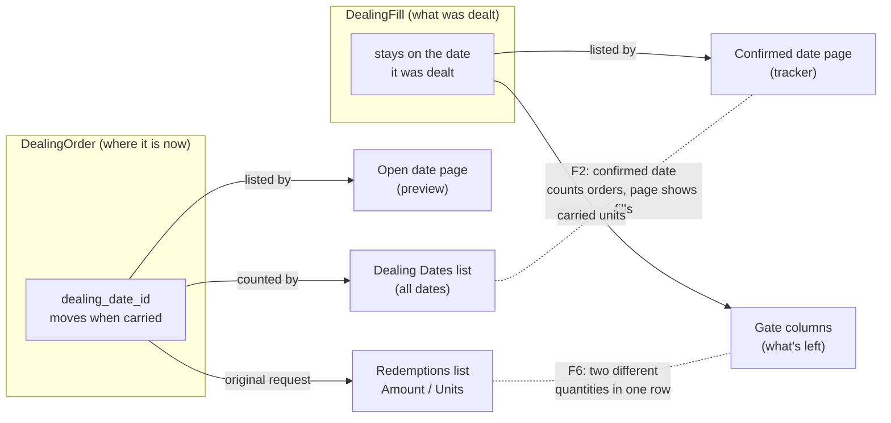

# Evergreen screens review: fund 356 (Demo Evergreen Fund (USD))

**Date:** 11/10/2026 · **Data:** dev DB, fund 356 (classes A and I, 18 dealing dates, 12 approved computed NAVs,
6 folios), plus fund 343 where noted.

**How it was checked:** every evergreen page of the fund was rendered as a fund admin with approver role:
the fund page, Dealing Dates, Subscriptions, Redemptions, NAV list, every NAV, Fees, Unit register, every
dealing date, every order and every folio (52 pages). Each page's tab counts, alerts and badges were
then compared against the other screens showing the same records and against the database.

The question each finding answers: **does the same fact read the same on every screen, and does each
notice apply to the record it's shown on?**

---

## Summary

| # | Finding | Where | Kind | Status |
|---|---|---|---|---|
| F1 | Ready orders waiting on a NAV vanished from the dealing date's tabs | Dealing date page | Count mismatch | **Fixed** (working tree, E322) |
| F2 | A confirmed date's list count drops to 0 when its orders are carried to the next date | Dealing Dates list vs dealing date page | Count mismatch | **Fixed** (working tree, E323) |
| F3 | Red "NAV already priced" alert on a date whose cut-off is months away | Dealing date page | Notice doesn't apply yet | **Fixed** (working tree, E324) |
| F4 | Preview says "Priced at the 30/09 NAV" for a date that will price at a later NAV | Dealing date page | Misleading wording | **Fixed** (working tree, E324) |
| F5 | Step says "Approve NAV" while the date is still open for orders | Dealing Dates list, dealing date page | Wrong state | **Fixed** (working tree, E324) |
| F6 | Part-filled redemptions show the original request next to figures for what's left | Redemptions list, 01/01/2027 dealing date | Mixed figures in one row | **Fixed** (working tree, E323) |
| F7 | Unit register "Queued" disagrees with the redemptions queue | Unit register | Count mismatch | **Fixed** (working tree, E323) |
| F8 | First NAVs (no units yet) are flagged for a missing management fee | NAV page, Fees tab | Notice doesn't apply | **Fixed** (working tree, E325) |
| F9 | Two different fund values with no as-of date | Fund stats vs Unit register | Unlabelled figures | **Fixed** (working tree, E326) |
| F10 | "Net flows QTD" counts the 01/10 subscription but not that day's redemptions | Fund stats | Definition | **Fixed** (working tree, E327): counted at Confirm |
| F11 | A dealing date's gate preview leaves out redemptions waiting for a NAV, so a later order looks fully paid | Dealing date page vs Redemptions list | Mismatch | **Fixed** (working tree, E328): whole queue estimated |

---

## F1. Ready orders waiting on a NAV vanished from the dealing date's tabs (fixed)

**Seen:**
- **Fund 343, 02/11/2026:** the list showed 2 redemptions, but the page showed Redemptions (0).
- **Fund 356, 01/01/2027:** 2 of the 3 redemptions were hidden in the same way.

**Why:** `DealingPricer.preview` prices only the orders that are ready **and** whose class has a usable NAV.
Ready orders of a class whose only approved NAV already priced the previous date (Decision 4) were left
out of both its priced list and its not-ready list.

**Fix (in the working tree):**
- `Pricing#awaiting_nav` now returns those orders.
- Both tabs list them greyed, with a `Waiting for NAV` badge and the same reason that blocks Confirm. The tab counts include them.
- The preview line no longer names a NAV that can't be used.
- Test: E322 in `review_fixes.feature`.

## F2. A confirmed date's list count drops to 0 when its orders are carried

**Seen:** on the Dealing Dates list, 01/10/2026 shows **Redemptions 0**. Its page shows **Redemptions (2)**:
Alder Ridge and Meridian, both part-filled on 01/10 and awaiting payment.

**Why:**
- The list counts orders by their current `dealing_date_id` (`DealingDatesController#index`).
- A part-filled redemption's order **moves** to the next redemption date (01/01/2027) for the rest of its request.
- The confirmed page lists the stored **fills**, which stay on 01/10.

**Proposed:** on the list, a confirmed or closed date counts its fills (what was dealt that day), and an open
date counts its orders. Then 01/10 reads 2 on both screens, and 01/01/2027 reads 3 (the two carried plus Harbor's).

## F3. Red "NAV already priced" alert on a date whose cut-off is months away

**Seen:** 01/01/2027 (cut-off 27/12/2026) shows, in red: "Class I's 30 September 2026 NAV already priced
01 October 2026 — draft and approve a newer NAV first".

**Why it doesn't apply:** 01/01/2027 will price at the 31/12/2026 NAV, which can't exist yet. Nothing is
wrong, and nothing can be done about it today. It only becomes a blocker once the cut-off has passed and the date is ready to confirm.

**Proposed:**
- **Before the cut-off:** no red alert. The preview line says the class will be priced at its NAV for the period, once that NAV is approved.
- **After the cut-off:** the red alert as now, because it really is what blocks Confirm.
- The `Waiting for NAV` rows (F1) keep their reason in both cases.

## F4. Preview says "Priced at the 30/09 NAV" for a date that will price at a later NAV

**Seen:**
- **02/11/2026:** "Preview — … Priced at the 09/30/2026 NAV ($10.19 per unit)." The cut-off was 28/10, and the 31/10 NAV isn't drafted yet.
- **01/01/2027:** "Priced at the Class A 09/30/2026 NAV."

**Why it misleads:** the preview prices at the latest approved NAV **today**. At confirmation the date prices at
the latest approved NAV on or before its own date, so the figures will change once a newer NAV is approved.
"Priced at" reads as final.

**Proposed:** "Estimated at the Class A 30/09/2026 NAV ($10.19), the latest approved today. Confirming prices
at the latest approved NAV on or before 01/01/2027." Keep "Priced at" only when that NAV is the one Confirm will use.

## F5. Step says "Approve NAV" while the date is still open for orders

**Seen:**
- **Fund 356, 01/01/2027 (cut-off 27/12/2026):** the Step reads **Approve NAV**, on the list and on the page's status.
- **Correction:** this review first said fund 343's 02/11/2026 was also wrong ("Collect subscription money"). It isn't: that date's cut-off (28/10) hasn't passed and a pre-funded subscription is unpaid, so collecting money is the right step.

**Why:** the step is worked out from what is missing, not from where the date is in its timetable. Orders can
still arrive until 27/12, so the date's first job is still to take orders.

**Proposed:**
- **Before the cut-off:** the step is **Open for orders**.
- **After the cut-off:** the first blocker in order: unpaid subscriptions → NAV → review and confirm.
- Done in `evergreen_dealing_step`, the list's step helper. The dealing-date journey's own checks are unchanged, since they only run once the date has a journey.

## F6. Part-filled redemptions show the original request next to figures for what's left

**Seen:** on the Redemptions list (and the 01/01/2027 dealing date), for the orders carried from 01/10:

| Investor | Amount / Units column | What's actually left (from the 01/10 fill) | Running total / Will be paid / Deferred use |
|---|---|---|---|
| Alder Ridge (amount-based) | $300,000.00 · ≈29,366.77 units | $204,705.55 · 20,038.47 units | what's left |
| Meridian (unit-based) | ≈$918,160.12 · 89,878.0000 units | 61,328.42 units | what's left |

So one row shows two different quantities. Meridian's Running total rises by $626,508, not by the $918,160
shown in its Amount column.

**Proposed:**
- For a part-filled order, the Amount and Units columns show **what's left to redeem**, with a small "of 89,878 requested" note and a tooltip naming the 01/10 fill.
- The same on the order page and the folio's Requests tab, so every screen shows the same remaining quantity.

## F7. Unit register "Queued" disagrees with the redemptions queue

**Seen** (Unit register, Queued units):

| Folio | Register shows | Actually queued for 01/01/2027 |
|---|---|---|
| F-103 Meridian | 89,878 | 61,328.42 (the original request less the 28,549.58 dealt on 01/10) |
| F-104 Alder Ridge | blank | ≈20,038.47 (an amount-based order, so it has no `units`) |
| F-101 Harbor | 8,496 | 8,496 ✓ |

**Why:** the column reads the order's requested `units`. It ignores what has already been dealt and doesn't
convert amount-based orders.

**Proposed:**
- Queued = the remaining units, as in F6.
- An amount-based order shows ≈ units at the latest NAV per unit, with the same ≈ tooltip used elsewhere.

## F8. First NAVs (no units yet) are flagged for a missing management fee

**Seen:**
- **NAV pages A and I, 30/04/2026:** both show "No units outstanding — initial price" **and** "No management fee accrued yet — run the fee formula to April 30, 2026 **before approving**". The NAV is already approved, so "before approving" is wrong too.
- **Fees tab:** the same two NAVs show the red **No fee in this NAV** badge.

**Why it doesn't apply:** with no units outstanding there is nothing to charge a fee on.

**Proposed:**
- `evergreen_mgmt_fee_warning` and the Fees tab's row state both skip a NAV whose `units_outstanding` is zero. The Fees tab shows a grey `No units yet` badge instead.
- On an approved NAV, the warning drops "before approving".
- The Fees-tab part is in this session's new code, so it would be fixed alongside.

## F9. Two different fund values with no as-of date

**Seen:**
- **Fund page stats:** NAV **$7,738,926.12** and Units **757,933.15**. These are the 30/09/2026 NAVs of A and I.
- **Unit register:** Value total **$8,238,925.91**, with class I holding 647,151.21 units.

**Why they differ:** the register values **today's** units (including Northgate's 48,944.62 units allotted on
01/10) at the 30/09 NAV per unit. The stats show the 30/09 NAV itself. Both are right, but neither says
which date it is for, so the fund appears to have two values that are $500,000 apart.

**Proposed:**
- The stats say "NAV at 30/09/2026" and "Units at 30/09/2026".
- The register's Value header says "Value at the 30/09/2026 NAV per unit", and the total row notes "includes units dealt since".

## F10. "Net flows QTD" counts the 01/10 subscription but not that day's redemptions (to confirm)

**Seen:** "Net flows QTD $500,000.00". On 01/10, Q4's only dealing date so far, there was $500,000 of subscriptions
and $386,946 of redemptions, dealt but not yet paid.

**Question:** should net flows count redemptions when they're dealt, or only when they're paid? If "when
paid" is the intent, the card should say "Net flows QTD (paid)". If "when dealt", it should read $113,054.

---

## Checked and consistent

- **Fund page pills** Subscriptions (2) / Redemptions (3): match the two lists and the open orders.
- **Dealing date tab counts** for every date: match their rows. Since F1, open dates also match the list.
- **Confirmed dates' "Confirmed … at the … NAV" lines:** match each fill's NAV, and the NAV list's "Priced" badges agree.
- **Fees tab (new):** accrued-to dates match each computed NAV's `mgmt_fee_accrued_to`, apart from F8.
- **NAV stats:** the sum of the class NAVs at 30/09 equals the fund NAV card, and units likewise.
- **Settings:** the "No unit classes yet" alert in the markup is hidden (it's only for new funds), so it isn't a finding.

## F10 explained: what "Net flows QTD" counts

`EvergreenFundFigures#flows_qtd` adds up this quarter's dealing **fills that have their units booked**
(`fund_unit_id` set):

- **A subscription** gets its units at **allotment**. For a pre-funded fund that happens at Confirm, so the
  01/10 subscription of $500,000 counts straight away.
- **A redemption** gets its units cancelled only when it is **marked paid**. The 01/10 redemptions
  ($95,294.44 + $291,651.86 = $386,946.30) are dealt but still "Awaiting payment", so they don't count yet.

So the card reads **$500,000 today**, and drops to **$113,053.70** once the two redemptions are paid. This is
deliberate: design example H33 defines it as "subscriptions allotted minus redemptions paid". It measures
money that has actually moved. But the card's label doesn't say that, and the two sides switch on at
different moments, so right after a dealing date it overstates inflows.

| Option | Card on 11/10 | Meaning |
|---|---|---|
| Keep it, relabel | $500,000 · "Net flows QTD (settled)", tooltip: "allotted subscriptions − paid redemptions" | Cash that has moved |
| Count on Confirm | $113,053.70 | What was dealt this quarter, paid or not, which matches the dealing date's figures |
| Show both | $113,053.70, with the subtitle "dealt · $500,000 settled" | Both, on one card |

**Decided 11/10/2026: count at Confirm.** The card now reads $113,053.69 for fund 356. Its tooltip gives
the working: "Subscriptions dealt this quarter $500,000.00 − redemptions dealt $386,946.30 ($386,946.30 not
yet paid) — counted when a dealing date is confirmed". `EvergreenFundFigures#flows_qtd` also returns
`unallotted_in` and `unpaid_out` for that tooltip.

## F11. The gate preview leaves out redemptions waiting for a NAV

**Seen:**
- **01/01/2027 page:** Harbor (Class A, queue #3) is previewed as "Will be paid 100%" with $0 deferred.
- **Redemptions list:** the same order is "Will be part-filled". Alder Ridge (#1) and Meridian (#2) are ahead of it, and the gate is fund-wide.

**Why:** the page's gate preview runs `GateAllocator` on the **priced** orders only. Orders waiting for a NAV
(F1) aren't in the queue, so a later order gets the whole gate. The Redemptions list uses
`EvergreenGateForecast`, which includes every queued order.

**Done (decided 11/10/2026): estimate, don't hide.** While any redemption waits for a NAV:
- The page values the whole queue with `EvergreenGateForecast`, the same as the Redemptions list, so both screens show the same outcome for every order.
- An info box headed **Estimate.** says why: how many redemptions are waiting, for which class's NAV, which NAV they're valued at, and that the figures change once that NAV is approved.
- The gate cards are marked ≈.
- Each waiting row keeps its place and its queue badge, with `Waiting for NAV` and "Estimated until Class I's NAV is approved". Once the deadline has passed, it shows the blocking reason instead.

Confirm can't run while a class is waiting, so nothing is ever dealt on an estimate. On fund 356, Harbor now
reads "Will be part-filled" ($36,505.56 paid, $50,082.33 deferred) on both screens.

**Also fixed while here:** the preview line said nothing happens "until you click Confirm" next to a
disabled Confirm button. It now says when Confirm becomes available: "…until this dealing date is
confirmed. Cut-off is 27 December 2026 — confirm after it." After the deadline, if a NAV is missing, it
says Confirm can be done once that NAV is approved. "Until you click Confirm" is used only when the button is enabled.
