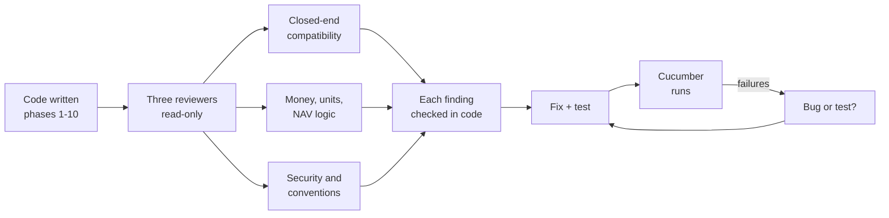
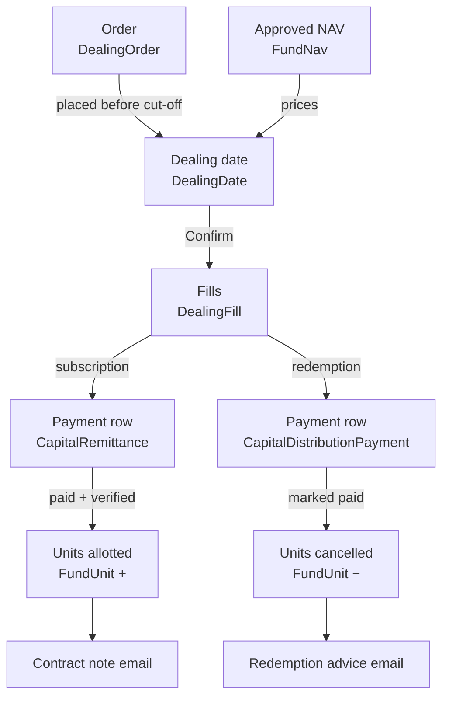
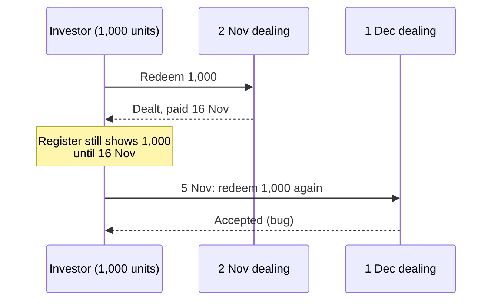
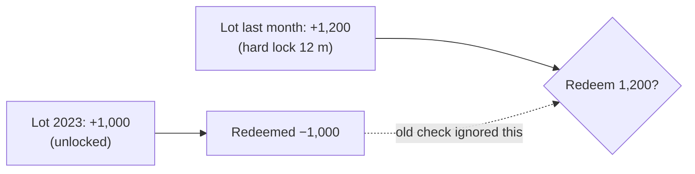
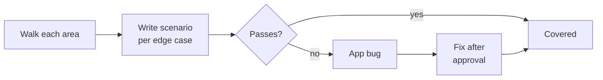

# Evergreen funds — code review findings, fixes and open items

This document explains every issue found while reviewing and testing the evergreen (open-ended) fund
work on the `open-ended-funds` branch: what the system does at that point, what went wrong, a worked
example with real numbers, and how it was fixed — or why it is still open. Read it alongside
[open_ended_funds.md](open_ended_funds.md) and the OpenSpec change
`openspec/changes/open-ended-funds/` (design.md has the worked examples H/E/X referenced below).

---

## Contents

1. [How the review was done](#1-how-the-review-was-done)
2. [A two-minute refresher on the moving parts](#2-a-two-minute-refresher-on-the-moving-parts)
3. [Fixed — closed-end funds must not change](#3-fixed--closed-end-funds-must-not-change)
4. [Fixed — security and access](#4-fixed--security-and-access)
5. [Fixed — money and units](#5-fixed--money-and-units)
6. [Fixed — NAV and performance fee](#6-fixed--nav-and-performance-fee)
7. [Fixed — notifications and documents](#7-fixed--notifications-and-documents)
8. [Fixed — found by the tests](#8-fixed--found-by-the-tests)
9. [Found but not fixed](#9-found-but-not-fixed)
10. [Second review — shared code and the newest work](#10-second-review--shared-code-and-the-newest-work)

---

## 1. How the review was done

Every finding was re-checked against the code before anything was changed — several "bugs" turned
out to be test data or design arithmetic errors (see [section 8](#8-fixed--found-by-the-tests)).
A second review of the newer code (notifications, dealing-date documents, shared-code changes) is
running now — [section 10](#10-still-in-progress).

---

## 2. A two-minute refresher on the moving parts

Most findings make sense once you hold this picture in your head.

| Thing | What it is | Why it matters below |
|---|---|---|
| **Dealing date** | A date on which orders are priced, e.g. 2 Nov 2026 | Orders must land on an *open* one |
| **Cut-off / notice** | Last moment to subscribe / redeem for a date | Decides which date an order goes to |
| **Fill** | What was actually dealt for an order on a date | A gated redemption can be part-filled; the rest is *carried* |
| **Gate** | Cap on redemptions, e.g. 5 % of NAV per dealing date | FIFO or pro-rata |
| **FundUnit** | The unit register row: + on allotment, − on redemption | Redemption units are only removed when the payment is marked **paid** |
| **Pre-funded** | Investor pays before dealing | Units allotted at confirm |
| **Pay-after** | Investor pays after dealing | Units allotted when money is recorded |
| **High-water mark (HWM)** | Highest NAV per unit a performance fee was charged on | Fee only on gains above it |

The key subtlety: **a redemption is dealt on the dealing date but its units leave the register only
when it is paid**, often 10 business days later. Several money bugs came from that gap.

---

## 3. Fixed — closed-end funds must not change

The hard rule: nothing may change for closed-end funds. The reviewer found **no case where a
closed-end fund behaved differently**, but found extra cost and a few leaks.

### 3.1 Every remittance and distribution payment ran extra queries

- **Where:** `evergreen_settlement_hooks.rb` — an `after_commit` on `CapitalRemittance` and
  `CapitalDistributionPayment` asks "is this an evergreen settlement row?".
- **What went wrong:** the check ran 1–2 database lookups for **every** remittance and payment in the
  system, closed-end included.
- **Example:** generating a capital call for 5,000 folios added ~10,000 lookups, and every later
  payment, verify or reconciliation save added 2 more.
- **Fix:** check the entity's `enable_evergreen_funds` flag first (no query). Closed-end entities now
  pay nothing.

### 3.2 Funds list ran one query per fund card

- **Where:** `funds/_index.html.erb`, LP dashboard widget `_lp_funds.html.erb`.
- **What went wrong:** `fund.evergreen?` loads the entity and the evergreen setting — once per card.
- **Fix:** preload `:entity` and `:evergreen_fund_setting` with the funds.

### 3.3 "Dealing order / Dealing date" offered to every entity

- **Where:** workflow template form ("Applies to").
- **Fix:** only shown when the entity has evergreen funds switched on (or the template already uses
  one). The workflow-instance controller's allow-list now includes the two types so evergreen
  journeys can actually be launched.

### 3.4 Capital call / distribution pages redirected even when evergreen was switched off

- **Where:** `capital_calls_controller.rb`, `capital_distributions_controller.rb`.
- **What went wrong:** an evergreen settlement call redirected to the evergreen page whenever a
  dealing date pointed at it — even after the entity switch was turned off (the documented rollback
  path), and also for JSON requests.
- **Fix:** redirect only HTML requests, only while the fund is evergreen.

### 3.5 Smaller items

| Item | Fix |
|---|---|
| Workflow auto-assignment on update did the evergreen lookup before its cheap early exits | Moved after them |
| Deleting an evergreen fund failed with a "restrict" error (children deleted in the wrong order) | Associations reordered: fills → orders → dates → NAVs |
| Autocorrect had reformatted unrelated lines in `sidekiq.rb`, `workflowable.rb` | Restored, so the closed-end diff is only the guarded hooks |

---

## 4. Fixed — security and access

### 4.1 An investor could redeem from **another investor's folio** (high)

- **Where:** the order form → `DealingOrderCreate`.
- **What went wrong:** the controller worked out *which investor* is ordering, but passed the
  submitted folio id straight through. Nothing checked the folio belonged to that investor or fund.
- **Example:** Delta Ventures' user edits the form to send `capital_commitment_id` = Waterfield's
  folio F-001 with "all units". A redemption of Waterfield's 12,000 units is created in Delta's name.
- **Fix:** the controller only passes a folio the investor owns in this fund, and
  `DealingOrderCreate` refuses any folio from another fund or investor and any investor from another
  entity ("Choose a folio of this investor in this fund") — covering portal, admin and upload.

### 4.2 Approving a NAV you changed — allowed, with an audit trail (decision)

- **Where:** NAV override → approve. Approval needs the approver role.
- **The review's concern:** an approver could override a line and then approve the NAV they had just
  altered. A first fix made the overriding user the preparer, which blocked that.
- **Decision (yours):** an approver can always approve, even after making changes — but every change
  must be traceable. So the first fix was reverted, and instead:
  - `FundNav` (and the fund's evergreen settings) are **audited**: every draft, override, approval
    and reopen is recorded with who, when, and the old → new values.
  - Each override carries an audit comment — e.g. *"Overrode cash: Bank statement"*.
  - An approval by someone who also overrode lines says so — e.g. *"Approved — approver also
    overrode cash"*.
  - The NAV page shows, for each overridden line, the reason, **who** changed it and **when**, and a
    **NAV audit trail** panel with the full history (also on the Audit Trail screen).
- **What is enforced:** only users with the **approver** role can approve. An approver may approve a
  NAV they drafted themselves (small funds need this) — the trail notes *"approver also prepared this
  NAV"*. A user without the role sees "Needs the approver role", and a direct request is refused.

### 4.3 Back-dated orders landed on already-confirmed dates (high)

- **Where:** admin order entry (received time is editable) and early confirms.
- **What went wrong:** the order's dealing date came from its received time only; nothing checked the
  date was still open. Such an order sat on a confirmed date forever — never priced, never cancellable.
- **Example:** 2 Nov is confirmed. An admin enters a redemption "received 20 Sep" → it lands on 2 Nov.
- **Fix:** an order whose date is no longer open moves to the **next open** dealing date; saving also
  locks the dealing date, so an order can't slip in while a confirm is running.

### 4.4 Switching back to closed-end could delete orders with money (high)

- **Where:** `EvergreenDisable`.
- **What went wrong:** the button was hidden once dealing dates existed, but the service only refused
  when a date was *confirmed*; a direct request deleted every pending order — including orders whose
  folio and payment row (possibly with money received) were already created.
- **Fix:** one rule for both: allowed only while the fund has **no orders and no confirmed dealing
  dates**. Then only empty generated dates and NAV drafts are removed.

### 4.5 Medium items

| Finding | Example | Fix |
|---|---|---|
| Signed-form upload open to read-only users, any file type, 500 on a second upload | A read-only GP user uploads a `.exe` | Own `upload_form?` policy (pending subscription, own order or GP editor); PDF/image/Word only; friendly error |
| Crashes instead of messages | "Mark paid" on a subscription fill → 500; reject reason over 255 chars → 500; bad NAV date → 500; Accept clicked twice overwrites who accepted | Guards with messages; reason truncated; strict date; accept only once |
| Investors could see the *names* of unapproved generated documents | — | Investor Documents tab and folio page exclude unapproved generated documents |
| One bad custom dealing date silently wiped the whole list; "03/04/2027" read day-first | Enter `2027-03-31, 03/04/2027` | Strict `YYYY-MM-DD`; the bad entries are named in an error |

---

## 5. Fixed — money and units

### 5.1 Redeeming units that were already being redeemed (high)

- **What went wrong:** the "free units" check counted units in the register, but a dealt redemption
  only leaves the register when it is paid.
- **Example:** 1,000 units, redemption dealt on 2 Nov (paid 16 Nov). On 5 Nov the investor asks for
  1,000 more → accepted → on 1 Dec the folio goes to −1,000 and ₹1 Cr is paid out that wasn't owed.
- **Fix:** `DealingOrder#free_units` = held − redemptions dealt but not yet paid. Used by the order
  check, by "all units" orders and to cap every redemption request at pricing.
- **Same root cause, also fixed:** a carried "all units" redemption asked for the whole holding again
  on the next date (holds 4,000, 1,000 filled but unpaid → next date asked for 4,000, now 3,000).

### 5.2 A part payment allotted part of the units, and the rest never got any (high)

- **What went wrong:** recording a payment also verified it, and the allotment engine allots on the
  money collected. Once units were allotted, the fill was marked done.
- **Example:** ₹1 Cr subscription (pay-after). ₹50 L arrives → units for ₹50 L allotted and the
  contract note sent. The second ₹50 L arrives → nothing happens; ₹50 L sits with no units.
- **Fix:** units are allotted only when the subscription is **paid in full** (same 10-paise tolerance
  used elsewhere). The second payment's save triggers the allotment.
- **And if the rest never comes (your question):** the GP clicks **Accept received amount** on the
  order or its tracker row. The subscription becomes the ₹50 L received — order, payment row and the
  folio's subscribed amount all drop to ₹50 L (the order keeps the original ₹1 Cr and who reduced it,
  on the audit trail) — and units are allotted for ₹50 L at the dealing NAV. After dealing, the fill
  is re-sized at the same NAV per unit (1,000 units for ₹1 Cr → 500 units for ₹50 L at ₹10,000 per unit).
  Worked examples E72, E73, X31 (`partial_payments.feature`).

### 5.3 A fund-level gate only counted classes that had orders (high)

- **What went wrong:** a 5 % *fund-level* gate was computed on the NAV of the classes with redemptions
  that day, not the whole fund.
- **Example:** Class A NAV ₹80 Cr, Class B ₹20 Cr, gate 5 % of the fund = ₹5 Cr. Only Class B has
  redemptions → pool computed as 5 % × ₹20 Cr = **₹1 Cr**; ₹4 Cr was wrongly carried forward.
- **Fix:** the pool uses every class's latest approved NAV.

### 5.4 Lock-ups ignored past redemptions (high)

- **What went wrong:** the check looked only at purchase lots, so units bought (and since redeemed)
  long ago still counted as "unlocked".
- **Example:** 1,000 units bought in 2023 and fully redeemed; 1,200 bought last month under a
  12-month **hard** lock-up. Redeeming 1,200: old check said 1,000 unlocked + 200 locked → under a
  *soft* lock-up the fee was charged on 200 instead of 1,200; under a *hard* lock-up it should have
  been refused outright.
- **Fix:** `EvergreenLots.remaining` nets every redemption (paid, and dealt-but-unpaid) against the
  **oldest** lots first; lock-up checks and the unit register classify what is left.

### 5.5 Early-redemption fee deducted twice (high)

- **What went wrong:** the fee was a ledger entry read by a distribution-level "Expense" fee, which
  every payment of the folio applies in full.
- **Example:** one folio, two redemptions on 2 Nov with fees ₹10,000 and ₹20,000. Each payment
  deducted ₹30,000 → ₹60,000 taken instead of ₹30,000.
- **Fix:** each redemption payment is created **net of its own fee**; the ledger entry stays for the
  accounts. Units cancelled are unchanged (they come from the fill's exact units).

### 5.6 Two approvers clicking at once crystallised the fee twice (high)

- **Example:** H30's ₹44,00,000 performance fee booked twice (₹88 L) when two approvers clicked
  Approve together.
- **Fix:** approval re-checks "already approved?" after taking the row lock.

### 5.7 Medium items

| Finding | Example | Fix |
|---|---|---|
| Payment timing stored on the fund setting **and** on each dealing date — they could disagree | Fund switched from pay-after to pay-before: new orders paid up front, but confirm read "pay-after" and sent payment instructions to people who'd already paid | Saving settings updates every **open** dealing date; confirmed dates keep what they were dealt with |
| Undo brought back orders that had changed since | C carried to 1 Dec, C cancels on 5 Nov, admin undoes 2 Nov → C was pending again; if 1 Dec was already confirmed, orders could be dealt twice | Undo refused when moved orders were dealt on a later confirmed date; only still-open orders are restored |
| Calendar ran out of dates → crash | Custom calendar with no date after 1 Dec; an unready order on 1 Dec → 500 on the dealing page and at confirm | Unready order cancelled ("no later dealing date"); a gated remainder is closed with a note; pricing says so |
| Two folios opened at the same moment could get the same number | Two portal subscriptions at once → both "F-101" | Folio numbering locked per fund |

---

## 6. Fixed — NAV and performance fee

| Finding | Example | Fix |
|---|---|---|
| Overriding a line on an **uploaded** NAV wiped it | Uploaded NAV ₹100 Cr has no line breakdown; override Cash to ₹5 Cr → NAV recomputed from lines = ₹5 Cr | Line overrides refused on uploaded NAVs (re-upload instead); the override card is hidden. Uploading over a computed draft clears its old lines and overrides |
| Crystallisation needed a NAV dated exactly on the period end | Year end 31 Dec 2028 is a Sunday; the NAV is dated Fri 29 Dec → never crystallised | The period's last business day counts |
| A zero fee still "crystallised" and reset the hurdle clock | Class below its mark at year end: no fee, but the hurdle clock restarted from that date | Nothing is marked crystallised when no fee accrued |
| Confirm and Reopen could race | Reopen a NAV at the same moment a confirm prices at it → fills point at a draft NAV | Confirm locks the NAVs it prices at; Reopen re-checks "used by a dealing date" under its lock |

---

## 7. Fixed — notifications and documents

These came from the notifications Cucumber feature, written one scenario per worked example.

| Finding | Example | Fix |
|---|---|---|
| NAV-update email holding value kept fractions of a paisa | 4,892.3679 units × ₹10,160.94 = ₹4,97,11,056.6898 shown as **…56.68** | Rounded to the paisa → **…56.69** |
| "Gate applied" alert showed the wrong carried amount and date | "₹1,38,99,999.99 carried to Jan 01, 2027" — amount rebuilt from units (lost a paisa); date guessed with the 30-day notice, but the orders moved to **1 Dec** | Amount requests carry exactly "asked − paid"; the date is where the carried orders actually went |
| Large-redemption email lost the percentage | Subject "( % of Class A NAV)" | The percentage is passed to the email |
| Custom subjects didn't fill `{{placeholders}}` | "Reminder: fund your {{fund_name}} subscription" | Evergreen emails fill subject placeholders (shared mailer unchanged) |
| Reminder days 0 accepted | — | Must be 1–30 |
| A failing fund in the daily job was only logged | One fund's bad data → nobody told | Reported through the app's error reporting; the other funds still run |
| "Settlement overdue" cadence measured from the wrong date for pre-funded dates | Worked in the test only because two dates happened to be 7 days apart | Counted from the obligation that is actually overdue |
| Saving the wizard froze every default | A default changed in a later release never reached a fund that had saved its settings | Only values that differ from the default are stored |
| NAV upload rows all "failed" after the alert hook was added | The importer's row method returned the hook's `nil` | Returns `true` |

---

## 8. Fixed — found by the tests

Not every red test was an app bug. These were the design's or the test's own errors — worth knowing
because the numbers appear in the docs.

| What failed | What was actually wrong | Correct value |
|---|---|---|
| H7 indicative units | Design arithmetic: ₹5 Cr ÷ 9,980.69 | **5,009.6736** (not …6735) |
| H5 NAV upload | Design rounded the NAV to the lakh, so NAV ÷ units ≠ NAV per unit | NAV **₹98,25,98,930.50** for 98,450 units at 9,980.69 |
| H37 investor value | Design showed the rounded figure | **₹4,97,11,056.68/69** |
| H26/E22 queue order | With the default 30-day notice a 10 Nov redemption goes to **1 Jan**, not 1 Dec | Scenario sets a 7-day class notice |
| Management fee "doubled" | The allocation run also writes a fund-level total row; the test summed it | Sum folio rows only — the NAV code was already right |
| Investor sign-in failing in some scenarios | Travelling the test clock before today made the browser drop the 60-minute session cookie | Evergreen tests keep the cookie when the clock is moved |
| Order "Check" did nothing | The required "I have read the offering documents" box blocked **every** submit, including Check | Check skips browser validation (`formnovalidate`) |

---

## 9. Found but not fixed

### 9.1 Design decisions — decided 8 Oct 2026

Both are explained simply in [evergreen_design_decisions.md](evergreen_design_decisions.md).

- **Fee payments split across classes by value share** — decided: a payment settles the class that
  owed it (split by what each class owed). Worked examples E197–E200.
- **Pre-funded money lifting NAV per unit** — decided: money for orders not yet dealt (and the payout
  of dealt-but-unpaid redemptions) is held in its own NAV line until the units exist. Worked examples
  E201–E204.

Both are built (tasks section 15) and tested in `nav_corrections.feature` (8 of 8).

### 9.2 Performance (works, but slow at scale)

| Screen | Why it's slow | Fix when needed |
|---|---|---|
| Orders list | Per row: fund setting, payment row, journey status, queue position, entered-by (~5 queries × 50 rows) | Preload; compute queue positions in one pass |
| Dealing dates list | Each row's step badge builds a progress object (4–8 queries) | Batch the progress figures |
| Unit register / folio page | 3 queries per folio; the folio page builds the whole register to show one row | Filter to the folio; aggregate in SQL |
| NAV list | Each draft row computes "stale" (aggregates over account entries); unpaginated | Compute stale lazily on the NAV page; paginate |
| Fund page | Builds the fund figures twice (stats + Evergreen card) | Memoise per request |

### 9.3 Low

- **Statements:** redemptions are counted by dealing date but units by payment date, so a redemption
  dealt 31 Dec and paid 10 Jan appears in Q4's "redeemed" while closing units still include it.
- **Fee rate per order:** an order spanning two locked lots (8 and 18 months old) is charged one rate.
- **Un-verify / un-mark-paid** after units moved reverses nothing.
- **Contract note email lost** if the send fails after units are recorded (retry sees units and stops).
- **Dead code:** unused overview figures (`cash_cents`, `trend`), `import` routes on NAVs/orders with
  no action, the Overview controller kept only for old links.

### 9.4 Closed-end regression: one failing scenario

`features/fund/capital_distributions.feature:272` ("An oversized document on a distribution payment
stops every notification") fails: a "Needs your review" journey email is sent. The scenario and the
distribution journey both come from `main` commits this branch doesn't touch, and it fails on its
own, so it looks pre-existing — not confirmed on `main` yet.

---

## 10. Second review — shared code and the newest work

### 10.1 Changes to shared code (done)

Closed-end fund pages, notifications, routes and helpers render and behave as before. Two points:

| Finding | Example | Status |
|---|---|---|
| Deleting a fund that ever logged an evergreen notification failed | Fund made evergreen, a reminder was logged, fund switched back to closed-end, then deleted → foreign-key error | **Fixed** — log rows are deleted with the fund |
| The "not applicable" step popup and tooltip changed for **every** journey, not only evergreen | On a capital-call journey, clicking a skipped step now also shows *What it does / What happens / Why it matters*, and the tooltip no longer says "Checked automatically" | **Intended** — you asked for skipped steps to explain themselves; it applies to calls, distributions, KYC, KPI and approval journeys too |

Everything else was clean: custom-notification changes only affect the new "Evergreen" type, the new
user tags can't collide with the existing tag lookups, the workflow-template form is unchanged for
entities without evergreen, and the new route and helper names are unique.

### 10.2 Notifications and dealing-date documents (done)

| Finding | Example | Status |
|---|---|---|
| **Generate documents / Approve & send always crashed** | Both buttons → 500: the controller never loaded the dealing date for those two actions | **Fixed** |
| Two orders of one folio on one date fought over one document | Two subscriptions for F-101 on 2 Nov: generating the second document deleted (or failed to delete) the first, because both had the same name | **Fixed** — the document name includes the fill |
| Approve & send failing part-way stranded documents | Email to investor 3 of 10 fails → that document is approved but never sent, and no button can send it | **Fixed** — "awaiting" now includes approved-but-unsent documents; each is locked and re-checked so two approvers can't double-send |
| A retried allotment skipped the investor email | Units recorded, then the email step errors; the retry sees the units and stops → no contract note, date can't close | **Fixed** — a retry still sends the email if it was missed |
| Units-free email missed month-end lots | Lots issued 29–31 Jan with a 1-month lock-up unlock on 28 Feb, but only 28 Jan lots were found | **Fixed** — the whole tail of the month is included |
| "Documents awaiting approval" only once a day | A second Generate run the same day (late pay-after allotments) alerted nobody | **Fixed** — once per run |
| Template removed after settlement left an order stuck | The fill had neither a document nor an email; the date could never close | **Fixed** — such fills get the plain email at the next Generate |
| Double-click on Generate could make two documents | — | **Fixed** — each fill is locked and re-checked |
| One bad order stopped all of a fund's daily checks | One broken order → no reminders, summaries or overdue alerts for that fund that day | **Fixed** — each record is isolated and the error reported |
| NAV update re-emailed folios after a part failure | Folio 7 fails → retry re-emails folios 1–6 | **Fixed** — once per folio |
| Weekly overdue alert skipped a week after a missed job day | — | **Fixed** — sends if none went out in the last 7 days |
| Copy-from-fund listed funds the user can't see | — | **Fixed** — only visible funds |
| Relationship manager not checked against the fund's entity | — | **Fixed** |
| Send-once log could hide a real error | — | **Fixed** — only the "already sent" case is swallowed |
| "Generate documents" step stuck when nothing settled | Every redemption fully gated → step pending forever | **Fixed** |

**Still open (low / performance):**
- **Template lookups:** about 3–4 queries per fill, repeated on every journey check. With many settled orders this grows quickly; the fix is to load the fund's two templates once.
- **Daily job:** re-prices open dates that have already been alerted.
- **Ops alerts:** contents are recomputed for each recipient.
- **Regenerate:** runs LibreOffice inside the web request, not in a background job.
- **Send without recipients:** "sent" is recorded even when the investor has no portal users.
- **Units-free wording:** "without an early-redemption fee" can be wrong when a fee schedule runs past the lock-up.

### 10.3 Found by the dealing-documents tests (fixed)

`dealing_documents.feature` first ran 10 of 18 green. All 8 failures were app gaps against the spec:

| Example | What was wrong | Fix |
|---|---|---|
| E66, E67 | The Approve & send popup said "1 contract note **and 0 redemption advices**" | Only the kinds being approved are named: "1 contract note" |
| E68 | A tracker row said "Document to generate" | It names the document: "Contract note to generate" / "Advice to generate" |
| E69 | The investor's Transactions tab linked a contract note **before approval** (the Documents tab already hid it) | The link shows only for an approved document |
| X28 | Close just vanished while documents were unsent — nobody could tell why | Close shows disabled with "Send every contract note and redemption advice first" |
| X30 | A fill whose generation failed looked identical to one never generated, and had no way to retry | It shows a red "Not generated" badge with Regenerate |
| E51 | The emails showed NAV per unit as "10,220.00" — no currency — and said "your contract note is attached" when nothing was | "₹10,220.00"; the "attached" sentence only when a document is attached |

Custom-notification templates keep `{{nav_per_unit}}` as a plain number, because a template's author
writes their own currency around it.

## 11. Edge-case audit (8 Oct 2026)

Every area of the feature was walked for edge cases: boundaries, exact thresholds, zero and negative
values, several lots or classes, rounding, month and year ends, out-of-order steps, double clicks,
permissions and direct requests. About 150 scenarios were added, and every H/E/X worked example in
design.md now has exactly one commented Cucumber scenario (316 IDs, checked both ways).

### 11.1 Bugs found and fixed

| ID | What was wrong | Example | Fix |
|---|---|---|---|
| E86 | A soft-lock fee used the **oldest** locked lot's age for every locked unit | 100 units 18 months old (2%) + 100 units 3 months old (3%) at ₹10,000: charged ₹40,000, should be ₹50,000 | `EvergreenLockUp` charges each lot at its own age's rate |
| E87 | The fee was fixed when the order was placed, even if it rolled past the unlock date | Units unlock 15 Jan; order rolls 1 Jan → 1 Feb: charged ₹20,000, should be ₹0 | Pricing re-judges the lock-up on the date it actually deals; a roll refreshes the order's fee |
| X49 | Redemptions of 0 or −100 units were accepted | −100 passed the free-units check | "Enter units or an amount greater than zero" |
| E141 | A part-paid row said "Money received · allotting…" | ₹40 L of ₹1 Cr in | "Money received" only when paid in full; otherwise "Awaiting the rest" |
| X86 / X87 | A ₹0 payment, or a second click after full payment, added a ₹0 payment row | Double click on Record payment | Refused: "Enter an amount greater than zero" / "Nothing is owed on this subscription" |
| X88 | A second Mark paid overwrote the paid date and bank reference | 10 Nov / UTR-1 became 12 Nov / UTR-2 | Refused: "Already marked paid on 10/11/2026" |
| X92 | Regenerate made an advice for an unpaid redemption | Direct request for B LLP before payment | Refused until the order is settled |
| X95 | A template removed after settlement left that investor un-emailed, and the date could never close | Contract-note template deleted after allotment | The same button sends the plain emails ("Send emails (1)"); the date then closes |
| E108 | The preview said "will be cancelled" but confirm rolled the order (money was received) | ₹1 Cr of ₹5 Cr received, fund cancels unready orders | One rule (`DealingRoll.fate`) for preview and confirm: money received always rolls |
| E181 (was X57) | A date with only not-ready orders could never be confirmed, so its orders were stuck | One unpaid pre-funded subscription | Confirm runs as roll/cancel only: "Nothing to price … Confirming rolls or cancels …" |
| X115 | The portal card offered Redeem when every unit was hard-locked | 12-month hard lock-up | Card Redeem disabled with the unlock date; the card now uses the closed-end card layout |

### 11.2 Decisions taken

| Question | Decision |
|---|---|
| Part-paid order when the fund cancels unready orders | Roll it — money received is never cancelled away (E108) |
| Date with only unready orders | Confirm rolls / cancels them, prices nothing (E181) |
| NAV upload with the same class and date twice | Refuse the whole file (X116) |
| Negative NAV | Refuse it on every path — draft, override, upload (X117) |
| High-water mark when a crystallisation date's fee is ₹0 | Mark stays where it is |
| Payment reminder when the daily job misses a day | Catch up the next day, still once per order (E161) |

### 11.3 Still running

| Item | Status |
|---|---|
| Full evergreen suite on the latest code | Next |
