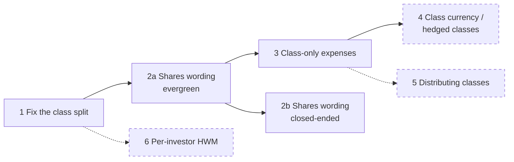
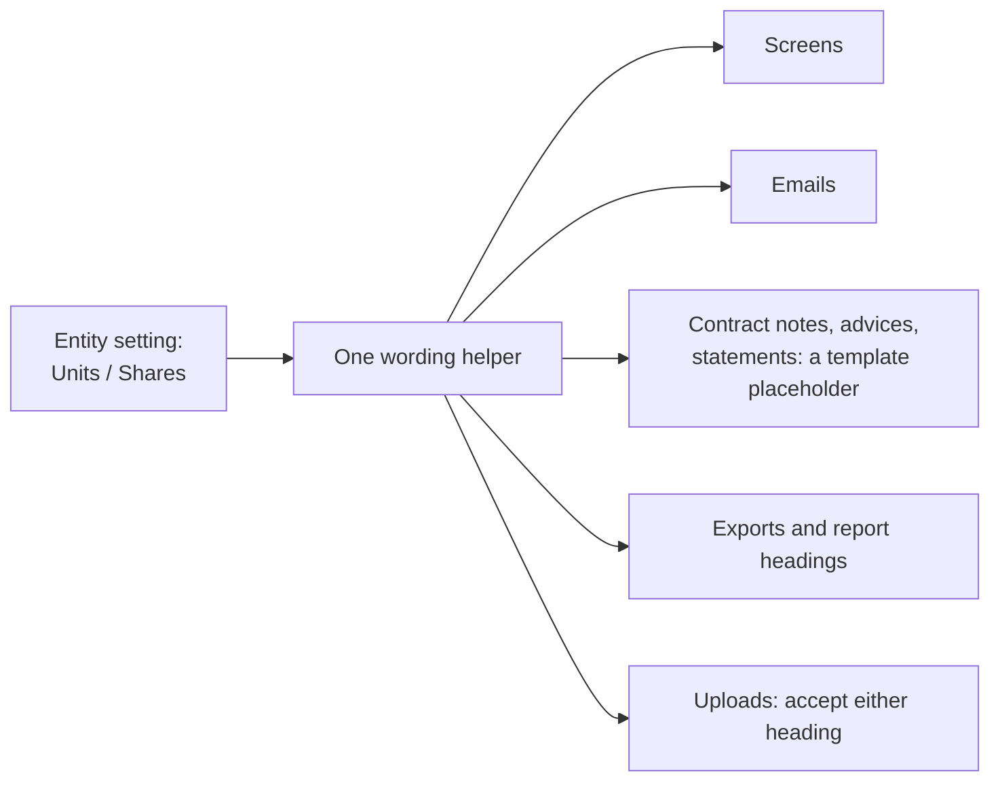

# Evergreen funds — share classes and "shares" wording: plan

**Status (9 Oct 2026):** items 1, 2 and 3 (small and medium) are **approved**.
- **Items 1 and 3** are **built** as OpenSpec change `evergreen-share-classes` on the
  `open-ended-funds` branch; QA sign-off on a deployed build is still to do.
- **Item 2** ("Units" or "Shares") is a **separate feature**, on its own branch and worktree.
- **Items 4, 5 and 6** (large) are **PENDING / TBD**: not planned until a client needs them.

**Where this came from:** business feedback on the evergreen work (9 Oct 2026):

1. US funds say **shares**, not units. This applies to closed-ended funds too. **Decided:** a
   per-**entity** setting, not a per-fund one.
2. Funds need **a different NAV for each class**. CapHive already does this, but the business rules
   didn't show it clearly. It's now documented in `evergreen_business_rules.md`, section 8, "How each
   class gets its own NAV". While writing that section we found one calculation problem (item 1
   below).
3. Plan for what classes **can't do differently yet** (items 3 to 6).

---

## Summary

| # | Item | Why | Size | Status |
|---|---|---|---|---|
| 1 | Fix how shared lines are split while a class owes a fee | Correctness: unpaid fees move value between classes | Small | **Done** (built 9 Oct 2026) |
| 2 | "Units" or "Shares", per entity | US wording, for evergreen and closed-ended funds | Medium | **In progress, separate feature and branch** (2a evergreen, 2b closed-ended) |
| 3 | Expenses charged to one class only | US multi-class funds charge servicing and transfer-agent fees by class | Medium | **Done** (built 9 Oct 2026) |
| 4 | A class in another currency (incl. hedged classes) | Offshore and feeder funds offer USD, EUR and other classes | Large | **PENDING** |
| 5 | Classes that pay out income | Interval and income funds distribute; hedge funds don't | Medium–large | **PENDING** |
| 6 | A high-water mark per investor (series or equalisation) | Standard for US hedge funds | Large | **PENDING** (Decision 3) |

Solid items are being built now. Dashed ones are **PENDING** until a client needs them.

---

## 1. Fix how shared lines are split while a class owes a fee

### The problem

Shared lines (investments, cash, other assets, other liabilities) are split by each class's value.
Today that value is units × the class's **NAV per unit at the previous NAV**, and that NAV has
already had the class's **unpaid fees** taken off. The fee is then taken off again as the class's
own line. So while a class owes a fee, its share of the pool is too small, and the other classes
gain the difference.

### Example (round numbers, nothing else changes)

Both classes start with 50,000 units at ₹10,000, so ₹50 crore each, out of a shared pool of
₹100 crore. Class A owes a ₹1 crore fee it hasn't paid; Class B owes nothing.

| | Class A | Class B |
|---|---|---|
| NAV 1 | ₹50 Cr − ₹1 Cr fee = **₹49 Cr** | **₹50 Cr** |
| NAV 2 today: shares split 49 : 50 | ₹100 Cr × 49.49% = ₹49.49 Cr − ₹1 Cr fee = **₹48.49 Cr** | ₹100 Cr × 50.51% = **₹50.51 Cr** |
| NAV 2 after the fix: shares split 50 : 50 | ₹50 Cr − ₹1 Cr fee = **₹49 Cr** | **₹50 Cr** |

Nothing happened between the two NAVs, yet today's split moves ₹50.5 lakh from Class A to Class B,
and it keeps drifting on each NAV until the fee is paid. Once paid it stops, but what already moved
stays moved.

### The fix

Split by each class's **stake**: its previous NAV, **plus** its own fee lines still owed then
(management fee payable, performance fee payable and accrued), × units today ÷ units then,
**minus** its own fee payments since. In the example both stakes are ₹50 crore, so it's 50 : 50.

Subtracting the payments matters. When Class A's ₹1 crore is paid, the shared cash falls for every
class, and A's stake falls by the same ₹1 crore, so the split is still right after the payment.
Splitting by value before fees alone would get the unpaid case right but leak value once the fee is
paid.

- **Where:** the class split only (`ClassApportioner`). Nothing else changes.
- **Uploaded NAVs** have no fee lines, so they split exactly as today.
- **Already-approved NAVs** stay as they are. The fix applies to NAVs drafted from then on.
- **Tests:** a new edge-case scenario with the example above, and the existing two-class scenario
  (E7) still passes.
- **Business decision:** none. This is a correction.

---

## 2. "Units" or "Shares", per entity

### What changes

A new entity setting, **"Holdings are called: Units / Shares"**:

- **Default:** from the server's country. The US server defaults to Shares; India and the rest to
  Units. This follows how the financial-year start is already defaulted, from the per-country site
  marker.
- **Who changes it:** a company admin, on the entity settings.
- **Why per entity, not per fund, and not by browser language:** one manager uses one vocabulary
  across its funds. Today the browser's language picks the screen locale, so a US manager working
  from an Indian browser would see "Units". The setting follows the entity, whoever is looking.

**Words that change:**

| Units (India, today) | Shares (US) |
|---|---|
| Unit / Units | Share / Shares |
| NAV per unit | NAV per share |
| Unit class | Share class |
| Allot units | Issue shares |
| Cancel units | Redeem shares |
| Units held / Units outstanding | Shares held / Shares outstanding |
| Unit register | Share register |

**What doesn't change:**
- **Stored data:** table and column names (`fund_units`, `units`).
- **The API and MCP tool field names.** Their descriptions can mention both words.
- **Amounts and decimals:** fractional shares keep 4 decimals.

### Where

| Area | Notes |
|---|---|
| Evergreen screens and emails | About 109 places say "unit(s)" today. Some words are already in `evergreen.*.yml`; the rest are typed into the screens. |
| Closed-ended screens and emails | About 38 files say "Units": unit register, commitment details, distribution payments, etc. |
| Documents | A `{{unit_term}}`-style placeholder, so one template serves both countries. Existing templates keep working as they are. |
| Uploads | A "Units" or "Shares" column heading is accepted either way. |
| User guides | Written once, with "units (shares in the US)" at first mention. |

### Phases

- **2a Evergreen:** new code and low risk. Ships with the helper and the setting.
- **2b Closed-ended:** touches screens and emails already in use. It needs its own change and its own
  regression run.

### Tests

For each phase, a scenario with a US entity that walks the main screens, an email and a document
and sees "shares", and one with an Indian entity that still sees "units".

---

## 3. Expenses charged to one class only

### Why

Every expense other than management and performance fees is shared by all classes today.
Multi-class funds often have costs that belong to one class: a servicing or distribution fee for
the retail class, transfer-agent costs by class, a legal cost for setting up one class. In US
registered multi-class funds these class expenses are standard.

### Proposal

Each class can name its **own ledger entries** for "class expenses" and "class liabilities".

- **What the NAV does:** it leaves those entries out of the shared pool and takes them off that
  class only. It's a new line on the class NAV, "Class-only expenses", with its source shown like
  the other lines.
- **Why named ledger entries:** it reuses how the fund settings already point at the ledger (cash,
  other assets, other liabilities), so `AccountEntry` and the existing uploads need **no change**.
- **Tests:** a two-class fund with a ₹10 lakh Class B expense; Class A's NAV is unchanged and
  Class B's falls by exactly ₹10 lakh. Edge cases: no entry named, and an entry named by two
  classes (refused).

### For the business to decide

- Should a class be able to charge **more than one** expense type?
- Is one "class expenses" line enough?

---

## 4. A class in another currency (incl. hedged classes) — PENDING

> **PENDING.** Not planned or built. Kept here so the business knows the gap; it is picked up
> only when a client needs it.

### Why

Offshore and feeder funds often offer a USD class in an INR fund, or EUR and GBP classes in a USD
fund, sometimes **hedged** (the class bears the cost and result of a currency hedge). Today every
class and every order must be in the fund's currency (R4.3).

### What it needs

- **Class currency:** a currency on each class.
- **FX on each NAV date:**
  - the class's NAV per unit is worked out in fund currency and converted at the NAV-date rate;
  - this uses the entity's exchange rates, which already exist;
  - the rate used is shown on the NAV.
- **Orders, payments, contract notes and advices** in the class's currency.
- **Hedged classes:** the hedge's gains and costs are charged to that class only. This **builds on
  item 3**.
- **Reports and statements:** each class reported in its own currency, with the fund total in fund
  currency.

### Size and recommendation

Large. It reaches orders, payments, documents and statements. Wait for a client who needs it, and
build item 3 first.

---

## 5. Classes that pay out income — PENDING

> **PENDING.** Not planned or built. Kept here so the business knows the gap; it is picked up
> only when a client needs it.

### Why

Some classes pay income out (**distributing**); others keep it in the NAV (**accumulating**). US
interval funds and income funds usually distribute, often with automatic reinvestment. Hedge funds
usually accumulate. Today every class accumulates.

### What it needs

- **A per-class setting:** accumulating (today) or distributing, and how often.
- **A distribution per share** on a date, paid only to that class. Its NAV falls by the amount.
  This reuses the existing distribution and payment records.
- **Reinvestment:** optionally, the distribution buys new units at that day's NAV.
- **Notices:** income distribution notices; tax reporting is out of scope.

### Size and recommendation

Medium to large. Wait for a client who needs it.

---

## 6. A high-water mark per investor (series or equalisation) — PENDING

> **PENDING.** Not planned or built. Kept here so the business knows the gap; it is picked up
> only when a client needs it.

### Why

There is one high-water mark per class today (R9.4). An investor who joins when the class is below
its mark can gain back to the mark without paying a performance fee. One who joins above it pays
nothing on their own early gains until the class passes the old mark. US hedge funds avoid this
with:
- **series of shares:** a new series for each subscription date, each with its own mark, rolled up
  once it has paid a fee; or
- **equalisation:** a per-investor adjustment.

### Status

Already parked as **Decision 3** in `evergreen_design_decisions.md`. Large, because it changes how
performance fees are calculated, booked and reported. Wait for a client who needs it.

---

## Also noticed (not asked; for the business to note)

- **Switching classes:** moving an investor from one class to another, for example to the lower-fee
  class once they cross a size threshold, is a redemption plus a subscription today. Some funds
  expect a single "switch" at the dealing-date price.

---

## Next step

- **Items 1 and 3:** built (`openspec/changes/evergreen-share-classes`); next is QA sign-off on a
  deployed build (`qa-checklist.md`), then archive the change.
- **Item 2:** gets its own OpenSpec change on a separate branch and worktree.
