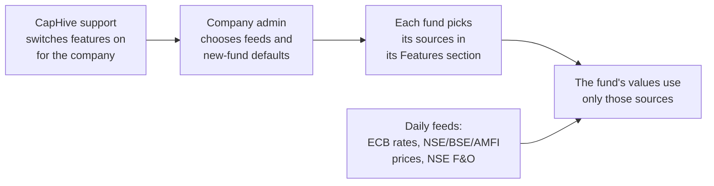
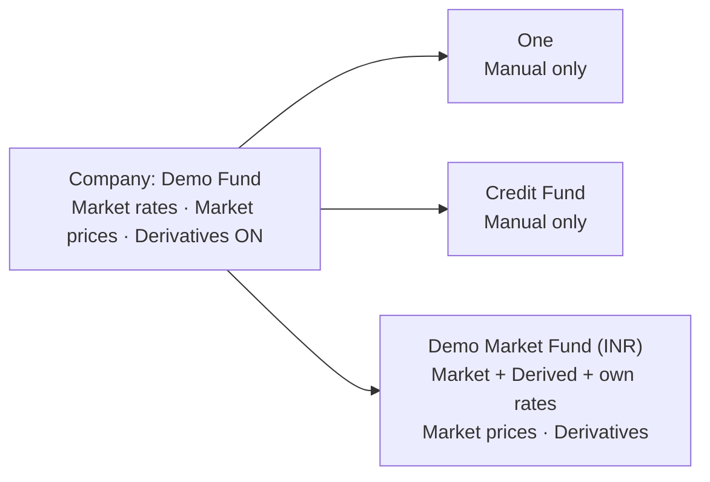
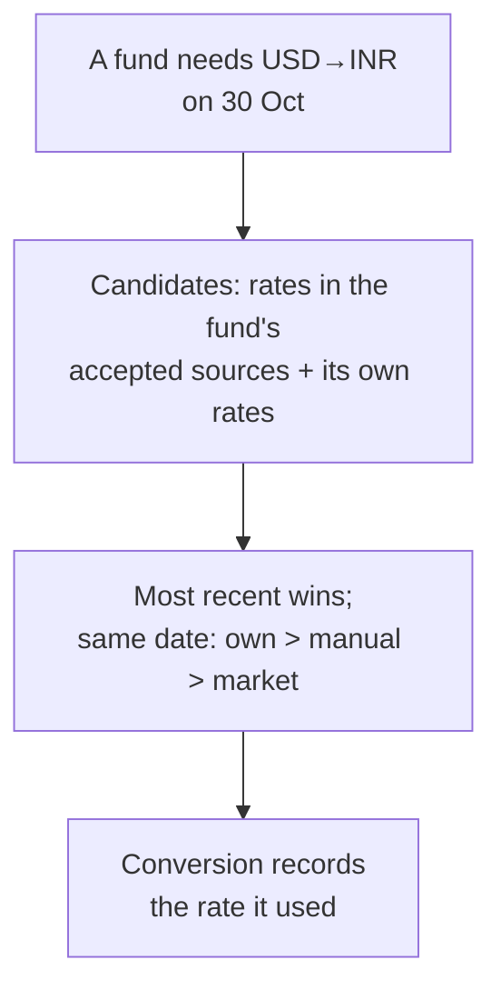
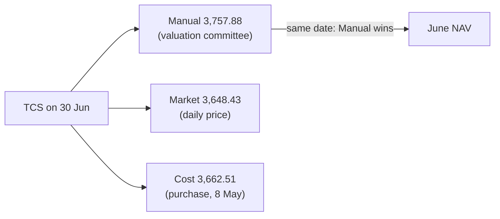
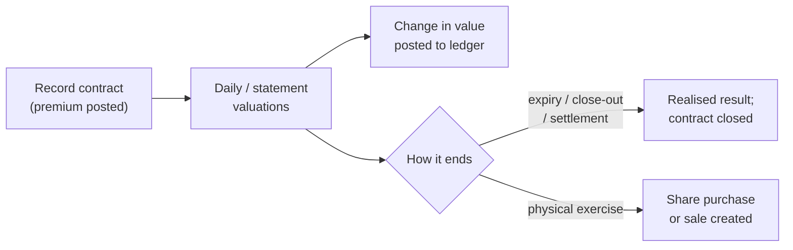

# Fund Market Data — Business Note

**Released to `main`:** 11 Oct 2026 (PR #1801) · **Audience:** product, client success, support, fund operations
**Detailed references:** [proposal](../../../openspec/changes/fund-market-data/proposal.md) ·
[business rules](../../../openspec/changes/fund-market-data/business-rules.md) ·
[user guide](../../user_guides/market_data_user_guide.md)

---

## 1. In one paragraph

A CapHive company can now run very different funds side by side — a SEBI AIF on board-approved
manual FX rates, a hybrid fund with some listed shares, and a public-market fund that wants daily
market data and holds derivatives — and each fund uses only the data it is allowed to use. Market
data features are switched on for the company by CapHive support and then chosen fund by fund. FX
rates and listed-share prices can now arrive automatically every day; every rate and price says
where it came from; and funds can record options, futures, FX forwards and swaps with their values
and ledger entries. Nothing changes for any fund until someone switches it on.



> **Every example below comes from a real demo fund**, "Demo Market Fund (INR)", built by
> `bin/rails evergreen:seed_demo_fund ENTITY_ID=<id> PORTFOLIO=public EXECUTE=1` (see
> [section 3.6](#36-see-it-in-a-demo-fund)). The figures are from one run on 11 Oct 2026 in development.
> A run elsewhere (staging, another day) gets a different fund id and slightly different figures.

---

## 2. Why we built it

| Problem before | What changes |
|---|---|
| FX rates were typed in by hand, one set for the whole company — an AIF and a public-market fund had to share them | Each fund chooses its rate sources: **Manual**, **Market** (daily feed) and/or **Derived** (reverse and cross rates). A fund can also hold its own rates |
| Listed shares were priced by hand, one value per day | Listed holdings are priced daily from NSE, BSE and AMFI files |
| A purchase overwrote that day's price with the purchase price | A purchase records a separate *Cost* price; it never overwrites a market or manual price |
| No record of where a rate or price came from | Every rate and price shows its source and provider |
| Derivatives could not be recorded at all | Options, warrants, futures, forwards, FX forwards and OTC swaps, with events, values and ledger entries |
| Fund switches (show ratios / units / portfolio / valuations to LPs, AI commentary) were scattered yes/no settings | One **Features** section per fund, built the same way as company features |

---

## 3. What a client can do now

### 3.1 Switch features on — company, then fund

- **CapHive support** ticks the company features: **Market FX rates**, **Market prices**,
  **Derivatives** (Admin → Entities).
- **The company admin** opens Company menu → **Market Data** and turns on the feeds, sets the
  cross-rate currency (default USD) and the defaults new funds start with.
- **Fund staff** open the fund → **Actions → Edit** → **Features** and tick what that fund uses.
  **Manual is always accepted** — it is how a wrong feed value is corrected and how an AIF works.

**Example — one company, three funds.** The demo company ("Demo Fund") has the three company
features on. Only the new open-ended demo fund ticks anything; its existing funds were left exactly
as they were (checked: holdings, fair values, commitments, ledger and NAVs unchanged).

| | "One" (existing closed-ended fund) | "Credit Fund" (existing) | **Demo Market Fund (INR)** (open-ended) |
|---|---|---|---|
| FX rates accepted | Manual | Manual | Manual + Market + Derived + **its own rates** |
| Prices accepted | Manual, Cost | Manual, Cost | Manual, Cost + **Market** |
| Derivatives | Off | Off | On (3 contracts) |
| LP switches | ratios, units, portfolio | units | units, portfolio, valuations |



### 3.2 FX rates

- **Daily ECB feed** for the currency pairs the company actually uses. Pairs without EUR (e.g.
  USD→INR) are worked out from the same day's ECB table and labelled *ECB via EUR*.
- **Which rate a fund uses:** the most recent rate it accepts on or before the date; on the same
  date the fund's own rate beats Manual, and Manual beats Market.
- **Derived rates** (for funds that accept them): USD→INR from INR→USD, or EUR→INR via USD.
- **Fund-specific rates:** a fund with *Use fund-specific FX rates* can hold its own manual rates
  (entered or uploaded with a *Fund* column) that only it uses.
- **Correcting a feed rate** = add a manual rate for that date.
- **Gain split:** for foreign holdings, gain is shown as **price effect + currency effect**.



**In the demo fund**

- **Market rates** were loaded for every weekday (130 days) for EUR, GBP and SGD → INR. On 9 Oct
  they were EUR→INR 95.0332, GBP→INR 103.3217 and SGD→INR 60.2335, Source *Market*, Provider *Demo*.
- **USD→INR was deliberately not loaded as a Market rate.** Market rates are company-wide, and
  another fund of the company ("Fund 1") accepts Market rates and holds USD. A company-wide USD
  rate would have changed Fund 1's values. So the demo fund converts USD with **its own weekly
  rates** instead: fund-specific rates that no other fund can see.

*Worked example — the Apple holding (the fund's one USD share):*

| | Date | Price | USD→INR used | Value in INR |
|---|---|---|---|---|
| Bought 1,000 shares | 8 May 2026 | $189.09 ($1,89,093.70) | 83.1267 (fund's own) | ₹1,57,18,735 |
| Valued | 9 Oct 2026 | $196.94 (manual) | 82.7007 (fund's own) | ₹1,62,86,944 |

Gain **₹5,68,208** = **price effect ₹6,48,762**, (196.94 − 189.09) × 1,000 × 82.70, **+ currency
effect −₹80,554**, $1,89,093.70 × (82.7007 − 83.1267). The share rose 4%, but the rupee
strengthened slightly, which took back about ₹0.8 lakh. The holding page shows both lines.

### 3.3 Prices for listed holdings

- Instruments now carry **ISIN, ticker, exchange** and a **pricing method** (Market, Model,
  Manual, Cost). Existing instruments stay **Manual**.
- **Daily price feed:** NSE and BSE closing prices (by ticker) and AMFI mutual-fund NAVs (by ISIN).
  Holdings on other exchanges (e.g. NASDAQ) stay manually priced.
- Each fund uses only the price sources it accepts; on the same date Manual beats Market beats Cost.
- **Test feed** button checks the feeds without storing anything.
- **Corporate actions:** splits, bonuses and dividends reported by NSE appear as suggestions;
  someone confirms them (creating the stock adjustment or dividend income) or dismisses them.

**In the demo fund — the portfolio on 9 Oct 2026**

| Holding | Exchange · pricing | Shares | Cost | Price used on 9 Oct | Value |
|---|---|---|---|---|---|
| Infosys | NSE · Market | 10,000 | ₹1,40,74,782 | 1,624.60 (Market) | ₹1,62,45,966 |
| Reliance Industries | NSE · Market | 10,000 | ₹1,25,59,297 | 1,222.55 (Market) | ₹1,22,25,546 |
| Tata Consultancy Services | NSE · Market | 3,000 | ₹1,09,87,534 | 3,822.05 (Market) | ₹1,14,66,159 |
| HDFC Bank | NSE · Market | 7,500 | ₹1,25,95,091 | 1,646.19 (Market) | ₹1,23,46,437 |
| State Bank of India | NSE · Market | 15,000 | ₹1,09,56,857 | 763.60 (Market) | ₹1,14,53,996 |
| ITC | **BSE** · Market | 25,000 | ₹1,17,70,008 | 396.24 (Market) | ₹99,06,048 |
| Bharti Airtel (bought Aug) | NSE · Market | 10,000 | ₹1,55,58,430 | 1,724.99 (Market) | ₹1,72,49,930 |
| Apple | **NASDAQ** · Manual | 1,000 | ₹1,57,18,735 | $196.94 (Manual) | ₹1,62,86,944 |

That's 910 Market prices (7 holdings × 130 weekdays), 32 Manual prices (Apple each week and NAV
date, plus one TCS override) and 8 Cost prices (one per purchase).

*Worked example — Manual beats Market.* On 30 Jun 2026 the Market price of TCS was **3,648.43**.
The valuation committee entered a Manual price of **3,757.88** (+3%) for the same date. The June
NAV used the Manual price: 3,000 shares × 109.45 = **₹3,28,350 more** than the Market price would
give. On every other day, with no Manual price, the fund used Market.



*Corporate actions in the demo fund:*

| Holding | Suggestion | Ex-date | Status |
|---|---|---|---|
| State Bank of India | Split 1 → 5 ("Sub-division of shares from Rs 1 to Rs 0.20") | 1 Nov 2026 | Pending — Confirm / Dismiss |
| ITC | Interim dividend ₹6.50 a share | 21 Oct 2026 | Pending — Confirm / Dismiss |
| ITC | Final dividend ₹7.85 a share | 11 May 2026 | Dismissed (never suggested again) |

### 3.4 Derivatives

- Funds with the Derivatives feature get a **Derivatives** page (fund **Actions → Derivatives**).
- Record **options, warrants, futures, forwards, FX forwards** and **interest-rate / cross-currency /
  total-return / credit-default swaps**.
- Add events: **valuation, settlement, margin, exercise, expiry, close-out**.
- **Values** come from the NSE F&O daily settlement price (listed) or the counterparty's statement
  (entered or uploaded). **CapHive does not price derivatives** — no option or swap models.
- **Ledger entries** are posted automatically (premium, change in value, realised result, margin).
- **Physical exercise** creates the share purchase (call) or sale (put).
- A contract can be marked as **hedging a holding or a share class**; the holding page shows it.

**In the demo fund — three listed contracts, valued every Friday, all traded on 8 May 2026**

| Contract | Terms | Premium | Value on 9 Oct | Ledger entries posted |
|---|---|---|---|---|
| Infosys 1,340 put, **long**, **hedges the Infosys holding** | 4 lots × 400, expires 24 Dec 2026 | ₹60,800 paid | ₹34,950 | Premium −₹60,800; Unrealised −₹25,850 (34,950 − 60,800) |
| Nifty future Jul-26, **long** | 2 lots × 75, expired 30 Jul 2026 — **closed** | none | — (settled) | Settlement −₹3,51,395; Realised −₹3,51,395; Unrealised reversed to ₹0 |
| Nifty 24,900 call, **short (written)** | 1 lot × 75, expires 24 Dec 2026 | ₹9,000 received | −₹5,174 (**liability**) | Premium +₹9,000; Unrealised +₹3,826 (9,000 − 5,174) |

The future shows the full life of a contract: weekly valuations, then an Expiry event. On expiry
the unrealised loss built up week by week is reversed, and the final cash (−₹3,51,395, the market
having fallen below the trade level) is booked as settlement and realised loss.



### 3.5 Notifications (internal only)

| Email | Who | When |
|---|---|---|
| "FX feed: no rates loaded for …" / "Price feed: no prices loaded for …" | Users tagged **FundAccounting** | Once per day when a feed misses data |
| "Suggested corporate action: …" | FundAccounting | Once per new suggestion |
| "… expires on …" | FundAccounting with access to the fund | Once, 5 business days before expiry |

**Investors see nothing new.** Their visibility switches keep working exactly as before.

### 3.6 See it in a demo fund

One rake task builds a complete open-ended (evergreen) fund with six months of history: classes A
and I, six investors, monthly dealing, approved NAVs and fees. `PORTFOLIO` picks what it holds:

| `PORTFOLIO=` | Fund it builds | Market data |
|---|---|---|
| `private` (default) | Private companies valued monthly by hand | None, as before |
| `public` | NSE/BSE listed shares + one NASDAQ share (INR fund) | Everything in this note |
| `hybrid` | The private companies beside four listed shares | Market prices for the listed ones; derivatives; corporate actions |

```
bin/rails evergreen:seed_demo_fund ENTITY_ID=<company id> PORTFOLIO=public            # dry run: prints the plan
bin/rails evergreen:seed_demo_fund ENTITY_ID=<company id> PORTFOLIO=public EXECUTE=1  # builds it
```

- **Development and staging only.** It refuses to run in production, sends no emails, and never
  calls the real feeds: prices and rates are generated and labelled Provider *Demo*.
- **Other funds are untouched.** Market data is switched on for the new fund only. Its
  instruments are its own (tickers end in `-F<fund id>`), and a company-wide Market rate is skipped
  for any currency another Market-accepting fund holds.
- **Each run creates a new fund** with a new id, named "Demo Market Fund (INR) <date time>"
  (public) or "Demo Hybrid Fund (INR) <date time>" (hybrid). Find it in the Funds list.

**Where to look** (in the new fund):

| What | Where |
|---|---|
| Fund's sources | Fund → Actions → Edit Fund → **Features** |
| Holdings, Market vs Manual prices | Fund → **Portfolio** tab; click a holding, then its instrument for the **Valuations** tab |
| USD price and currency effect | The Apple holding |
| Derivatives | Fund → Portfolio tab → **Derivatives** card, or Actions → **Derivatives**; open a contract for its **Events** and **Ledger entries** |
| Corporate actions | An instrument's **Corporate Actions** tab, or Portfolio › Corporate actions |
| Rates, run history | Company menu → **Market Data** (Run history) and **Exchange rates** |
| NAVs | Fund → **NAV** tab: A ₹1,000 → ₹1,010.22 and I ₹1,000 → ₹1,012.68 from 30 Apr to 30 Sep in the dev run. The NAV counts the share holdings; derivative values are not in it yet (see section 6) |

---

## 4. Important rules worth telling clients

- **Booked amounts never move.** Changing a fund's sources, or a new market rate, changes current
  fair values only — commitments, calls, remittances and distributions keep their booked rate.
- **Market rates never create commitment adjustments** — only manual rates do (if that option is on).
- **Market data belongs to the company that loaded it** — nothing is shared between companies.
- **Two funds can value the same holding differently** — by design, when they accept different
  sources; every value shows its source.

---

## 5. Rollout and compatibility

- **Safe by default:** existing rates and valuations become *Manual*, instruments *Manual-priced*,
  and every fund *Manual only* — no figure changes on deploy.
- **Fund switches moved, not lost:** the six old fund settings were copied into the new Features
  flags. The old database columns are **kept** (not dropped) for one release so a rollback is safe;
  a later change will remove them. Old switch names still work in uploads and the API.
- **Data finding:** production already holds a few duplicate exchange rates for the same company,
  pair and date (10 groups in the dump). The system keeps working; uniqueness is enforced by the
  application for new rates.
- **Migrations:** eight, run in order (`20261011100000` → `20261011100700`).

---

## 6. Not included yet

| Item | Status |
|---|---|
| Open-ended NAV checks (derivative lines in NAV, price/rate exception panel, NAV marked out of date when a rate changes) | Next — built on the open-ended funds branch now that this is on `main` |
| Derivative exposure limits (SEBI Cat I/II hedging-only, Cat III 2× NAV, UCITS-style counterparty caps) | Later release |
| FBIL INR reference rates | When FBIL offers a machine-readable feed |
| Licensed data vendors for non-Indian markets | Per client request |
| Cash held in other currencies; share classes in other currencies / hedged classes | Later |
| Performance tuning of rate lookups in large reports | Follow-up |

---

## 7. Quick FAQ

| Question | Answer |
|---|---|
| Will an AIF's figures change? | No. Every fund starts Manual only. |
| Who turns this on? | CapHive support (company features), then the company admin and fund staff. |
| What does it cost to run the feeds? | Nothing — ECB, NSE, BSE, AMFI and NSE F&O files are free and public. |
| Can a fund stop using manual rates? | No — manual is always accepted so a bad feed value can be corrected. |
| Does CapHive value options or swaps? | No — exchange settlement prices or counterparty statements only. |
| Where is the step-by-step test script? | `openspec/changes/fund-market-data/qa-checklist.md` |
