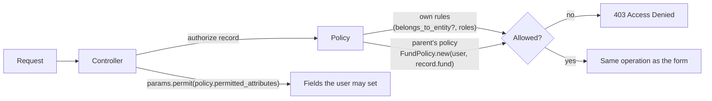

# Funds API — security fixes, planned under the Pundit policies

**Status:** plan only. Nothing here is implemented on `funds-json-api`; the security fixes will be built on
their own separate branch, from this plan.

The `funds-json-api` branch carries only the API changes. A review of the old `worktree-funds-api-review`
branch (PR #1839) found several holes that let a user write into another firm's data. The fixes on that branch
were built as controller code: an `EntityFromParent` concern, a `keeps_owner_on_update` guard in 41
controllers, and ad-hoc checks in the documents and valuations controllers. That spread the rules across
controllers and policies. This note records the holes and how each will be fixed **in the policy**, so the
policies alone decide what can and cannot be done.

## The rule

- Every "allowed / refused" decision lives in a Pundit policy. Controllers only call `authorize`.
- Use the patterns the policies already have; add no new concerns, guards or DSLs:
  - **Delegate to the parent's policy.** `AllocationRunPolicy` already does this:
    `FundPolicy.new(user, record.fund).update?`.
  - **Use Pundit's `permitted_attributes`** for fields only some users may set. The controller then permits
    `policy(record).permitted_attributes` instead of a fixed list.

## The holes, and the policy fix for each

| # | Hole | Policy fix |
|---|---|---|
| 1 | **Fund records on another firm's fund.** A create took `entity_id` from the request. A company admin could send their own firm's id with Beta's `fund_id`; `belongs_to_entity?` checked only `record.entity_id`, so it passed. This affects calls, remittances, remittance payments, distributions, distribution payments, commitments, account entries, adjustments and portfolio records. | `FundBasePolicy#create?` / `#update?` also require the record's fund to be one the user may edit: `FundPolicy.new(user, record.fund).update?` (the `AllocationRunPolicy` pattern). One method in the shared base policy covers every fund child policy. |
| 2 | **Moving a record to another firm's fund on edit** (a changed `fund_id`). | Same rule as #1. For the policy to see the new fund, `update` authorizes the record with the posted attributes applied (`assign_attributes`, then `authorize`), the standard Pundit order. |
| 3 | **Documents planted in another firm's folder.** `Document#setup_entity` re-points the document to the folder's firm after `authorize`. | `DocumentPolicy#create?` / `#update?` also require the folder to be one the user may write to, by delegating to the folder's policy. Same for a newly named owner. |
| 4 | **Valuation moved onto another firm's instrument.** | `ValuationPolicy#update?` also requires the instrument's policy to allow it. |
| 5 | **Custom notification on another firm's fund.** | `CustomNotificationPolicy#create?` also requires the owner's policy to allow `update?`. |
| 6 | **Permission granted on another firm's record.** | `PermissionPolicy#create?` also requires the owner's policy to allow it. |
| 7 | **E-signature, stamp paper, folder, access right, fee, reminder, note, notice entry on another firm's parent.** | Each policy's `create?` / `update?` delegates to its parent's policy (#1 pattern). |
| 8 | **New KYC linked to another firm's commitment.** | `InvestorKycPolicy#create?` requires the linked owner to be the same firm and investor. |
| 9 | **Privileged fields set by users who may not:** `is_erb` (runs code), KYC verification flags, approval counts / `approved`, entity `permissions`, Calculation custom fields. | Each policy's `permitted_attributes` lists them only for the users allowed (support, fund-side users, approvers). The controllers permit `policy(record).permitted_attributes`. |

## What stays exactly as on `main`

- `ApplicationPolicy#belongs_to_entity?` is unchanged. Group companies keep acting for their child firms.
- The legitimate flows keep working, because they already satisfy these rules:
  - the web forms set `entity_id` from the parent in `new`;
  - the folder pickers list only the firm's own folders;
  - the approval / notice dropdowns offer only same-firm choices.
- Same-firm moves (another of the firm's own funds or folders) stay allowed.

## Tests

The old branch's cross-firm scenarios carry over unchanged as the acceptance tests:

- writes: X1–X7, X25, X33, E1, E2, E14, E15, E21, E34;
- core / misc: X34–X50, E35–E39, E41;
- entity feature flags: X32 (a company admin cannot set `permissions`).

They are in `features/api/funds_json_api_writes.feature`, `features/api/core_misc_api.feature` and
`features/api/import_pipeline.feature` on `worktree-funds-api-review`. The scenarios keep their IDs; only the code under them moves into the policies.

## Order of work

1. `FundBasePolicy` parent check (#1, #2). It covers most of the holes and is one method.
2. Document, valuation, notification, permission and other parent checks (#3–#8).
3. `permitted_attributes` for privileged fields (#9).

Each step ships on its own with its scenarios. Design approval comes before any code.
