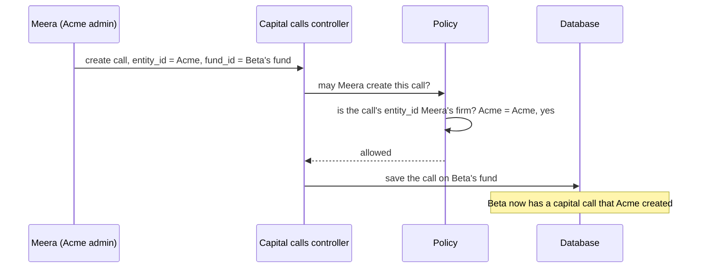
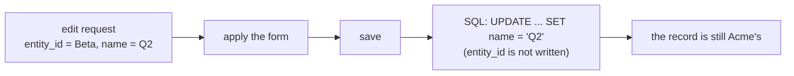
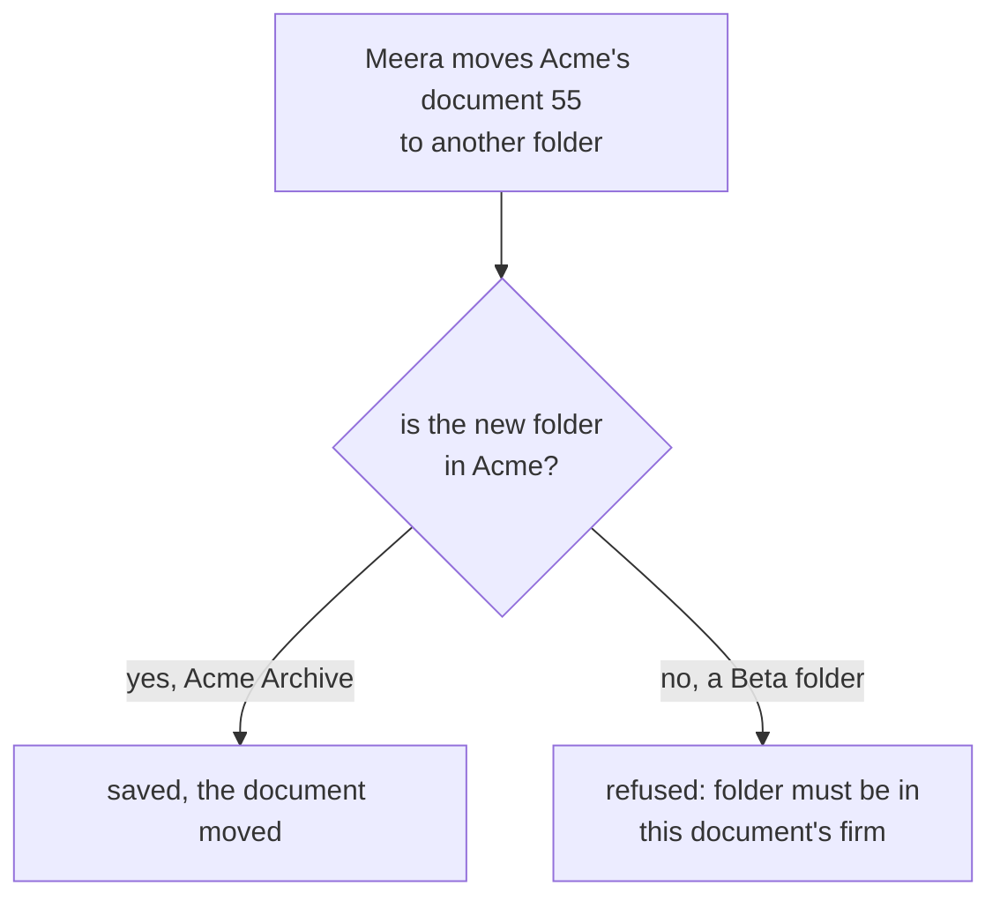
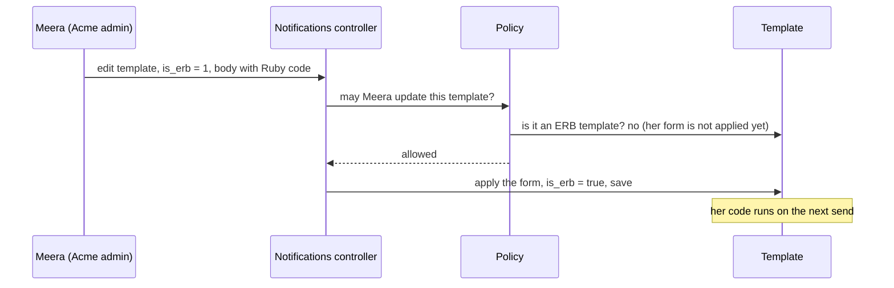
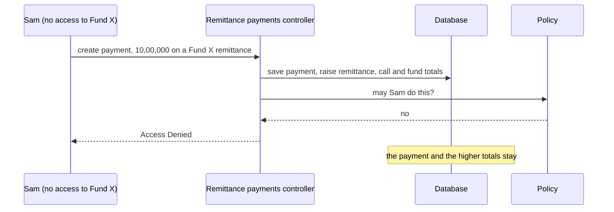
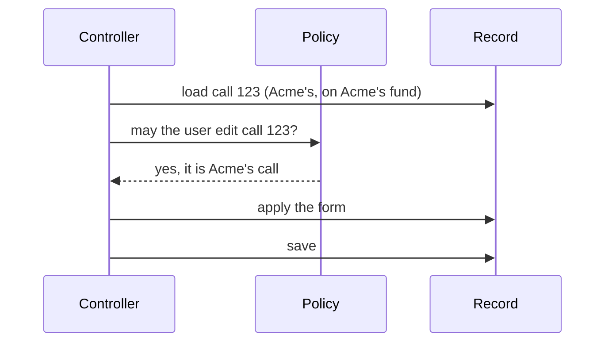

# Keeping every record inside its own firm

**Status:** design approved 2026-10-18. Built on `funds-security-policies`, not committed, awaiting code
review (see [§8](#8-what-is-on-the-branch-today)).
**This is a living document.** Update it as each part is built.

Contents

1. [The problem](#1-the-problem)
2. [The rule](#2-the-rule)
3. [The six changes, A to F](#3-the-six-changes-a-to-f)
4. [Why updates need no second permission check](#4-why-updates-need-no-second-permission-check)
5. [Which change closes which hole](#5-which-change-closes-which-hole)
6. [Where the rule must not be applied](#6-where-the-rule-must-not-be-applied)
7. [Open questions](#7-open-questions)
8. [What is on the branch today](#8-what-is-on-the-branch-today)
9. [Decisions](#9-decisions)

---

## 1. The problem

Every record in CapHive belongs to a **firm**: the column `entity_id`. Most records also hang off a **parent**:
a capital call off a fund, a document off a folder, an e-signature off a document. The parent belongs to a
firm too, and normally the two agree.

The request that creates or edits a record sends **both** values, and the permission check (the Pundit
policy) only looked at the record's own `entity_id`. So a user could state their own firm while naming
**another firm's parent**.

**Worked example.** Meera is a company admin at Acme. She sends:

```json
{ "capital_call": { "entity_id": <Acme>, "fund_id": <a fund that belongs to Beta> } }
```



The same can happen on **edit**. Meera opens one of Acme's own calls and changes its `fund_id` to Beta's
fund.

A review of the whole app (2026-10-18) found 28 holes of this kind, plus five fields that only certain users
should be able to set. They are listed in [§5](#5-which-change-closes-which-hole).

---

## 2. The rule

> **A record never changes firm. Its parent never changes, unless there is a real use case. When a parent may
> change, it must stay inside the record's firm. The policy decides who may create what.**

| | Rule |
|---|---|
| 1 | A record's `entity_id` is fixed once it is created. The one exception is a `User`, whose firm changes when an investor advisor or a support user switches firm |
| 2 | A record's parent is fixed once it is created, unless a screen legitimately moves it |
| 3 | Where a parent may move (a document to another folder), the new parent must be in the record's own firm |
| 4 | On create, the policy checks the parent's firm, not just the record's own `entity_id` |
| 5 | Fields that only some users may set are listed per user in the policy |
| 6 | Permission is always checked before anything is saved |

---

## 3. The six changes, A to F

| | Change | Where it lives | Rule |
|---|---|---|---|
| **A** | `entity_id` can't change, for every model except `User` | `ApplicationRecord`, one line | 1 |
| **B** | the parent column can't change | one line in each model that has a fixed parent | 2 |
| **C** | a parent that may move must stay in the record's firm | one validation in each of those few models | 3 |
| **D** | on create, the policy checks the parent's firm | `ApplicationPolicy`, plus one clause in each affected policy | 4 |
| **E** | the policy lists which fields each user may send | `permitted_attributes` in five policies | 5 |
| **F** | permission is checked before saving | two controllers (bug fixes) | 6 |

### A. A record's firm can't change

**What.** One line in `ApplicationRecord`, which every model inherits:

```ruby
class ApplicationRecord < ActiveRecord::Base
  # A record never moves to another firm once created
  attr_readonly :entity_id
end

class User < ApplicationRecord
  # The exception: a user's firm changes when an investor advisor or a support user switches firm
  self._attr_readonly -= ["entity_id"]
end
```

**How `attr_readonly` works.** A read-only column is written when the record is **created** and never again.
On an update, Rails leaves it out of the SQL.



**Worked example.** Meera edits an Acme call and sends `entity_id = Beta` along with a new name. The name
is saved and the firm stays Acme.

**Things to know.**

- This app uses Rails 7.0 defaults (`raise_on_assign_to_attr_readonly = false`). A changed `entity_id` is
  **silently left out**. No error is shown, which suits edit forms that re-post the same hidden value.
- `update_column(:entity_id, …)` and `update_columns(entity_id: …)` **raise an error** on a read-only
  column. Code that must re-file records under another firm uses `update_all`, which writes directly and is
  unaffected. Entity merge already does this.
- A record can't move between a group company's child firms either.

**Checked before approving** (search of every place that sets `entity_id`, 2026-10-18):

| Code | Effect |
|---|---|
| Controllers' `new` / `create`, and callbacks that set the firm before the first save | none. Inserts write every column |
| Investor-advisor switch (`investor_advisor.rb`), support switch (`support_client_mapping.rb:82,157`), `user.rb:383` | none. These change a `User` |
| Callbacks that re-set the firm on every save: `Document#setup_entity` (from the folder), `ESignature` (from the document), `StampPaper` and `NdaConfig` (from the owner) | on update the new firm is left out, and the record keeps its firm. For documents, change C refuses a move to another firm's folder |
| Controllers that set `entity_id = current_user.entity_id` during an update (notes, permissions, dashboard widgets, valuations) | left out. The firm stays as it was |
| Entity merge (`entity_merge.rb`) | none. It moves records with `update_all` |
| `entity_merge.rb:27` `old_inv.update_column(:entity_id, …)` | would raise. That line is **already broken today**: `old_inv` is undefined, since the loop variable is `old_investor`, and the method's comment says it must never be called |
| `incoming_email.rb:52` `folder.update_columns(owner_id:, owner_type:)` | none. It doesn't write `entity_id` |

### B. A record's parent can't change

**What.** Where no screen ever moves a record to another parent, the parent column becomes read-only, in the
model, next to its `belongs_to`:

```ruby
class CapitalCall < ApplicationRecord
  belongs_to :fund
  attr_readonly :fund_id   # a call never moves to another fund
```

**Worked example.** Meera edits an Acme call and sends `fund_id` = Beta's fund. The fund is left out of the
save. The call stays on Acme's fund, and the rest of her edit saves.

**Which models.**

| Parent column | Models |
|---|---|
| `fund_id` (46 fund models) | CapitalCall, CallFee, CapitalCommitment, AccountEntry, AccountEntryReportInsight, CommitmentAdjustment, CapitalRemittance, CapitalRemittancePayment, CapitalDistribution, CapitalDistributionPayment, DistributionFee, FundUnit, FundUnitSetting, FundUnitTransfer, RatioFormula, FundFormulaOperation, TieOutFigure, AllocationRun, AllocationRunReport, AllocationRunTemplate, AllocationGroupRunItem, FundReport, AggregatePortfolioInvestment, PortfolioInvestment, PortfolioCashflow, PortfolioAttribution, PortfolioScenario, ScenarioInvestment, StockConversion, ExcusedInvestor, FundNav, DealingDate, DealingOrder, DealingFill, EvergreenFundSetting, EvergreenClassTerm, EvergreenNotificationLog, DerivativeContract, DerivativeEvent, FinancialStatement, FinancialStatementAccount, FinancialStatementDefinition, FinancialStatementLayoutRow, FinancialStatementMappingRule, FinancialStatementMappingSuggestion, FinancialStatementSetting |
| `document_id` | ESignature |
| `approval_id` | ApprovalResponse |
| owner (`owner_id`, `owner_type`) | AccessRight, Reminder, StampPaper, Permission, Note, Chat, Task, CustomNotification, Valuation |
| `investor_notice_id` | InvestorNoticeEntry |
| `kanban_board_id` | KanbanColumn, KanbanCard |
| `form_type_id` | FormCustomField |
| `secondary_sale_id` | Offer, Interest, Allocation |
| `investment_opportunity_id` | ExpressionOfInterest |
| `deal_id` | DealInvestor, DealActivity |
| `kpi_report_id` | Kpi |
| `portfolio_company_id` | Investment (startups), KpiReport |
| `investment_instrument_id` | Valuation |
| `capital_commitment_id` | SideLetter, AccountEntry |
| `capital_call_id` | CallFee |
| `capital_distribution_id` | DistributionFee |
| source (`sourceable_id`, `sourceable_type`) | SideLetterObligation |

**Three edit forms show a fund dropdown. Why, and what to do (checked 2026-10-18).** Fund reports,
portfolio scenarios and allocation run templates show a fund dropdown on their edit page. In all three, the
dropdown exists for **creating** a record. It appears on Edit only because New and Edit share one `_form`
partial, and none of them hides it for an existing record. Nothing in their history or code points to a "move
to another fund" feature.

| Form | Added | Why the dropdown is there on New | What it does on Edit |
|---|---|---|---|
| Fund reports (`fund_reports/_form.html.erb:16-26`) | 2023-04-30, the scaffold that created fund reports (`be6a3a3c8`) | New is always opened from a fund (`new_fund_report_path(fund_id: …)`), and the form then lists only that fund: a single choice | `params[:fund_id]` is absent, so it lists every fund of the firm. A scaffold leftover |
| Portfolio scenarios (`portfolio_scenarios/_form.html.erb:20-21`) | 2023-08-01, "Portfolio scenarios" (#71) | `new` ignores the `fund_id` in the link (`portfolio_scenarios_controller.rb:22-25` sets only `entity_id`), so the dropdown is the only way to pick the fund | same dropdown, because the form is shared |
| Allocation run templates (`allocation_run_templates/_form.html.erb:47-50`) | 2026-09-05, "Allocation templates" (#1667) | New is opened from the templates list, not from a fund, so the user picks the fund. Picking it reloads that fund's documents (`allocation_run_template_form_controller.js` `fundChanged`) | changing the fund clears the document picker. The template's settings were built for the old fund, so a fund change on edit would leave them inconsistent |

**So:** on New the dropdown is needed. On Edit it is an accident of the shared form, and using it would leave a
template's documents and formulas pointing at the old fund. That supports read-only `fund_id`.

**Matching UI change (proposed).** Every edit page that offers a dropdown for a parent that B makes read-only
should stop offering it. Show the dropdown only for a new record, and on Edit show the parent's name as plain
text. Otherwise the user picks a value that is silently ignored.

| Form | Dropdown on Edit | Change |
|---|---|---|
| Fund reports (`fund_reports/_form.html.erb:24-25`) | fund | name as text on Edit |
| Portfolio scenarios (`portfolio_scenarios/_form.html.erb:20-21`) | fund | name as text on Edit |
| Allocation run templates (`allocation_run_templates/_form.html.erb:47-50`) | fund | name as text on Edit |
| Investments (`investments/_form.html.erb:15-17`) | portfolio company | name as text on Edit |
| KPI reports (`kpi_reports/_form.html.erb:215-216`) | portfolio company (disabled only when the report is read-only) | name as text on Edit |
| Valuations (`valuations/_form.html.erb:51-54`) | instrument (Edit has its own single-instrument dropdown; New picks several) | name as text on Edit |
| Side letters (`side_letters/_form.html.erb:16-17`) | capital commitment | name as text on Edit |
| Side-letter obligations (`side_letter_obligations/_form.html.erb:53-55`) | source portfolio investment | name as text on Edit |

Eight small view changes.

### C. A parent that may move must stay in the record's firm

**Why B isn't enough here.** Some parents legitimately change on edit:

- a document moves from *Acme › Q1 Reports* to *Acme › Archive*;
- a kanban card is dragged to another column.

Making those columns read-only would break real screens. The policy can't catch a bad move either: it runs
before the form is applied, so it never sees the new parent ([§4](#4-why-updates-need-no-second-permission-check)).

**What.** One validation per model: the new parent must be in the record's own firm. Because of A, the
record's firm can't change, so the target can't be faked.

```ruby
class Document < ApplicationRecord
  # A document can move between its own firm's folders, never into another firm's
  validate { errors.add(:folder, "must be in this document's firm") if folder && folder.entity_id != entity_id }
```

**Worked example.**



Before this change, the second case moved the document **into Beta's data room**. `Document#setup_entity`
copies the folder's firm onto the document on every save.

**Which models.**

| Model | Parent that may move | Must be |
|---|---|---|
| Document | folder | a folder of the document's firm |
| Folder | parent folder | a folder of the same firm |
| KanbanCard | column | a column on the card's own board |
| Allocation (secondaries) | offer, interest | an offer and interest of the allocation's own sale |
| InvestorNotice | owner (can be set later on a notice saved without one) | a record of the notice's firm |

### D. On create, the policy checks the parent's firm

**Why this works without touching controllers.** Every create action builds the record from the form
first, then asks the policy:

```ruby
def create
  @capital_call = CapitalCall.new(capital_call_params)   # fund_id from the form
  authorize @capital_call                                # the policy sees that fund
```

So on create, the policy can see the parent the user named.

**What.** One shared helper in `ApplicationPolicy`, written once:

```ruby
# The user's own firm, or a child firm of their group company
def users_firm?(user, entity_id)
  user.entity_id == entity_id || (user.entity_type == "Group Company" && user.entity.child_ids.include?(entity_id))
end

def belongs_to_entity?(user, record)          # unchanged behaviour, now uses the helper
  users_firm?(user, record.entity_id)
end

# The parent a record hangs off is in one of the user's firms. No parent: nothing to check.
def parent_in_users_firms?(parent)
  parent.nil? || users_firm?(user, parent.is_a?(Entity) ? parent.id : parent.entity_id)
end
```

Then two kinds of policy use it:

1. **Fund records.** Their policies go through `permissioned_employee?`. One change there checks the record's
   fund. It finds the fund through `model_with_access_rights` (the 20 `ForInvestor` fund models), or else
   `record.fund` (the other fund models).
2. **Policies with their own shortcut**: documents, folders, e-signatures, stamp papers, permissions, notes,
   chats, tasks, notices, notice entries, custom notifications, approvals, KYC links, investments, kanban,
   custom fields, KPIs, instruments, side letters, CI widgets, deal activities, and secondary-sale offers. Each
   adds one clause naming its parent:

   ```ruby
   def create?
     belongs_to_entity?(user, record) && parent_in_users_firms?(record.folder)   # DocumentPolicy
   end
   ```

**Worked examples.**

| Who | Creates | Result |
|---|---|---|
| Meera, Acme admin | a call on Acme's fund | allowed |
| Meera | a call on Beta's fund, stating `entity_id` = Acme | **refused**: the fund is Beta's |
| Sam, Acme employee with access on Acme's fund | a call on that fund | allowed |
| An Acme Group admin (group company) | a call on its child firm Acme India's fund | allowed: child firms are the user's firms |
| Meera | a document in a Beta folder | **refused** |
| Meera | a custom field on Beta's form type | **refused** |
| Support | anything | allowed, as before |

### E. The policy lists which fields each user may send

**The problem.** A few fields are powerful, and only certain users may set them:

| Field | Who may set it | What goes wrong if anyone can |
|---|---|---|
| `is_erb` on an email template | support | the email body runs as **Ruby code** on our servers when the email is sent |
| `verified`, `pan_verified`, `bank_verified` on a KYC | the fund team | an investor marks their own KYC as verified |
| `approved` and the counts on an approval | approvers, through the Approve button | anyone with edit access approves, or fakes the vote counts |
| `permissions` on an entity | support | a client switches on paid features for themselves |
| a **Calculation** custom field | support | its formula runs as code |
| a fund formula's `formula`, `is_template` | support | the formula is Ruby code, run with `eval` during allocations |
| a fund formula's `meta_data` | support | its `scope` key is called as a method by name, and its `where` key is pasted into SQL (see below) |
| a fund formula's `rule_type` | support (to confirm) | it decides how support's formula code is run |

Today these are protected only by **hiding them on the screen**. For example, the template form shows the
"Dynamic Template" (`is_erb`) toggle only to support (`custom_notifications/_form.html.erb:377`). But the
server still **accepts** the field from anyone. The controller's list of accepted fields includes `:is_erb`
for every user (`custom_notifications_controller.rb:83`).

**The hole, step by step.** Meera edits Acme's capital-call email template, a normal, non-ERB template.

1. The ERB toggle isn't shown to her.
2. With the browser's developer tools, or her API token, she submits the form with `is_erb = 1` and a body
   containing Ruby code.
3. The controller asks the policy whether she may update the template. The rule is
   `(record.is_erb ? support? : create?)`, meaning "an ERB template is support-only". But it reads `is_erb`
   from the template **as it is now**, which is `false`, because her form hasn't been applied yet. So it allows
   her.
4. The form is applied (`is_erb` becomes `true`) and saved.
5. Her code runs the next time the email is sent.



The same gap lets an investor switch on `pan_verified` for their own KYC.

**Fund formulas: half done today, and `meta_data` is open.** Only support may create a formula
(`FundFormulaPolicy#create?` is `support?`), but company admins and permitted employees may edit one
(`update?` is `permissioned_employee?(:update)`). The controller already drops the code field for them, by hand
(`fund_formulas_controller.rb:209-215`):

```ruby
if current_user.support? || Rails.env.local?
  # Only support can change the formula
  params.require(:fund_formula).permit(..., :formula, ..., :is_template, ...)
else
  params.require(:fund_formula).permit(..., :rule_type, :meta_data, :rule_for, :ai_generated, ...)   # no :formula
end
```

So `formula` is safe. But two fields that normal users **can** still send also run as code:

- **`meta_data` → `scope`** (`allocate_master_fund_account_entries.rb:95-97`):
  ```ruby
  master_fund_account_entries = master_fund_account_entries.send(fund_formula.meta_data_hash["scope"].strip)
  ```
  `.send(name)` calls **any method** by name on the master fund's account entries. It's meant for a named filter
  such as `for_portfolio_investments`. **Example:** Meera, a company admin, edits a feeder fund's formula and
  sets `meta_data` to `scope: delete_all`. On the next allocation run, that line runs
  `master_fund_account_entries.delete_all`, which deletes those account entries directly, with no callbacks and no
  audit trail.
- **`meta_data` → `where`** (`allocate_for_portfolio_company.rb:37`):
  ```ruby
  portfolio_companies = portfolio_companies.where(fund_formula.meta_data_hash["where"])
  ```
  A string given to `.where` is **raw SQL**, so Meera's text goes straight into a database query.

`rule_type` (`run_formula.rb:54`) chooses how support's formula code is run: as an allocation, a generated
entry, a custom field, and so on. A normal user changing it makes support's code run in a context it wasn't
written for.

The remaining fields only steer the run, not the code: `name`, `description`, `sequence`, `enabled`,
`entry_type`, `roll_up`, `rule_for`, `tag_list`, `explain`, `generate_ytd_qtly`, `add_to_commitment_cache`,
`ai_generated`. Normal users keep them.

**The fix.** Pundit, the policy library we already use, has `permitted_attributes`. The policy returns the
fields **this user** may send, and the controller accepts only those:

```ruby
class CustomNotificationPolicy < ApplicationPolicy
  def permitted_attributes
    fields = [:subject, :body, :whatsapp, :for_type, :email_method, :enabled, ...]   # everyone who may edit
    fields << :is_erb if user.support?                                              # only support may send is_erb
    fields
  end
end
```

```ruby
# controller, before
params.require(:custom_notification).permit(:subject, :body, ..., :is_erb, ...)
# controller, after
permitted_attributes(@custom_notification)
```

Meera's `is_erb = 1` is now dropped before it reaches the template. Her other changes save, and support is
unaffected.

**Where.** Six policies, and one line in each of their controllers:

| Policy | Field listed only for |
|---|---|
| CustomNotificationPolicy | `is_erb`: support |
| InvestorKycPolicy | `verified`, `pan_verified`, `bank_verified`: fund-side users |
| ApprovalPolicy | `approved`, the counts: never through edit (they change only through Approve) |
| EntityPolicy | `permissions`: support |
| FormCustomFieldPolicy | `field_type = Calculation`: support |
| FundFormulaPolicy | `formula`, `is_template`, `meta_data`, `rule_type`: support. This moves today's hand-written split in `fund_formulas_controller.rb:209-215` into the policy, and adds `meta_data` and `rule_type` |

### F. Permission is checked before saving

**What should happen.** An action builds the record, asks the policy, and **only if allowed** saves it. When
the policy says no, nothing is written.

**Two controllers save first and ask afterwards.**

Remittance payments (`capital_remittance_payments_controller.rb:30-33`):

```ruby
def create
  @capital_remittance_payment = CapitalRemittancePayment.new(capital_remittance_payment_params)
  result = CapitalRemittancePaymentCreate.call(capital_remittance_payment: @capital_remittance_payment)  # SAVES
  authorize(@capital_remittance_payment)                                                               # asks AFTER
```

**Worked example.** Sam, an Acme employee with no access to Fund X, posts a ₹10,00,000 payment against a
remittance in Fund X.



Sam sees "Access Denied", but the payment row and the raised totals are already in the database.

Kanban cards (`kanban_cards_controller.rb:26-29`) do the same: `KanbanCard.create!` inserts the card, then
`authorize` runs.

**The fix.** Swap the order:

```ruby
@capital_remittance_payment = CapitalRemittancePayment.new(capital_remittance_payment_params)
authorize(@capital_remittance_payment)                                                               # ask first
result = CapitalRemittancePaymentCreate.call(capital_remittance_payment: @capital_remittance_payment) # then save
```

```ruby
@kanban_card = KanbanCard.new(kanban_card_params)
authorize @kanban_card
authorize @kanban_card.kanban_board
@kanban_card.save!
```

---

## 4. Why updates need no second permission check

On an edit, the controller asks the policy **before** applying the form:



A policy only receives the record, never the form. When it runs, the form's changes haven't been applied, so it
can't see a new fund, folder or flag. Catching those in the policy would need a second `authorize` after the
form is applied, in about 40 update actions.

The design avoids that:

| What an edit could try | Stopped by |
|---|---|
| change the record's firm | **A**: `entity_id` can't change |
| move it to another parent | **B**: the parent can't change |
| move it to another firm's parent, where moves are allowed | **C**: the new parent must be in the record's firm |
| set a field only certain users may set | **E**: the field isn't accepted from that user |

The single permission check in each controller's `set_…` method then only needs to answer whether this user may
edit **this** record, which it already does.

---

## 5. Which change closes which hole

| # | Hole | On | Closed by |
|---|---|---|---|
| 1 | Fund record (call, remittance, payment, distribution, commitment, account entry, adjustment, portfolio record, …) created on another firm's fund | create | D |
| 2 | Fund record moved to another firm's fund | edit | B + A |
| 3 | Any record's firm changed | edit | A |
| 4 | Remittance payment saved before permission is checked | create | F |
| 5 | Portfolio cashflow, stock adjustment / conversion, scenario investment, KPI report: the check never looked at their real parent; a KPI report moved to another portfolio company | both | D + B |
| 6 | Document uploaded into another firm's folder | create | D |
| 7 | Document moved into another firm's folder | edit | C + A |
| 8 | Folder created under, or moved into, another firm's folder | both | D + C + A |
| 9 | E-signature on another firm's document | create | D + B |
| 10 | Stamp paper, permission, note, chat or task on another firm's record | create | D + B |
| 11 | Reminder, access right or approval response re-pointed to another record | edit | B + A |
| 12 | Custom notification on another firm's fund | create | D + B |
| 13 | Approval created on another firm's fund | create | D |
| 14 | Investor notice entry for another firm's notice or investor | create | D + B |
| 15 | New KYC linked to another firm's commitment | create | D |
| 16 | Valuation put on, or moved to, another firm's instrument | both | D + B |
| 17 | Startup investment: no firm check at all; moved to another portfolio company | both | D + B + A |
| 18 | Kanban card saved before permission is checked; card or column on another firm's board; card moved to another board's column | both | F + D + B + C |
| 19 | Custom field added to another firm's form type | create | D + B |
| 20 | KPI, KPI mapping, instrument, side letter, CI widget, track record or deal activity on another firm's parent | create | D |
| 21 | Side letter's commitment, or an obligation's source, switched to another firm's | edit | B |
| 22 | Secondary-sale offer with a stated firm; allocation pointing at another sale's offer or interest | both | D + B + C |
| 23 | ERB email template (runs code) set by a non-support user | both | E |
| 24 | Approval approved, or its counts set, by a non-approver | edit | E |
| 25 | Investor marks their own KYC verified | edit | E |
| 26 | Company admin switches the firm's feature flags | edit | E |
| 27 | Calculation custom field created by a non-support user | both | E |
| 28 | Investor notice given another firm's record as owner | edit | C |
| 29 | Fund formula `meta_data` set by a normal user: `scope` calls any method (e.g. `delete_all`), `where` injects SQL | edit | E |
| 30 | Fund formula `rule_type` changed by a normal user, so support's code runs in another context | edit | E |

---

## 6. Where the rule must not be applied

Some columns point at **another firm on purpose**. Checking them against the user's firm would break real
flows:

| Column | Why it is another firm |
|---|---|
| Offer `investor_id` | the seller's investor record |
| Interest `investor_id`, `interest_entity_id` | the buyer |
| ExpressionOfInterest `investor_id`, `eoi_entity_id` | the investor expressing interest |
| ApprovalResponse `response_entity_id` | the investor responding |
| InvestorNoticeEntry `investor_entity_id` | the investor's own firm |
| Documents a deal investor uploads into the deal firm | an outside investor uploading by design |
| KPI reports filed by a portfolio company's own user | the portfolio company's firm |
| Folder owner | re-assigned by code (`incoming_email.rb:52`), so not read-only |

For the investor columns, the right check is "the investor record belongs to the parent's firm". These rows
are excluded from A–F.

---

## 7. Open questions

| Question | Why it matters |
|---|---|
| Is a firm-level fund formula or fund ratio (no fund) ever given a fund later? | If never, `fund_id` becomes read-only on FundFormula and FundRatio too |
| Can a document's owner change (for example, re-attached to another commitment)? | If never, the document's owner becomes read-only (B) |
| Is a kanban board's owner ever changed? | Same |
| Should a fund formula's `rule_type` be support-only? | It decides how support's formula code runs. Proposed: yes |

---

## 8. What is on the branch today

**Built on `funds-security-policies` (2026-10-18), not committed, awaiting code review. Tests not run yet.**

| Change | Where |
|---|---|
| **A** | `ApplicationRecord`: `attr_readonly :entity_id`, plus the shared `validate_parent_in_own_firm` helper (for C). `User`: opts out |
| **B** | `attr_readonly` after the `belongs_to` in 75 places: `fund_id` (46 fund models), `capital_call_id` (CallFee), `capital_distribution_id` (DistributionFee), `capital_commitment_id` (AccountEntry, SideLetter), `document_id`, `approval_id`, owner columns (8 models), `investor_notice_id`, `kanban_board_id`, `form_type_id`, `secondary_sale_id`, `investment_opportunity_id`, `deal_id`, `kpi_report_id`, `portfolio_company_id`, `investment_instrument_id`, `sourceable` |
| **C** | Document (folder), Folder (parent), InvestorNotice (owner) through `validate_parent_in_own_firm`; KanbanCard (column on its own board) and Allocation (offer and interest in its own sale) with their own checks |
| **D** | `ApplicationPolicy`: `users_firm?`, `parent_in_users_firms?`; `permissioned_employee?` checks the governing record **and** `record.fund`. One parent clause in 29 policies: document (folder, or the owner's firm for owner uploads), folder, e-signature, stamp paper, permission, note, chat, task, notice, notice entry, custom notification, approval, investment, kanban column and card, form custom field, KPI, KPI report, KPI mapping, instrument, side letter, CI widget, track record, deal activity, deal investor, expression of interest, allocation run template and report, valuation |
| **E** | `permitted_attributes` in CustomNotificationPolicy (`is_erb`), ApprovalPolicy (`approved` and counts never), EntityPolicy (`permissions`), FormCustomFieldPolicy (Calculation on create; `field_type` of an existing field), FundFormulaPolicy (`formula`, `meta_data`, `rule_type`, `is_template`), InvestorKycPolicy (verification flags). Each controller's params method asks its policy for the list |
| **F** | `CapitalRemittancePaymentsController#create` and `KanbanCardsController#create`: `authorize` before saving |
| UI | Eight edit forms show the fixed parent as a disabled text box on Edit, instead of a dropdown: fund reports, portfolio scenarios, allocation run templates, investments, KPI reports, valuations, side letters, side-letter obligations |
| Removed | the earlier trial's `attr_readonly … if parent_class_type == Fund` line in `ForInvestor` |
| Test | `features/security/fund_records_firm_policy.feature` X33 now expects the move to be ignored (the call stays on its fund) |

**Behaviour changes to look at in review**

| Change | Who notices |
|---|---|
| A normal user can no longer change an existing custom field's type (only support can) | anyone who edits a field's type after creating it |
| A fund formula's `rule_type` is support-only (it was proposed, §7) | company admins editing a formula's rule type |
| A task, note or chat can't be re-pointed to another owner | if any screen moves a task between records |
| Creating an invalid kanban card answers with the form and its errors (it raised a server error, because `create!` was used) | nobody in normal use |

**Not built yet**

| Item | Why |
|---|---|
| New KYC linked to another firm's commitment (D) | `InvestorKycCreate` links the owner **after** `authorize`. The owner must be set on the record before `authorize`, a change to that service |
| Secondary-sale offer created by an investor with a stated firm (D) | the investor sub-policy and the controller need a separate look |
| FundFormula / FundRatio with no fund; document and kanban board owners | open questions in §7 |

---

## 9. Decisions

| Date | Decision | Why |
|---|---|---|
| 2026-10-18 | Firm rules are decided by the policies; no controller guards or new concerns | The controller-based fixes on PR #1839 were complex and in the wrong place |
| 2026-10-18 | Create: the policy checks the parent's firm (D) | Create actions already authorize the record built from the form, so no controller changes |
| 2026-10-18 | No second permission check on update | It would mean a second `authorize` in about 40 controllers. A, B, C and E remove the need |
| 2026-10-18 | No record ever changes firm, except `User` (A) | No use case. Advisor and support switches change the user's firm |
| 2026-10-18 | Fixed parents are read-only in each model, not in `ForInvestor` (B) | `ForInvestor` is about investor access and covered only 20 of 50 fund models |
| 2026-10-18 | Documents, investments, kanban and custom fields never move between firms. Parents that move inside a firm must stay in it (C) | No use case for moving between firms |
| 2026-10-18 | An investment and a KPI report never move to another portfolio company, and a valuation never moves to another instrument (B, not C) | No use case |
| 2026-10-18 | A side letter's commitment and an obligation's source never change (B, not C) | No use case |
| 2026-10-18 | Fields that only some users may set use Pundit's `permitted_attributes` (E) | Keeps the rule in the policy, with one `authorize` |
| 2026-10-18 | A fund formula's `formula`, `is_template` and `meta_data` are support-only, through `permitted_attributes` (E). `rule_type` proposed | They run as code (`eval`, `.send`, raw SQL). Normal users may still edit the formula's other fields |
| 2026-10-18 | The two save-before-authorize controllers are fixed (F) | Plain bugs: a refused request still wrote data |
| 2026-10-18 | No "the record's firm must equal its fund's firm" rule | Group-company data filed under a sibling child firm is untidy, not cross-firm access |
