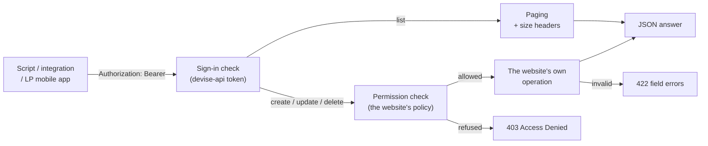
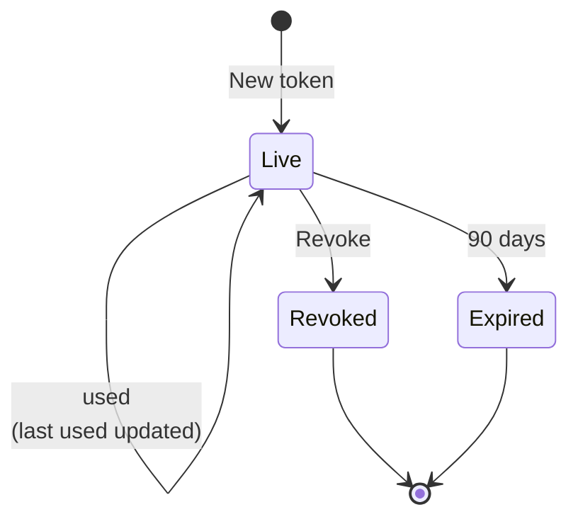
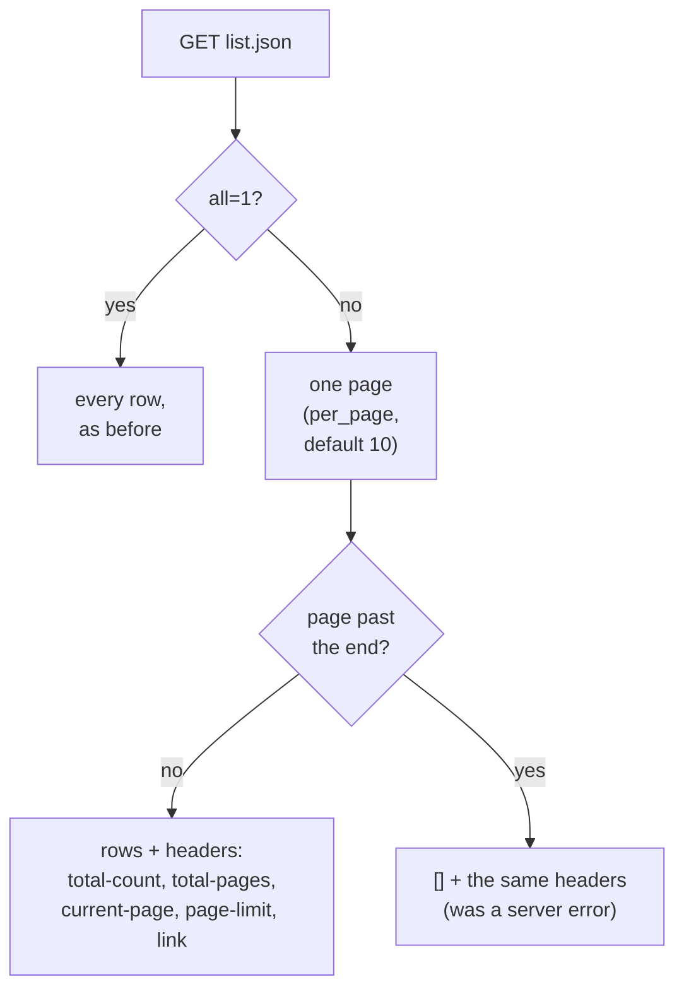

# Funds JSON API — reference

The fund pages' own `.json` endpoints, used with a bearer token. There is **no separate API**: every
request runs the same controller action and the same business operation as the website form, so
the API can never drift from what the screens do.

**Backward compatible.** Existing clients see no changed behaviour: every status code, body, row
count and `per_page` / `all` result they got before is unchanged. What is new is additive (fields,
paging headers, the summary and statement endpoints, the API tokens screen) or replaces a failure
(a server error, or a redirect sent to a JSON caller) with a working answer.

The H/E/X IDs below name the Cucumber scenarios in `features/api/`. The cross-firm security fixes are a
separate change, planned under the Pundit policies: see
[funds_api_security_policy_plan.md](funds_api_security_policy_plan.md).



---

## 1. Getting a token

| Who | How |
|---|---|
| Any website user, including fund admins with two-factor on | **Profile › API tokens › New token**. Name it, copy it — it is shown once. |
| LP mobile app | Signs in through `/api/mobile/v1/session` (its own flow). |

- A token **acts as its user**: same funds, same permissions, nothing more.
- It **lives 90 days** and is **never refreshed** (`/users/tokens/refresh` answers 403
  `use_website_token`). Make a new one when it expires.
- **Revoke** on Profile › API tokens stops it immediately (next call: 401).
- At most **10 live tokens** per user.
- A token can't create, list or revoke tokens — that needs the website session.



Every request:

```
Authorization: Bearer <token>
Content-Type: application/json
Accept: application/json
```

---

## 2. Endpoints

All are the website's routes with `.json`. Lists take the website's filters (`fund_id`,
`capital_call_id`, `capital_commitment_id`, ransack `q[...]`).

| Resource | List | Show | Create | Update | Delete |
|---|---|---|---|---|---|
| Funds | `GET /funds.json` | `GET /funds/:id.json` | `POST /funds.json` | `PATCH /funds/:id.json` | `DELETE /funds/:id.json` |
| **Fund summary** | — | `GET /funds/:id/summary.json` | — | — | — |
| **Recompute totals** | — | — | — | `PATCH /funds/:id/recompute_totals.json` (202) | — |
| Capital commitments | `GET /capital_commitments.json` | `GET /capital_commitments/:id.json` | `POST` | `PATCH` | `DELETE` |
| **Commitment statement** | — | `GET /capital_commitments/:id/statement.json` | — | — | — |
| Commitment adjustments | `GET /commitment_adjustments.json` | `GET /commitment_adjustments/:id.json` | `POST` | `PATCH` | `DELETE` |
| Capital calls | `GET /capital_calls.json` | `GET /capital_calls/:id.json` | `POST` | `PATCH` | `DELETE` |
| Capital remittances | `GET /capital_remittances.json` | `GET /capital_remittances/:id.json` | `POST` | `PATCH` | `DELETE` |
| Remittance payments | `GET /capital_remittance_payments.json` | `GET …/:id.json` | `POST` | `PATCH` | `DELETE` |
| Capital distributions | `GET /capital_distributions.json` | `GET …/:id.json` | `POST` | `PATCH` | `DELETE` |
| Distribution payments | `GET /capital_distribution_payments.json` | `GET …/:id.json` | `POST` | `PATCH` | `DELETE` |
| Account entries | `GET /account_entries.json` | `GET /account_entries/:id.json` | `POST` | `PATCH` | `DELETE` |
| Fund units | `GET /fund_units.json` | `GET /fund_units/:id.json` | — | — | — |
| Fund ratios | `GET /fund_ratios.json` | `GET /fund_ratios/:id.json` | — | — | — |
| Valuations | `GET /valuations.json` | `GET /valuations/:id.json` | `POST` | `PATCH` | `DELETE` |
| Import uploads | `GET /import_uploads.json` | `GET /import_uploads/:id.json` | `POST` | — | `DELETE /import_uploads/:id/delete_data.json` (202) |
| Entities | — | `GET /entities/:id.json` | — | `PATCH` | — |

Request bodies wrap the record in its name, exactly as the form posts it:

```json
POST /capital_calls.json
{"capital_call": {"fund_id": 42, "name": "Q2 call", "percentage_called": 10,
  "call_date": "2026-10-20", "due_date": "2026-11-20",
  "call_basis": "Percentage of Commitment", "fund_closes": ["All"]}}
```

### Write rules

- A write is checked by **the same policy as the website form** — what the form may do, the API may
  do; nothing more.
- A create **runs the same operation as the form**: remittances are generated, notifications sent,
  journeys advanced — exactly as on screen (H1, H3).
- Send the record's `entity_id` as the form does (the firm of its fund). Tightening how the firm is
  checked is planned under the policies — see
  [funds_api_security_policy_plan.md](funds_api_security_policy_plan.md).

### Fund summary — `GET /funds/:id/summary.json`

The figures on the fund's overview, in major units:

```json
{"id": 42, "name": "Acme Growth Fund I", "currency": "INR", "tracking_currency": "USD",
 "committed_amount": 300000000.0, "call_amount": 90000000.0, "collected_amount": 85000000.0,
 "due_amount": 5000000.0, "distribution_amount": 0.0,
 "tracking_committed_amount": 3600000.0, "...": "...",
 "capital_commitments_count": 3, "capital_calls_count": 1, "capital_distributions_count": 0}
```

`due_amount = call_amount − collected_amount` (90,000,000 − 85,000,000 = 5,000,000).

### Commitment statement — `GET /capital_commitments/:id/statement.json`

One folio: its remittances per call (called, collected, due), payments, distribution payments and
**ledger totals by entry type** (never the entries — page them from `/account_entries.json?capital_commitment_id=`).
An investor sees only their own folios.

```json
{"folio_id": "AGF-007", "currency": "INR", "folio_currency": "INR",
 "call_amount": 30000000.0, "collected_amount": 30000000.0, "due_amount": 0.0,
 "remittances": [{"call_name": "Q1", "call_amount": 30000000.0, "collected_amount": 30000000.0, "due_amount": 0.0}],
 "remittance_payments": [{"payment_date": "2026-10-21", "amount": 15000000.0}, {"payment_date": "2026-10-22", "amount": 15000000.0}],
 "distribution_payments": [],
 "ledger_totals": {"NAV": 1500.0, "Fee": 200.0}}
```

### Currency

Capital calls, distributions and remittance payments carry `currency` — the fund currency of their
amounts (`folio_*` amounts are in `folio_currency`).

---

## 3. Lists: paging



- The body is always a **plain JSON array**; paging information is in the headers.
- Follow `link` (`rel="next"`) until it's absent. A page past the end is `[]` with the real totals.
- `per_page` behaves exactly as before: `0` or negative uses the default (10), and the app's own
  limit of 1,000 rows per page still applies.
- `all=1` returns every row, exactly as before — there is no row cap.
- `/funds.json` and `/capital_distributions.json` now page for API callers (both answered a
  server error for any non-empty list before).
- Website requests (session, no token) are unchanged.

---

## 4. Errors

Every error answer is the one the app already gave; only server errors and redirects sent to
JSON callers were replaced with a JSON answer.

| Status | When | Body |
|---|---|---|
| 400 | The record's object is missing (`{}` instead of `{"capital_call": …}`) | Rails' standard 400 answer, the same as every other endpoint (capital calls gave a server error here before) |
| 401 | Token missing, wrong, expired or revoked | devise-api's answer |
| 403 | Not allowed (another firm's record, no fund access) **or no such record** | `{"error": "Access Denied"}` |
| 422 | Validation / business rule | the record's errors: `{"due_date": ["can't be blank"]}` |
| 422 | Deleting a remittance whose units are allocated (was a redirect) | `{"base": ["Cannot delete this remittance as units have already been allocated for payments …"]}` |
| 422 | Deleting a remittance payment that is refused (was a server error) | the payment's errors |

---

## 5. For the client-onboarding agent

| Need | Field / reply |
|---|---|
| Did the import work? | `GET /import_uploads/:id.json` → `outcome` (`running` / `succeeded` / `partially_failed` / `failed`), `total_rows_count`, `processed_row_count`, `failed_row_count`, `row_errors` (first 20 failed rows: `{row, message}`), `custom_fields_created`, `results_url`. `status` is unchanged — it can say "Completed" even when rows failed, so read `outcome`. |
| Is the entity in sandbox? | `GET /entities/:id.json` → `entity_setting` {`id`, `sandbox`, `sandbox_emails`, `sandbox_numbers`, KYC doc lists, `mcp_enabled`} — only for users who can update the entity |
| Turn sandbox on | `PATCH /entities/:id.json` `{"entity": {"entity_setting_attributes": {"sandbox": true}}}` — updates the entity's one settings row (an `id` is not needed) |
| Undo an import | `DELETE /import_uploads/:id/delete_data.json` → `202 {"id": …, "status": "deletion_started"}` |
| Verify many remittances | `POST /capital_remittances/bulk_actions.json?capital_call_id=…&bulk_action=verify` → `202 {"status": "queued", "count": N}`; the fund / call / commitment totals are recomputed when the batch finishes. The call must be approved first. |
| Totals look wrong | `PATCH /funds/:id/recompute_totals.json` → `202 {"status": "recompute_queued"}` (users who can edit the fund) |

Import notes (Orios trial):

- **Dates** in text cells are read in the upload request's language — the website uses the browser's,
  an API client its `Accept-Language` header (none: the app's default). `en`/`en-IN` read `05/04/2026` as
  5 April, `en-US` as 4 May. `yyyy-mm-dd` always works — prefer it.
- **Optional columns** (unstarred in the template) may be left out for investor and capital-call
  uploads; a capital-call workbook needs no "Exchange Rates" sheet unless it has rates.
- **Form Tag** may be left blank when the entity has exactly one form type of that kind.
- **Feature flags** (`permissions`) can only be changed by CapHive support.

---

## FAQ

**Q: Why is there no `/api/v1/funds`?**
Because it would need its own copy of every create and update and would drift from the forms. The
website's actions *are* the API; a fix to a form fixes the API.

**Q: My 422 body has no `errors` key — is that a bug?**
No. The 422 body is the record's errors hash as it has always been, so existing clients keep working.

**Q: How do I read a 5,000-row list?**
Page it: `per_page=100` and follow `link` `rel="next"` until it is absent. `all=1` still returns
every row, as it always has, but one large answer is slower and heavier than paging.

**Q: Does anything change for the LP mobile app?**
No. Its lists stay plain arrays, its `per_page=100` and per-folio `all=true` calls return exactly
what they did before, and the fields it reads are unchanged.

**Q: Why does a record id that doesn't exist answer 403, not a not-found status?**
That is the answer existing clients already get, and the rule for this API is that existing
clients see no changed behaviour. A script cannot tell "wrong id" from "not allowed" by status
alone; check the id against a list first.
