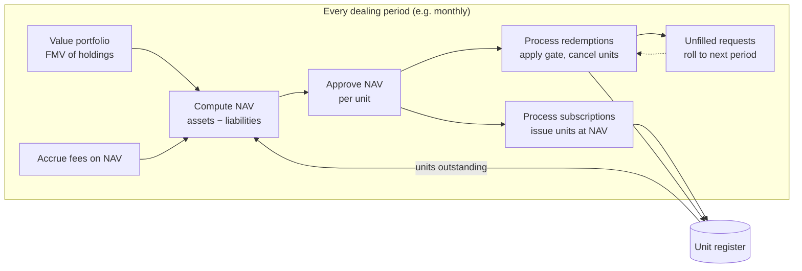
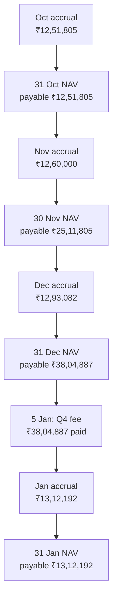
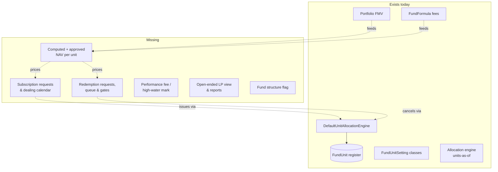
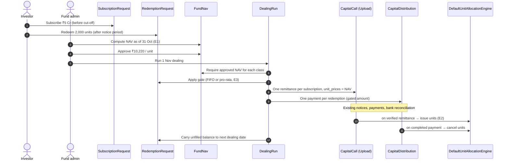
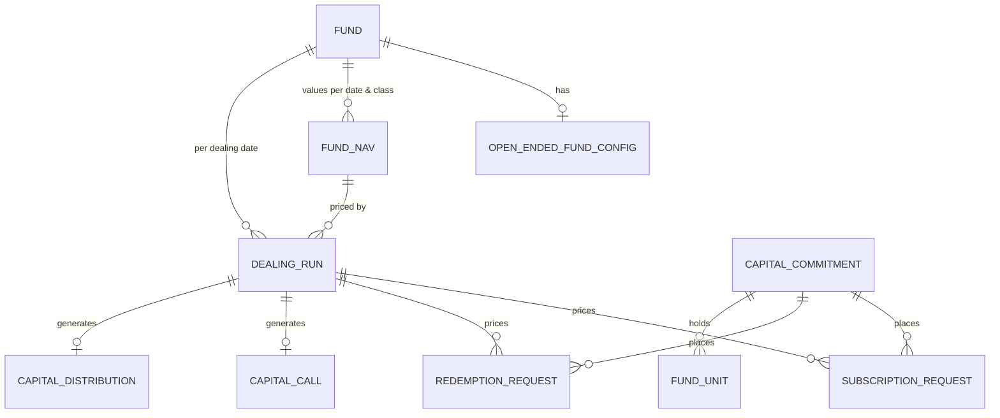

# Open-Ended Funds — What They Are, Where We Fall Short, How We Support Them

**Status:** Discussion draft (2026-10-07) — no code written yet. Design choices below need approval before any build.
**Related:** `docs/gtm/us_gtm/evergreen_fund_structures.md` (GTM view — see [§6](#6-notes-on-the-existing-gtm-doc) for corrections), `app/packs/funds/funds/jobs/fund_units_job.md`, `docs/user_guides/fund_units_user_guide.md`.

---

## 1. What an open-ended fund is

A **closed-ended fund** (what CapHive is built around) raises a fixed pot of *commitments* during a fundraise window, draws that money over time through *capital calls*, returns it through *distributions*, and winds up after a fixed term (typically 7–12 years).

An **open-ended fund** (also called *evergreen*, *perpetual* or *semi-liquid*) has no fixed size and no end date. Investors come and go continuously:

- **They buy in at the current NAV per unit.** There is no commitment to draw down — the investor pays the full subscription amount up front, on a *dealing date* (e.g. the first business day of each month).
- **They exit by redeeming units**, at the NAV per unit on a redemption dealing date, after giving notice. The fund does not have to sell assets to pay them all at once — *gates* cap how much can be redeemed per period, and the excess waits in a queue.
- **NAV is the centre of everything.** Every subscription, redemption and fee is priced off a periodic, approved NAV per unit.
- **Fees are charged on NAV**, not on committed capital. Performance fees, where charged, usually use a *high-water mark* so investors don't pay twice for the same gain.

| | Closed-ended | Open-ended |
|---|---|---|
| Money in | Commitment, then drawn down by calls | Paid in full at subscription, at current NAV |
| Unit price | Set per call (often face value, e.g. ₹100 / $1,000) | Recomputed every period = NAV ÷ units outstanding |
| Money out | Distributions as the GP exits investments | Investor-initiated redemption requests, queued and gated |
| Mgmt fee basis | Committed / invested capital | NAV |
| Fund size | Fixed at final close | Grows and shrinks continuously |
| Life | Fixed term | Perpetual |
| Investor's position | Commitment, called, uncalled, distributed | Units held × NAV per unit |

### Where they show up in our markets

- **India:** under the SEBI AIF Regulations, Category I and II AIFs must be close-ended; **Category III AIFs may be open-ended**. Open-ended Cat III funds (long-only / long-short public-market strategies) are the main Indian use case.
- **US:** evergreen private-credit and private-equity vehicles, tender-offer funds and interval funds (interval funds offer periodic repurchases of 5–25% of shares under Rule 23c-3). The GTM doc cites growth figures for this segment.

### Lifecycle



---

## 2. Worked examples

These figures are reused throughout the doc.

**E1 — NAV per unit.** On 31 Oct the fund holds investments at FMV ₹95.0 Cr and cash of ₹8.0 Cr; it owes ₹0.5 Cr of accrued fees and ₹0.3 Cr of other payables. Units outstanding: 1,00,000.

```
Gross assets   = 95.0 + 8.0          = ₹103.0 Cr
Liabilities    = 0.5 + 0.3           =   ₹0.8 Cr
NAV            = 103.0 − 0.8         = ₹102.2 Cr
NAV per unit   = 102.2 Cr / 1,00,000 = ₹10,220
```

**E2 — Subscription.** Investor P subscribes ₹5.0 Cr on the 1 Nov dealing date, priced at the approved 31 Oct NAV.

```
Units issued = 5,00,00,000 / 10,220 = 4,892.37 units
```

**E3 — Redemption with a gate.** The quarterly gate is 5% of NAV: `5% × 102.2 Cr = ₹5.11 Cr`. Requests in the queue, in order received: A ₹3.0 Cr, B ₹2.5 Cr, C ₹1.0 Cr (total ₹6.5 Cr — over the gate).

| Investor | Requested | FIFO: paid | FIFO: carried | Pro-rata (78.6%): paid | Pro-rata: carried |
|---|---|---|---|---|---|
| A | 3.00 | 3.00 | 0 | 2.36 | 0.64 |
| B | 2.50 | 2.11 | 0.39 | 1.97 | 0.53 |
| C | 1.00 | 0 | 1.00 | 0.79 | 0.21 |
| **Total** | **6.50** | **5.11** | **1.39** | **5.11** | **1.39** |

Pro-rata factor = `5.11 / 6.50 = 78.6%`. Which method applies is set by the fund's offering documents, so we need to support both.

**E4 — Management fee on NAV.** 1.5% p.a. on the 31 Oct NAV, for a 30-day month:

```
102,20,00,000 × 1.5% × 30 / 365 = ₹12,60,000
```

That accrual is a liability, so it reduces the next period's NAV (it feeds the "accrued fees" line in E1).

**When is it charged?** It runs on two separate clocks, and neither one is the dealing date:

| Clock | Set by | Rule |
|---|---|---|
| **Accrual** | How often NAV is struck | The fee must be accrued up to **every** NAV date, because NAV per unit is the dealing price |
| **Payment** | The offering documents, e.g. quarterly in arrears | The manager is paid whatever has built up, on its own schedule |
| Dealing | Fund settings, e.g. monthly subscriptions, quarterly redemptions | Doesn't drive the fee at all |

**E4a — a quarter, month by month.** The fund strikes a NAV at every month-end, deals subscriptions monthly and redemptions quarterly, and pays the fee quarterly in arrears. Each month's fee uses the latest approved NAV on or before the first day of that month. (This example starts at 30 Sep with nothing payable, so its figures are independent of the ₹50 lakh in E1.)

| Month | NAV used | Days | Fee accrued | Paid | Management fee payable in the month-end NAV | Dealing that month |
|---|---|---|---|---|---|---|
| Oct 2026 | 30 Sep: ₹98.26 Cr | 31 | 98,26,00,000 × 1.5% × 31 / 365 = **₹12,51,805** | — | **₹12,51,805** (31 Oct NAV) | none |
| Nov 2026 | 31 Oct: ₹102.20 Cr | 30 | 102,20,00,000 × 1.5% × 30 / 365 = **₹12,60,000** | — | 12,51,805 + 12,60,000 = **₹25,11,805** (30 Nov NAV) | Subscriptions 2 Nov |
| Dec 2026 | 30 Nov: ₹101.50 Cr | 31 | 101,50,00,000 × 1.5% × 31 / 365 = **₹12,93,082** | — | 25,11,805 + 12,93,082 = **₹38,04,887** (31 Dec NAV) | Subscriptions 1 Dec |
| Jan 2027 | 31 Dec: ₹103.00 Cr | 31 | 103,00,00,000 × 1.5% × 31 / 365 = **₹13,12,192** | **₹38,04,887** on 5 Jan (Q4 fee) | 38,04,887 + 13,12,192 − 38,04,887 = **₹13,12,192** (31 Jan NAV) | Redemptions 31 Dec dealt on the 31 Dec NAV, which already carries the full Q4 fee |



**Why the fee can't wait for a dealing date or a payment date.** Suppose the admin runs the fee formula only quarterly, so the 30 Nov NAV leaves out November's ₹12,60,000. With 1,00,000 units, NAV per unit is then too high by ₹12,60,000 ÷ 1,00,000 = **₹12.60**. An investor redeeming 2,000 units at the 1 Dec dealing gets 2,000 × ₹12.60 = **₹25,200** more than their fair share. A subscriber on the same date gets slightly fewer units than they should. The investors who stay make up the difference. So when a NAV is drafted and the class's latest management-fee accrual is older than the NAV date, CapHive shows "Management fee accrued only to 31 Oct 2026 — run the fee formula to 30 Nov 2026 before approving".

**A fund that strikes NAVs only quarterly** accrues once a quarter over the whole quarter: 102,20,00,000 × 1.5% × 92 / 365 = **₹38,64,000** for 1 Oct–31 Dec. That's a different total from E4a's ₹38,04,887, because E4a re-prices each month on the latest NAV while this uses one NAV for all 92 days.

---

## 3. What the platform already does

Verified against the code on 2026-10-07.

| Capability | Where | Relevance to open-ended |
|---|---|---|
| **Unit register** — quantity (8 dp), price, premium, `issue_date`, `unit_type` per commitment | `fund_units` table, `FundUnit` | This is the open-ended fund's core register. Works as is. |
| **Unit issuance on calls** — `quantity = amount / (price + premium)`, issue date = later of payment date or due date | `DefaultUnitAllocationEngine#allocate_remittance` | Same formula as a subscription, if price = NAV per unit. |
| **Unit cancellation on distributions** — negative-quantity `FundUnit` | `DefaultUnitAllocationEngine#allocate_distribution_payment` | Same mechanism as a redemption. |
| **Unit classes / series** — fee %, setup fee %, carry %, ISIN per class | `FundUnitSetting` (validated against `fund.unit_types`) | Open-ended funds commonly run several share classes. |
| **Unit transfers between investors** | `FundUnitTransfer`, `FundUnitTransferService` | Secondary transfers. |
| **Allocations by units held** — the allocation cache exposes each commitment's units as of `end_date` | `allocation_engine/account_entry_allocation/commitment_cache.rb:55` | Income, expenses and gains can be split by units rather than commitment %, which open-ended funds need. |
| **Portfolio FMV as of a date** | `AggregatePortfolioInvestment#as_of` → `fmv_cents` | The asset side of NAV. |
| **Formula engine for fees and ratios** | `FundFormula` (`GenerateAccountEntry`), `FundRatio` / `RatioFormula` | A fee on NAV (E4) can be expressed as a formula today. |
| **Commitment adjustments** | `CommitmentAdjustment` | Can top up an investor's "commitment" on each new subscription. |
| **"Upload" call basis** — call amounts per investor are uploaded rather than derived from a commitment % | `CapitalCall::CALL_BASIS`; `fund_closes` not required for Upload (`capital_call.rb:56`) | Lets a call carry arbitrary per-investor subscription amounts. |

---

## 4. Gaps



### G1 — NAV per unit is typed in by hand, not computed

The engine reads the price from the call: `capital_call.unit_prices[unit_type]["price"]` (`default_unit_allocation_engine.rb:45`); distributions likewise use `capital_distribution.unit_prices[unit_type]` (`:130`). `unit_prices` is a free-text column on both tables. Nothing computes E1 (assets − liabilities ÷ units), stores NAV per unit by date and class, or requires approval before it is used. **Consequence:** a typo in a call's unit price silently mis-issues units for every investor in that call.

### G2 — No way to subscribe except through a capital call

Units are only issued from a verified `CapitalRemittance` belonging to a `CapitalCall` (`FundUnitsJob` routes only `CapitalCall` / `CapitalDistribution`). There is no subscription request, dealing calendar, cut-off time or "price at next NAV" rule. A commitment record is also mandatory and requires `folio_id`, `fund_close` and `commitment_date` (`capital_commitment.rb:102`), so even a first subscription has to be modelled as a commitment under a close.

### G3 — Redemptions are amount-based distributions, with no queue or gate

A distribution cancels `cost_of_investment_with_fees / price` units (`default_unit_allocation_engine.rb:133`) — the GP decides the amount. Open-ended redemptions are investor-initiated and usually requested **in units** (or "all my units"). Missing: redemption requests, notice periods, lock-ups / early-redemption fees, FIFO or pro-rata gating (E3) and carrying unfilled requests forward.

### G4 — Unit generation is a manual button

`FundUnitsJob` is enqueued from `CapitalCallsController#allocate_units` / the distribution equivalent, i.e. a user clicks "allocate units". For an open-ended fund, unit issuance at the dealing date is the core settlement step and should be part of the dealing run, with the run blocked if NAV isn't approved.

### G5 — Fund-level numbers are closed-ended

`funds` tracks `committed_amount`, `call_amount`, `distribution_amount`, `target_committed_amount`, `first_close_date`, `last_close_date`. For an open-ended fund the headline figures are NAV, units outstanding, NAV per unit, net flows and the redemption queue. There is no flag saying a fund is open-ended, so screens can't switch between the two.

### G6 — No performance fee with a high-water mark

`FundUnitSetting.carry` is a carry %, which is a closed-ended waterfall concept. Open-ended funds typically charge a performance fee per class (or per investor or series) above a high-water mark, crystallised periodically, often with *equalisation* or *series accounting* so that an investor who entered at a high NAV isn't charged for gains made before they joined. None of that exists.

### G7 — Investor view and reports

The investor portal and quarterly reports show commitment, called, uncalled and distributed. Open-ended investors need: units held, NAV per unit, holding value, cost, unrealised gain, period subscriptions and redemptions, and their position in the redemption queue.

### Gap summary

| # | Gap | Severity | Can we work around it today? |
|---|---|---|---|
| G1 | Computed, approved NAV per unit | **Blocker at scale** | Yes — compute offline, type into `unit_prices` |
| G2 | Subscriptions without capital calls | High | Yes — one Upload-basis call per dealing date |
| G3 | Redemption requests, queue, gates | High | Partly — distribution per dealing date; queue in a spreadsheet |
| G4 | Automatic unit issuance at dealing | Medium | Yes — click "allocate units" |
| G5 | Open-ended fund flag and headline numbers | Medium | No (closed-ended numbers are shown) |
| G6 | Performance fee / high-water mark | Medium (Cat III: high) | Partly — custom `FundFormula`, no high-water-mark state |
| G7 | Investor view and reports | Medium | Partly — custom report templates |

---

## 5. How we can support it

### 5.1 Today: run it on the closed-ended machinery

Good enough for a pilot with a handful of investors and monthly dealing.

1. Create the fund with one `unit_type` per share class, and one `FundUnitSetting` per class.
2. Give each investor a `CapitalCommitment` (their folio) under a single standing close. Treat its committed amount as "cumulative subscribed", topped up with a `CommitmentAdjustment` on each new subscription.
3. **Each subscription dealing date = one capital call** with basis *Upload*. Upload each investor's subscription amount; set `unit_prices[class].price` = the approved NAV per unit (E1) and premium = 0. Verify remittances, then click *Allocate Units* → E2's 4,892.37 units.
4. **Each redemption dealing date = one capital distribution.** The gate (E3) is worked out offline; enter each investor's paid amount as the face value for redemption, with `unit_prices[class]` = NAV per unit.
5. Use a `FundFormula` for the management fee on NAV (E4), and allocation formulas that split by `units` rather than commitment %.

**Limits:** NAV, gate and queue live outside the platform; redemptions are by amount, not units; investor screens still show "uncalled"; no audit trail on NAV.

### 5.2 Target design (proposal — needs approval)

**Principle: keep calls and distributions as the settlement path.** Rather than building a parallel ledger (the GTM doc's approach, where subscriptions bypass `CapitalRemittance`), new request and NAV models *generate* an Upload-basis capital call and a capital distribution per dealing date. Everything downstream — account entries, notices, payments, bank reconciliation, journeys, allocation, `FundUnit` issuance — then works unchanged. The new code covers pricing and queuing, not settlement.



#### New models (additive)



| Model | Key fields | Why |
|---|---|---|
| `OpenEndedFundConfig` (1:1 with `Fund`; its existence marks the fund as open-ended) | subscription / redemption frequency, cut-off days, notice period days, lock-up months, early-redemption fee %, gate % and basis (fund / class), gate method (FIFO / pro-rata), minimum subscription and holding | Fixes G5 without adding a column to `funds`; holds the offering-document terms |
| `FundNav` | fund, `unit_type`, `nav_date`, gross assets, liabilities, NAV, units outstanding, NAV per unit, `status` (draft / approved), approved by / at, breakdown JSON | Fixes G1. One row per class per date. Units outstanding is read from `FundUnit` as of `nav_date`; assets come from portfolio FMV plus cash; liabilities come from fee accruals. Approval is required before use. |
| `SubscriptionRequest` | commitment, `unit_type`, amount, received at, dealing date, status, `fund_nav_id`, units issued | Fixes G2. Requests received after the cut-off move to the next dealing date. |
| `RedemptionRequest` | commitment, `unit_type`, **units** or amount or "all", received at, dealing date, status (pending / partial / done / cancelled), units paid, carried-forward units, gate applied | Fixes G3 |
| `DealingRun` | fund, dealing date, generated call and distribution ids, gate calculation JSON, status | Holds the sequence above together; an audit record of how each investor was priced and gated |

#### Changes to existing code (flagged — each needs explicit sign-off)

| Change | Why | Risk |
|---|---|---|
| `DefaultUnitAllocationEngine#allocate_distribution_payment`: accept a **unit quantity** from a linked `RedemptionRequest` rather than always deriving it from `cost_of_investment / price` | Redemptions are requested in units; going from amount back to units loses precision | Path only taken when a request is linked; closed-ended path unchanged |
| `FundUnitsJob`: run automatically on verify / complete for calls generated by a dealing run (G4) | Units must exist before the next NAV | Gated on `OpenEndedFundConfig` |
| Fund and investor-portal views: switch headline numbers when the config exists (G5, G7) | Closed-ended numbers are meaningless here | View-only |

#### Phases

1. **NAV** — `OpenEndedFundConfig`, `FundNav` with compute and approve, and a NAV-history screen. On its own this replaces the offline spreadsheet in §5.1 step 3: the Upload call can take its price from the approved NAV.
2. **Subscriptions** — `SubscriptionRequest`, `DealingRun` generating the Upload call, automatic unit issuance.
3. **Redemptions** — `RedemptionRequest`, gates (FIFO and pro-rata), carry-forward, notice periods and lock-ups, distribution generation.
4. **Fees and reporting** — fee-on-NAV formula template, performance fee with high-water mark (G6), open-ended investor portal and quarterly report.

---

## 6. Notes on the existing GTM doc

`docs/gtm/us_gtm/evergreen_fund_structures.md` is broadly right about what exists, with two corrections:

- It says `Fund` gets `:evergreen` "alongside `:closed_end`, `:continuation`" in a `fund_structure_type` enum. **That enum does not exist** — there is no such column in `db/schema.rb` and no reference in `app/`. Marking a fund as open-ended is new work (proposed above as `OpenEndedFundConfig`).
- It has subscriptions bypass `CapitalRemittance` with a new `allocate_subscription` path. This doc recommends instead **generating** calls and distributions from dealing runs, so that notices, payments, bank reconciliation, account entries and journeys keep working without a second settlement path.

---

## 7. Open questions — resolved as settings

Evergreen funds differ widely: a Cat III AIF, a US tender-offer fund, an interval fund and a hedge-fund-style vehicle answer each question differently. So each question is answered with a **fund setting** (some overridable per class), not one fixed rule. Presets fill typical values for each kind of fund. Full list: [proposal → Validation Rules and Fund Setups](../../../openspec/changes/open-ended-funds/proposal.md#validation-rules).

| # | Question | Answer: what the fund can configure | Default | Example of a fund that needs it |
|---|---|---|---|---|
| 1 | **Gate basis** — fund or class? Per dealing date or per period? | **Gate %** of NAV (0 = none); **gate level** fund or class; **gate period** per dealing date, per calendar quarter or per year; optional **investor-level gate** (% of each investor's holding per period) | No gate | US tender-offer fund: 5 % of fund NAV per quarter, though it deals monthly. Hedge-fund style: 25 % of each investor's holding per quarter |
| 2 | **Gating method** — FIFO or pro-rata? | **Gate method** FIFO or pro-rata | Pro-rata | Interval funds and most US evergreen funds use pro-rata; some offering documents specify first-come-first-served |
| 3 | **Performance fee** — class high-water mark, or series accounting / equalisation? | Per class: **performance fee model** (None, or Class high-water mark in this change); fee %; **hurdle** % with **hard** or **soft** type; **crystallisation** quarterly, semi-annual or annual. The model setting is built to take per-investor and series models later | None | Cat III long-short: 20 % above a class mark, annual. US evergreen PE: 12.5 % above a soft 8 % hurdle |
| 4 | **NAV inputs** — CapHive data or an external administrator? | Both, chosen per NAV: **New NAV** drafts from CapHive (portfolio FMV + ledger), **Upload NAV** loads the administrator's; either can have lines overridden; both need a second-person approval | — | Self-administered fund computes; administered fund uploads |
| 5 | **Dealing frequency** — is monthly enough? | **Dealing calendar** separately for subscriptions and redemptions: monthly, quarterly, semi-annual, annual, or a **custom list of dates** (covers weekly, or skipping holidays); **dealing day** first, last or day N | Monthly subscriptions, quarterly redemptions | Interval fund: custom repurchase dates. Cat III: monthly both ways |

Questions raised later, answered the same way:

| # | Question | Answer: setting | Default |
|---|---|---|---|
| 6 | When does a subscriber pay? | **Payment timing**: before dealing (cleared by cut-off) or after dealing (within N days) | Before dealing |
| 7 | What happens to orders unpaid or not ready at cut-off? | **Roll** to the next dealing date or **Cancel** | Roll |
| 8 | Must each order pass checks (KYC, signed form, GP acceptance) first? | **Order journeys**: off, subscriptions, or both; editable templates | Off |
| 9 | Do classes differ in lock-up, notice, minimums or exit load? | **Per-class overrides** for notice, lock-up (hard/soft), early-redemption fee (flat or by unit age), minimum initial/additional subscription, minimum holding | Fund values |
| 10 | Can investors redeem by amount, or only by units? | **Redemption forms allowed**: any of units, amount, all units | All three |
| 11 | How soon are redemptions paid? | **Redemption settlement**: 1–90 business days after dealing | 10 |

What stays fixed (not configurable in this change): business days are Monday–Friday; NAV per unit is in fund currency; daily dealing, swing pricing, equalisation and suspension are future work.

## 8. FAQ

**Q: Can we onboard an open-ended fund today?**
Yes, for a small pilot, using §5.1. Each dealing date becomes an Upload-basis call plus a distribution, with NAV entered as the unit price. NAV calculation, gating and the redemption queue happen in a spreadsheet, and the investor portal still shows closed-ended figures.

**Q: Why not just add a NAV field and stop there?**
Because NAV is only half the problem. Without request models, every subscription and redemption still needs a fund admin to build a call or distribution by hand, and the gate (E3) — the rule investors care most about under stress — is invisible to the system and has no audit trail.

**Q: Why generate calls and distributions instead of a new subscription ledger?**
Calls and distributions already carry notices, payment collection, bank reconciliation, account entries, journeys and unit issuance. A parallel ledger would mean rebuilding all of that and keeping two sets of rules in sync. Generating them keeps settlement on one code path and confines the new code to pricing and queuing.

**Q: Does allocating income and expenses work for open-ended funds?**
Yes — the allocation engine already exposes each commitment's `units` as of the period end (`commitment_cache.rb:55`), so formulas can allocate by units held. The thing to watch is timing: units issued on a dealing date must exist before that period's allocation runs, which is why G4 (automatic unit issuance) matters.

**Q: What happens to "committed / called / uncalled" for an open-ended investor?**
In §5.1 the commitment equals cumulative subscriptions, so "uncalled" is always about zero and means nothing. The target design hides those figures for funds that have an `OpenEndedFundConfig` and shows units, NAV per unit and holding value instead.
