# Outbound data feeds — high-level architecture

Architecture note, written 2026-09-30. **Exploratory — no code, no commitment.** One large
client has asked to have data pushed into their systems; no requirements beyond that have
been given yet. This document describes *how such a thing would work* so the shape can be
discussed before anything is specified. A change proposal, when there is one, belongs in
`openspec/changes/`.

Companion: [Xero integration use cases](xero_integration_use_cases.md) — the *inbound*
counterpart, and a useful contrast throughout.

---

## Contents

1. [What this is for](#1-what-this-is-for)
2. [The one big idea: three seams, not one](#2-the-one-big-idea-three-seams-not-one)
3. [Orthogonality — what "decoupled from the app" means concretely](#3-orthogonality--what-decoupled-from-the-app-means-concretely)
4. [Component map](#4-component-map)
5. [The trigger seam](#5-the-trigger-seam)
6. [The read seam — projection, mapping, enrichment](#6-the-read-seam--projection-mapping-enrichment)
7. [The outbox — durability, ordering, idempotency](#7-the-outbox--durability-ordering-idempotency)
8. [The egress seam — transports](#8-the-egress-seam--transports)
9. [Configuration — what a client's feed looks like](#9-configuration--what-a-clients-feed-looks-like)
10. [Worked example A — an event push](#10-worked-example-a--an-event-push)
11. [Worked example B — a dataset drop](#11-worked-example-b--a-dataset-drop)
12. [Non-interference guarantees](#12-non-interference-guarantees)
13. [Failure modes](#13-failure-modes)
14. [What already exists vs what is new](#14-what-already-exists-vs-what-is-new)
15. [Why not an off-the-shelf integration framework?](#15-why-not-an-off-the-shelf-integration-framework)
16. [Kafka — deferred, and the seam that keeps it cheap](#16-kafka--deferred-and-the-seam-that-keeps-it-cheap)
17. [The drift guard](#17-the-drift-guard)
18. [Open questions](#18-open-questions)
19. [Deliberately out of scope](#19-deliberately-out-of-scope)

---

## 1. What this is for

A client wants CapHive data to appear in their own systems — a data warehouse, a CRM, an
accounting package, a reporting tool — without a person exporting a spreadsheet and emailing
it. Three delivery styles are contemplated:

| Style | Looks like | Typical cadence |
|---|---|---|
| **HTTP push** | We POST a JSON document to a URL they own | Seconds after the change |
| **File drop** | We write an XLSX to a bucket or folder they read | Nightly / monthly |
| **Kafka** | We produce a message onto a topic in their cluster | Seconds (deferred — see §16) |

Two further requirements were stated:

- **Selective.** Only some events, only some records. Not "everything that moves."
- **Transformable.** Their field names, not ours; and enriched with dependent objects (a
  capital call payload that carries the fund and the entity, not just foreign keys).

And one constraint, which drives most of this document:

- **Orthogonal.** The feature must not interfere with the application, and should be as
  decoupled from it as possible.

### What this is *not*

It is not an API for clients to query (that exists — Doorkeeper-authenticated
`/api/v1/*`, plus the MCP server for AI clients). Push means *we* hold their credentials,
*we* own the retries, and *we* are the ones paged when their endpoint is down. That is a
real and permanent operational transfer, and it is the main reason to prefer pull when a
client will accept pull.

---

## 2. The one big idea: three seams, not one

"Push data to clients" sounds like one feature. Architecturally it is three, and they have
**different answers to the decoupling question**. Conflating them is the main way this design
goes wrong.

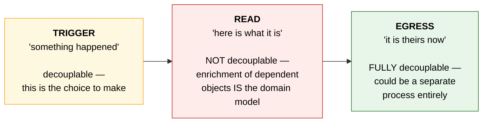

The **read seam cannot be decoupled**, and it is important to accept that early rather than
spend effort fighting it. "Enrich with dependent objects" is a request to traverse
associations — `capital_call → fund → entity`, `commitment → investor → kyc`. Anything that
can do that knows the domain model by definition.

The alternative — reading the database directly, with no application knowledge — does not
remove the coupling. It **moves it from code to schema**:

| Coupled to *code* | Coupled to *schema* |
|---|---|
| Breaks loudly — a test fails, CI is red, a reviewer sees it | Breaks silently — a column is renamed, nobody notices |
| Changes when *behaviour* changes | Changes on *every migration* |
| Speaks the domain's language ("call issued") | Speaks MySQL's ("status went 2 → 3") |
| Knows `amount_cents / 100.0` is what a human means | Ships cents and calls them dollars |
| Knows `acts_as_paranoid` means `deleted_at` = removed | Sees an ordinary UPDATE |

That last row is not hypothetical. Every model that includes `Trackable` gets
`acts_as_paranoid`, so **deletion in this application is an update**. A schema-level reader
has to be *told* that, in a place with no tests — which is strictly worse than a domain-level
reader that simply asks the model.

So the decoupling effort goes into the **trigger** seam (where there is a genuine choice) and
the **egress** seam (where full decoupling is free), and the read seam gets a different
treatment: the coupling is made **declared and guarded** rather than scattered and implicit.
See §6 and §17.

---

## 3. Orthogonality — what "decoupled from the app" means concretely

The application already has a machine-checked definition of orthogonality available:
`packs-rails` is in the Gemfile and the root `package.yml` sets `enforce_dependencies: true`,
with each pack declaring its `dependencies:`.

That turns a vague goal into a testable one:

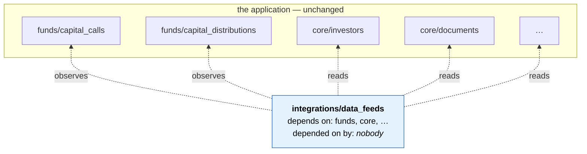

**The arrow points one way, into the app, never out.** The test is blunt and mechanical:

> Delete the feed pack. The application still boots, still passes its tests, and
> `git grep -i datafeed app/packs/funds app/packs/core` returns nothing.

This immediately rules out two otherwise-tempting designs:

- ❌ **Call sites** — `DataFeed.emit(:capital_call_issued, self)` sprinkled through business
  logic. Reverses the arrow, and rots: every new feature has to remember to call it, and
  nothing fails when someone forgets.
- ❌ **A concern** — `include Publishable` in each watched model. Tidier, but the feed's name
  is still in the app's mouth, and packwerk correctly flags the dependency.

What remains is **external registration**: the feed's own boot code attaches to the models it
watches. The application is never edited, and all the wiring lives in one file that belongs
to the feed.

The *mechanism* — reopening a class you do not own from boot code — is already used here:
`config/initializers/sidekiq.rb` reopens `PrometheusExporter::Instrumentation::Sidekiq`, and
`config/initializers/noticed.rb` injects `EventExtensions` / `NotificationExtensions` into the
Noticed gem's classes. Both target *gem* internals rather than application models, so this
would be a new application of a familiar technique, not a new technique.

**The important caveat.** Structural orthogonality is the *easy* half, and on its own it
guarantees nothing operationally. A feed can be perfectly packwerk-clean and still take
production down by exhausting the connection pool. The non-interference that matters is in
§12, and it is about *where work runs*, not where code lives.

---

## 4. Component map

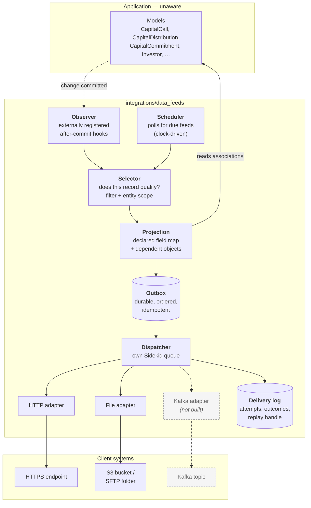

Vocabulary used throughout this document:

| Term | Meaning |
|---|---|
| **Feed** | One client destination plus its contract. A client may have several. |
| **Trigger** | What wakes the feed — a record change, or a clock. |
| **Selector** | The rule deciding whether a given record qualifies for this feed. |
| **Projection** | The declared shape of the payload: field mapping and enrichment. |
| **Outbox** | The durable list of things owed to a client but not yet delivered. |
| **Adapter** | The transport. Knows how to deliver, and what "delivered" means. |
| **Delivery log** | Every attempt and its outcome — the audit trail and the replay handle. |

---

## 5. The trigger seam

Two triggers, because the two product shapes genuinely differ:

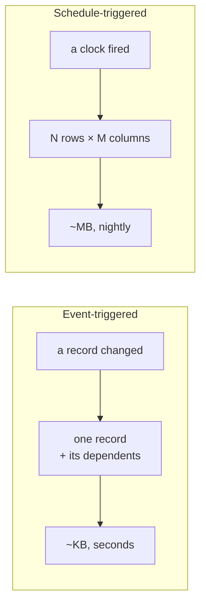

### Event trigger

The feed pack registers after-commit observation on the models on its watch list. **After
commit, not during** — the record must already be durable, and nothing the feed does may be
able to roll back a capital call.

The observer's only job is to ask the Selector "does anything want this?" and, if so, write an
outbox row. It does no HTTP, no rendering, no association walking. It must be cheap enough to
run on every write of a watched model without anyone noticing.

**Choosing where to observe.** Ordered from most to least coupled:

| | Approach | Arrow | Verdict |
|---|---|---|---|
| ① | Explicit calls in business logic | ❌ reversed | Rots; every new feature must remember |
| ② | A concern included in each model | ❌ reversed | Tidier, still the app's problem |
| ③ | **Externally registered observation** | ✅ correct | **Recommended** |
| ④ | Tail the `audits` table | ✅ correct | Covers only 49 of 317 models; records *diffs*, not entities; `audits` is one of the flagged-huge tables |
| ⑤ | MySQL binlog CDC (Debezium/Maxwell) | ✅ none | Whole new infrastructure; couples to schema (§2); loses all domain meaning |

③ delivers everything ④ and ⑤ promise — zero application edits, correct dependency direction —
while still speaking the domain's language. ④ and ⑤ buy no additional decoupling and pay for
it in meaning.

> The `audited` set is still worth a look for a different reason: 49 models is a ready-made
> map of *what someone already judged worth tracking*. That is a useful prior on the watch
> list, even though the audit trail is the wrong transport.

### The mechanism — how external registration works in Rails

Rails supports this directly; no gem is required. The shape is two files, one of which
deliberately contains no logic:

```ruby
# config/initializers/data_feeds.rb
# The only file outside the feed pack.
Rails.application.config.to_prepare do
  DataFeeds::Registry.install!
end
```

```ruby
# app/packs/integrations/data_feeds/registry.rb — all wiring lives here
module DataFeeds
  WATCHED = %w[CapitalCall CapitalDistribution CapitalCommitment].freeze

  module Registry
    def self.install!
      WATCHED.each do |name|
        klass = name.safe_constantize or next

        # The observer does exactly one thing: write a row. No HTTP, no
        # association walking, no rendering — see §12.
        klass.after_commit(on: %i[create update]) do
          DataFeeds::Observer.record(self)
        end
      end
    end
  end
end
```

`CapitalCall` is never edited and never mentions the feed. The dependency arrow of §3 holds.

**`to_prepare`, not a plain initializer.** This is the detail that catches people. In
development Zeitwerk discards the model class on each reload and builds a fresh one, taking
any callback with it — a plain initializer registers once at boot and then silently stops
firing after the first code reload. Referencing an autoloadable constant at initializer top
level is also an error in modern Rails. `to_prepare` re-runs after every reload, so the hook
re-attaches each time.

**Alternatives, and why they are not preferred here:**

| Technique | What it is | Verdict |
|---|---|---|
| `rails-observers` | `ActiveRecord::Observer`, core Rails until 4.0, now an extracted gem. Literally this pattern, declaratively. | Barely maintained — a lot of dependency risk for syntax that is ten lines to write |
| `ActiveSupport.on_load(:active_record)` | How gems hook every model | Boots cheaply but adds a callback to all 317 models and defers the watch-list check to runtime |
| `Module#prepend` on a domain method | Wraps e.g. `CapitalCall#issue!` | Captures a true business event rather than inferring one from a column — but couples to a method name. Worth it for a small number of high-value events |
| `ActiveSupport::Notifications` | Real decoupled pub/sub | **Does not work.** Rails publishes `sql.active_record`, not `capital_call.created`. Getting domain events onto it means publishing them from the application — which reverses the arrow again |

**Actor attribution comes free.** `ApplicationJob` already carries `Current.user` across the
process boundary and restores it around `perform` (for `audited`), so an observer can record
*who* caused a change without any new plumbing.

### What can actually trigger a feed

Worth stating explicitly, because "configurable for some events" means different things to
different readers, and because the mechanism does not see all of them.

| Trigger | Example | Observer sees it? | Notes |
|---|---|---|---|
| Record created | a call is drafted | ✅ `on: :create` | Usually **too early** to send — a draft is not news |
| Record updated (any column) | anything edited | ✅ `on: :update` | **Too noisy** to be a feed on its own |
| A specific column changed | `amount_cents` revised | ✅ `saved_change_to_amount_cents?` | |
| **State transition** | `status: draft → issued` | ✅ `saved_change_to_status?` + previous value | **This is what clients mean by "an event."** It is also §9's *lifecycle* level of selectivity |
| Domain action | `call.issue!` | ✅ but only via `prepend` | The truest business event; couples to a method name |
| Soft delete | `destroy` under `acts_as_paranoid` | ⚠️ as an **UPDATE** of `deleted_at` — **not** `on: :destroy` | Easy to get wrong and never notice |
| Hard delete | `really_destroy!` | ✅ `on: :destroy` | Rare in this application |
| Association changed | a payment added to a call | ⚠️ only if that child model is *also* watched | A child insert does not fire the parent's callbacks |
| Bulk update | `in_batches` + `update_all` | ❌ **never** | See blind spots below |
| Bulk insert | `insert_all` / `upsert_all` | ❌ never | |
| Direct SQL, migration, console fix | a one-off data correction | ❌ never | |
| **Time passing** | "the due date has been reached" | ❌ **no record changed at all** | No observer can ever see this. It needs the schedule trigger |

The middle block — state transitions — is the useful one, and it is the reason an
audit-trail-based trigger (④ above) is not equivalent: a diff of `status: 2 → 3` is a row
change, whereas "this call has been issued" is the thing a client wants to act on.

The last row deserves its own emphasis. A meaningful share of what clients ask to be notified
about is not a write at all — a due date arriving, a reporting period closing, a commitment
ageing past a threshold. **Those are only ever visible to a clock**, which is a further reason
the two triggers of §2 both have to exist.

### Blind spots — what external registration cannot see

| Blind spot | Consequence |
|---|---|
| **`update_all` / `delete_all` / `insert_all` / `upsert_all` bypass callbacks entirely** | Bulk changes are **invisible to the feed** |
| `acts_as_paranoid` makes `destroy` an UPDATE | `on: :destroy` never fires for an ordinary delete |
| STI | Registering on a subclass misses its siblings — register on the parent |
| An exception raised in `after_commit` | The transaction has already committed, so raising undoes nothing; it simply fails the user's request over data that *did* save |
| Anything that never touches ActiveRecord | Migrations, console fixes, restored backups |

**The first row is the serious one, and it is not hypothetical here.** `CLAUDE.md` actively
*recommends* `in_batches` and `update_all` for large tables such as `account_entries`, and
operational guidance exists on slicing those updates by `fund_id` and `reporting_date`. The
codebase's own performance advice therefore steers directly toward the operations an observer
cannot see. Any bulk path touching a watched model will silently emit nothing.

Two mitigations, and the second is the reliable one:

1. **Explicit emission from bulk paths** — correct where the bulk path is known, but it is
   opt-in, it reverses the dependency arrow at that call site, and nothing fails when a future
   bulk path forgets.
2. **A periodic dataset drop as the backstop** — a full position file on a schedule is
   *derived from current state*, not from a change stream, so it reflects bulk updates,
   console fixes and restored backups alike. Any divergence between the two is also a
   reconciliation signal.

This is the strongest practical argument for building the **schedule-driven path first** and
treating the event stream as a latency optimisation layered on top of it, rather than the
other way round — which happens to be the same order the existing code favours (§14).

### Schedule trigger

Identical in spirit to `ReportBuilderSchedulerJob`, which already exists: due-ness is
precomputed onto a `next_run_at` column so the poller only asks "what is due now" rather than
recomputing schedule arithmetic. `Schedulable` and `NextRunCalculator` already implement this.

---

## 6. The read seam — projection, mapping, enrichment

This is the part that cannot be decoupled (§2), so the goal shifts: make the coupling
**declared in one place** and **verified automatically**, rather than scattered through
transformation code.

### The declaration

A projection states, per entity: which fields are exported, what the client calls each one,
and which dependent objects travel with it.

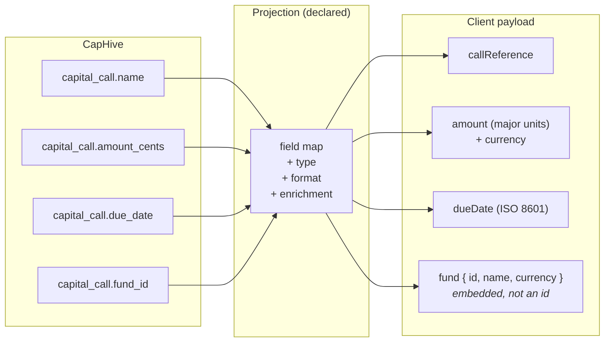

Three things the projection has to get right, each of which is a known trap in this codebase:

**Money.** Amounts are stored as `*_cents`. `RansackerAmounts` already establishes the
convention that the *outside* world sees major units — the MCP ontology exposes `foo` as
`foo_cents / 100.0`. A feed must follow the same convention, and must always ship the currency
alongside the number. A bare `amount: 250000` with no currency is a support ticket waiting to
happen.

**Dates.** The application deliberately has no single date format — screens follow the active
locale (`%d/%m/%Y` for `en`, `%m/%d/%Y` for `en-US`, `%Y/%m/%d` for `ja`) and emails force
`Mon dd, yyyy`. **Neither is right for a machine feed.** An outbound payload should use
ISO 8601 unconditionally, and must not inherit whatever locale happened to be active on the
job thread — the same trap `EmailDateLocalization` exists to solve for mailers.

**Enrichment depth.** "Include dependent objects" has no natural stopping point: a call
carries a fund, which carries an entity, which carries settings. Depth must be part of the
declaration, not a runtime decision, or one feed quietly serialises half the database.

### Why declared rather than coded

A hand-written transformer per client becomes N bespoke, untested serialisers. A declaration
can be validated, diffed, shown in a UI, and — critically — **executed against the real models
by a test** (§17).

The repository already has this exact pattern: `app/packs/ai/mcp_server/ontology/` describes
16 entities' fields, types, relationships and money semantics for models that contain zero
references back to it. It is the working proof that a declared, external, domain-aware read
layer is viable here, and it is the obvious thing to build on rather than beside.

### Memory discipline

`CLAUDE.md` exists largely because of memory incidents on exactly this kind of read.
A projection is the most likely place in this feature to cause one:

- select only declared columns — `account_entries` has wide `json_fields`, `notes` and
  `explanation` columns that dominate per-row memory;
- batch with `find_each` / `in_batches`, never materialise a full scope;
- never eager-load a large association speculatively;
- dedup in SQL (`distinct.pluck`), not in Ruby.

---

## 7. The outbox — durability, ordering, idempotency

Everything owed to a client lands in a durable outbox before anyone tries to deliver it. This
is what makes the feature restartable, auditable and replayable, and it is what stops a client
outage from becoming our data loss.

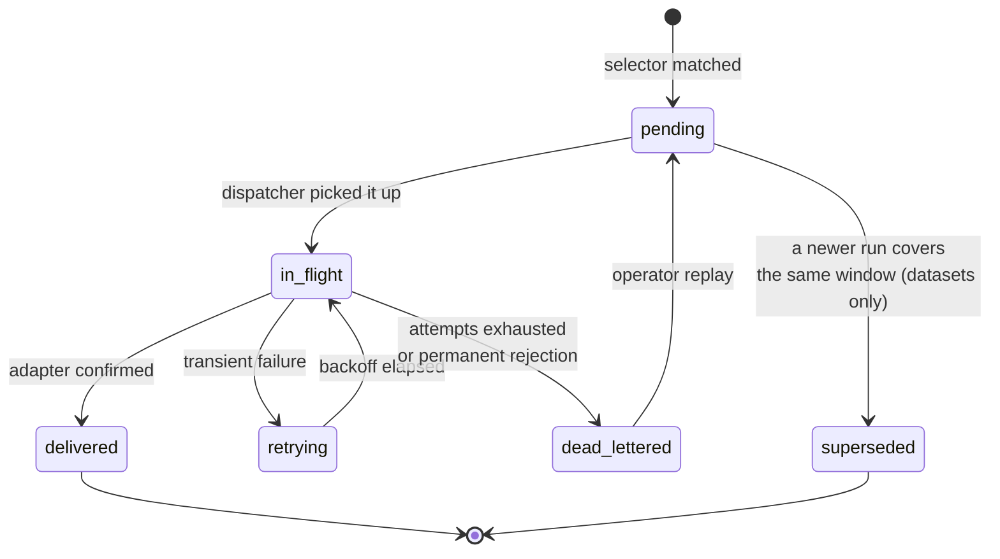

What each row carries, and why:

| Field | Why it exists |
|---|---|
| `idempotency_key` | Stable per **event**, not per attempt. Lets the client dedupe our retries. A retry that creates a second capital call on their side is the worst outcome this feature can produce. |
| `ordering_key` | Usually the subject record's identity. Guarantees that two updates to the same call arrive in order. **Cheap now, near-impossible to retrofit** — see §16. |
| `payload` | Stored as structured data, not a pre-rendered string, so the serialisation format stays an adapter decision. |
| `attempts`, `last_error` (text) | Deliberately *not* `http_status`. The moment a status code becomes a first-class column, the schema has picked a transport. |
| `occurred_at` vs `delivered_at` | Lets "how far behind are we" be answered without guessing. |

**Ordering is per-key, not global.** Serialising an entire client's feed makes one slow
delivery block everything behind it. Serialising per subject record gives the guarantee that
actually matters — you never see an update before the create — at a fraction of the cost.

**Datasets supersede rather than retry forever.** If last night's nightly file never landed
and tonight's is ready, tonight's is the answer. Only event rows retry indefinitely into a
dead letter.

---

## 8. The egress seam — transports

This is the seam that *can* be fully decoupled, and the place to spend the decoupling effort.
The crucial observation is that the three transports **disagree about what delivery means**:

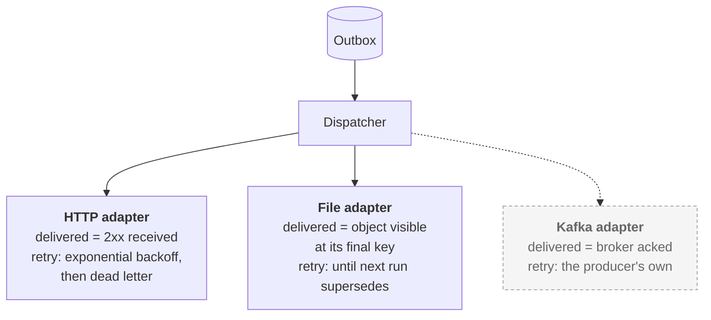

That disagreement is where the boundary belongs. Each adapter owns its own definition of
success and its own retry story. A shared "retry policy" abstraction that tries to fit all
three fits none of them.

### HTTP

The straightforward one, and the one the existing gems already cover (`faraday` and
`httparty` are both present). What matters is not the request but the discipline around it:
a signed payload so the client can verify it came from us, a hard timeout, an idempotency
key in the headers, and a circuit breaker so one client's dead endpoint does not consume
the dispatcher's capacity for everyone else.

### File drop

Two sub-cases, and they are not equally ready:

- **S3** — `aws-sdk-s3` is already in the Gemfile. Writing into a bucket the *client* owns is
  a cross-account IAM arrangement, not a credential we store. That is the better pattern:
  they grant a role, they can revoke it, we never hold a long-lived secret.
- **SFTP** — `net-ssh` is present but **`net-sftp` is not**. This is a genuine new dependency,
  plus per-client host keys and credentials to store and rotate.

Two mechanics matter more than the transport:

- **Atomic visibility.** Write to a temporary key, then rename. A client's poller must never
  read a half-written workbook. Half a file that looks complete is worse than no file.
- **XLSX is not a data format.** It has a 1,048,576-row ceiling, it coerces things that look
  like dates, and it drops leading zeros. For a large client's nightly position file, CSV or
  Parquet is the correct answer and XLSX is the one a human asked for. Worth offering both.

`caxlsx` and `ReportBuilderXlsxExporter` already exist and cover the rendering.

### Kafka

Deferred. See §16 for why, and for the four decisions that keep it cheap to add later.

---

## 9. Configuration — what a client's feed looks like

Configuration is per **Entity** (the tenant), consistent with how every other switchable
behaviour in the application works via `EntitySetting`. Conceptually a feed is four
independent choices:

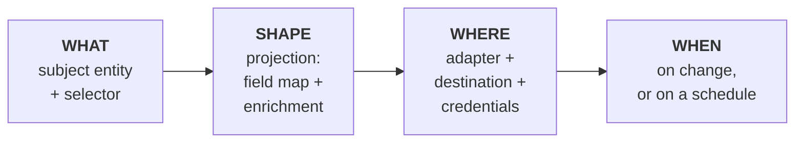

Keeping these four orthogonal is what makes the feature composable rather than a matrix of
special cases: the same projection can serve an HTTP push and a nightly file; the same
destination can carry several subjects.

**Selectivity** operates at three levels, and all three are needed:

| Level | Example |
|---|---|
| Subject | "capital calls, yes; documents, no" |
| Lifecycle | "only when issued — not on every draft edit" |
| Record | "only funds tagged `Fund III`" |

The middle one is the one clients actually mean when they say "only some events," and it is
also the one an audit-trail-based trigger (§5 ④) cannot express, because a diff of
`status: draft → issued` is a row change, not a business event.

**Credentials** are per-feed secrets. The application already stores per-entity third-party
keys on `entity_settings` (`anthropic_api_key`, `digio_client_secret`, and others), so there
is precedent — but a push feed's credentials are write-access to a client's system, which
raises the stakes. Cross-account IAM beats a stored secret wherever the client will allow it.

---

## 10. Worked example A — an event push

**Scenario.** A fund admin issues a capital call for ₹2,50,00,000 on Fund III, due
2026-10-15. The client wants to know within seconds so their treasury system can expect the
money.

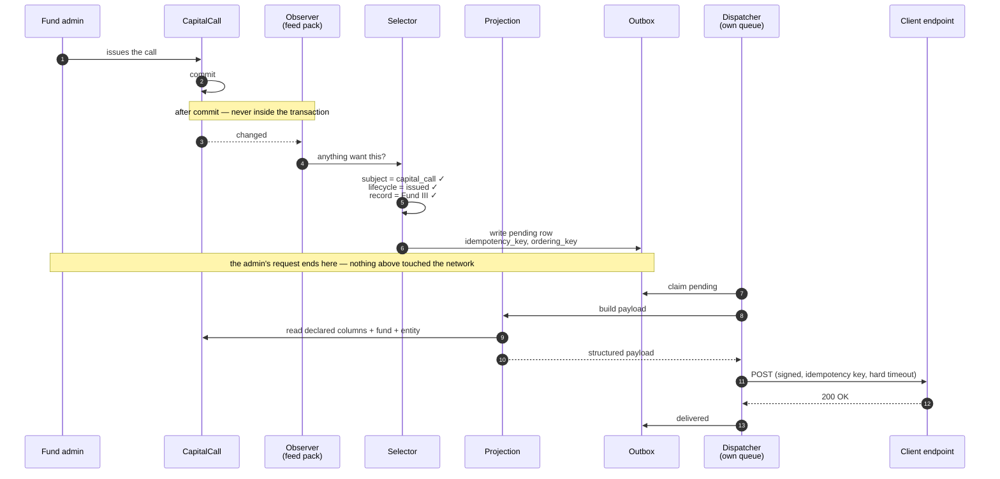

The shape of what lands on their side — mapped names, major units with currency, ISO dates,
the fund embedded rather than referenced by id:

```json
{
  "event": "capital_call.issued",
  "eventId": "01JB8Q2W5X...",
  "occurredAt": "2026-09-30T11:04:17Z",
  "data": {
    "callReference": "FIII-CC-07",
    "amount": 25000000.00,
    "currency": "INR",
    "dueDate": "2026-10-15",
    "fund": { "id": "f_4471", "name": "Fund III", "currency": "INR" }
  }
}
```

Note what steps 1–6 do *not* include: no HTTP call, no association walking, no rendering. The
admin's request does exactly one extra thing — an insert. Everything expensive happens after
they have their page back, on a queue that is not theirs.

**If the client's endpoint is down**, the row goes to `retrying` with backoff, and their
treasury system catches up when they recover. Nothing in CapHive changes; nothing is lost;
the admin is never told, because it is not their problem.

---

## 11. Worked example B — a dataset drop

**Scenario.** Every night at 02:00 the client wants the full commitment position for all
funds — every investor, their committed, called and distributed amounts — as a file in their
S3 bucket.

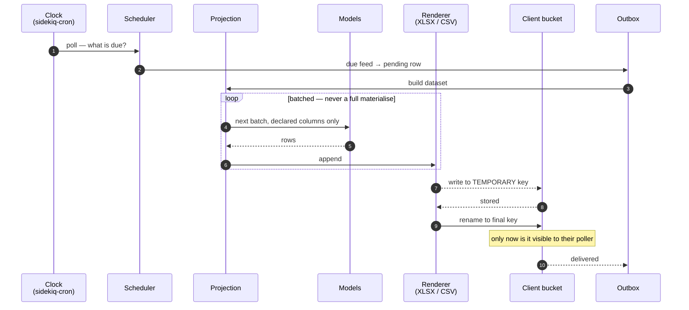

Two details carry most of the risk:

**Batching.** This is the read most likely to reproduce a past memory incident. The scope is
iterated in batches with only the declared columns selected — never `.to_a`, never a
speculative `includes` of a large association.

**Atomic rename.** The file becomes visible at its final key only once it is complete. A
client poller that reads a partially-written workbook gets a plausible-looking file with
missing rows, and neither side notices until a reconciliation months later.

**Supersession.** If the 02:00 run failed and the 02:00 run the next night succeeds, the
older row is marked `superseded`, not retried. Delivering a stale position file *after* a
fresh one is worse than never delivering it.

**What already exists here.** `Report#template` already encodes root model, joins, filters,
formulas and currency; `ReportBuilderQueryEngine` executes it; `ReportBuilderXlsxExporter`
renders it; `ReportSchedule` + `NextRunCalculator` already fire it on a cadence. Today the
destination is a list of email recipients. **The dataset half of this feature is mostly a new
destination for a path that already works in production** — which is a strong argument for
doing it first and separately from the event half.

---

## 12. Non-interference guarantees

Structural orthogonality (§3) says nothing about runtime. These are the guarantees that
actually keep the application safe, and each maps to a specific way this feature could hurt it:

| Guarantee | The failure it prevents |
|---|---|
| Nothing network-bound runs inside a database transaction | A client's slow endpoint holds a row lock, and a capital call cannot be saved |
| The observer only writes an outbox row — no HTTP, no rendering | A user's save waits on someone else's infrastructure |
| A feed error can never fail the user's operation | An integration outage blocks the business |
| …but it must never be silently swallowed either | The feed appears healthy while quietly emitting nothing — the same silent-success class `CLAUDE.md` documents for Ransack's `ignore_unknown_conditions` |
| Its own Sidekiq queue, never `default` | One client's backlog starves capital call emails |
| A per-feed circuit breaker | One dead endpoint consumes every worker thread |
| Batched, column-scoped reads | The memory incidents `CLAUDE.md` was written about |
| No DB connection held while waiting on a client socket | Pool exhaustion — an application-wide outage from an integration |
| Per-entity kill switch | No deploy needed to stop a misbehaving feed |

The fourth row is the subtle one and deserves its own emphasis. "Must not interfere" pushes
toward swallowing every error, and a feed that swallows errors is *worse* than one that
raises: the client believes they are receiving data, we believe we are sending it, and the
divergence is discovered at a reconciliation. **Failures must be loud to us and invisible to
the user** — which means they surface on a monitoring dashboard and an operator's queue, not
in the admin's browser.

---

## 13. Failure modes

| # | Failure | Consequence | Mitigation |
|---|---|---|---|
| 1 | Client endpoint down | Backlog | Outbox + backoff + dead letter; the app is unaffected |
| 2 | Client endpoint slow (no timeout) | Workers exhausted | Hard timeout + circuit breaker |
| 3 | Duplicate delivery on retry | Double-counted records on their side | Stable `idempotency_key` per event |
| 4 | Out-of-order delivery | Update applied before create | `ordering_key`, serialised per subject |
| 5 | Partial file read | Silently incomplete data, found months later | Temp key + atomic rename |
| 6 | Model changes, mapping does not | Field silently becomes null; client trusts it | Drift guard (§17) |
| 7 | Projection loads too much | Memory incident | Column scoping + batching |
| 8 | Feed errors swallowed | Silent success — the worst outcome | Errors loud to operators, invisible to users |
| 9 | Credentials leak or expire | Breach, or a silent stop | Cross-account IAM over stored secrets; expiry alerting |
| 10 | Client receives data they should not see | Confidentiality breach across funds | Selector runs inside the entity scope; never a raw global query |
| 11 | Backfill floods the client | Their system falls over; we get blamed | Explicit replay with rate limiting, never an accidental one |
| 12 | Bulk update bypasses callbacks | Change never emitted; client's copy silently diverges | Periodic dataset drop as backstop + reconciliation (§5) |

Row 6 is the one this architecture is most specifically designed around, and row 8 is the one
most likely to be introduced by a well-meaning attempt to satisfy "must not interfere."

---

## 14. What already exists vs what is new

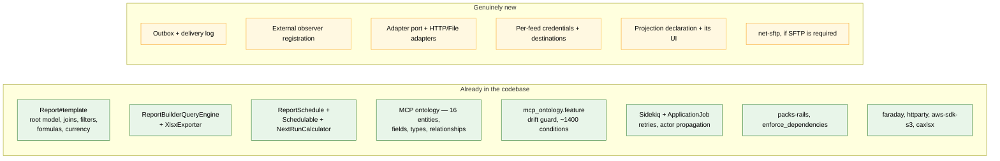

The asymmetry is the practical headline: **the schedule-driven file path is largely
assembled already; the event-driven path is where the real new machinery lives.** There is
no change stream in this application today, and `audited` — covering 49 of 317 models, storing
diffs rather than entities, in one of the flagged-large tables — is not one.

---

## 15. Why not an off-the-shelf integration framework?

There is a mature category of tools whose whole purpose is "connect anything to anything."
**Short answer: they solve the egress seam, which is already the cheap one — and they cannot
solve the read seam, which is where the work actually is.**

### The tools

| Tool | What it is | Runs on |
|---|---|---|
| **Apache Camel** | The classic integration framework — 300+ connectors | JVM |
| **Apache NiFi** | Drag-and-drop data movement, with provenance tracking | JVM |
| **Kafka Connect** | Connectors, with Kafka on one end by definition | JVM |
| **MuleSoft, Boomi, Workato** | Commercial iPaaS — same idea, sold as a service | SaaS |
| **Airbyte, Fivetran, Meltano** | ELT — move a dataset into a warehouse | Docker / SaaS |

**There is no Ruby equivalent, and that is not an oversight.** Camel's value is 300
community-maintained connectors plus a JVM to host long-lived flows. Ruby's culture went the
other way: use the vendor's gem, put it behind Sidekiq, write a class. The nearest gem,
**Kiba**, is a transform pipeline with no connectors at all.

### Why they do not fit

All of them assume the source is something generic — a table, a REST endpoint, a file, a
queue. This source is a Rails domain model: entity scoping, Pundit policies, `acts_as_paranoid`
deletes, money in `*_cents`, and "issued" as a business event rather than a column value. None
of that is legible to a generic connector.

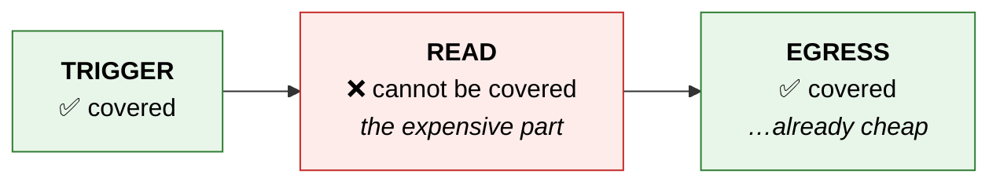

To point Camel at CapHive, the domain would first have to be exposed as something generic — a
view, an API, a JSON feed. **That exposure *is* the read seam.** Build it and the hard part is
already done; what is left is "POST this" or "write this file" — a day of Faraday, not a
platform.

So the trade on offer is: skip writing the HTTP adapter, in exchange for running a JVM tier.
And that tier is expensive here for exactly the reason Kafka is (§16) — no Dockerfile, no
Kamal, EC2 boxes provisioned by `lib/tasks/*.rake`, and `production.in` and `production.us`
maintained independently.

### What to do instead

The instinct — *don't hand-build N integrations* — is right. It just pays off one layer up.

**① Write to a bucket in an open format.** Build the read seam, emit NDJSON or Parquet to S3,
and stop. Airbyte, Fivetran, Kafka Connect, Snowflake external tables and dbt all ingest from
a bucket. One destination written; the whole connector ecosystem for free; none of it hosted
here. Another reason to build the file-drop transport first.

**② Let the client use their own iPaaS.** A large enterprise client very likely already
licenses MuleSoft or Boomi and has a team building flows in it daily. If so, the better offer
is *point your flow at our existing authenticated API*. They get mapping and enrichment in a
tool they already know; we hold none of their credentials and own none of their retries. This
would collapse most of this document — which is why it is worth establishing early
(open question #9, §18).

### The rule

> An integration framework earns its keep when the **sources** are many and generic. Here
> there is one source and it is a domain model. Prefer exporting to an open format, in a place
> the client's own tooling already reaches.

---

## 16. Kafka — deferred, and the seam that keeps it cheap

No client has asked for Kafka. It is on the list as an option to evaluate. The evaluation:

**It is unusually expensive in this deployment, for reasons unrelated to Kafka itself.**
The live Ruby client (`rdkafka`) binds to `librdkafka`, a C library. There is no Dockerfile,
no Kamal and no Capistrano in this repository — deployment is EC2 boxes driven by
`lib/tasks/*.rake`. So the native library has to be installed on every application and worker
box, in `production.in` and `production.us` independently, and on every box built from then
on. The pure-Ruby alternative (`ruby-kafka`) is unmaintained, so there is no lighter path.

Beyond packaging: the producer is asynchronous, so a job returning is not a message
delivered — get that wrong and you have a job reporting success while the message was
dropped. Per-client brokers mean their network, their SASL credentials, their CA, possibly
VPC peering. And Kafka consumers usually expect Avro plus a schema registry.

**The substitutes are good.** An HTTP POST to a bridge the client runs puts our payload on
their topic with their cluster's auth, their partitioning, their registry — fifty lines on
their side, nothing permanent on ours. A file drop into a bucket they already have a
connector for achieves the same.

**The rule worth writing down:** Kafka earns a place when a client's ingestion is genuinely
Kafka-only, *and* they will not run a bridge, *and* it is more than one client. One client
asking is a bridge. Three clients asking is a transport.

### The four decisions that keep it cheap to add later

Deferring costs almost nothing **if** the seam is drawn correctly on day one:

| # | Decision | Why it matters later |
|---|---|---|
| 1 | **Emit an `ordering_key` on every event from the start** | Kafka needs a partition key for per-entity ordering; HTTP does not care. Add it later and you cannot order historical events without a backfill. **This is the only one that is genuinely hard to retrofit** — and it costs one column today. |
| 2 | Idempotency key per **event**, not per attempt | Both worlds need it — HTTP for retries, Kafka after a consumer rebalance |
| 3 | Outbox failure column is `last_error` (text), not `http_status` | A status-code column means the schema has picked a transport |
| 4 | Payload stored structured, serialised at the adapter | Keeps Avro or protobuf possible without touching the projection layer |

Get these four right and Kafka is one new adapter class plus credential fields. Get #1 wrong
and it is a migration over the whole delivery history.

---

## 17. The drift guard

A reverse-dependency layer (§3) has one characteristic failure: the application changes
underneath it and **nothing fails**. A renamed column, a changed enum, a removed association —
the mapping silently resolves to nothing, the client receives a field full of nulls, and they
believe it.

This is failure mode #6, and it is the single most important thing to design against, because
it is the one that is invisible on both sides.

The repository has already solved exactly this problem, for exactly this shape of layer. The
MCP ontology is a declared external description of 16 models that contain no reference back to
it; `features/ai/mcp_server/mcp_ontology.feature` executes every advertised filter, sort,
aggregate and group-by against the real models — roughly 1,400 conditions — and fails on
anything Ransack silently ignores or that raises.

The same discipline applies here, and the principle generalises:

> A projection is a claim about the domain model. Every claim gets executed against the real
> models by a test. A mapping that no longer resolves fails CI, not a client reconciliation.

Without that guard, an orthogonal seam is merely a silent one — and silence is the specific
thing that makes this class of integration dangerous.

---

## 18. Open questions

Requirements-dependent, unanswerable today, listed so they are not forgotten:

1. **Watch list.** Which subjects are in scope at all? The `audited` 49 are a candidate
   universe; the realistic answer may be a handful — calls, distributions, commitments,
   investors. This drives whether the projection layer is a few declarations or a generated
   monster, and it is the one decision worth making before anything else.
2. **Event or dataset?** Does the client want to be *told things* or *given a position*? They
   are different builds (§2), and the dataset one is mostly assembled already (§14).
3. **Push or pull?** A Doorkeeper-authenticated API and the MCP server already exist. Push
   transfers retry ownership and credential custody to us, permanently. Worth confirming the
   client will not accept pull before accepting that.
4. **Backfill.** Does day one include history, or only changes from go-live? History means a
   rate-limited replay path, which is a feature in its own right.
5. **Ordering guarantee.** Per-record ordering is cheap. Global ordering is not, and is
   almost never what is wanted.
6. **Who sees failures?** An operator queue, the fund admin, or the client themselves? This
   decides whether a status UI is in scope.
7. **XLSX or CSV/Parquet?** For a large nightly position file, XLSX is the format a human
   asked for and the wrong one for a machine (§8).
8. **SFTP?** It is a new dependency (`net-sftp` is not in the Gemfile) plus credential
   custody. S3 with cross-account IAM avoids both.
9. **Does the client already run an integration platform?** If they have a MuleSoft, Boomi or
   Workato team, pointing their own flow at the existing authenticated API may be a better
   offer than anything in this document — and it costs a conversation rather than a quarter.
   See §15.

## 19. Deliberately out of scope

- **Inbound.** Writing client data *into* CapHive is a different feature with different
  failure modes (see the Xero note for the inbound shape).
- **Kafka**, until §16's rule is met.
- **Bidirectional sync / conflict resolution.** Push is one-way by construction.
- **A client-facing self-service portal** for configuring their own feeds.
- **Real-time streaming below the seconds range.** Nothing here targets sub-second latency,
  and nothing in the product needs it.
