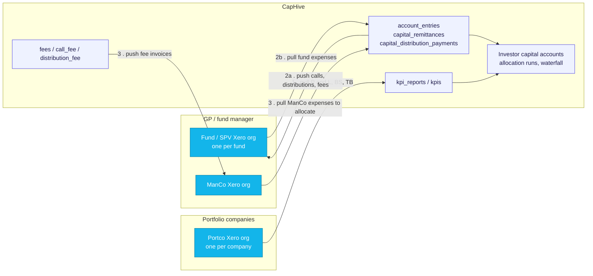
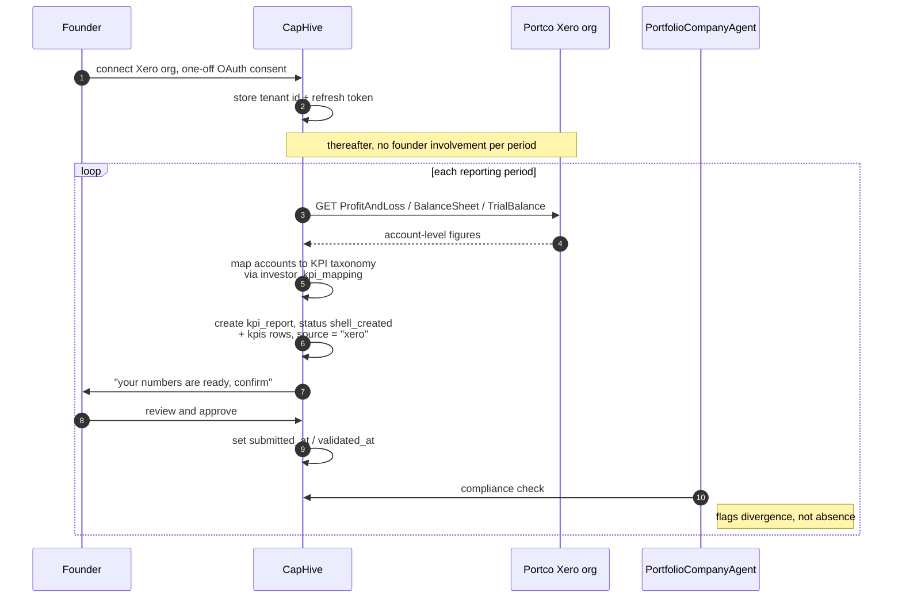
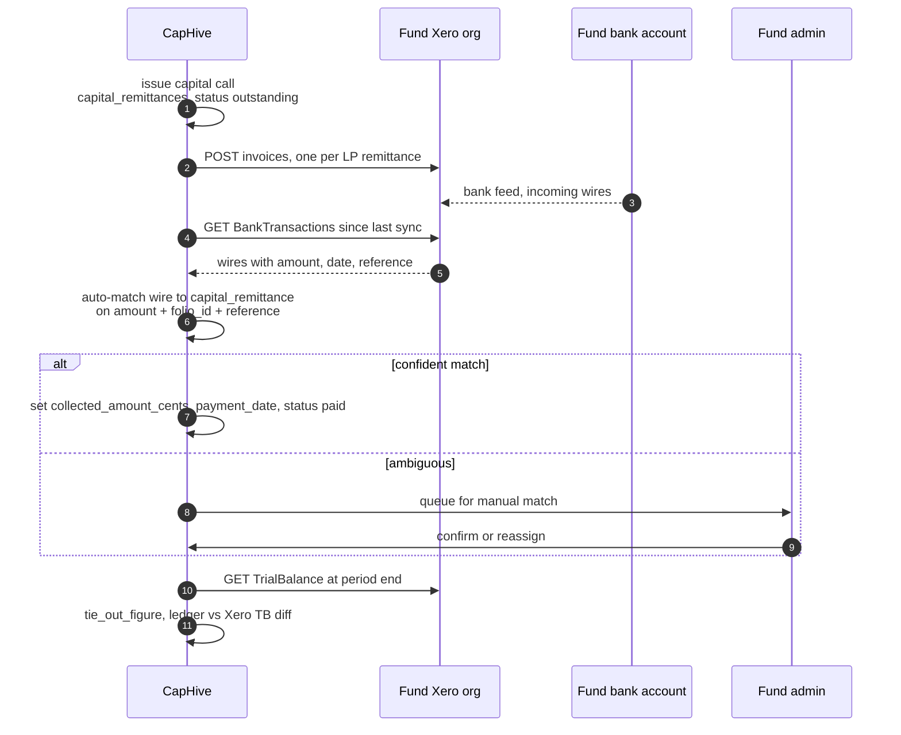
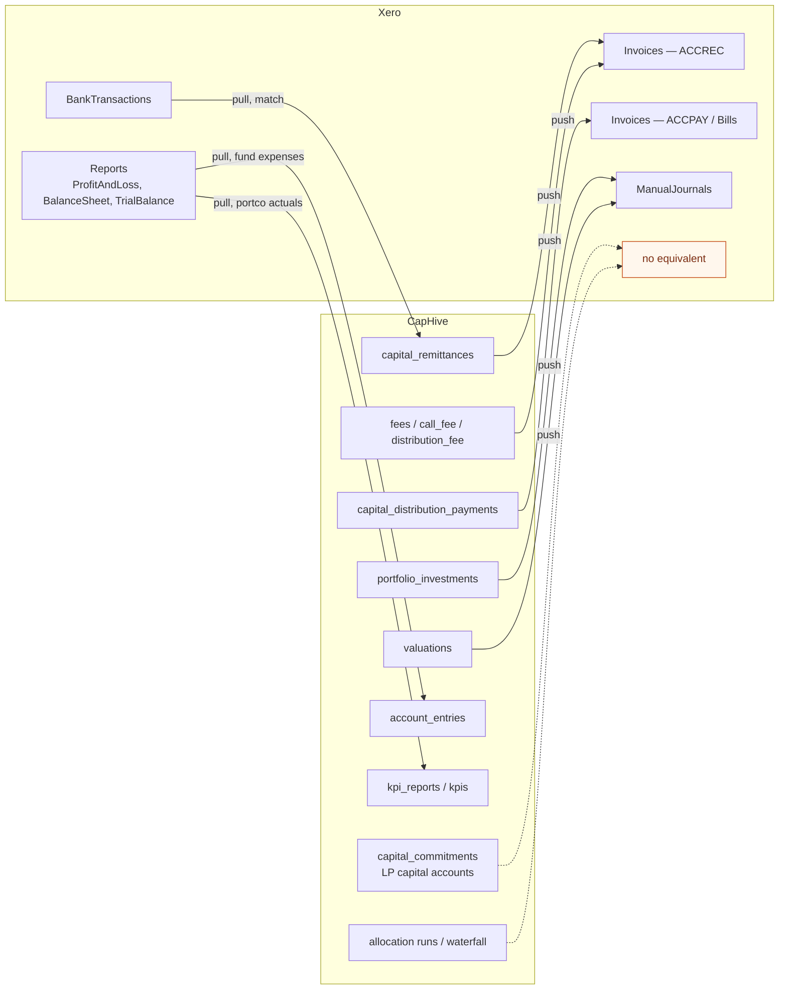
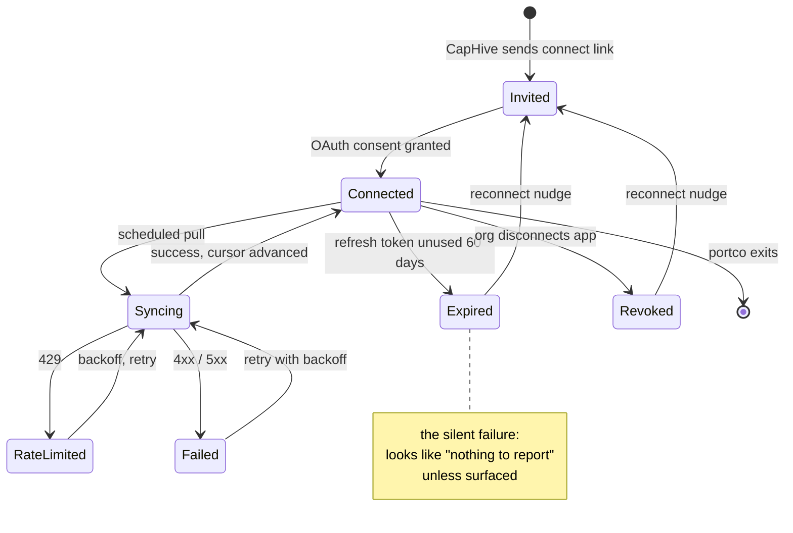

# Xero integration — use cases

Research note, 2026-09-21. Written in response to customers asking for a Xero integration.
This is a scoping document, not a design: it separates the three things customers mean by
"Xero", sizes each one against what CapHive already stores, and lists the platform
constraints that shape any build. A change proposal belongs in `openspec/changes/`.

## Summary

There are **three different integrations** behind the request. They have different buyers,
different data flows and very different build cost, so they should be scoped separately.

| # | Direction | Buyer | Value | Cost |
|---|---|---|---|---|
| 1 | Portco's Xero → CapHive KPIs | VC / growth investor | High — differentiating | Medium (mapping + app certification) |
| 2 | Fund/SPV books ↔ Xero | Fund admin, small GP | High — bank rec especially | Medium–high |
| 3 | ManCo / GP entity ↔ Xero | GP finance | Low–medium | Low |

Recommended sequencing: **1**, then the bank-reconciliation slice of **2**, then **3**.

Xero never holds investor-level capital accounts in any of the three: that stays in CapHive.

Before scoping further, one question needs answering per customer: are they asking about
**their own fund/ManCo books** in Xero, or about **their portfolio companies'** Xero?
Those are almost entirely separate builds.

## 1. Portfolio-company financials → CapHive KPIs

The pattern Standard Metrics, Visible, Archstone and Allvue all built. It removes work from
the KPI cycle rather than adding a sync to maintain.

- Portco founder connects their own Xero org once (OAuth); CapHive pulls P&L, Balance Sheet
  and Trial Balance on a schedule — no quarterly KPI chase email.
- Auto-populates `kpi_reports` instead of the manual / `import_upload` path: revenue, gross
  margin, opex, EBITDA, cash balance, net burn — and runway as a derived KPI.
- Turns the KPI cycle into review-and-confirm: pre-filled report, founder approves,
  `submitted_at` / `validated_at` set automatically.
- Monthly cadence instead of quarterly at no extra founder cost — much better early warning
  on burn and runway.
- Feeds the existing `PortfolioCompanyAgent` compliance checks: "KPI not submitted" becomes
  rare, and the agent can instead flag *divergence* between submitted numbers and Xero
  actuals.
- The real work is chart-of-accounts mapping per portco (their account names → the CapHive
  KPI taxonomy). `investor_kpi_mapping` is the natural home; account-name→KPI mapping is a
  good LLM-assisted-then-human-confirmed task.

- Caveat: only covers portcos small enough to be on Xero (typically pre-Series B, and
  AU/NZ/UK-weighted), and accrual quality varies. Surface "unreconciled" / "draft" state
  rather than trusting the numbers blindly.

## 2. Fund / SPV books ↔ Xero

Many smaller GPs and SPV managers genuinely keep fund books in Xero, one Xero org per
fund or SPV.

- **Push CapHive → Xero**: capital call receipts (`capital_remittances`), distributions
  (`capital_distribution_payments`), management fees and other `fees` / `call_fee` /
  `distribution_fee` posted as invoices, bills or manual journals — so the accountant stops
  rekeying what CapHive already computed.
- **Pull Xero → CapHive**: fund-level expenses (audit, legal, admin) posted in Xero,
  imported as `account_entries` so they flow into NAV and allocation runs without being
  typed twice.
- **Bank reconciliation of capital calls**: read Xero bank transactions and auto-match
  incoming wires to outstanding `capital_remittances`. The most repetitive task in a call
  cycle and the strongest demo in this group.

- **Tie-out**: reconcile the CapHive ledger against Xero's trial balance at period close and
  show the difference — `tie_out_figure` already exists to hang this on.
- **Investment and valuation postings**: push cost of `portfolio_investments` and fair-value
  adjustments from `valuations` into Xero as journals so the fund's balance sheet matches
  the portfolio.
- Caveat to state plainly to customers: Xero is not a fund accounting system. No
  investor-level capital accounts, no waterfall, no commitment tracking. The integration
  positions CapHive as the investor and allocation layer and Xero as the statutory GL — it
  replaces neither.
- Structural constraint: Xero allows only **2 tracking categories × ~100 options** per org,
  so "one Xero org per fund" is the workable pattern, not "one org, funds as tracking
  codes". Multi-fund managers then need per-tenant connection management.

## 3. Management company / GP entity

- Push management-fee and carry invoices raised in CapHive into the ManCo's Xero as sales
  invoices, and read paid/unpaid status back.
- Pull ManCo expenses that get allocated across funds, so the allocation lives in CapHive
  but the source of truth stays in the accountant's system.
- Fund-expense allocation both ways: one bill in Xero → split across funds by commitment
  percentage in CapHive → journals back.

## Object mapping

Which Xero object each CapHive concept lands on, and in which direction. Anything Xero has
no home for stays CapHive-only — that column is the argument for why the integration is not
a migration.

## Cross-cutting benefits

- Kills double entry between the GP's accountant and the platform — the reason named first
  in every Xero integration pitch.
- Audit season: auditors get a CapHive-to-Xero reconciliation instead of a spreadsheet.
- Accountant-led distribution: Xero's app marketplace and its accountant/bookkeeper channel
  are a real inbound source in AU/NZ/UK, where Xero holds roughly 70–80% of the Australian
  cloud accounting market and ~4.2M subscribers, against QuickBooks' North American
  dominance (~7M). If these customers are AU/NZ/UK, Xero first and QuickBooks second; if
  US, reverse it.
- The same connector shape works for QuickBooks and NetSuite later — build the mapping and
  sync layer once and treat Xero as the first adapter.

## Platform constraints to plan around

A connection is a per-org OAuth grant, and the failure mode that matters is a *silent* one:
a portco connection that lapses looks identical to a portco with nothing to report until
someone checks. Any build needs the reconnect path in scope from day one.

- OAuth 2.0 per Xero org ("tenant"); 30-minute access tokens with 60-day refresh. Needs
  token storage and reconnect nudges — a dormant portco connection expires silently.
- Rate limits: 60 calls/minute and 5,000 calls/day **per org**, so per-tenant limits do not
  collide. But 100+ portco orgs on a nightly sync needs a queued, staggered job.
- Uncertified apps are capped at 25 connected orgs. App certification is a prerequisite for
  the portco use case at any real scale.
- `/Journals` is read-only (no POST). Writes go through Invoices, BankTransactions and
  ManualJournals, batched up to 50 per request.
- Webhooks cover only a narrow set (contacts, invoices), so most syncing is polled with
  `If-Modified-Since`, not pushed.
- No existing OAuth-client integration pattern in the codebase to copy wholesale: DocuSign
  (`app/packs/core/investor_kycs/services/docusign/`) uses JWT service-account auth, not
  per-tenant user consent. Token storage and refresh would be new.

## Sources

- [Xero Accounting API overview](https://developer.xero.com/documentation/api/accounting/overview)
- [Accounting API Reports](https://developer.xero.com/documentation/api/accounting/reports)
- [Accounting API Tracking Categories](https://developer.xero.com/documentation/api/accounting/trackingcategories)
- [Xero rate limits](https://developer.xero.com/documentation/best-practices/api-call-efficiencies/rate-limits)
- [OAuth 2.0 API limits](https://developer.xero.com/documentation/guides/oauth2/limits/)
- [Standard Metrics — portfolio monitoring software](https://standardmetrics.io/library/portfolio-monitoring-software-an-investors-guide/)
- [Visible.vc — VC reporting software](https://visible.vc/blog/venture-capital-reporting-software/)
- [Allvue — portfolio monitoring](https://www.allvuesystems.com/solutions/portfolio-monitoring/)
- [Carta — fund accounting](https://carta.com/learn/private-funds/management/fund-administration/fund-accounting/)
- [Allocations — what SPV administration includes](https://www.allocations.com/insights/what-spv-administration-includes)
- [Xero market share in Australia](https://www.scalesuite.com.au/resources/xero-market-share-australian-businesses)
- [QuickBooks market share](https://www.acecloudhosting.com/blog/quickbooks-market-share/)
