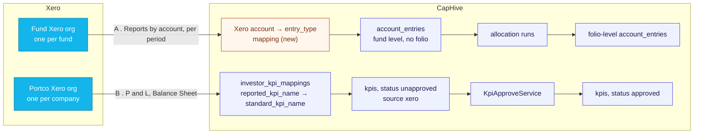
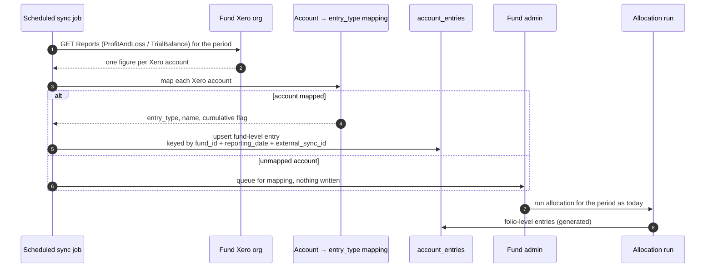
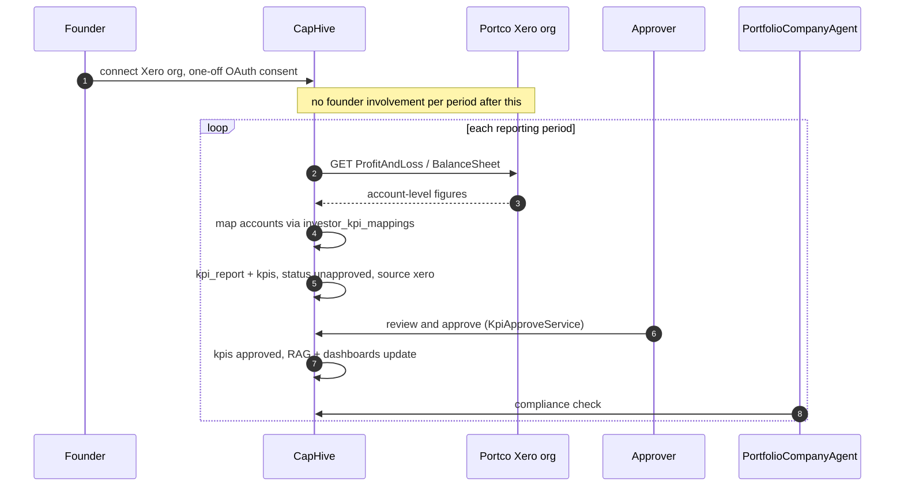
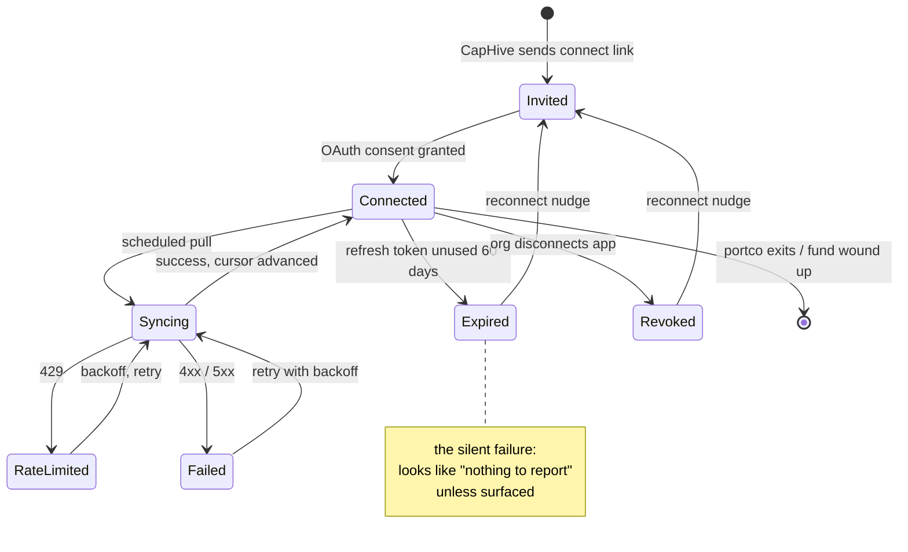

# Xero integration — use cases

Research note, first written 2026-09-21, pruned 2026-09-30. This is a scoping document, not a
design; a change proposal belongs in `openspec/changes/`.

## Scope

Two use cases, both **pull only** in Phase I:

| # | Source | Lands in CapHive as | Buyer |
|---|---|---|---|
| A | Fund's own Xero org (one per fund / SPV) | fund-level `account_entries` | Fund admin, small GP |
| B | Portfolio company's Xero org (one per company) | `kpis` on a `kpi_report` | VC / growth investor |

Out of scope: pushing anything into Xero (Phase II, see the end), bank reconciliation of
capital calls, investment / valuation journals, and the ManCo / GP entity's books.

Xero never holds investor-level capital accounts in either flow. That stays in CapHive.

## A. Fund Xero → fund-level account entries

Many smaller GPs and SPV managers keep the fund's statutory books in Xero, one org per fund.
Fund-level expenses and income (audit, legal, admin, bank interest) are posted there and
then typed into CapHive a second time so they reach NAV and allocation runs. The sync
removes that second entry.

**Where it fits.** `ImportAccountEntry` already treats a row with no folio as a fund-level
entry (`app/packs/funds/capital_commitments/services/import_account_entry.rb:26`). Xero has
no idea who the LPs are, so every synced row is fund-level (`capital_commitment_id` nil), and
the existing allocation runs spread it across folios. The sync is another way to feed the
import, not a new ledger path.

**Decisions**

- **Granularity: one row per account per period, not per transaction.** Pull report totals
  (about 20–60 accounts per fund per period), not `/Journals` lines, which would add
  hundreds to thousands of rows per period to `account_entries`, the largest table in the
  system. Balance-sheet accounts map to `cumulative: true`; P&L accounts are period
  movements. (Phase II may need line-level reads; see below.)
- **Re-sync upserts on a new external reference column on `account_entries`.**
  `AccountEntry` checks uniqueness on `name + entry_type + reporting_date + amount_cents +
  …`, which includes the amount. Without a stable key, if an accountant corrects a Xero
  posting from 10,000 to 12,000 and the sync runs again, it inserts a second row instead
  of updating the first, and the fund's NAV counts the expense twice.
  The existing `ref_id` can't do this job. It is an integer (default 0) that the importer
  fills from the sheet's "Ref Id" column, and it sits inside the uniqueness check next to
  `amount_cents` so that two otherwise identical rows can both exist. It tells duplicates
  apart; it doesn't identify an entry, and Xero account ids are GUIDs anyway. So a new
  column is needed: `external_sync_id`, a nullable string wide enough for a GUID
  (36 characters), holding the Xero `AccountID` as-is. The period and the Xero org are
  already on the row, so they aren't encoded into the column: the period is
  `reporting_date`, and the org is implied by `fund_id`, since each fund connects to one
  Xero org. The sync looks up by `fund_id + reporting_date + external_sync_id`, updates
  the amount when the row exists, and inserts otherwise. That combination is also the
  index. Rows entered by hand or uploaded leave it null and behave as they do today. `account_entries` is very large, so the migration needs care: a nullable column
  can be added instantly in MySQL 8, but building the index cannot.
- **Account mapping: a per-fund table, new.** It maps each Xero account to an
  `entry_type` / `name` / `cumulative` flag, is set up once per fund, and is extended when
  the accountant adds accounts. An unmapped account is held back and shown to the fund
  admin, never dropped silently.
- **Periods already allocated are flagged, not overwritten.** Once CapHive has run an
  allocation for a period, a later change in Xero for that period is held for review.
  It does not quietly change the fund-level entry under a finished run.
- **Structure constraint:** Xero allows only 2 tracking categories × ~100 options per org,
  so "one Xero org per fund" is the pattern that works, not "one org, funds as tracking
  codes". A multi-fund manager has one connection per fund.
- **What to tell customers plainly:** Xero is not a fund accounting system. CapHive stays
  the investor and allocation layer; Xero stays the statutory ledger.

## B. Portfolio-company Xero → KPIs

The pattern Standard Metrics, Visible and Allvue built. The founder connects the company's
Xero org once; after that CapHive pulls actuals every period with no KPI chase email.

**Where it fits.** It is one more importer beside `ImportKpiWorkbookJob`, using the
staging workflow that already exists:

- Imported values land as `kpis` with `status: unapproved`, and `KpiApproveService` promotes
  them to `approved` (see `app/packs/startups/kpis/jobs/kpi_import_process.md`). An
  unapproved KPI never reaches reports or RAG rules.
- `investor_kpi_mappings.reported_kpi_name` → `standard_kpi_name` is already how an
  external label maps to a standard KPI. A Xero account name (or a sum of accounts) is
  just another reported name.
- `kpis.source` records `"xero"`, so reviewers can tell pulled values from uploaded ones.

**Benefits**

- Revenue, gross margin, opex, EBITDA, cash balance, net burn and runway (derived)
  populate themselves, so reporting can be monthly instead of quarterly at no extra cost
  to the founder.
- `PortfolioCompanyAgent`'s "KPI not submitted" check fires far less often for connected
  companies. It could later compare figures a founder uploads with the Xero actuals.

**Caveats**

- Only reaches companies small enough to run on Xero (typically pre-Series B; strongest in
  AU / NZ / UK). Accrual quality varies, so reports should flag draft or unreconciled
  periods rather than trust them blindly.
- The real work is mapping each company's chart of accounts to CapHive's KPI list, which
  differs per company. An LLM can suggest the mapping and a person confirms it; after
  that it is reused every period.

## Platform constraints (both use cases)

A connection is an OAuth grant per Xero org, and it fails silently: a lapsed connection
looks exactly like "nothing new this period" until someone checks. The reconnect path has
to be in scope from day one.

- OAuth 2.0 per Xero org ("tenant"). Access tokens last 30 minutes; refresh tokens lapse
  after 60 days unused. Needs token storage, refresh, and reconnect nudges.
- Rate limits are per org: 60 calls/minute and 5,000 calls/day, so orgs don't compete for
  the same limit. A nightly sync of 100+ orgs still needs a queued, staggered job.
- An uncertified app can connect at most 25 orgs. For use case B at any real scale, app
  certification must happen first.
- Webhooks cover only a narrow set of objects (contacts, invoices), so syncing is a
  scheduled poll.
- There is no OAuth-client integration in the codebase to copy. DocuSign
  (`app/packs/core/investor_kycs/services/docusign/`) uses JWT service-account auth, not
  per-org user consent, so token storage and refresh are new work.

## Phase II — push (not scoped)

Pushing CapHive entries to Xero (for example, allocation-run output summed to fund level
and posted as ManualJournals) is deferred to Phase II. The one thing that must carry into
Phase I's design: once CapHive writes into Xero, the pull will see those postings on its
next run and import them back, double counting them. Phase II has to separate what CapHive
pushed from what the accountant posted, most likely by reading `/Journals` lines instead of
report totals, or by using accounts only CapHive writes to. Keep the Phase I external-key
design general enough to record pushed objects too.

## Sources

- [Xero Accounting API overview](https://developer.xero.com/documentation/api/accounting/overview)
- [Accounting API Reports](https://developer.xero.com/documentation/api/accounting/reports)
- [Accounting API Tracking Categories](https://developer.xero.com/documentation/api/accounting/trackingcategories)
- [Xero rate limits](https://developer.xero.com/documentation/best-practices/api-call-efficiencies/rate-limits)
- [OAuth 2.0 API limits](https://developer.xero.com/documentation/guides/oauth2/limits/)
- [Standard Metrics — portfolio monitoring software](https://standardmetrics.io/library/portfolio-monitoring-software-an-investors-guide/)
- [Visible.vc — VC reporting software](https://visible.vc/blog/venture-capital-reporting-software/)
- [Allvue — portfolio monitoring](https://www.allvuesystems.com/solutions/portfolio-monitoring/)
