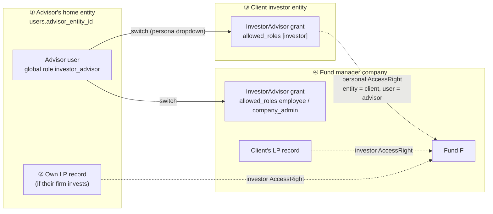
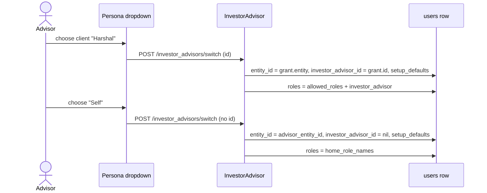
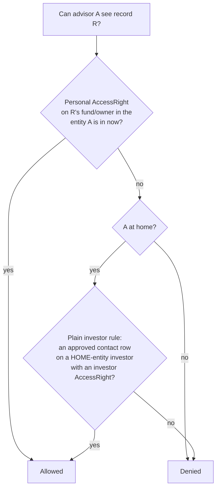
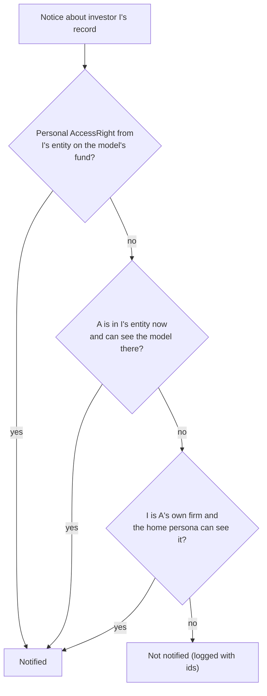

# Investor Advisors — how the role works

How a user acts for other organisations in CapHive: the two kinds of advisor grant, switching
persona, what an advisor can see and is notified about at home and while switched, and the full
lifecycle from adding to removing. Written from the code as of 2026-10-17 (`origin/main` `dd657b7a2`
plus [#1836](https://github.com/ausangshukla/IRM/pull/1836) and the tenant-isolation batch 1 fixes,
[fix-tenant-isolation-batch1](../../../openspec/changes/fix-tenant-isolation-batch1/report.md)). For the user-facing view see the
[Investor Advisor user guide](../../user_guides/investor_advisor_user_guide.md). For past security
fixes see [docs/security/investor_advisor_security_review.md](../../security/investor_advisor_security_review.md).

---

## 1. The picture

| # | Box | Real names |
|---|---|---|
| ① | The advisor's own firm (an *Investor Advisor*, *Investor*, *Family Office* or fund company) | `users.advisor_entity_id`; roles restored on revert = `users.advisor_entity_roles` (`User#home_role_names`) |
| ② | The advisor's firm as an LP of some fund, if it invests itself | `Investor` with `investor_entity_id` = home, the advisor's `InvestorAccess` row on it |
| ③ | **Investor Advisor** grant: the advisor acts for a client investor | `InvestorAdvisor` with `entity_id` = the client's investor entity, `allowed_roles` `[investor]`; personal `AccessRight` (`user_id` = advisor, `entity_id` = client) per fund; `InvestorAccess` on the client's LP record |
| ④ | **Fund Advisor** grant: the advisor works as staff of a fund manager | `InvestorAdvisor` with `entity_id` = the fund company, `allowed_roles` from `employee`, `company_admin`, `approver`, `rm`; personal `AccessRight` per fund (the fund's **Access** tab) |

**One global role.** Any grant gives the user the rolify role `investor_advisor` with no resource.
The role says "this user is an advisor somewhere". It never says for whom, so every rule below works
out *where the user is now* and *whose record it is*.

---

## 2. Persona: at home vs switched

| State | How the code knows | Code |
|---|---|---|
| **Switched** into a grant | `entity_id != advisor_entity_id` (`User#investor_advisor?`), or `investor_advisor_id` set | `user.rb` |
| **At home** | neither marker set | `ApplicationPolicy#advisor_at_home?`: both markers, because prod has advisors with a nil `advisor_entity_id` and switched advisors with a nil `investor_advisor_id` |
| Feature flags while switched | the grant's `permissions` / `extended_permissions` | `UserEnabled#get_permissions`, `#get_extended_permissions` |

**Home persona.** `User#home_persona` is an in-memory, read-only copy of the user as a revert would
leave them (home entity, `home_role_names`, the `curr_role` that `setup_defaults` sets there). It
lets a check ask "would they see this at home?" without moving the real user.
`User#switched_persona(grant)` does the same for a switch.

**`users.entity_id` is transient for advisors.** It is wherever they last switched. Never treat it as
the advisor's company. Use `advisor_entity_id` for "their firm".

---

## 3. What an advisor can see

`ApplicationPolicy#permissioned_investor?` is the rule every investor-side policy uses (funds,
commitments, calls, remittances, distributions, account entries, units, ratios, portfolio, deals'
`overview?`, opportunities, secondaries, approvals).

| Persona | Own firm's LP records ② | Client's records ③ | Fund company as staff ④ |
|---|---|---|---|
| At home | ✅ like any contact of that LP | ❌ | ❌ |
| Switched into the client | ❌ (Access Denied with "Switch your persona to Self") | ✅ only funds with a personal grant | ❌ |
| Switched into the fund company (Fund Advisor) | ❌ | ❌ | ✅ as `employee`/`company_admin`, limited by the grant's permissions |

- **Lists match pages.** The fund list scopes (`Fund.for_investor`, `ForInvestor`) decide by switch state the same way (`AccessRight.access_filter`, `investor_granted_access_filter`).
- **KYC:** `InvestorKycPolicy#show?` adds the advisor's staff grant on the KYC's entity (judged by the grant wherever they are) and, at home, their own investor's KYC.
- **An advisor account without the role** (stored home roles leave out `investor_advisor`) uses the plain investor rule with the same home-entity limit.

### Access Denied guidance

`WithAuthentication#access_denied_message` re-runs the denied policy query against the home persona
and against the switched persona for at most two candidate grants: the record's investor entity,
then its company. It then says what would work:

| Situation | Message |
|---|---|
| Switched away, own record | Access Denied: you are currently switched into X. Switch your persona to Self to view this. |
| A client or fund company they advise could see it | Access Denied: You can view this as an advisor for Y. Switch your persona to Y to view it. **[Switch to Y]** (full-page denials; returns to the page via `return_to`, same-site paths only) |
| No switch helps | Access Denied |

---

## 4. What an advisor is notified about

Recipients come from `Investor#notification_users(model, with_tag:)`: approved contact rows,
filtered by Notification Topics (`tag_list`), then by access. For a contact holding the advisor
role the access test is `Investor#advisor_notifiable?`:

| Notice is about | A at home | A switched into a client | A switched into the fund company |
|---|---|---|---|
| Their own firm's LP | ✅ | ✅ (home persona) | ✅ (home persona) |
| A client with a personal grant on that fund | ✅ | ✅ | ✅ |
| A client without a personal grant on that fund | ❌ | ❌ (even if switched into a different client sharing the fund) | ❌ |

- **Email** goes out unless the recipient's contact row on that folio has email turned off. The advisor-grant override in `config/initializers/noticed.rb` never reverses a named contact's opt-out (`named_contact_on_folio?`). A Fund Advisor **switched into** the fund company counts as staff of it and is emailed whatever their contact row says.
- **The fund's recipient preview** uses the same rule (`FundsHelper#calculate_user_access_stats` → `advisor_notifiable?`).
- **Deal notices** use `overview?` as well as `show?` (`Investor#investor_can_view?`).

---

## 5. Lifecycle

| Action | Where | What happens |
|---|---|---|
| Add from a commitment | Commitment → **Actions → Add Investor Advisor** (company admin of the fund company) | `AddFolioInvestorAdvisor`: creates the user and an *Investor Advisor* firm if the email is new, then the grant on the client's entity with roles `[investor]`, a personal fund AccessRight, and an approved contact row. The client entity's company admins are notified. |
| Import | Fund → **Import → Import Investor Advisors** | `ImportInvestorAdvisor`: same objects. **Allowed Roles** defaults to `employee,investor` when blank (the commitment flow forces `investor`). |
| Add to own entity | Company menu → **Advisors** → **New Investor Advisor** | Links a user who already holds the role. Creates no login. |
| Add as a plain contact | Stakeholder → **Users** → **New** | Refused for advisor-role users (client access must come with grants), **except** on the LP record of the advisor's own firm (#1836). |
| Switch / revert | Persona dropdown (topbar) | §2. One transaction under a row lock: the entity move and the role swap succeed or fail together, and a grant deleted meanwhile can't be switched into. Users whose own firm is of type *Investor Advisor* are submitted into their first grant automatically on a full page load (`_personas.html.erb`). |
| Edit a grant | Company menu → **Advisors** → **Edit** | Only **Allowed Roles**, **Permissions** and **Extended Permissions** change. The grant's entity and email are fixed at creation; it stays linked to its user even if their login email changes. |
| Remove a client row | Stakeholder → **Users** → **Delete** | Soft-deletes the row. `remove_advisor_fund_access_rights` deletes the personal fund grant in that client's entity unless another approved advisor row of the **same client** is still in that fund. |
| Scheduled reports | Report builder schedules | A schedule runs against the report's own entity, whatever persona its owner is in, and is skipped once the owner no longer belongs there. |
| Delete a grant | Company menu → **Advisors** → **Delete** (grant's own entity) | If the advisor is switched into that grant, sends them home first. Then removes the user's AccessRights in that entity and their contact rows on that entity's investors. Their login and firm stay. |

---

## 6. Known functional gaps (not security)

Found in the review of 2026-10-17. Each is behaviour that surprises users, not a data leak.
Security findings from the same review are fixed in
[fix-tenant-isolation-batch1](../../../openspec/changes/fix-tenant-isolation-batch1/report.md); the
ones needing a product decision are listed there as batch 2.

| Gap | Effect | Where |
|---|---|---|
| Auto-switch on page load for *Investor Advisor*-type firms | They can't stay on **Self** past a reload, so their own firm's view and the "Switch to Self" hint don't stick. The client picked is the first grant, in no fixed order | `investor_advisors/_personas.html.erb` |
| Re-adding a deleted advisor | Can be refused with "Email has already been taken", because uniqueness checks see the soft-deleted grant / contact row | `investor_advisor.rb` `validates_uniqueness_of :email`, `investor_access.rb` |
| Email links carry `investor_advisor_id` | The link does not switch persona (switching is POST-only). The Access Denied **Switch to …** button is the way in | `base_notifier.rb` |
| Switched advisors can't open **All Notifications** | The bell shows a count, but the page is refused while switched | `NotificationPolicy#index?` |
| Who is told about a new advisor | Company admins whose current entity is the client. Often none for an LP entity. Not sent when the grant is reused for another fund | `InvestorAdvisor#notify_investor_team` |
| Own-firm contact row labelled "Advisor" | Users tab shows **Advisor** for a plain own-firm contact row | `_investor_access.html.erb` |
| After switch/revert, back to the same page | Can land on a page the new persona can't see (Access Denied right after choosing **Self**) | `InvestorAdvisorsController#switch` (`redirect_back`) |
| Home dashboard for an *Investor Advisor* firm user with `curr_role` employee | No dashboard partial matches, so the page is empty | `entities/dashboard.html.erb` |
| Personal shares at home | A document shared to the advisor personally opens but is not listed at home | `AccessRight.access_filter` |
| No-model recipient paths | Investment opportunities, EOIs, approvals, secondary-sale buyer/seller lists, NDA auto-tag and KYC reminders include client contact rows without a grant check | `investment_opportunity.rb`, `approval_response.rb`, `secondary_sale_notifiers.rb`, `nda_notification_recipients.rb`, `kyc_reminder_job.rb` |
| Persona list cached | The topbar fragment (5 days) doesn't change when a grant is added or removed, until the next switch or sign-in | `layouts/modernize/_topbar.html.erb` |

---

## 7. Reference

- Security: [fix-tenant-isolation-batch1](../../../openspec/changes/fix-tenant-isolation-batch1/report.md) (tenant keys from the server, grant edit/delete, scheduled reports, user pages), `features/security/tenant_isolation_batch1.feature`.
- Changes: [fix-advisor-own-investor-access](../../../openspec/changes/fix-advisor-own-investor-access/report.md) (own-investor access, notifications, Access Denied guidance) · [fix-advisor-add-own-lp-contact](../../../openspec/changes/fix-advisor-add-own-lp-contact/report.md) (Users form) · [kyc-advisor-notification-delivery-fix](../../../openspec/changes/kyc-advisor-notification-delivery-fix/design.md) (KYC emails).
- Tests: `features/advisor/investor_advisor_own_investor_access.feature` (H1–H8, E1–E18, X1–X11), `features/advisor/investor_advisor_notifications.feature` (NOTIF-1..9), `features/core/investor_access_advisor_own_lp.feature`, `features/advisor/investor_advisor.feature`.
- Support tooling: the **Investor Advisor Health Check** on a user's page (`User#investor_advisor_setup_issues`, `User.check_investor_advisor(email)`).
