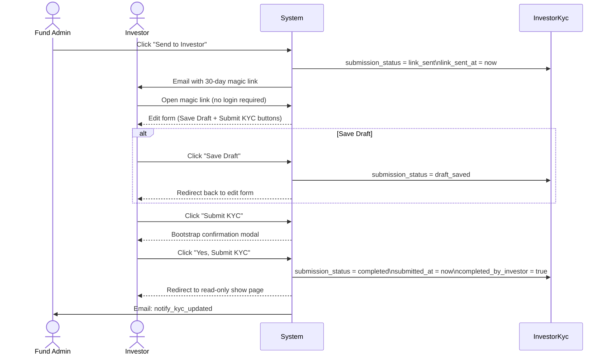
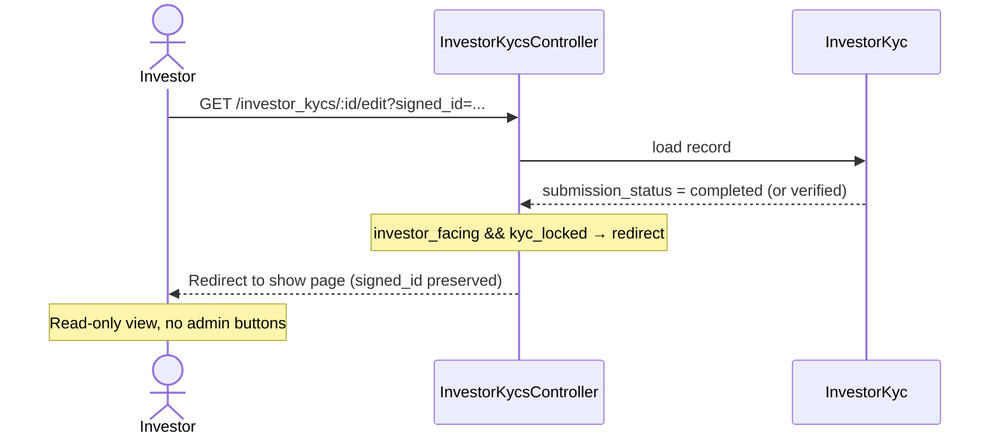
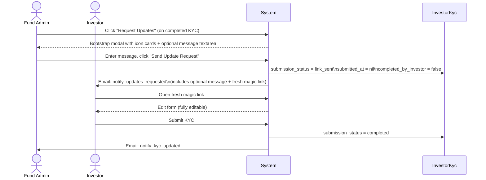
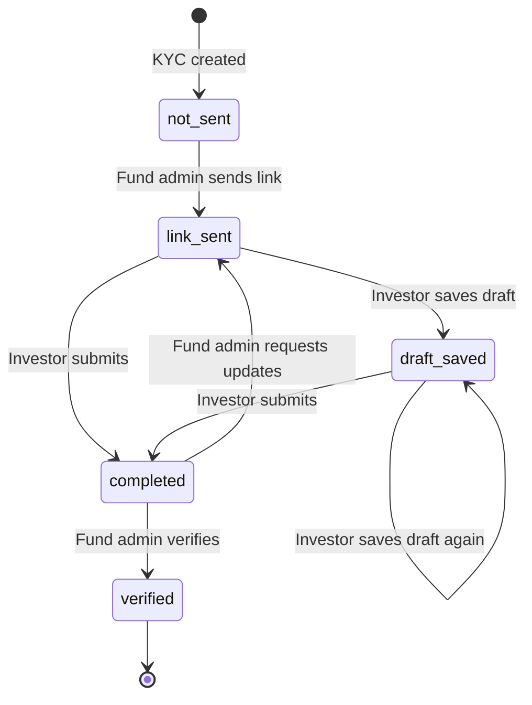

# Investor KYC Send Workflow — Technical Reference

Implemented on: `feature/investor-kyc-status-workflow`  
PRD: `docs/modules/investors/investor_kyc_enhancement_prd.md` (Part 2)

---

## Overview

This document covers the status-tracking and magic-link layer added to the `InvestorKyc` send workflow. It mirrors the `KpiReport` portco workflow pattern.

---

## Flow Diagrams

### Main Send → Submit Flow



### Locked KYC — Investor Accesses After Submission



### Request Updates Flow



### State Machine



---

## Database Changes

Migration: `db/migrate/20260522100001_add_submission_status_to_investor_kycs.rb`

| Column | Type | Default | Purpose |
|--------|------|---------|---------|
| `submission_status` | string | `"not_sent"` | State machine tracking send/fill/submit lifecycle |
| `link_sent_at` | datetime | nil | Timestamp when magic link was last dispatched |
| `submitted_at` | datetime | nil | Timestamp when investor submitted the form |

---

## State Machine

`InvestorKyc` gains a `submission_status` string enum (prefix `:submission`):

| Value | Enum helper | Meaning |
|-------|------------|---------|
| `not_sent` | `submission_not_sent?` | Created, not yet sent |
| `link_sent` | `submission_link_sent?` | Magic link emailed to investor |
| `draft_saved` | `submission_draft_saved?` | Investor saved progress |
| `completed` | `submission_completed?` | Investor submitted |
| `verified` | `submission_verified?` | Fund admin verified |

### Boolean sync

`after_save :sync_boolean_fields_from_status` keeps `completed_by_investor` and `verified` booleans in sync whenever `submission_status` changes, so all existing scopes (`.completed`, `.verified`) continue to work without modification.

---

## Magic Link

`InvestorKyc` is added to `ApplicationRecord::SIGNED_ID_ALLOWED_MODELS`. The existing `signed_id_for_user` / `find_by_signed_id_for_user` infrastructure (shared with `KpiReport`) handles token generation and verification.

- Expiry: **30 days** (KpiReport uses 15 days)
- Token includes: model name, record id, user email
- Invalid/expired tokens render an inline error page (no redirect, no exception)

### How the link is generated

`InvestorKycMailer#setup` generates `@signed_id` for emails where the investor is the recipient:
- `notify_kyc_required`
- `kyc_required_reminder`
- `notify_updates_requested`

The signed link is embedded in the email templates as `edit_investor_kyc_url(kyc, signed_id: @signed_id)`.

---

## Controller Changes (`InvestorKycsController`)

### Unauthenticated access

```ruby
skip_before_action :authenticate_user!, only: %i[show edit update extract_docs_data], if: -> { params[:signed_id].present? }
```

`show` is included so that investors redirected from a locked `edit` can view the read-only show page without authenticating.

`set_investor_kyc` calls `find_by_signed_id_for_user(params[:signed_id])` when the param is present. On failure it renders an inline expired-link page and returns early.

### `pundit_user` override

```ruby
def pundit_user
  @signed_id_user || current_user
end
```

`@signed_id_user` is set by `find_by_signed_id_for_user` when a valid token is found.

### Locked KYC redirect in `edit`

When an investor (via `signed_id` or `investor` role) opens the edit page for a completed/verified KYC, they are immediately redirected to the show page:

```ruby
if investor_facing && kyc_locked
  redirect_to investor_kyc_url(@investor_kyc, signed_id: params[:signed_id])
end
```

This replaces the old disabled-form approach.

### Status transitions

`resolve_status_transition(submit_action)` maps the `params[:submit_action]` value from the form to a status hash:

| `submit_action` param | Resulting `submission_status` |
|-----------------------|-------------------------------|
| `"final"` | `"completed"`, sets `submitted_at` |
| *(blank, KYC is not_sent or link_sent)* | `"draft_saved"` |
| *(blank, KYC already in draft_saved+)* | no change |

After a final submission (`submit_action=final`), the investor is redirected to the **show** page (not back to edit). For all other saves, redirect is back to edit with `signed_id`.

### Guard against locked-KYC updates

`update` rejects investor submissions to a completed/verified KYC at the server level:

```ruby
if was_already_completed && investor_user
  redirect_to investor_kyc_url(@investor_kyc, signed_id: params[:signed_id]), alert: "..."
end
```

### New routes

```
POST /investor_kycs/:id/request_updates   → request_updates
GET  /investor_kycs/investor_pending      → investor_pending
```

### `request_updates` action

Resets status to `link_sent`, clears `submitted_at` and `completed_by_investor`, sends `notify_updates_requested` email with optional custom message. Only available to employees with `investor_kyc_update` permission.

### `investor_pending` action

Returns all `InvestorKyc` records in `link_sent` or `draft_saved` state for the logged-in investor (via `pending_investor` scope + `for_investor` scope). Requires `investor` role.

---

## Policy Changes (`InvestorKycPolicy`)

| Method | Rule |
|--------|------|
| `edit?` | Allows `signed_id_access?` (used for the redirect path; investor never sees the edit form when locked) |
| `update?` | Also allows `signed_id_investor?` (only when not yet completed/verified) |
| `request_updates?` | Requires `permissioned_employee?(:investor_kyc_update)` |
| `investor_pending?` | Requires `user.curr_role == "investor"` |

Private helper `signed_id_investor?` returns true when `signed_id_access?` is true and the KYC is neither completed nor verified.

---

## Form Changes

`_form.html.erb` introduces these local booleans:

| Variable | Meaning |
|----------|---------|
| `via_signed_id` | `params[:signed_id].present?` |
| `kyc_locked` | KYC is completed or verified |
| `investor_facing` | `is_investor \|\| via_signed_id` |
| `show_investor_btns` | `investor_facing && !kyc_locked` |

When `show_investor_btns` is true, each wizard step shows **Save Draft** and (on the last step) **Submit KYC** buttons instead of the generic Save button.

**Submit KYC** triggers a Bootstrap confirmation modal (`#submitKycConfirmModal`) — not a browser `confirm()` dialog. The modal lives in the `wizard_container` div (outside the `<form>` tag to avoid Bootstrap backdrop stacking issues). The `interim-save` Stimulus controller is attached to `wizard_container` (not the form) so both the form and the modal button are within its scope.

Investors accessing a locked KYC are redirected to `show` by the controller before the form renders — the form itself has no disabled state for investors.

The hidden `signed_id` input is injected into the form so the param persists through Save Draft redirects.

---

## Show Page Changes

### Status badge in Attributes panel

The `submission_status` badge is displayed as the first row of the **Attributes** card in the right column of the show page, alongside Expiry Date, Completed, KYC Verified, etc. The badge includes a sub-line for `submitted_at` (when completed) or `link_sent_at` (when link sent but not yet submitted).

### Investor-facing show page

When `params[:signed_id]` is present or the user has the `investor` role, all fund-admin action buttons (Edit, Delete, Verify, Request Updates, KYC Actions, Preview Notifications) are hidden. The investor sees only the read-only KYC data cards.

---

## Reminder Job Changes (`KycReminderJob`)

- Collection query now excludes `completed` and `verified` submission statuses at the DB level.
- Individual-KYC path skips via `next if submission_completed? || submission_verified?`.

---

## Mailer / Notifier

| Email method | Sent by | Trigger |
|-------------|---------|---------|
| `notify_kyc_required` | `InvestorKycNotifier` | Fund admin clicks Send / Bulk Send |
| `kyc_required_reminder` | `KycReminderJob` | Scheduled reminder |
| `notify_updates_requested` | `request_updates` action | Fund admin requests re-fill |
| `notify_kyc_updated` | `notify_fund_on_submission` (controller) | Investor submits (status → completed) |

All investor-facing emails (`notify_kyc_required`, `kyc_required_reminder`, `notify_updates_requested`) embed a 30-day magic link.

---

## Bulk Actions

New bulk action **"Send KYC Link"** on the index page enqueues `InvestorKycsBulkActionJob` with `bulk_action: "SendKycLink"`. KYCs already in `completed` or `verified` state are silently skipped by the job.

---

## Index Filters

Five new Send Status quick-filter links in the index filter dropdown map directly to `submission_status` ransack predicates: Not Sent, Link Sent, Draft Saved, Completed, Verified.

`submission_status` is also added to `ransackable_attributes` so custom Ransack queries work.

---

## Advisor Notification Bug Fix

`Investor#notification_users` previously called `user.dup` when evaluating `investor_advisor` policy access. `dup` clears the primary key and association cache, breaking `has_cached_role?`. Fixed to use the original user object; `permissioned_investor_advisor?` does not depend on `curr_role`.
