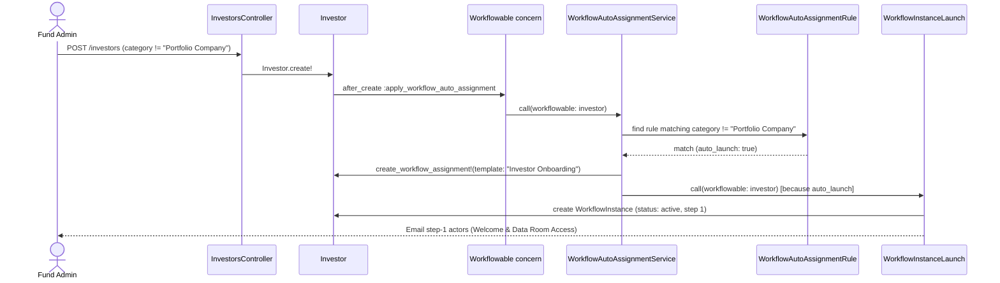
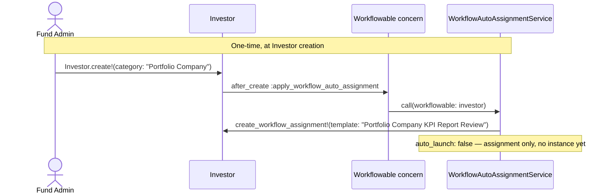
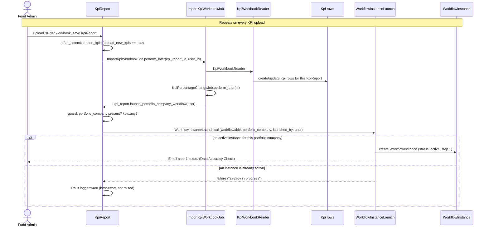
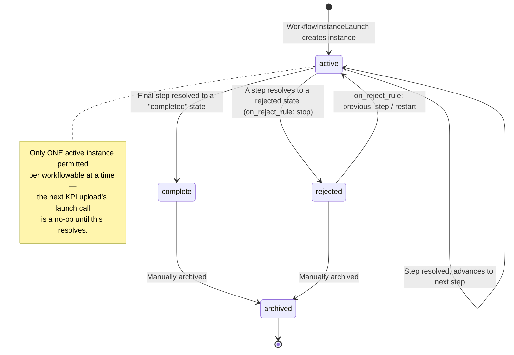

# Investor Workflow Templates — Technical Reference

Implemented on: `mandatory_attachments`

---

## Overview

`Investor` is registered as a sixth `workflowable_type` in the generic `app/packs/core/workflow_templates/` engine (alongside `Folder`, `InvestorKyc`, `CapitalCommitment`, `CapitalCall`, `Approval`). It covers two distinct scenarios, distinguished by the `category` column on `Investor` rather than by a separate `workflowable_type`:

1. **Investor Onboarding** — for regular (non-portfolio-company) investors.
2. **Portfolio Company KPI Report Review** — for portfolio companies (`category == "Portfolio Company"`), reviewed every time a new KPI report is uploaded for them.

### Why this needed two different mechanisms, not one

The engine's declarative auto-assignment layer (`WorkflowAutoAssignmentRule` / `WorkflowAutoAssignmentService`) only ever **assigns a template once** per record. `Workflowable#apply_workflow_auto_assignment_on_update` (`app/packs/core/workflow_templates/models/concerns/workflowable.rb:102-109`) bails out immediately once a template is already assigned:

```ruby
def apply_workflow_auto_assignment_on_update
  return unless respond_to?(:entity) && entity.present?
  return if workflow_assignment.present?   # <-- never re-evaluates once assigned
  ...
end
```

That's fine for onboarding (assign once, launch once, at creation). It is **not** fine for KPI report review, because KPI reports are periodic — a portfolio company needs a *fresh* review launched on every upload, not just the first one. Adding a column like `last_kpi_upload_date` to `Investor` would not fix this: the engine would still only react to it the first time, since the `workflow_assignment.present?` guard short-circuits every check after that.

The fix splits the two responsibilities:

| Responsibility | Mechanism | Where |
|---|---|---|
| **Assign** — decide which template applies to this Investor | Declarative `WorkflowAutoAssignmentRule`, keyed on `category` | Seeded once, in `lib/tasks/investor_workflow_seeds.rake` |
| **Launch** (onboarding) — start the review the moment the record exists | `auto_launch: true` on the rule | Same rule, fires via `after_create` |
| **Launch** (KPI review) — start a *new* review every time KPIs are uploaded | Explicit `WorkflowInstanceLaunch.call(...)` | `KpiReport#launch_portfolio_company_workflow`, called from `ImportKpiWorkbookJob` |

`WorkflowInstanceLaunch#create_instance` (`app/packs/core/workflow_templates/services/workflow_instance_launch.rb:14-37`) already refuses to start a second instance while one is active for the same workflowable, so calling it on every KPI upload is safe — it naturally just no-ops (logged, not raised) if the previous review hasn't been completed/archived yet.

---

## Flow Diagrams

### Scenario 1 — Investor Onboarding



### Scenario 2 — Portfolio Company KPI Report Review (the main flow)

Two separate events, potentially far apart in time: the Investor is created once; KPI reports are uploaded repeatedly afterward.





### `WorkflowInstance` state machine



---

## Where the code actually lives

| Concern | File |
|---|---|
| `Investor` registered as a workflowable type | `app/packs/core/workflow_templates/models/workflow_template.rb` (`WORKFLOWABLE_TYPE_OPTIONS`), `app/packs/core/workflow_templates/controllers/workflow_instances_controller.rb` (`ALLOWED_WORKFLOWABLE_TYPES`) |
| `Investor` becomes workflowable | `app/packs/core/investors/models/investor.rb` (`include Workflowable`, `workflow_display_name`) |
| Permission to assign/view workflows on an Investor | `app/packs/core/investors/policies/investor_policy.rb#assign_workflow?` |
| Workflow tab wiring | `app/packs/core/investors/controllers/investors_controller.rb` (`include HasWorkflowable`), `_portfolio_company_details.html.erb` / `_stakeholder_details.html.erb` (renders `workflow_templates/workflow_tab`) |
| Per-upload launch | `app/packs/startups/kpis/models/kpi_report.rb#launch_portfolio_company_workflow`, called from `app/packs/startups/kpis/jobs/import_kpi_workbook_job.rb` |
| Sample templates + rules + demo data | `lib/tasks/investor_workflow_seeds.rake` |

---

## Seeding / demoing this locally

```
rake 'investor_workflow_seeds:seed[ENTITY_ID]'
```

Creates both templates and their auto-assignment rules, plus one demo Portfolio Company Investor and one demo `KpiReport` (with a few `Kpi` rows). The seed calls `launch_portfolio_company_workflow` directly on the demo report — the same method the real upload job calls — since simulating an actual file upload isn't practical from a rake task.

```
rake 'investor_workflow_seeds:teardown[ENTITY_ID]'
```

Destroys the demo Investor/KpiReport/Kpi rows first (which cascades to their own `WorkflowInstance`/`WorkflowAssignment` rows), then the two templates. Note: `workflow_instances.workflow_template_id` is a real DB foreign key with no cascade — a template can only be destroyed once no `WorkflowInstance` row (active or archived) still references it; the teardown task reports (rather than crashes on) any template it can't remove for this reason.
