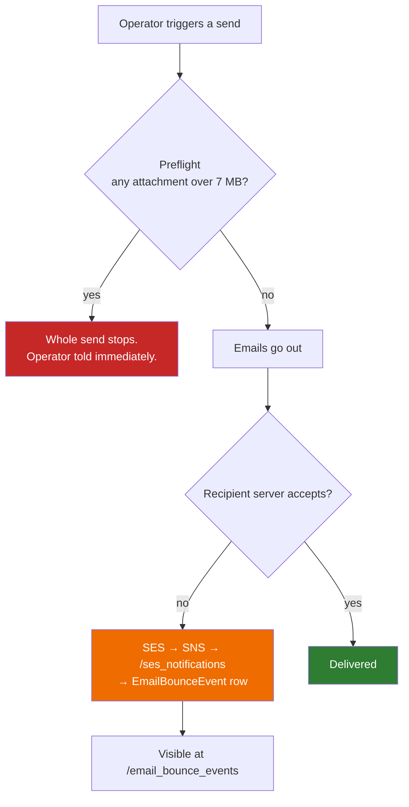

# Manual test plan — attachment size limit & SES bounce tracking

Hands-on checks for the two changes shipped in
[#1725](https://github.com/ausangshukla/IRM/pull/1725): the 7 MB email attachment limit,
and SES bounce/complaint tracking.

The automated suites already cover the logic — `--tags @attachment` (43 scenarios) and
`features/core/email_bounce_tracking.feature` (10 scenarios). **What they cannot cover is
real AWS and the real UI**, which is exactly where every bug in this feature was found.
Both bugs in the bounce handler passed all their tests.

---

## What is being tested



---

## Prerequisites

- A test entity with a fund, at least **two** capital commitments, each with an investor
  contact that has email enabled.
- An oversized file. Generate one rather than hunting for it:
  ```bash
  # ~10 MB PDF-named file; content does not matter, only the byte size
  dd if=/dev/urandom of=/tmp/big_report.pdf bs=1M count=10
  # ~4 MB, for the "several medium files" case
  dd if=/dev/urandom of=/tmp/mid_a.pdf bs=1M count=4
  dd if=/dev/urandom of=/tmp/mid_b.pdf bs=1M count=4
  ```
- For the bounce tests: an environment where `ses:verify_bounce_tracking[<env>]` reports all
  four checks green.
- **Restart Sidekiq before you start, and again after any code change you want to test.**
  This is not housekeeping — it silently invalidates a whole test session. Every send in
  section A runs inside a Sidekiq worker (`FundNotificationJob`, `CapitalCallJob`,
  `CapitalDistributionPaymentNotificationJob`), and a worker loads the code once at boot and
  never reloads it. A worker started before your change keeps producing the old behaviour
  however many times you press Send, with no error to indicate why. Verifying the same code
  via `rails runner` will pass, because that is a fresh process — so the two disagree and the
  job is the one that matters.
  ```bash
  ps -o pid,etime,cmd -C ruby | grep -i sidekiq   # if etime predates your change, restart
  ```
- **`bounce@simulator.amazonses.com`** and **`complaint@simulator.amazonses.com`** are AWS's
  mailbox simulator. They bounce/complain on demand and **do not affect sending reputation**.
  Always use these rather than a real address.

> The limit is **7 MB per document AND 7 MB per email total**. A 7 MB file becomes ~10 MB on
> the wire once encoded, which is the point at which corporate mail servers start rejecting.

---

## A. Attachment size limit

### A1 — Oversized document blocks a Send Document, with immediate feedback
1. Upload `/tmp/big_report.pdf` as a document on a fund.
2. Ensure the entity has an enabled **Send Document** custom notification.
3. Open the document and click the Send Document notification button; confirm.

**Expect:** the page returns with a **red alert** naming the document and its size, e.g.
*"Cannot send big_report: big_report is 10 MB - over the 7 MB limit for a single attachment…"*
**No email is sent to anyone.**

**Fails if:** you get the normal green "Document will be sent…" notice, or some investors
receive it.

### A2 — Normal document still sends unchanged *(regression)*
Repeat A1 with a small file (e.g. `public/sample_uploads/sample_kyc1.pdf`).

**Expect:** green notice, investors receive the email, attachment present and openable.
This is the common path for every client — it must be untouched.

### A3 — One investor's oversized document stops the send for everyone
1. On **commitment 2 only**, upload `/tmp/big_report.pdf` named `Annual Report`.
2. On **commitment 1**, upload a small document also named `Annual Report`.
3. Create a fund adhoc notification with `attachment_names` = `Annual Report`.
4. Trigger it for **all** commitments.

**Expect:** **nobody** receives it — including commitment 1, whose document was fine. The
triggering admin (or the entity's company admins) receives an email whose subject contains
*"not sent"*, and whose body:

- **names the investor** whose document is oversized, as
  `<Investor>, Folio: <folio>` — not just the file name. On a 137-investor fund every
  commitment may hold a document called `Annual Report`; without the investor the operator
  has nowhere to start looking.
- **states that nothing was sent to anyone**: *"NO emails were sent - the entire send was
  stopped, including 1 recipient whose attachments were within the limit."*

That second sentence is the one to check deliberately. Read the message without it and it
looks like a single investor failed and the rest went out — and nothing in the app corrects
that impression, because a batch stopped before it starts writes no `Noticed::Notification`
at all. The notifications list shows neither a sent nor a skipped row for the investors who
were fine, so the email is the only place this is stated.

**This is the most important test.** A partial send — half the investors receiving the
report and the rest silently not, with no record of who — is the exact outcome this feature
exists to prevent.

Also confirm a **danger alert appears in the UI** when the job finishes. It is broadcast to
the user who triggered the send, so you must still be on a page in the app to see it; the
email is the reliable signal, the alert is the convenient one.

### A4 — Several documents that each fit but together do not
1. On commitment 2, upload `/tmp/mid_a.pdf` as `Pack 1` and `/tmp/mid_b.pdf` as `Pack 2`
   (4 MB each).
2. Adhoc notification with `attachment_names` = `Pack*`, `latest_doc_only` **unchecked**.
3. Trigger for all commitments.

**Expect:** blocked. Neither file breaches 7 MB alone; together they are 8 MB.

### A5 — The same document matched twice is NOT blocked
1. On commitment 1, upload a single **4 MB** document named `Annual Report`.
2. Adhoc notification with `attachment_names` = `Annual Report, Annual*`  ← matches it twice.
3. Trigger.

**Expect:** the email **sends**, carrying **one** 4 MB attachment.

Attachments are keyed by filename, so the same document matched twice produces one MIME
part. Counting it as 8 MB would refuse a message that is really 4 MB. If this test blocks,
the deduplication has regressed.

### A6 — Capital call notices
Generate and approve call notices where one generated notice exceeds 7 MB, then send call
notices for the call.

**Expect:** no notices go out; company admins receive *"Capital call notices not sent"*.
Re-run with normal notices and confirm they send as before.

### A7 — Workflow step email degrades to a link
On a workflow template with *attach documents in email* enabled, attach an oversized file to
the workflowable and trigger a step activation.

**Expect:** the email **is delivered**, without the attachment, showing the fallback note and
link instead.

**Fails if:** the email arrives with no attachment *and* no note — that was the original
regression, where the document was dropped silently.

### A6b — Capital call REMINDER (separate code path)
Remittances tab → **Capital Call Reminder**, with one remittance holding an oversized document
and its call approved.

**Expect:** an **immediate red flash** naming the investor and the document — not a success
message. This path runs inside the request, unlike every other send, so it does not wait for a
job. You should also get the *"Capital call reminders not sent"* email.

**Why it is its own test:** reminders go through `CapitalCall#reminder_capital_call`, which has
its own copy of the preflight wiring rather than sharing `CapitalCallJob#blocked_by_attachment_size?`.
The code comment on that method says outright the two must be kept in step by hand, so A6
passing proves nothing about this.

**Fails if:** you see *"Reminder sent for capital call."* — that is the pre-fix behaviour, which
reported success for a run that sent nothing.

### A6c — Capital distribution notices
A distribution with approved, completed payments where one payment's notice exceeds 7 MB.
Mark paid / trigger notifications.

**Expect:** no notices at all; *"Distribution notices not sent"* email with the table; a red
in-app alert.

### A6d — Adhoc KYC notification
A notification with `email_method` **adhoc_kyc_notification**, `attachment_names` matching an
oversized document on one **InvestorKyc**.

**Expect:** blocked for every KYC on the fund.

**Why separate:** this is the other branch of `FundNotificationJob`, and `attachment_names`
resolves against the InvestorKyc rather than the CapitalCommitment
(`FundInvestorKycMailer#custom_notification_documents_owner`). The commitment path passing tells
you nothing about this resolution.

### A6e — Single remittance re-send (the one path with no batch preflight)
Remittance show page → **Send Notification**, with an oversized document on that remittance.

**Expect:** the button is **greyed out** with the size reason listed alongside the other
blockers ("the call is not approved", etc.), and a direct POST is refused with
*"Notification cannot be sent: ..."*.

**Why it matters:** this sends one remittance directly and never reaches the batch preflight.
Before the size check was added to `CapitalRemittance#notification_blocked_reasons` it reported
*"Sent notification."* and the mailer then skipped the attachment silently, so the only trace
was a skipped-notification report minutes later.

### A6f — Bulk Send Document
Search documents, then the bulk **Send Document** action over a result set containing an
oversized document.

**Expect:** a **danger UserAlert** rather than a flash — `DocumentsBulkActionJob#send_document`
rescues what `DocumentSender` raises and reports through `set_error`. The other documents in the
set still send; the bulk path is per-document, not all-or-nothing.

### A6g — Near-limit warning (not a block)
Attach a document of roughly 6 MB — over 80% of the limit but under it.

**Expect:** an **orange** caution ("close to the 7 MB limit. One more document would stop this
send.") and the send **goes through**. This is a different branch from the red block, and a
warning shown on every send would be a warning nobody reads.

### A6h — The same document matched twice is not double-counted
`attachment_names` with two entries that both match one ~4 MB document (e.g. an exact name and a
wildcard covering it).

**Expect:** it **sends**. `attachments[]` is keyed by filename, so the same document twice is one
MIME part of 4 MB, not 8 MB. Refusing this would block sends that are genuinely fine.

### A8 — The skip is visible in-app
After A3, open **Notifications** and filter to skipped ones
(`?q[skip_reason_not_null]=1`, linked from the report email).

**Expect:** rows with a `skip_reason` naming the document and the limit.

### A9 — UI states, no send required
- **Custom notification show**, with an oversized document uploaded to the notification itself:
  a red *"This notification cannot be sent"* card, and the **Send Notification button disabled**
  with a tooltip. Nothing should be queueable.
- **Custom notification form**, Attachments step: the amber panel stating the limit and that one
  oversized attachment stops the whole send.
- **Notifications list** → dropdown → **View Skipped**: reaches the skipped rows without needing
  the link from the report email.
- **Send Document confirm dialog**: the size caution appears inside the confirm popup, not after
  submitting.

---

## B. SES bounce tracking

Run `bundle exec rake "ses:verify_bounce_tracking[<env>]"` first. All four checks must be
green, or B1-B5 cannot pass.

### B1 — A bounce is recorded
Send any notification to a recipient whose email is `bounce@simulator.amazonses.com`.
Wait ~60s.

```ruby
EmailBounceEvent.order(created_at: :desc).limit(5)
  .pluck(:occurred_at, :recipient_email, :bounce_type, :bounce_subtype, :noticed_notification_id)
```

**Expect:** a row with `Permanent` / `General`.

### B2 — Correlation *(the one that matters)*
On the B1 row, **`noticed_notification_id` must be non-nil.**

That is the only proof that `X-CapHive-Tracking-Id` survives the round trip through SES and
attaches to the right notification. Everything else can be green while this is broken.

Also confirm the notification itself shows a bounced status.

### B3 — A complaint is recorded
Repeat with `complaint@simulator.amazonses.com`.
**Expect:** a row with `event_type` = complaint and a `complaint_feedback_type`.

### B4 — Visible in the UI
Open **/email_bounce_events** (also linked from the notifications menu).
**Expect:** the rows appear with recipient, type, subtype and diagnostic code.

> An **uncorrelated** bounce has `entity_id = nil` and is visible **only to a support user** —
> `EmailBounceEventPolicy::Scope` limits everyone else to their own entity. If the table looks
> empty as a company admin, check as support before concluding it is broken.

### B5 — Entity scoping
As a company admin of entity A, confirm you see only entity A's bounces. As support, confirm
you see all of them.

### B6 — Disable recipient email
Use **Disable Email** on a bounce row.
**Expect:** the matching `InvestorAccess` records get `email_enabled = false`, the count in
the confirmation matches what actually changed, and the change is in the audit trail.
Nothing should be disabled automatically without this action.

---

## C. Security

### C1 — A message from someone else's topic is rejected
Bounce tracking is protected by `SES_SNS_TOPIC_ARN`, because a valid SNS signature only
proves a message came from *some* topic in *some* AWS account.

```bash
curl -s -o /dev/null -w '%{http_code}\n' -X POST https://<host>/ses_notifications \
  -H 'Content-Type: application/json' \
  -d '{"Type":"Notification","TopicArn":"arn:aws:sns:us-east-1:999999999999:attacker",
       "Message":"{}","MessageId":"x","Timestamp":"2026-01-01T00:00:00Z",
       "SignatureVersion":"1","Signature":"x","SigningCertURL":"https://sns.us-east-1.amazonaws.com/x.pem"}'
```

**Expect:** `403`. (Unsigned, so it fails at signature verification first — which is also
correct. The topic check is covered by the automated suite; this confirms the endpoint is
not open.)

### C2 — Fails closed without configuration
On an environment where `SES_SNS_TOPIC_ARN` is unset, the endpoint must reject everything
rather than accept unverified events. Confirm with the same curl: `403`, and a log line
saying the topic cannot be verified.

---

## Quick reference

| Symptom | Most likely cause |
|---|---|
| Send blocked but document looks small | Check the **total** — several attachments, or a CustomNotification with its own documents |
| `email_bounce_events` empty though SNS shows delivered | The job returned early or raised — check Sidekiq; a 2xx from the endpoint does **not** mean the row was written |
| A send behaves the way it did before your change | Sidekiq was not restarted. The worker holds the code it booted with; `rails runner` loads fresh code and will disagree with it |
| Blocked-send email names a document but no investor | Sidekiq is running pre-fix code (see above), or `batch_error_message` was called without the record label |
| Bounce row present but `noticed_notification_id` nil | Correlation failed, or the send was not notifier-driven (only those carry a tracking id) |
| Bounce table empty as company admin | Uncorrelated bounces have `entity_id = nil` and are support-only |
| `verify_bounce_tracking` green but nothing arrives | Deploy the app *and* the env file — the endpoint fails closed without `SES_SNS_TOPIC_ARN` |

## Related

- [Email attachment size limit](attachment_size_limit.md)
- [SES bounce handling](ses_bounce_handling.md)
- [PeerCapital incident](../../operations/troubleshooting/24092026_peercapital_annual_report_email_bounces.md)
