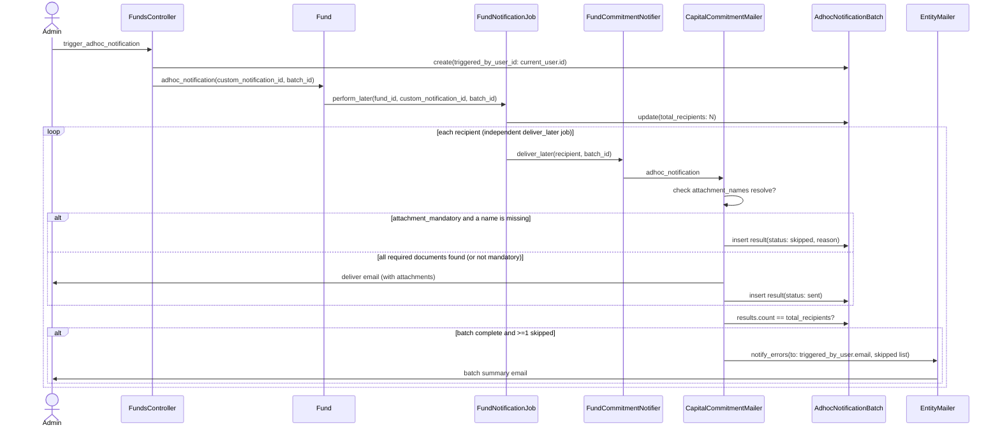

# PRD: Attachment Mandatory for Custom Notifications

## 1. Overview
Add an **Attachment Mandatory** option to `CustomNotification`. When enabled, a recipient's notification email is only sent if every document name listed in `attachment_names` resolves to at least one matching document for that recipient's commitment/KYC record. Recipients missing a required document are skipped (not sent to), while the rest of the batch still goes out. Once the whole batch finishes, the admin who triggered the send receives a summary email listing who was skipped and why.

## 2. Problem Statement
`CustomNotification.attachment_names` (`app/packs/core/notifications/models/custom_notification.rb`) lets an admin list document names (comma-separated, wildcards supported) to attach to a notification email. Today, if a name matches no document, `attach_custom_notification_documents` (`app/packs/core/base/mailers/application_mailer.rb:154-182`) silently skips it — the email still sends, potentially with zero attachments. This is explicitly asserted as current behavior in `features/fund/fund_commitment_adhoc_notification.feature:188-198` ("Notification sends successfully with zero attachments when attachment_names matches nothing").

For notifications where the attachment *is* the point of the email (e.g. a capital call notice, a K-1), sending without it is worse than not sending at all — the recipient gets an email that looks complete but is missing the one thing they need.

## 3. Architecture Constraint
Adhoc sends are not a single loop with shared in-memory state. `Fund#adhoc_notification` (`app/packs/funds/funds/models/concerns/fund_notifiers.rb`) enqueues `FundNotificationJob` (`app/packs/funds/funds/jobs/fund_notification_job.rb`), which enumerates commitments/KYCs and their recipients, then dispatches one independent `deliver_later` job per recipient via `FundCommitmentNotifier` / `FundInvestorKycNotifier`. Each recipient's send happens in its own background job, possibly at a different time, with no shared state today. `current_user` is available in `funds_controller#trigger_adhoc_notification` but currently isn't threaded past the controller.

A true "batch summary" therefore requires new aggregation plumbing rather than an in-memory array.

## 4. User Requirements

### 4.1 Configuration
- New checkbox **Attachment Mandatory** on the `CustomNotification` form (`app/packs/core/notifications/views/custom_notifications/_form.html.erb`), next to the existing `attachment_names` / `latest_doc_only` fields.
- Help text clarifies: if checked, a recipient missing any listed attachment is skipped, and the triggering admin gets a summary email once the batch completes.

### 4.2 Match Rule
- **All-or-nothing per recipient**: every name in `attachment_names` must resolve to ≥1 document for that recipient's commitment/KYC record. If any single name has zero matches, that recipient is blocked.
- Recipients sharing one commitment/KYC (multiple `notification_users` on the same investor) share the same document set — a missing document should be reported once per commitment/investor, not once per individual recipient email address.

### 4.3 Failure Scope
- **Per-recipient skip only.** A missing mandatory attachment blocks that recipient's email; the rest of the batch is unaffected and still sends.

### 4.4 Feedback
- **One batch summary email**, sent to the admin who triggered the send, after all recipient jobs in the batch have finished. Lists which recipients were skipped and why.
- Default: only send the summary when at least one recipient was skipped (a fully successful batch doesn't need a summary email) — adjustable if a full tally (sent + skipped) is preferred instead.

## 5. Data Model Changes

- **Table**: `custom_notifications`
  - Add `attachment_mandatory` (boolean, default: `false`, not null) — own migration, following the `latest_doc_only` precedent (`db/migrate/20260703055255_replace_fuzzy_match_with_latest_doc_only_on_custom_notifications.rb`).
- **New table**: `adhoc_notification_batches`
  - `fund_id`, `custom_notification_id`, `triggered_by_user_id`, `total_recipients`, `created_at`.
- **New table**: `adhoc_notification_batch_results`
  - `batch_id`, recipient identifier/name, `status` (`sent` / `skipped`), `reason`, `created_at`.
  - One row inserted per recipient job (success or skip) — avoids read-modify-write races on a counter/array column. "Batch complete" is detected by `results.count == total_recipients` after each insert.

## 6. Application Logic

- **`funds_controller#trigger_adhoc_notification`**: create the `AdhocNotificationBatch` record with `triggered_by_user_id: current_user.id`.
- **`Fund#adhoc_notification`** → **`FundNotificationJob`**: thread `batch_id` through to `FundCommitmentNotifier` / `FundInvestorKycNotifier` params; set `total_recipients` once the full recipient set is enumerated.
- **Mailer** (`attach_custom_notification_documents` / `send_mail` in `application_mailer.rb`): when `custom_notification.attachment_mandatory?`, check all names resolve *before* attaching/sending.
  - If any name is missing: don't send the mail (early return / `perform_deliveries = false`), insert a `skipped` result row with the reason.
  - Otherwise: send normally, insert a `sent` result row.
  - After each insert, if `results.count == total_recipients` for that batch, send the summary via `EntityMailer.with(to: batch.triggered_by_user.email, error_msg:, subject:, entity_id:).notify_errors.deliver_now` — same pattern as `SendPortcoNotificationJob#send_error_email` (`app/packs/startups/kpis/jobs/send_portco_notification_job.rb:140-155`).
- **`custom_notifications_controller.rb`**: permit `:attachment_mandatory` in strong params.

## 7. Sequence Diagram

## 8. UI Implementation
- Update `app/packs/core/notifications/views/custom_notifications/_form.html.erb` with the new checkbox.
- Update `custom_notifications_controller.rb` strong params.

## 9. Test Plan (Cucumber only — no RSpec)
Extend `features/fund/fund_commitment_adhoc_notification.feature` / `features/step_definitions/fund.rb`:
- Mandatory attachment present for all recipients → notification sends normally to everyone.
- Mandatory attachment missing for one investor among several → that investor is skipped; others still receive the email.
- Batch summary email is delivered to the triggering admin, listing the skipped investor(s) and reason, once all recipient jobs in the batch complete.
- Non-mandatory `attachment_names` (flag off) retains today's behavior: email sends even with zero matched attachments.

## 10. Acceptance Criteria
- [ ] "Attachment Mandatory" checkbox appears on the Custom Notification form and persists correctly.
- [ ] A recipient missing a required attachment does not receive the email.
- [ ] Other recipients in the same batch are unaffected by one recipient's skip.
- [ ] Admin who triggered the send receives exactly one summary email per batch, only when ≥1 recipient was skipped.
- [ ] Summary email lists each skipped recipient/investor and the missing document name(s).
- [ ] Existing (non-mandatory) `attachment_names` behavior is unchanged when the checkbox is off.
