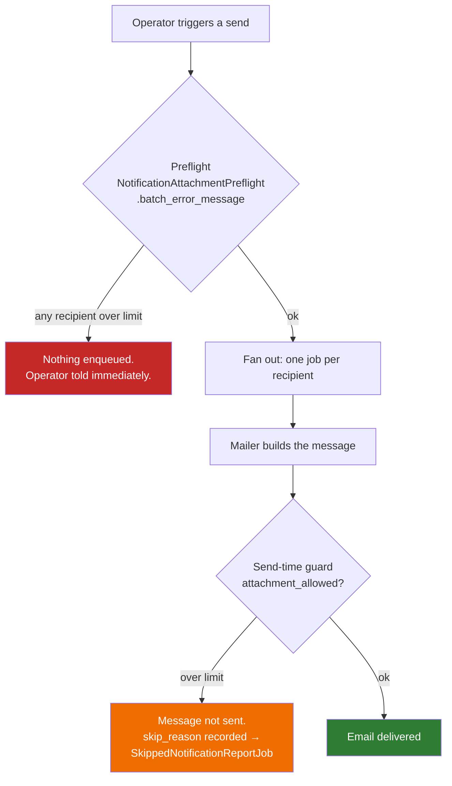
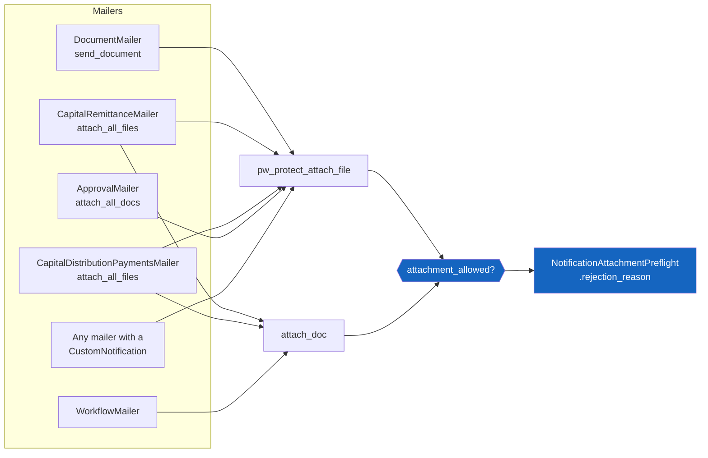
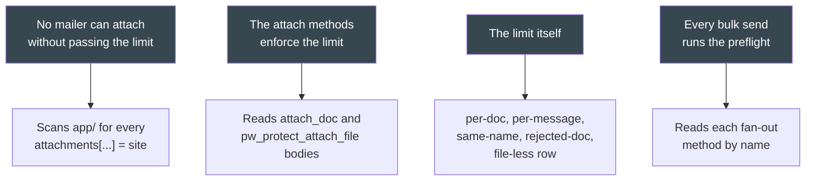
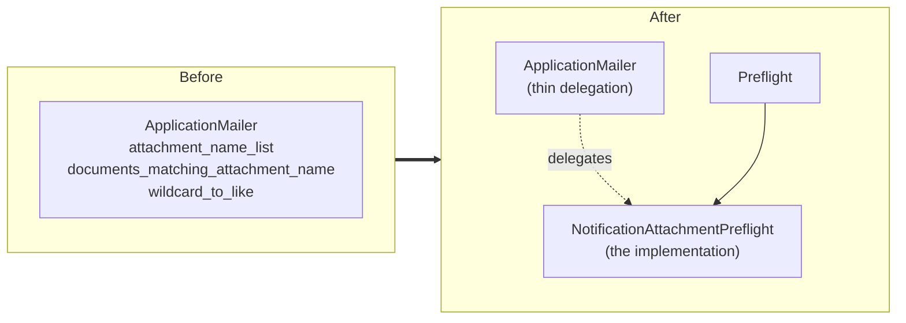

# Email attachment size limit

How CapHive stops an oversized document from being emailed, and why it is enforced in two
places rather than one.

Background: [the September 2026 PeerCapital incident](../../operations/troubleshooting/24092026_peercapital_annual_report_email_bounces.md),
where a 20.3 MB PDF went to 137 investors at ~28 MB per message and roughly nine in ten
deliveries bounced — while every one was recorded as "Sent".

---

## 1. The rule

**7 MB**, applied **per document** *and* **per email**.

```ruby
NotificationAttachmentPreflight::MAX_ATTACHMENT_BYTES = 7.megabytes
```

Why 7 MB, when the files themselves are bigger than that on disk?

| Raw attachment | MIME-encoded (×1.37) | Outcome |
|---|---|---|
| 5 MB | 6.9 MB | safe everywhere |
| **7 MB** | **9.6 MB** | **the limit** — under SES throttling and common corporate caps |
| 10 MB | 13.7 MB | SES bandwidth-throttles; fails 10 MB corporate caps |
| 18 MB | 24.7 MB | near Gmail's 25 MB practical ceiling |
| 20.3 MB | 27.8 MB | the incident |
| 29.2 MB | 40 MB | SES hard limit — rejected outright |

Two AWS-documented facts set it: MIME encoding costs **~137%** of the file size, and
**messages over 10 MB are bandwidth-throttled**, as low as 40 MB/s.

### Same-named documents are one attachment, not two

`attachments[...]` is a hash keyed by filename, so adding a document whose key already exists
**replaces** that part rather than appending one. The running total therefore tracks
`{key => bytes}` and takes the *merge*, never a blind sum:

```ruby
prospective = attached_sizes.merge(attachment_key(document) => size).values.sum
```

Without this, a 4 MB document matched by two `attachment_names` entries (`"Annual Report"`,
`"Annual*"`) counts as 8 MB and a perfectly sendable 4 MB email is refused.

A **rejected** document contributes nothing to the total either — it is never attached, so
counting it would make the next document look oversized and name an innocent file in the
operator's email.

---

## 2. Two layers, one rule



**Why both.** The send-time guard is the safety property: no oversized email can ever leave,
on any path, including a mailer added next year. The preflight is the *fail-fast* property:
without it one bad document becomes N individually-skipped emails, discovered from a report
minutes later, after half the list has already been processed.

They are also not redundant in time — the preflight runs at enqueue, delivery happens up to
300 s later (`email_delay`), so a document can be swapped in between.

### They cannot drift apart

Both call the same method. There is exactly one statement of the rule:

```ruby
# NotificationAttachmentPreflight
def self.rejection_reason(document, attached_sizes: {})
  size = document_byte_size(document)
  return nil if size.zero?

  return "... is #{human(size)} - over the ... limit for a single attachment" if size > MAX_ATTACHMENT_BYTES

  prospective = attached_sizes.merge(attachment_key(document) => size).values.sum
  return "... would take the total over the ... limit for one email" if prospective > MAX_ATTACHMENT_BYTES

  nil
end
```

```ruby
# ApplicationMailer — the send-time guard is a thin caller
def attachment_allowed?(document)
  @attached_sizes ||= {}
  reason = NotificationAttachmentPreflight.rejection_reason(document, attached_sizes: @attached_sizes)

  if reason
    (@oversized_attachments ||= []) << reason
    return false
  end

  @attached_sizes[NotificationAttachmentPreflight.attachment_key(document)] =
    NotificationAttachmentPreflight.document_byte_size(document)
  true
end
```

Sizes come from Shrine's `file_data` metadata, so **nothing is downloaded** to run either
check — scanning 138 recipients costs metadata reads, not 138 × 20 MB.

---

## 3. Where the guard sits

`attach_doc` and `pw_protect_attach_file` are the **only two methods that attach a Document
row**. Guarding there covers every notification mailer without any of them knowing the limit
exists:



`WorkflowMailer` is a special case: it is invoked directly with no `notification_id`, so
`@notification` is nil and the `send_mail` bail (guarded on `@notification` to keep previews
rendering) does not apply. It therefore runs the same check itself and shows its existing
link fallback instead:

```ruby
oversized = NotificationAttachmentPreflight.violations(files).any?
@attachments_skipped = true if oversized   # template shows a note + link
```

Before this, it had its own looser per-file 10 MB rule — so an 8 MB file passed its check, was
then refused by the shared guard, and the email went out **silently missing its document**.

Any other mailer that ever lands in that position (attaching outside a notifier, so there is no
`Notification` to record a skip against) now logs at **error** level rather than dropping the
attachment silently — there is no skip row to find it by otherwise.

---

## 4. What happens when a send is blocked

Every fan-out point preflights, and each surfaces the failure the way its caller can handle:

| Path | Entry point | How the operator finds out |
|---|---|---|
| Send Document | `DocumentSender.send` | **raises** → flash on the page, or a danger `UserAlert` from the bulk action |
| Capital call notices | `CapitalCallJob#notify` | returns; emails the entity's company admins |
| Capital call reminders | `CapitalCall#reminder_capital_call` | returns; emails company admins |
| Distribution notices | `CapitalDistributionPaymentNotificationJob#perform` | returns; `UserAlert` to the triggerer + email |
| Adhoc fund notification | `FundNotificationJob#perform_by_capital_commitment` | returns; emails the triggerer, else company admins |
| Adhoc KYC notification | `FundNotificationJob#perform_by_investor_kyc` | same |

**Jobs return rather than raise.** Raising inside a Sidekiq job would simply retry the same
doomed batch on a backoff forever. `DocumentSender` is the exception because it runs inside
the request, and both of its callers already turn a `StandardError` into operator-visible
feedback.

### Checked per recipient, stopped as a whole

`attachment_names` resolves against **each recipient's own record**, so two investors on the
same send can legitimately receive different documents. The preflight therefore walks every
recipient — but one violation stops the run for everyone:

```ruby
NotificationAttachmentPreflight.batch_error_message(
  commitments, custom_notification,
  context: "Cannot send \"#{custom_notification.subject}\" for #{fund.name}"
)
```

That is deliberate. A partial send — half the investors receiving the report and the rest
silently not, with no record of who — is the outcome this whole mechanism exists to prevent.

### Only records the send would actually touch

The preflight is scoped to what the run would really email. Otherwise an oversized document on
an **already-notified** remittance would permanently block first-time notices for everyone
else on the call:

```ruby
# In SQL where possible...
remittances.where(notification_sent: [false, nil])

# ...and via skip_if where it is not. skip_doc_gen? reads a json_fields key.
skip_if: ->(cr) { cr.capital_commitment.skip_doc_gen? }
```

`batch_error_message` iterates with `find_each`, so a large `capital_remittances` set is never
materialised (see the large-table rules in `CLAUDE.md`).

---

## 5. Known exemptions

Three mailers attach generated output rather than a `Document` row, build the bytes in memory,
and call `mail()` directly instead of going through `send_mail` — so there is no
`Noticed::Notification` to record a skip against:

- `ReportMailer#scheduled_report`
- `UserMailer#audit_download`
- `UserMailer#model_download`

They are single-recipient, user-initiated downloads, so an oversized one bounces a single email
back to the person who asked for it rather than fanning out to an investor list. They are
listed explicitly in the drift guard so they stay visible rather than forgotten.

---

## 6. How this is kept honest

`features/core/notification_attachment_size.feature` (tagged `@attachment`):



Scenario 1 is the completeness claim: guarding two methods only covers everything while no
mailer assigns `attachments[...]` directly. It fails, naming the file, the moment one does.
Scenario 2 exists because without it scenario 1 would keep passing while the limit did
nothing.

Scenario 4 keys on `[file, method]`, not file — a file-level string match is exactly what let
`perform_by_investor_kyc` sit unguarded in a file that already mentioned the preflight for the
commitment path. It follows one level of indirection, since `CapitalCallJob#notify` delegates
to `blocked_by_attachment_size?`.

Behaviour is covered in `features/fund/fund_commitment_adhoc_notification.feature`, whose 24
pre-existing attachment scenarios are also tagged `@attachment` — they are the regression
suite for the extraction described below.

```bash
TEST_ENV_NUMBER=$RANDOM bundle exec cucumber --tags '@attachment' features/
```

### Testing a size threshold without a large fixture

Fabricate the size in `file_data` metadata:

```ruby
doc.file_data = { "id" => "...", "storage" => "store",
                  "metadata" => { "filename" => "x.pdf", "size" => 21_000_000,
                                  "mime_type" => "application/pdf" } }.to_json
doc.save!(validate: false)
```

Such a document has **no bytes in storage**, which is the point: anything that reads the file
instead of its metadata raises, so the scenario passing is itself proof that the guard
short-circuits before the read.

Where several documents must genuinely attach (the running-total case), create them with a real
small file and inflate only the reported size — and **give them distinct names**, or they
collapse into one MIME part and the test measures a message that never existed.

---

## 7. Structural change: where attachment resolution lives

To preflight `attachment_names` the resolution had to be callable without a mailer instance, so
it moved to the service and `ApplicationMailer` delegates:



```ruby
def attachment_name_list
  NotificationAttachmentPreflight.attachment_name_list(@custom_notification)
end

def documents_matching_attachment_name(name)
  NotificationAttachmentPreflight.documents_matching_attachment_name(custom_notification_documents_owner, name)
end
```

This is the critical path for every client email, so the move was verified as
behaviour-preserving against production data: **47 (CustomNotification, owner) pairs across all
23 notifications that use `attachment_names`, resolving to identical document sets — zero
mismatches.** The subtle behaviour those methods carry (MySQL collation matching, pattern
squishing, `exclude_generated_unapproved`, `latest_doc_only`) moved with the code and its
comments.

---

## 8. Why 7 MB, measured against production

### SES bandwidth throttling is not the reason

AWS throttles messages over 10 MB to "as low as 40 MB/s". That is a **bandwidth cap, not a
rejection** — nothing bounces, the send just slows. For a 102-recipient annual report at
13.5 MB encoded that is ~35 seconds instead of ~7. It is not a real constraint at our volumes,
and it did not cause the PeerCapital incident.

### The reason is who the recipients are

```
Approved, email-enabled investor contacts: 1341
  consumer (Gmail / Yahoo / Outlook.com / …):  719  (53.6%)
  corporate / self-hosted:                     622  (46.4%)
```

Just under half of all investor contacts sit behind corporate mail systems — `ambit.co`
(74 contacts), `avendus.com`, `vistra.com`, `in.ey.com`, `kirloskar.com` — where 10–25 MB caps
are the norm. Consumer mailboxes accept 25–50 MB and are not the problem; the corporate half is
exactly the population that failed for PeerCapital (~98 of 137 investors at 28 MB).

**7 MB raw = 9.6 MB encoded clears the common 10 MB corporate cap outright.** It is the only
threshold that is safe without needing to detect failures — and detection is precisely what is
missing while the SES→SNS bounce pipeline is unwired. Shipping a limit that knowingly relies on
some recipients rejecting mail, with no way to see it happen, is what turned the last incident
into a week of guesswork.

| Raw | Encoded | Clears |
|---|---|---|
| **7 MB** | 9.6 MB | 10 MB corporate caps — **current** |
| 10 MB | 13.7 MB | Gmail only; corporate is a gamble |
| 18 MB | 24.7 MB | just under Gmail's 25 MB; corporate fails routinely |

Caveat: the consumer/corporate split is inferred from domain names, not from probing each
server's advertised limit. It describes the shape of the risk, not a precise failure count.

### What the limit actually blocks today

Measured across the production dataset by resolving what every enabled CustomNotification would
attach — 2,668 (notification, recipient) pairs, 2,190 of them carrying at least one document:

| Path | Docs | Max | Median | Over 7 MB |
|---|---|---|---|---|
| CapitalRemittance (call notices) | 10,103 | 6.4 MB | 0.1 MB | **0** |
| CapitalDistributionPayment | 4,241 | 0.8 MB | 0.2 MB | **0** |
| Approval | 31 | 8.8 MB | 0.4 MB | 1 |

Across all 76,755 documents only 1.26% exceed 7 MB (p95 = 1.8 MB). The two highest-volume
notification paths are entirely unaffected, and the largest email anywhere in the database is
9.8 MB.

Exactly **one** enabled notification is blocked: *Pravega Fund II — Annual Investor Report FY26*
(CN 415, Fund 69), carrying four documents totalling 9.84 MB → ~13.5 MB encoded, to 102
investors. Three of those documents total 0.97 MB; the single 8.87 MB signed financial-statements
PDF is the whole problem. The right fix is to compress that file, not to raise the limit — at
13.5 MB it would be gambling on 42 corporate contacts with no way to detect the failures.

Worth watching: capital call notices top out at 6.4 MB, **91% of the limit**. No current notice
breaches it, but one that also picks up CustomNotification documents could cross the total.

## 9. Changing the limit

Change `MAX_ATTACHMENT_BYTES` in
`app/packs/core/notifications/services/notification_attachment_preflight.rb`. Both layers and
`WorkflowMailer` read it from there, and the boundary scenario derives its fixtures from it, so
nothing else needs touching.

**Do the SES→SNS bounce wiring first.** With bounce tracking live the limit can be raised and
the corporate bounce rate *observed*, then rolled back on evidence. Raising it while delivery
failures are invisible is the wrong order.

## Related

- [Incident: PeerCapital annual report bounces](../../operations/troubleshooting/24092026_peercapital_annual_report_email_bounces.md)
- [Notifications system](notifications_system.md)
- [SES bounce handling](ses_bounce_handling.md) — why "Sent" did not mean delivered
- [Attachment-mandatory custom notifications](attachment_mandatory_custom_notifications_prd.md) — the skip machinery this reuses
