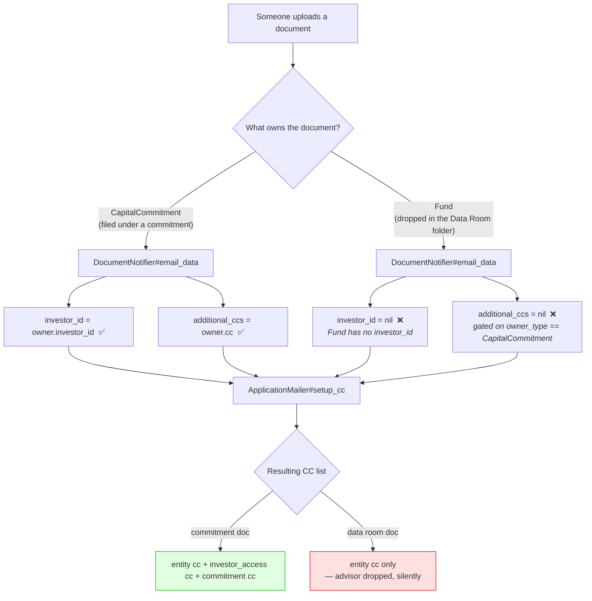
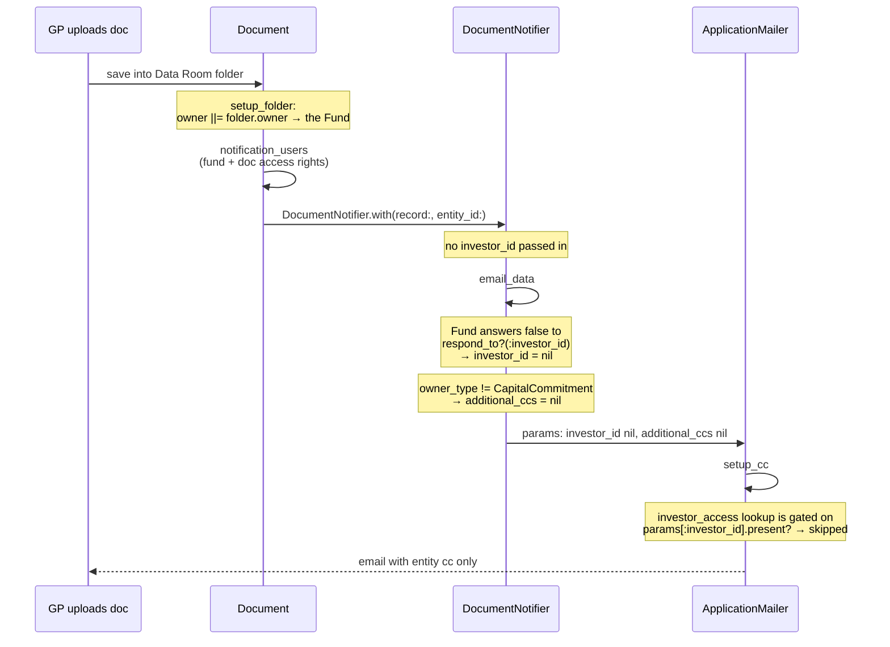
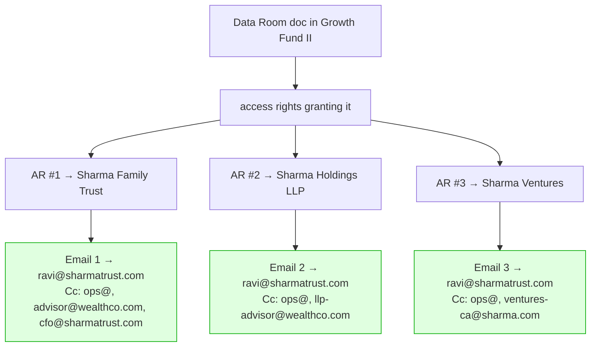
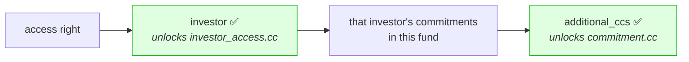
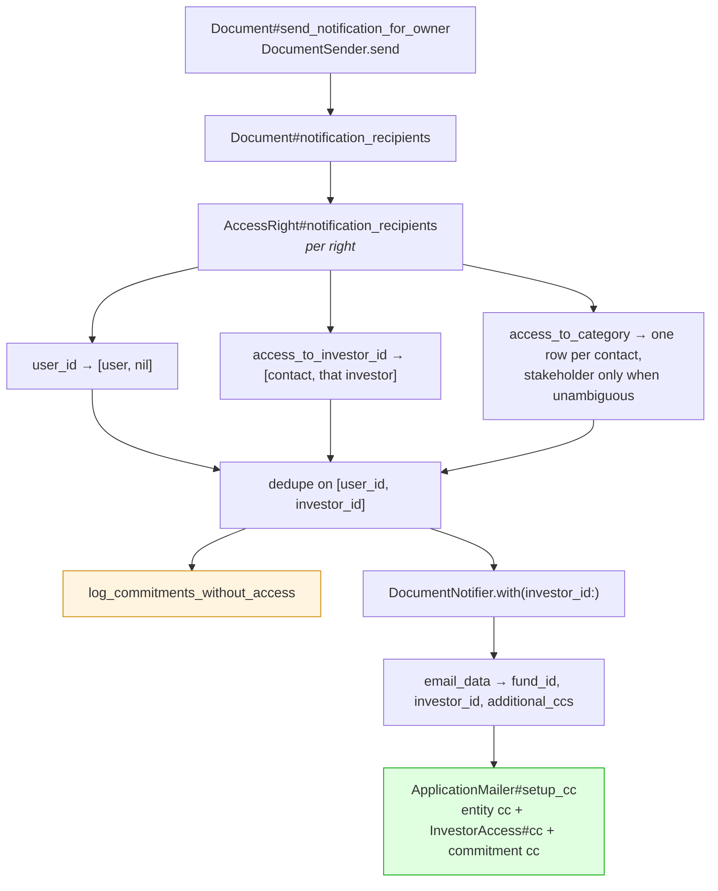

# Why data room documents don't CC the investor's CC addresses

## The short version

Every outgoing notification email builds its CC list from **three** sources:

| Source | Where it lives | How the mailer gets it |
|---|---|---|
| Entity-wide CC | `entity_settings.cc` | always read |
| Contact's CC | `investor_accesses.cc` | only if the email carries an `investor_id` |
| Commitment's CC | `capital_commitments.cc` | only if passed in as `additional_ccs` |

A document uploaded into a **fund data room** is owned by the **Fund**, not by a
commitment. Because of that, `DocumentNotifier` hands the mailer `investor_id = nil`
and `additional_ccs = nil` — so sources 2 and 3 are both switched off. Only the
entity-wide CC survives.

Nothing errors. The email sends, looks fine, and the advisor who was supposed to be
copied simply never hears about the document.

## The two paths, side by side



## Worked example

Set-up — the same investor, the same advisor, two documents:

- Fund: **Growth Fund II**
- Investor: **Sharma Family Trust**, commitment `#4412`
- Contact (`investor_accesses`): `ravi@sharmatrust.com`, with `cc = "advisor@wealthco.com"`
- Commitment `#4412` also has `cc = "cfo@sharmatrust.com"`
- Entity setting: `cc = "ops@growthfund.com"`

### Case A — Capital Account Statement filed under commitment #4412

```
owner_type = "CapitalCommitment"   owner_id = 4412

DocumentNotifier passes:  investor_id: 91        additional_ccs: "cfo@sharmatrust.com"

Email sent:
  To:  ravi@sharmatrust.com
  Cc:  ops@growthfund.com, advisor@wealthco.com, cfo@sharmatrust.com   ← all three ✅
```

### Case B — the same PDF dropped into Growth Fund II's Data Room

```
owner_type = "Fund"               owner_id = 7

DocumentNotifier passes:  investor_id: nil       additional_ccs: nil

Email sent:
  To:  ravi@sharmatrust.com
  Cc:  ops@growthfund.com                                              ← advisor gone ❌
```

Ravi still gets the document. His advisor and his CFO do not — even though the CC
addresses are sitting right there in the database, unchanged.

## Where it happens in the code



File-by-file:

| File | Line | What it does |
|---|---|---|
| `app/packs/core/folders/models/concerns/with_data_room.rb` | 11 | Data Room folder is created with `owner: self` → the Fund |
| `app/packs/core/documents/models/document.rb` | 276-289 | `send_notification_for_owner` → `DocumentNotifier`, no `investor_id` |
| `app/packs/core/documents/mailers/document_notifier.rb` | 13 | `investor_id` falls back to `params[:investor_id]`, which nobody sets |
| `app/packs/core/documents/mailers/document_notifier.rb` | 30 | `additional_ccs` hard-gated on `owner_type == "CapitalCommitment"` |
| `app/packs/core/base/mailers/application_mailer.rb` | 124 | investor_access CC lookup requires `params[:investor_id].present?` |

## The fix

### Decided: the access right is the unit of delivery, not the user

The fan-out used to be *per user* — `notification_users` ended in `.uniq`, so one person got
one email no matter how many access rights let them in. That is exactly what loses the CC
information: the moment you collapse three access rights into one recipient, you no longer
know whose CC list to use.

So the fan-out is now **one email per access right**, each carrying that access right's own
investor CC addresses.



Ravi receives three emails about the same document — one per stakeholder he represents —
and each one copies the right advisor. That mirrors how he already receives commitment
documents: one per commitment, never merged.

Dedup rule: **distinct (user, investor)**. Three access rights pointing at the *same*
investor still produce one email; three pointing at *different* investors produce three.
An access right granted directly to a named user (`user_id`, typically an employee) has no
investor, so it produces one email with no investor CC — unchanged from before.

One exception, for volume: a **category** right is a single right covering many investors, and
it still sends one email per contact. See "The category-right exception" below.

### How each CC gets unlocked



`setup_cc` already strips the recipient's own address from the CC list, so combining
sources is safe — no risk of double-delivery.

## Considered and rejected: driving the fan-out off commitments instead

The alternative was to ignore access rights for a fund data room document and notify every
investor holding a commitment in that fund — so that a committed LP is never missed even if
they hold no access right.

It was rejected. First, because the gap it targets is already mostly closed: a commitment
grants fund access when it is created (`CapitalCommitment#grant_access_to_fund`, called from
`CapitalCommitmentCreate` and `ImportCapitalCommitment`), that right cascades onto the Data
Room folder via `Fund#access_rights_changed`, and `Document#setup_access_rights` copies folder
rights onto each uploaded document. The chain **commitment → fund AR → data room AR → document
AR** already exists.

Second, because of what it would cost:

| Cost | Detail |
|---|---|
| Confidentiality | Access rights are how a GP scopes a data room per LP. Commitment-driven fan-out announces every data room document to every LP in the fund — and the subject line carries the document name, so a side-letter leaks by name even if the link 403s. |
| Lost audience | Prospects in diligence hold no commitment, and they are the data room's core audience. Same for advisors, consultants, GP reviewers, co-invest parties. It would fix "missing cc" and create "missing email". |
| Dead links | `notify_new_document` sends a link, not an attachment. Notifying someone without an access right produces a Pundit denial on click, plus an in-app notification that also 403s. |
| Dropped policy filter | Sending "even without access" means calling `investor.notification_users` without the model, losing the Pundit filter — which is what makes the two rows above bite. |
| Doesn't generalise | `notification_recipients` also serves Deal, SecondarySale and InvestmentOpportunity data rooms, which have no commitments. Two mechanisms instead of one. |

So: the **access right decides who is notified** (it is also what makes the link work), and
**commitments only supply cc addresses**. Where the two genuinely disagree, that is now logged
rather than silently absorbed — see below.

## What was built



| Change | File |
|---|---|
| `notification_recipients` / `category_recipients` — pair each user with the investor their right names | `access_rights/models/access_right.rb` |
| `notification_recipients` fan-out + dedupe; `notification_users` kept as the distinct-people view | `documents/models/document.rb` |
| `log_commitments_without_access` — names committed stakeholders no access right reaches | `documents/models/document.rb` |
| `investor_id` moved out of the `if record.owner` guard; `fund_id` derived from a `Fund` owner; `commitment_ccs` unions the investor's commitment ccs in that fund | `documents/mailers/document_notifier.rb` |
| Fan out per pair, passing `investor_id` | `documents/services/document_sender.rb` |
| Preview shows one row per email with its stakeholder | `documents_controller.rb`, `views/documents/show_email_list.html.erb` |
| `stub_document_notification_recipients` — one helper for pinning recipients in a scenario, so no stub site can miss the pairs accessor | `features/support/document_notification_stub.rb`, used by `document.rb` and `whats_app_delivery.rb` |
| Three scenarios: cc recovery, recipient-set parity, the gap log | `features/core/document.feature`, `features/step_definitions/document.rb` |

### The category-right exception

A category right ("All Stakeholders of Specific Category") is **one** access right that happens
to cover many investors. Splitting it per investor would multiply mail volume for every tenant
using it, which is not what "one email per access right" asked for. So `category_recipients`
still emits exactly one row per contact, and attaches the stakeholder only when the contact maps
to exactly one investor of that category. Ambiguous cases carry no investor, i.e. they behave
exactly as they do today.

### The commitment-without-access log

`Document#log_commitments_without_access` warns when a stakeholder holds a commitment in the
fund but no access right delivers the document:

```
Document 8812 (Fund Update Q3) in Fund 50 data room: 2 stakeholder(s) hold a commitment in this
fund but no access right delivers this document, so they were not notified - Sharma Holdings LLP, ...
```

It only logs. Adding them as recipients would send mail whose link denies them access; the fix
for a real gap is to restore the access right.

## Backward compatibility

The requirement was that nobody who received a notification before stops receiving one. Verified
against the **production dump** (`IRM_development` on 127.0.0.1:33066 — 76,804 documents, 139,115
access rights) by replicating the old algorithm and comparing, not by inspection.

The old resolution — `access_rights.map(&:users).flatten`, plus the owner's rights for
Fund/Deal/SecondarySale/InvestmentOpportunity, then `.uniq` — was run beside the new one:

| Check | Scope | Result |
|---|---|---|
| Document recipient sets | 1,194 documents across 26 owner types (250 sampled for each of Fund, Deal, SecondarySale, InvestmentOpportunity; 60 for the rest) | **0 mismatched recipient sets** |
| Category access rights | **all 169** | 0 mismatches, **0 change in rows per contact** |
| `user_id` rights | 300 sampled | 0 mismatches |
| `access_to_investor_id` rights | 400 sampled | 0 mismatches |

Nobody is dropped and nobody is added. The category result is the one that mattered most: that
branch has no rows in a typical dev database, and prod confirms both that no contact is lost and
that the number of emails per contact is unchanged — which is what keeps mail volume flat for
tenants using "All Stakeholders of Specific Category".

**One pre-existing failure surfaced and was fixed.** Document 201 raised
`Pundit::NotAuthorizedError: Must be logged in` during recipient resolution — identically on the old
algorithm, so not a regression, but worth fixing: `Investor#notification_users` did
`accesses.map(&:user)`, and a `nil` from an `InvestorAccess` whose user row had been deleted reached
`Pundit.policy(nil, model)`, which `ApplicationPolicy#initialize` rejects. Because the exception
aborts the whole resolution, **one dead login stopped the document notifying anyone**, healthy
contacts included — and callers passing no model were equally exposed, since a bare `nil` in the
returned array breaks anything doing `pluck(:email)` on it.

In the dump: 3 orphaned approved `investor_accesses` (in one GP entity), 1 fund, and 2 documents
that notified nobody. `notification_users` now uses `filter_map`, skipping the orphan and logging it
so the bad row is visible rather than silent. Verified: both documents now resolve their real
recipient, and across 200 healthy investors the recipient set is unchanged.

There is no soft-delete on `User`, and `User has_many :investor_accesses, dependent: :destroy` — so
these rows can only have come from a hard delete that bypassed callbacks. The 3 rows still want
cleaning up; they are now skipped rather than fatal.

### What the fix recovers

Measured by calling the real `DocumentNotifier#email_data` for each resolved pair on Fund-owned
documents — both cc sources were unconditionally `nil` there before:

| | |
|---|---|
| Fund-owned documents sampled (with recipients) | 117 |
| Recipient pairs checked | 5,199 |
| Pairs recovering any cc | 2,237 |
| **Pairs gaining a genuinely new address** (excluding the recipient's own, which `setup_cc` strips, and anything already in `entity_setting.cc`) | **2,210 — 43%** |
| Of those, carrying commitment-level cc | 137 |

So roughly **two in five data room notification recipients were losing their entire cc list**.
The recovered addresses are the intended parties — advisor firms, family offices, `accounts@` and
`reports@` mailboxes. `fund_id` resolved on every Fund-owned document tested, and a commitment
carrying a cc produced `additional_ccs` on a data room document (previously `nil`) while the
commitment-owned document's value stayed identical.

### The originating bug report

> Doc ID - 73989, notification - 32594 — email did not mark investor CCs

Document 73989 (`dec25report`) is owned by **Fund #111**, in `/Funds/Growth Fund/Data Room` — exactly
the shape described above. Notification 32594 is no longer in the dump, so the sent email could not be
inspected; instead old and new were simulated for the document's real recipients, replicating
`ApplicationMailer#setup_cc` line for line:

| To | cc before | cc after |
|---|---|---|
| `caphive.test.5@gmail.com` (stakeholder PCJ) | `aseemak56@yahoo.com` | `aseemak56@yahoo.com, caphive.test.3@…, caphive.test.4@…, caphive.test.6@…, ausang@gmail.com` |
| `caphive.test.2@gmail.com` (stakeholder MSD) | `aseemak56@yahoo.com` | `aseemak56@yahoo.com, caphive.test.4@…, caphive.test.7@…` |

Both recipients were getting only the entity-wide cc and now get their stakeholder's addresses. Note
that this entity has `entity_setting.sandbox = true` in the dump, where `setup_cc` is skipped
altogether and mail is redirected to `sandbox_emails`; the table shows behaviour with sandbox off,
i.e. normal operation.

### Duplicate cc addresses

Checking that bug report surfaced a second defect: `setup_cc` concatenated its three cc sources and
only stripped the recipient's own address, never deduping. The sources overlap routinely — a
stakeholder's advisor is frequently also named on the commitment cc — and `caphive.test.4@gmail.com`
appeared **twice** on one of the emails above. The list is now deduped case-insensitively, keeping the
first occurrence. Pre-existing behaviour, but this change makes the overlap far more likely, so it is
fixed here.

### Volume impact

Of the 1,194 documents compared, **32 fan out further than before** — all Fund-owned, 275 extra
emails in total — and only where one person genuinely represents several stakeholders. Everything
else sends exactly the number of emails it did before.

### Two things only running the suite caught

**Dead test stubs.** Three scenarios pinned their recipients with
`allow_any_instance_of(Document).to receive(:notification_users)`. Nothing in the send path calls
that any more, so the stub silently became a no-op, the real access-right resolution ran against a
fixture with no rights, and the scenario failed with "No users to send test doc to". Not a
production regression — but a stub that quietly stops stubbing is worse than one that breaks
loudly, so all three now go through `stub_document_notification_recipients`, which stubs both
accessors.

**A blind spot in the comparison above.** It compared recipients as `old_users.compact.map(&:id)`.
A `nil` user survives `present?` (`[nil].present?` is `true`, so the old `DocumentSender` entered
its send loop) but is dropped by the new `.select(&:first)`, giving `[]` and a "No users to send"
error. Compacting hid that flip. The only thing that produces a `nil` user is an
`AccessRight#user_id` pointing at a missing `User` row, and there are **0 of those in the dump**, so
the case cannot arise — but the earlier numbers would not have caught it.

### Where duplicate access rights actually come from

`AccessRight#access_is_unique` forbids two rows with the same
`(owner, access_to_investor_id, access_to_category, user_id, entity_id)`, so a stakeholder cannot
hold two rights on the *same* owner — `CapitalCommitment#grant_access_to_fund` silently no-ops when
the fund right already exists. The duplication the dedupe exists for is across *different* owners:
the document's own right (copied from the data room folder by `setup_access_rights`) and the fund's,
which `notification_recipients` unions in. Both rows are real; the dedupe on
`[user_id, investor_id]` is what makes them one email.

### Why `investor_id` cannot drop a recipient

`params[:investor_id]` is consulted first and `record.owner.investor_id` is the fallback, so a
sender that passes nothing behaves exactly as before. `investor_id` only ever affects the cc
list — never who receives the mail.

## The two smaller findings — both fixed, because the fix needs them

When first written up these looked cosmetic. The per-access-right design makes both load-bearing.

**1. `params[:investor_id]` was swallowed when a document has no owner.** The assignment sat
inside `if record.owner`, so the local stayed `nil` for an owner-less document. Harmless while no
caller passed one; now every send passes it, and `owner` is an `optional: true` belongs_to.
Resolution moved out of the guard.

**2. `fund_id` was `nil` for data room documents** — a `Fund` answers `false` to
`respond_to?(:fund_id)`. Previously harmless (`DocumentMailer` never reads it), now the scope for
the commitment cc lookup. Derived from `record.owner.id` when `owner_type == "Fund"`.
