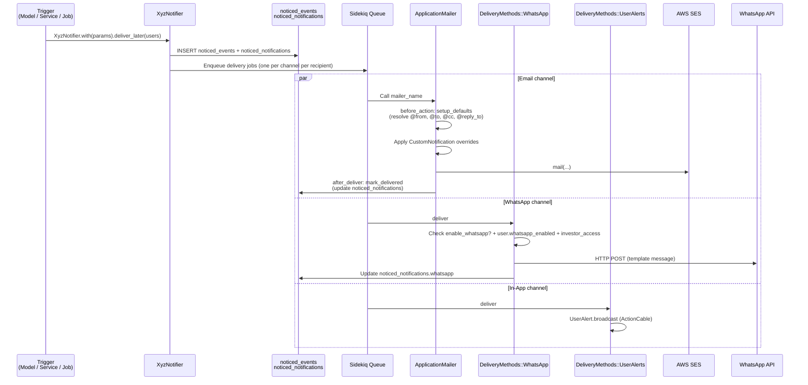
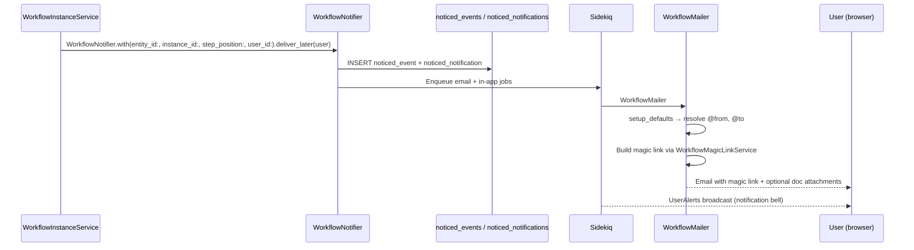

# Notification System — Technical Reference

This document is the authoritative technical reference for how notifications are built, configured, and delivered in IRM. It covers the full stack: notifiers, mailers, delivery channels, custom notifications, and the data model.

---

## Table of Contents

1. [Architecture Overview](#1-architecture-overview)
2. [Notification Flow](#2-notification-flow)
3. [BaseNotifier](#3-basenotifier)
4. [Notifier Catalogue](#4-notifier-catalogue)
5. [ApplicationMailer — Deep Dive](#5-applicationmailer--deep-dive)
6. [Mailer Catalogue](#6-mailer-catalogue)
7. [Delivery Channels](#7-delivery-channels)
8. [Custom Notifications](#8-custom-notifications)
9. [Trigger Points](#9-trigger-points)
10. [Background Jobs](#10-background-jobs)
11. [Configuration Reference](#11-configuration-reference)
12. [Data Model](#12-data-model)
13. [Adding a New Notifier](#13-adding-a-new-notifier)
14. [Mailers Outside Noticed — Gap Analysis](#14-mailers-outside-noticed--gap-analysis)

---

## 1. Architecture Overview

The notification system is built on the **Noticed gem** (`>= 2.x`). Noticed provides the persistence layer (`noticed_events` + `noticed_notifications` tables) and a background-job dispatch mechanism. IRM extends this with:

- **`BaseNotifier`** — common delivery configuration shared by all 24 domain notifiers
- **`ApplicationMailer`** — base class for all 28+ mailers, handling address resolution and sandbox routing
- **`DeliveryMethods::WhatsApp`** — custom Noticed delivery method for WhatsApp
- **`DeliveryMethods::UserAlerts`** — in-app real-time broadcast
- **`CustomNotification`** — per-owner override of subject, body, WhatsApp text, and attachments
- **`NotificationExtensions`** / **`EventExtensions`** — patches to Noticed's core classes

```
┌─────────────────────────────────────────────────────────────────────────────┐
│                          Notification System                                │
│                                                                             │
│  Trigger        Notifier           Noticed            Delivery              │
│  ─────────      ────────           ───────            ────────              │
│  Model          XyzNotifier        Event              :email ──▶ Mailer     │
│  callback   ──▶ < BaseNotifier  ──▶ Notification  ──▶ :whats_app ──▶ WATI  │
│  Service        < Noticed::Event   (DB records)       :user_alerts──▶ WS   │
│  Job                                                                        │
└─────────────────────────────────────────────────────────────────────────────┘
```

**Key files:**

| File | Role |
|---|---|
| `app/packs/core/notifications/models/base_notifier.rb` | Base notifier class |
| `app/packs/core/base/mailers/application_mailer.rb` | Base mailer class |
| `app/notifications/delivery_methods/whats_app.rb` | WhatsApp delivery |
| `app/notifications/delivery_methods/user_alerts.rb` | In-app alert delivery |
| `app/packs/core/notifications/models/custom_notification.rb` | Per-owner overrides |
| `config/initializers/noticed.rb` | Noticed extensions + patches |

---

## 2. Notification Flow

### End-to-End Sequence



### Simplified Timeline

```
1. Action happens (document uploaded, capital call approved, deal stage moved …)
2. Notifier.with(params).deliver_later(recipient_users)
3. Noticed creates Event + Notification rows in DB
4. Sidekiq picks up jobs, applies wait (email_delay) if configured
5. Email: Mailer called → address resolution → send via SES → notification marked delivered
6. WhatsApp: Delivery method checks flags → sends via WATI API
7. In-app: ActionCable broadcast to user's connected browser
```

---

## 3. BaseNotifier

**Path:** `app/packs/core/notifications/models/base_notifier.rb`

All domain notifiers inherit from `BaseNotifier < Noticed::Event`.

### Delivery Method Declaration

```ruby
# Test environment
deliver_by :email do |config|
  config.mailer = :mailer_name
  config.method = :email_method
  config.params = :email_data
end

# Production / Development
deliver_by :whats_app, class: "DeliveryMethods::WhatsApp" do |config|
  config.if   = -> { whatsapp_enabled }   # guard: checks entity + user flags
  config.wait = :email_delay              # randomized SES throttle
end

deliver_by :email do |config|
  config.if     = -> { email_enabled }    # guard: entity member or investor_access.email_enabled
  config.mailer = :mailer_name
  config.method = :email_method
  config.params = :email_data
  config.wait   = :email_delay
end
```

WhatsApp is **disabled in test** to avoid accidental API calls.

### Abstract Interface

Every notifier must implement `mailer_name`. Everything else has sensible defaults or comes from params.

| Method | Returns | Override? |
|---|---|---|
| `mailer_name` | Mailer class constant (e.g., `DocumentMailer`) | **Required** |
| `email_method` | `params[:email_method]` | Optional — override for static method name |
| `email_data` | Hash of params passed to mailer | Optional — override to add model-specific data |
| `entity` | `Entity.find(params[:entity_id])` | Rarely needed |
| `investor_advisor_id` | Advisor ID if recipient is an advisor | Rarely needed |

### `notification_methods` block

Notifiers declare a `notification_methods` block to define what appears on `Noticed::Notification` instances:

```ruby
notification_methods do
  def message   # Text shown in in-app alerts and WhatsApp fallback
  def url       # Deep link to the subject of the notification
  def custom_notification  # Look up the CustomNotification override
end
```

### Guard Conditions (`NotificationExtensions`)

These are mixed into `Noticed::Notification` via `config/initializers/noticed.rb`:

```
email_enabled:
  true if  recipient belongs to the model's entity  (internal user)
  OR       investor_access.email_enabled == true

whatsapp_enabled:
  true if  entity.permissions.enable_whatsapp?
  AND      (internal user  OR  investor_access.whatsapp_enabled)
  AND      recipient.whatsapp_enabled
  AND      recipient.phone.present?
```

### `email_delay` (SES throttle)

```ruby
def email_delay
  delay_seconds = entity.entity_setting.email_delay_seconds
  delay_seconds = delay_seconds.positive? ? rand(1..delay_seconds) : rand(1..300)
  Rails.env.development? ? 0 : delay_seconds
end
```

The random jitter prevents AWS SES rate-limit errors when bulk notifications go out.

---

## 4. Notifier Catalogue

| Notifier | Mailer | Primary trigger |
|---|---|---|
| `AccessRightNotifier` | `AccessRightsMailer` | AccessRight created |
| `AgentFailureNotifier` | `AgentSchedulerMailer` | Agent job failure |
| `AgentSchedulerNotifier` | `AgentSchedulerMailer` | Agent schedule report |
| `ApprovalNotifier` | `ApprovalMailer` | Approval created / updated |
| `CapitalDistributionPaymentNotifier` | `CapitalDistributionPaymentsMailer` | Distribution payment sent |
| `CapitalRemittanceNotifier` | `CapitalRemittanceMailer` | Capital call remittance |
| `CapitalRemittancePaymentNotifier` | `CapitalRemittancePaymentMailer` | Payment received |
| `DealActivityMoveNotifier` | `DealMailer` | Deal stage transition |
| `DocumentDownloadNotifier` | `DocumentMailer` | Document download link |
| `DocumentNotifier` | `DocumentMailer` | Document created / shared |
| `ExpressionOfInterestNotifier` | `ExpressionOfInterestMailer` | EOI created / approved |
| `FundCommitmentNotifier` | `CapitalCommitmentMailer` | Fund commitment action |
| `InterestNotifier` | `InterestMailer` | Secondary sale interest |
| `InvestmentOpportunityNotifier` | `InvestmentOpportunityMailer` | IO open for interest / allocated |
| `InvestorAccessNotifier` | `InvestorAccessMailer` | Investor access granted |
| `InvestorAdvisorNotifier` | `InvestorAdvisorMailer` | Advisor relationship created |
| `InvestorKycNotifier` | `InvestorKycMailer` | KYC status change |
| `KpiReportNotifier` | `KpiReportsMailer` | KPI report available |
| `OfferNotifier` | `OfferMailer` | Offer issued |
| `ReminderNotifier` | `ReminderMailer` | Scheduled reminder |
| `SecondSaleNotifier` | `SecondSaleMailer` | Secondary sale notification |
| `TaskNotifier` | `TasksMailer` | Task assigned / completed |
| `UserNotifier` | `UserMailer` | User account actions |

---

## 5. ApplicationMailer — Deep Dive

**Path:** `app/packs/core/base/mailers/application_mailer.rb`

`ApplicationMailer < ActionMailer::Base` is the shared base for every email in the system. It handles:

1. Address resolution (from / to / cc / reply-to)
2. Sandbox routing
3. Custom notification overrides
4. Attachment handling (including PDF password-protection)
5. Persistence (marking notification as delivered)

### Lifecycle

```
REQUEST TO SEND EMAIL
        │
        ▼
┌───────────────────┐
│  before_action    │  setup_defaults()
│  setup_defaults   │  → sets @entity, @user, @from, @to, @cc, @reply_to
└───────┬───────────┘
        │
        ▼
┌───────────────────┐
│  Mailer method    │  e.g. notify_new_document()
│  (domain-specific)│  → sets @model, @custom_notification
│                   │  → calls send_mail(subject: ...)
└───────┬───────────┘
        │
        ▼
┌───────────────────┐
│  send_mail()      │  Applies custom subject if CustomNotification present
│                   │  Attaches documents
│                   │  Calls mail(from:, to:, cc:, reply_to:, subject:)
└───────┬───────────┘
        │
        ▼
┌───────────────────┐
│  after_deliver    │  mark_delivered()
│  mark_delivered   │  → updates noticed_notifications:
│                   │     email_sent = true
│                   │     email = { to, from, cc, reply_to, params, mail }
│                   │     subject = message.subject.truncate(254)
└───────────────────┘
```

### `setup_defaults` — Address Resolution

Called as a `before_action` on every mailer method.

```ruby
def setup_defaults
  @notification = Noticed::Notification.find(params[:notification_id]) if params[:notification_id]
  @entity       = Entity.find(params[:entity_id])   if params[:entity_id]
  @user         = User.find(params[:user_id])        if params[:user_id]
  @additional_ccs = params[:additional_ccs]

  if @entity.present?
    @from     = params[:from_email].presence || from_email(@entity)
    unless @entity.entity_setting.sandbox
      setup_cc
      @reply_to = @entity.entity_setting.reply_to.presence || @cc.presence || @from
    end
    # Inbound email support: adds incoming_email_address to reply_to
    if @notification && @notification.model.is_a?(WithIncomingEmail)
      @reply_to = "#{@reply_to},#{@notification.model.incoming_email_address}"
    end
  end

  if @user.present?
    @to = @entity.entity_setting.sandbox ? @entity.entity_setting.sandbox_emails : @user.email
  end
end
```

### Address Priority Table

```
┌──────────┬────────────────────────────────────────────────────────────────┐
│ Field    │ Resolution order (first non-blank wins)                        │
├──────────┼────────────────────────────────────────────────────────────────┤
│ from     │ params[:from_email]                                            │
│          │ → EntitySetting#from_email                                     │
│          │ → ENV['SUPPORT_EMAIL_FROM']                                    │
├──────────┼────────────────────────────────────────────────────────────────┤
│ to       │ User#email                                                     │
│          │ → EntitySetting#sandbox_emails  (if sandbox mode)              │
├──────────┼────────────────────────────────────────────────────────────────┤
│ cc       │ EntitySetting#cc                                               │
│          │ + InvestorAccess#cc  (for that investor + user combination)    │
│          │ + params[:additional_ccs]                                      │
├──────────┼────────────────────────────────────────────────────────────────┤
│ reply_to │ EntitySetting#reply_to                                         │
│          │ → @cc                                                          │
│          │ → @from                                                        │
│          │ + model.incoming_email_address  (if WithIncomingEmail)         │
└──────────┴────────────────────────────────────────────────────────────────┘
```

### Sandbox Mode

When `entity_setting.sandbox == true`:

- `@to` is set to `entity_setting.sandbox_emails` (comma-separated list)
- `@cc` and `@reply_to` are **not** set (skipped in `setup_defaults`)
- `sandbox_whatsapp_numbers` redirects WhatsApp to `entity_setting.sandbox_numbers`
- All email still goes out (to sandbox addresses) — useful for UAT without exposing real investor emails

### `send_mail` — The Central Dispatch

```ruby
def send_mail(subject: nil, template_path: nil, template_name: nil)
  if @custom_notification
    subject = @custom_notification.subject
    attach_custom_notification_documents   # attach docs from CustomNotification
  end

  if @to.present?
    mail(from: @from, to: @to, cc: @cc, reply_to: @reply_to, subject:,
         template_path:, template_name:)
  else
    raise "No to email address, hence not sending any email"
  end
end
```

Most mailer methods end with `send_mail(subject: "...")`. Overriding the template is done via `template_path:` + `template_name:` arguments (used by `adhoc_notification`).

### Attachment Helpers

**`attach_doc(document)`** — streams a document from storage and attaches it inline.

**`attach_custom_notification_documents`** — called automatically by `send_mail` when a `CustomNotification` is present. It:

1. Attaches all documents linked directly on the `CustomNotification`
2. Looks up documents by name from `@notification.model.documents` if `attachment_names` is set

**`password_protect_attachment(doc, model, custom_notification)`** — runs `pdftk` to apply a user password before attaching. The password is resolved by calling the method chain in `custom_notification.attachment_password` on the model (e.g., `"investor.kyc_password"`).

**`pw_protect_attach_file(document, custom_notification)`** — wrapper that checks the `password_protect_attachment` flag and calls the appropriate attach path.

### `adhoc_notification`

A fallback mailer method for fully custom one-off emails:

```ruby
def adhoc_notification
  send_mail(
    subject: @custom_notification.subject,
    template_path: 'application_mailer',
    template_name: 'adhoc_notification'
  )
end
```

Uses the generic `app/packs/core/base/views/application_mailer/adhoc_notification.html.erb` template which renders the `CustomNotification#body` (with optional ERB evaluation).

### Domain Mailer Pattern

Every domain mailer follows this structure:

```ruby
class DocumentMailer < ApplicationMailer
  helper ApplicationHelper   # optional, for view helpers

  before_action :set_document  # domain-specific setup
  def set_document
    @document = Document.find(params[:document_id])
    email_method = params[:email_method] || @notification.params[:email_method]
    @custom_notification = @document.custom_notification(email_method)
  end

  def notify_new_document
    send_mail(subject: "New document: #{@document.name}")
  end

  def send_document
    send_mail(subject: "Document shared: #{@document.name}")
  end
end
```

Key conventions:
- A `before_action` named `set_<model>` loads the domain record and resolves the `CustomNotification`
- Each public method calls `send_mail(subject:)` at the end
- `@custom_notification` is set in the `before_action` so `send_mail` can pick it up automatically

---

## 6. Mailer Catalogue

| Mailer | Methods | Domain |
|---|---|---|
| `AccessRightsMailer` | `send_notification` | Access rights |
| `AgentSchedulerMailer` | `send_report` | AI agents |
| `ApprovalMailer` | `notify_new_approval`, `approval_reminder`, `notify_approval_response` | Approvals |
| `CapitalCommitmentMailer` | `notify_capital_commitment`, `reminder_capital_commitment` | Fund commitments |
| `CapitalDistributionPaymentsMailer` | `send_notification` | Capital distributions |
| `CapitalRemittanceMailer` | `notify_capital_remittance`, `reminder_capital_remittance` | Capital calls |
| `CapitalRemittancePaymentMailer` | `payment_received` | Capital call payments |
| `CashFlowReminderMailer` | `send_reminder` | Cash flow |
| `CashFlowReportMailer` | `send_report` | Cash flow |
| `DealMailer` | `deal_activity_move` | Deals |
| `DocShareMailer` | `send_doc_share` | Document sharing |
| `DocumentMailer` | `notify_new_document`, `send_document`, `email_link` | Documents |
| `EntityMailer` | `entity_created` | Entities |
| `ExpressionOfInterestMailer` | `notify_approved`, `signature_required`, `signature_completed` | EOI / e-signing |
| `FundStatsMailer` | `fund_stats_update` | Internal stats |
| `InterestMailer` | `notify_interest`, `notify_interest_accepted` | Secondaries |
| `InvestmentOpportunityMailer` | `notify_open_for_interests`, `notify_allocation` | Investment opportunities |
| `InvestorAccessMailer` | `send_notification` | Investor access |
| `InvestorAdvisorMailer` | `send_notification` | Investor advisors |
| `InvestorKycMailer` | `send_notification`, `send_reminder` | KYC |
| `KpiReportsMailer` | `send_kpi_report` | KPI reporting |
| `NudgeMailer` | `send_nudge` | Nudge / reminders |
| `OfferMailer` | `notify_offer` | Offers |
| `ReminderMailer` | `send_reminder` | General reminders |
| `ReportInsightMailer` | `send_report_insight_link`, `send_report_insight_summary` | Report insights |
| `ReportMailer` | `scheduled_report` | Scheduled reports |
| `SecondSaleMailer` | `notify_secondary_sale` | Secondaries |
| `TasksMailer` | `send_task_notification` | Tasks |
| `UserMailer` | `magic_link`, `no_account_found`, `audit_download`, `model_download` | Users / auth |

---

## 7. Delivery Channels

### Channel Comparison

```
┌─────────────────┬──────────────────────────────┬────────────────────────────────┐
│ Channel         │ Class                        │ When it fires                  │
├─────────────────┼──────────────────────────────┼────────────────────────────────┤
│ Email           │ ActionMailer via Noticed      │ email_enabled guard passes     │
│ WhatsApp        │ DeliveryMethods::WhatsApp     │ whatsapp_enabled guard passes  │
│ In-App Alert    │ DeliveryMethods::UserAlerts   │ always (for internal users)    │
└─────────────────┴──────────────────────────────┴────────────────────────────────┘
```

### Email Channel

Delivered through AWS SES via ActionMailer. The mailer resolves addresses in `ApplicationMailer#setup_defaults`, renders an ERB template, and delivers.

Layout: `app/packs/core/base/views/layouts/mailer.html.erb` — responsive table-based HTML email with entity branding. White-label aware (hides "Powered by CapHive" when `entity.entity_setting.white_label`).

### WhatsApp Channel

**Path:** `app/notifications/delivery_methods/whats_app.rb`

```
DeliveryMethods::WhatsApp#deliver
  │
  ├── Load entity, recipient, investor_access
  ├── Check: recipient.whatsapp_enabled && investor_access.whatsapp_enabled && entity permissions
  ├── Sanitize message (strip XSS chars)
  ├── Load endpoint + token + template_name from EntitySetting
  └── WhatsappGeneralNotification.new.perform(entity.name, message, notification, ...)
        └── HTTP POST to WATI endpoint with template parameters:
              { entity_name, message, link }
```

Message text: `CustomNotification#whatsapp` if set, otherwise `notification.message`. Special characters (`&^#\`~`) are rejected at validation time.

Sandbox mode: `sandbox_whatsapp_numbers` redirects sends to `entity_setting.sandbox_numbers`.

Logged in: `WhatsappLog` table and `noticed_notifications.whatsapp` (JSON).

### In-App (UserAlerts) Channel

**Path:** `app/notifications/delivery_methods/user_alerts.rb`

Broadcasts an ActionCable message to the recipient's connected browser session. The message is an HTML link pointing to the notification detail page.

---

## 8. Custom Notifications

**Model:** `app/packs/core/notifications/models/custom_notification.rb`

`CustomNotification` lets admins override the default subject, body, and WhatsApp text for any notification type without touching code.

### Polymorphic Ownership

```
CustomNotification
  belongs_to :entity
  belongs_to :owner (polymorphic)
    → Deal, Fund, CapitalCall, CapitalDistribution, Approval, Entity, …
```

### Key Fields

| Field | Purpose |
|---|---|
| `subject` | Email subject (max 255 chars) |
| `body` | HTML email body; evaluated as ERB if `is_erb: true` |
| `whatsapp` | WhatsApp message text (max 255 chars, no `&^#\`~`) |
| `email_method` | Which mailer method this overrides (e.g., `"notify_new_document"`) |
| `for_type` | Type filter (e.g., `"InvestmentOpportunity"`, `"InvestorKyc"`) |
| `tag` | Sub-category (e.g., deal activity stage name) for variant routing |
| `enabled` | Toggle — only enabled records are used |
| `latest` | Only the most recent per `(email_method, entity_id, owner_id, owner_type)` is active |
| `is_erb` | Body contains ERB — evaluated at send time |
| `show_details_link` | Show a "View details" link in the email |
| `show_details` | Show model details section |
| `password_protect_attachment` | PDFs are password-protected before attachment |
| `attachment_password` | Dot-separated method chain to resolve the password from the model |
| `attachment_names` | CSV of document names to auto-attach from `model.documents` |

### `latest` Flag

When a new `CustomNotification` is created, `reset_latest` runs after commit and sets all sibling records (same `email_method + entity_id + owner`) to `latest: false`. This means only the newest version is ever active — it's a simple versioning mechanism.

### How a Mailer Resolves a CustomNotification

```ruby
# In a domain mailer's before_action:
email_method = params[:email_method] || @notification.params[:email_method]
@custom_notification = @document.custom_notification(email_method)

# Custom notification lookup (on the model or entity):
CustomNotification
  .where(owner: self, email_method: email_method)
  .enabled
  .latest
  .first
```

### ERB Body Evaluation

```ruby
def render_erb_string
  ERB.new(body).result(binding)  # executed in the context of the CustomNotification instance
end
```

Use with care: this gives the template access to Ruby — useful for dynamic content but a security risk if user input reaches `body`.

### `adhoc_notification` Email Method

Setting `email_method: "adhoc_notification"` on a `CustomNotification` tells the system to use the generic template (`application_mailer/adhoc_notification.html.erb`) and render the custom body directly. This is used for fully bespoke one-off notifications attached to a Deal or Fund.

---

## 9. Trigger Points

Notifications are initiated from four places:

### A. Model Callbacks

```
CapitalRemittance  after_create  → create_activities → CapitalRemittanceNotifier.deliver_later
Document           after_create  → DocumentNotifier.deliver_later
ApprovalResponse   after_create  → ApprovalNotifier.deliver_later
```

### B. Service Objects (Trailblazer Operations)

```
CapitalDistributionPaymentSendNotification
  → CapitalDistributionPaymentNotifier.with(...).deliver_later(users)

SendPortcoNotification
  → KpiReportNotifier.with(...).deliver_later(users)

InvestmentOpportunitySender
  → InvestmentOpportunityNotifier.with(...).deliver_later(users)

PerformActivityAction  (deal stage transitions)
  → DealActivityMoveNotifier.with(...).deliver_later(users)
```

### C. Background Jobs

See [Section 10](#10-background-jobs) for the full job list. Jobs are the primary mechanism for bulk sends where iterating recipients or checking conditions must happen asynchronously.

### D. Manual Model Methods

Some models expose `send_notification(reminder: false)` which is called directly from controllers when a user triggers a re-send or the first send is initiated from the UI.

```ruby
# Example usage:
capital_remittance.send_notification
approval.send_notification(reminder: true)
```

---

## 10. Background Jobs

| Job | Queue | What it does |
|---|---|---|
| `ApprovalGenerateNotificationsJob` | default | Calls `approval.send_notification(reminder:)` — used for initial send and reminders |
| `CapitalDistributionPaymentNotificationJob` | `:serial` | Iterates all payments in a distribution; calls `CapitalDistributionPaymentSendNotification`; tracks failures and sends an error summary |
| `CapitalCallJob` | default | Sends remittance notifications when a capital call is approved |
| `FundNotificationJob` | default | Fund-related notification dispatch |
| `SendPortcoNotificationJob` | default | Enables KPI self-reporting and fires `KpiReportNotifier` |
| `WhatsappGeneralNotification` | default | Performs the actual HTTP call to the WhatsApp API; supports template, session, and document messages |

The `:serial` queue on `CapitalDistributionPaymentNotificationJob` prevents deadlocks when many payments are processed concurrently.

---

## 11. Configuration Reference

### EntitySetting Fields

| Setting | Effect |
|---|---|
| `from_email` | Sender address for this entity (overrides `SUPPORT_EMAIL_FROM`) |
| `reply_to` | Reply-to address |
| `cc` | Default CC on all emails |
| `sandbox` | Routes all emails to `sandbox_emails`; disables CC/reply-to |
| `sandbox_emails` | Comma-separated list of addresses to receive emails in sandbox mode |
| `sandbox_numbers` | Comma-separated WhatsApp numbers for sandbox mode |
| `email_delay_seconds` | Max random delay applied to each email (0 = use default 1–300s) |
| `enable_whatsapp` | Master switch for WhatsApp delivery |
| `whatsapp_endpoint` | WATI API base URL |
| `whatsapp_token` | WATI bearer token |
| `whatsapp_template` | Template name for outbound WhatsApp messages |
| `white_label` | Hides CapHive branding in email footer |

### InvestorAccess Fields

| Setting | Effect |
|---|---|
| `email_enabled` | Whether this investor receives emails |
| `whatsapp_enabled` | Whether this investor receives WhatsApp |
| `cc` | Investor-specific CC (merged with entity-level CC) |

### User Fields

| Setting | Effect |
|---|---|
| `whatsapp_enabled` | Personal WhatsApp preference |
| `phone` | WhatsApp recipient number |
| `phone_with_call_code` | Phone formatted with country code |

### Environment Variables

| Variable | Purpose |
|---|---|
| `SUPPORT_EMAIL_FROM` | Default from address for all entities without a custom `from_email` |
| `ERROR_EMAIL` | Recipient for exception notification emails |

---

## 12. Data Model

```
noticed_events
  id, type (notifier class), record_type, record_id, entity_id, params (JSON), created_at
    │
    ├── has_many noticed_notifications
    │     id, event_id, recipient_type, recipient_id
    │     email_sent (bool), email (JSON: {to, from, cc, reply_to, params, mail})
    │     whatsapp_sent (bool), whatsapp (JSON: {to, params})
    │     subject (string, max 254), read_at, created_at
    │
    └── belongs_to entity

custom_notifications
  id, entity_id, owner_id, owner_type (polymorphic)
  subject, body, whatsapp
  email_method, for_type, tag
  enabled, latest, is_erb
  show_details_link, show_details
  password_protect_attachment, attachment_password, attachment_names
  created_at, updated_at

whatsapp_logs
  id, entity_id, notification_id, created_at, updated_at
```

### Noticed JSON Fields

**`email` column** (set by `mark_delivered`):
```json
{
  "email": {
    "to":       "investor@example.com",
    "from":     "noreply@fund.com",
    "cc":       "cc@fund.com",
    "reply_to": "noreply@fund.com",
    "params":   { "notification_id": 123, "entity_id": 1, "user_id": 42 },
    "mail":     "<full email body HTML>"
  }
}
```

**`whatsapp` column** (set by `DeliveryMethods::WhatsApp`):
```json
{
  "to":     "+441234567890",
  "params": { "entity_name": "Acme Fund", "message": "Your document is ready." }
}
```

---

## 13. Adding a New Notifier

### Step 1: Create the Notifier

```ruby
# app/packs/<domain>/<feature>/mailers/my_thing_notifier.rb
class MyThingNotifier < BaseNotifier
  required_param :email_method          # typically passed at call site
  required_param :my_thing_id           # domain record ID

  def mailer_name(_notification = nil)
    MyThingMailer
  end

  def email_data(notification)
    {
      notification_id: notification.id,
      user_id:         notification.recipient_id,
      entity_id:       params[:entity_id],
      my_thing_id:     params[:my_thing_id]
    }
  end

  notification_methods do
    def message
      "Notification for MyThing ##{record.id}"
    end

    def url
      my_thing_url(record, sub_domain: record.entity.sub_domain)
    end
  end
end
```

### Step 2: Create the Mailer

```ruby
# app/packs/<domain>/<feature>/mailers/my_thing_mailer.rb
class MyThingMailer < ApplicationMailer
  helper ApplicationHelper

  before_action :set_my_thing
  def set_my_thing
    @my_thing = MyThing.find(params[:my_thing_id])
    email_method = params[:email_method] || @notification.params[:email_method]
    @custom_notification = @my_thing.custom_notification(email_method)
  end

  def notify_created
    send_mail(subject: "MyThing created: #{@my_thing.name}")
  end
end
```

### Step 3: Create the Email Template

```
app/packs/<domain>/<feature>/views/my_thing_mailer/notify_created.html.erb
```

### Step 4: Trigger it

```ruby
# Identify recipients
users = my_thing.notification_users

# Fire
MyThingNotifier
  .with(
    record:       my_thing,
    entity_id:    my_thing.entity_id,
    email_method: :notify_created,
    my_thing_id:  my_thing.id
  )
  .deliver_later(users)
```

### Checklist

- [ ] Notifier inherits `BaseNotifier`
- [ ] `mailer_name` returns the mailer class constant
- [ ] `email_data` includes `notification_id`, `user_id`, `entity_id` (minimum)
- [ ] Mailer `before_action` loads model and resolves `@custom_notification`
- [ ] Mailer method ends with `send_mail(subject:)`
- [ ] Email template exists at `views/<mailer_name>/<method>.html.erb`
- [ ] `deliver_later` is called with the correct params and recipient list

---

## 14. Mailers Outside Noticed — Gap Analysis

The following mailers send email directly through ActionMailer **without** going through a Noticed notifier. They therefore produce no `noticed_events`/`noticed_notifications` rows, no in-app alert, no WhatsApp delivery, and no `email_sent` audit trail.

*(Base classes `ApplicationMailer`, `SupportAgentBaseMailer`, and Devise's `DeviseMailer` are excluded — they are not domain mailers.)*

### 14.1 Cannot be wrapped in a Noticed notifier

These mailers either target non-User recipients or have structural constraints that make Noticed integration impractical.

| Mailer | Action(s) | Reason |
|---|---|---|
| `CustomerSupportEscalationMailer` | `escalation_created` | Recipients are internal CS staff resolved from `SupportClientMapping`, not FM User records |
| `DocShareMailer` | `share_email` | Recipient is `doc_share.email` — an anonymous external address; no User record exists |
| `ReportMailer` | `scheduled_report` | Sends a binary file attachment; Noticed's email delivery layer has no attachment API |
| `EntityMailer` | `notify_created`, `doc_gen_errors`, `spa_job_errors`, `notify_errors`, `notify_info`, `send_report` | Pure internal ops/error alerting to `SUPPORT_EMAIL_TO`; recipients are not Users |

### 14.2 Should be wrapped — clean User recipient, straightforward migration

| Mailer | Action(s) | Recommended notifier | Priority |
|---|---|---|---|
| `WorkflowMailer` | `step_activation`, `reminder` | `WorkflowNotifier` | **High** — step activation is a significant in-app event; currently no notification bell entry |
| `KycExpiryMailer` | `expiry_alert` | `KycExpiryNotifier` | **High** — compliance-critical; expiry alerts should be visible in-app and auditable |
| `EntityMailer` | `kpi_reminder` | `KpiReminderNotifier` | Medium — entity employees are User records; fits the Noticed pattern cleanly |

#### Proposed flow for `WorkflowNotifier`



### 14.3 Possible — recipient is a User, but validation required before migrating

These mailers route to entity employees or tag-resolved users, but the exact recipient set is computed at send time from agent configuration rather than a fixed `user_id` param. Migration requires confirming that all resolved addresses are always User records.

| Mailer | Action(s) | Blocker to resolve |
|---|---|---|
| `EsignMonitorMailer` | `stuck_documents_report` | Confirm `notify_tag` always resolves to entity employees (Users) — it falls back to `entity.primary_email` which may not be a User |
| `ReportInsightMailer` | `send_report_insight_link`, `send_report_insight_summary` | Audit `report.fetch_recipient_emails` — if it can return external addresses, Noticed cannot be the sole delivery path |
| `DataQualityMailer` | `quality_report` | `support_agent.json_fields["email"]` is a free-text config field; wrap only the employee-fallback path |
| `FundStatsMailer` | `fund_stats_update` | Same constraint as `DataQualityMailer` |

### 14.4 Partial fit — SupportAgent-configured recipient emails

All AI support-agent mailers share the same pattern: recipients come from `params[:recipients]` or `json_fields["notify_email"]` — free-text addresses configured by the entity admin, not guaranteed to match a User record. Noticed requires a `recipient` that is a User (or acts-as-notifiable model).

The practical path is a **dual-send**: fire the existing mailer for deliverability, *and* fire a notifier for the entity's admin users so they see a summary event in the notification bell — without trying to treat the configured email as a notifier recipient.

| Mailer | Action(s) |
|---|---|
| `CashFlowReminderMailer` | `send_reminder` |
| `CashFlowReportMailer` | `send_report` |
| `DealManagementDigestMailer` | `pipeline_digest` |
| `DealManagementReminderMailer` | `deal_activity_reminder` |
| `DealsReportMailer` | `send_report` |
| `RtaReconciliationMailer` | `reconciliation_report` |

### 14.5 Known bug: `ReminderNotifier` points to wrong mailer

`app/packs/core/reminders/models/reminder_notifier.rb` declares:

```ruby
def mailer_name(_notification = nil)
  InvestorKycMailer   # ← should be ReminderMailer
end
```

The notifier catalogue in Section 4 records it as wrapping `ReminderMailer`, but the code sends through `InvestorKycMailer#send_reminder` instead. `ReminderMailer` is therefore never called through Noticed. Fix: change `mailer_name` to return `ReminderMailer`.

### 14.6 Out of scope

| Mailer | Reason |
|---|---|
| `NudgeMailer` | Three-address sandbox routing (`to`/`cc`/`bcc`) via `sandbox_email` helper makes the Noticed single-recipient model a poor fit without significant refactoring |
