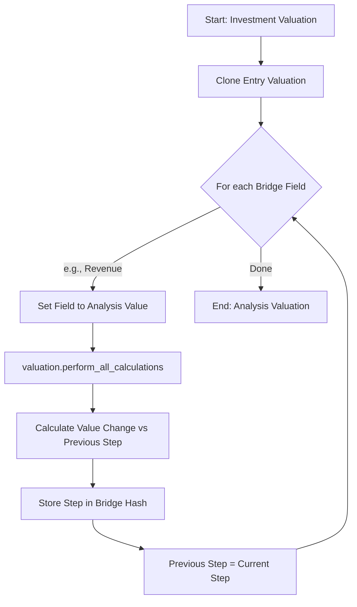

# Value Bridge Service Documentation

The `ValueBridgeService` ([`value_bridge_service.rb`](app/packs/core/valuations/services/value_bridge_service.rb)) is a specialized utility within the IRM system designed to decompose the change in a portfolio company's **Enterprise Value (EV)** between two points in time (typically Investment Date and Analysis Date).

It provides a step-by-step "bridge" analysis, showing how individual financial levers (like Revenue growth, Margin expansion, or Multiple changes) contribute to the overall value creation or destruction.

---

## 1. Core Logic & Methodology

The service uses an **incremental substitution** approach. Starting from the "Entry" valuation, it replaces one financial metric at a time with its value from the "Exit" (Analysis) valuation. After each substitution, it recalculates the Enterprise Value. The difference between the new EV and the previous step's EV is attributed to that specific metric.

### Standard Bridge Fields
By default, the bridge tracks:
1.  **Revenue**: Impact of changes in top-line growth.
2.  **EBITDA Margin**: Impact of changes in operational efficiency.
3.  **Valuation Multiple**: Impact of changes in market sentiment or sector re-rating.

---

## 2. Dynamic Calculation Framework (Custom Fields)

One of the most powerful features of the Value Bridge is its reliance on the **Dynamic Custom Field Framework**. Instead of hardcoding the math, the service uses formulas defined in the database.

### How it Works
Valuations are associated with a `FormType` (named "Valuation"), which contains a collection of `FormCustomField` objects. These fields can be:
- **NumberField**: Simple input values (e.g., Net Debt, Revenue).
- **Calculation**: Ruby-based formulas stored in the `meta_data` column.

### Flexibility & Customization
Because the logic is stored in data, administrators can modify the valuation model without changing code:
- **Adding Levers**: Want to track "Net Debt" or "FX Impact" in the bridge? Simply add them as `Calculation` fields.
- **Complex Formulas**: Formulas can reference other custom fields using `json_fields['field_name']`.

---

## 3. Walkthrough: Setting up a Value Bridge

To implement a value bridge like the one shown in the example (Revenue -> Margin -> Multiple -> Deleverage), follow these steps:

### Step 1: Define Input Fields
Create `NumberField` custom fields for your raw inputs:
1.  `revenue`
2.  `margin` (percentage)
3.  `multiple` (x)
4.  `net_debt` (for Deleverage tracking)

### Step 2: Define Calculation Fields
Create `Calculation` custom fields to link the inputs together. These use Ruby syntax:

| Field Name | Type | Formula (Metadata) |
| :--- | :--- | :--- |
| `ebitda` | Calculation | `(json_fields["revenue"].to_f * json_fields["margin"].to_f / 100).round(2)` |
| `enterprise_value`| Calculation | `(json_fields["ebitda"].to_f * json_fields["multiple"].to_f).round(2)` |
| `equity_value` | Calculation | `(json_fields["enterprise_value"].to_f - json_fields["net_debt"].to_f).round(2)` |

### Step 3: Configure the Bridge
When calling the `ValueBridgeService`, specify the order of substitution:
```ruby
bridge_fields = ["Revenue", "Margin", "Multiple", "Net Debt"]
service = ValueBridgeService.new(entry, current, value_bridge_fields: bridge_fields)
```

---

## 4. Process Flow Diagram



---

## 5. Visual Representation

The results are displayed through two primary components:

### A. The Comparison Table
A detailed matrix showing the state of every financial metric at every step of the bridge.
- **Rows**: All `key_fields` (Revenue, EBITDA, Multiple, EV, etc.).
- **Columns**: The "Steps" (Entry -> Revenue -> Margin -> Multiple -> Exit).

### B. The Waterfall Chart
A Highcharts-powered waterfall visualization representing the `enterprise_value_change` (or `equity_value_change`).
- **Starting Point**: Entry Value.
- **Intermediate Steps**: Green/Red bars for impact of each lever.
- **Ending Point**: Exit Value.


### C. Understanding the Example
In the image above, the bridge decomposes the change in Enterprise Value (EV) from **31/03/2023** to **31/12/2022**:
1.  **Starting EV (Entry)**: 151,200 (shown as the first black bar).
2.  **Revenue Impact**: +478,800 (large green bar). This reflects value created by top-line growth.
3.  **EBITDA Margin Impact**: 0.0 (horizontal line). No change in profitability margins.
4.  **Valuation Multiple Impact**: -105,000 (red bar). A decrease in the EV/EBITDA multiple used for valuation.
5.  **Fx Rate Impact**: 0.0 (horizontal line). No change in exchange rates between the two periods.
6.  **Final EV (Exit)**: 525,000 (final black bar).

The table above the chart shows the incremental calculation steps:
- Each column (Revenue, EBITDA Margin, etc.) represents a step where only *that* variable is updated to its final value.
- The `Enterprise Value Change` row captures the delta created by that specific substitution.

---

## 6. Specialized Features

- **FX Rate Handling**: Automatically uses the correct historical rates if `fx_rate` is a bridge lever.
- **MOIC Mode**: Passing `moic: true` converts absolute currency into multiples (e.g., "0.5x from Revenue growth") by dividing all steps by the Entry Value.

---

## 7. Dependencies

- **`Valuation` Model**: Data container.
- **`WithCustomField` Concern**: Executes formulas via `eval`.
- **`FormCustomField`**: Mapping and metadata storage.
