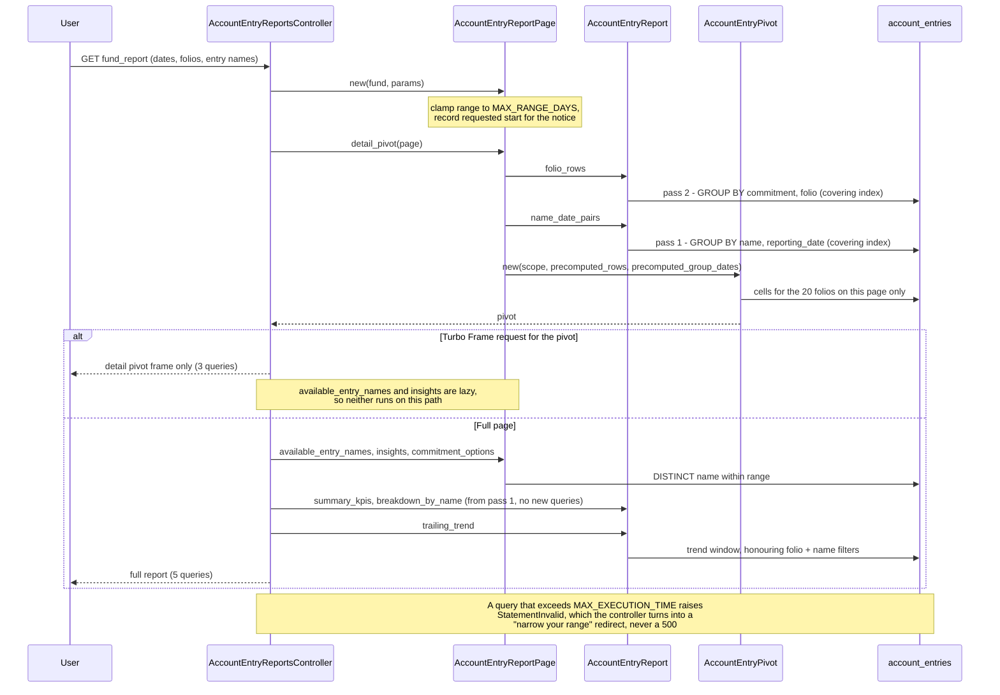

# Account Entries Period Report — Performance Assessment and Plan

Assessment of `/account_entry_reports/fund_report` (and the sibling `folio_report`)
written 2026-09-05. **Step 1 was implemented the same day** (section 5 records exactly
what shipped); steps 2 and 3 are still proposals. Entities with very large
`account_entries` ledgers could take the replica down with a single page load.

Code under review:

- `app/packs/funds/capital_commitments/controllers/account_entry_reports_controller.rb`
- `app/packs/funds/capital_commitments/services/account_entry_report_page.rb`
- `app/packs/funds/capital_commitments/services/account_entry_report.rb`
- `app/packs/funds/capital_commitments/services/account_entry_pivot.rb`
- `app/packs/funds/capital_commitments/views/account_entry_reports/*`

Related: `CLAUDE.md` (large-table query hygiene), `lib/tasks/partitions.rake`
(`account_entries` is `PARTITION BY RANGE (YEAR(reporting_date))`).

---

## 1. What one page load costs today

Everything on the page is an aggregate, but each aggregate is computed by a separate
pass over the raw ledger. For a fund-level load with a date range:

| Section | Query | Bounded by |
|---|---|---|
| `available_entry_names` | `distinct.pluck(:name)` over the fund's **whole history** | nothing — no date filter |
| `summary_kpis` | `sum`, `count`, `distinct.count(:capital_commitment_id)`, `distinct.count(:name)` | 4 separate range scans |
| `breakdown_by_name` | `group(:name).sum` | 1 range scan |
| `trailing_trend` | `group(quarter, name).sum`, 15 months back | top-5 names → uses `idx_fund_id_and_name_and_reporting_date`, fine |
| pivot rows | `distinct.pluck(:commitment_name, :capital_commitment_id)` | 1 range scan |
| pivot headers | `distinct.pluck(:name, :reporting_date)` | 1 range scan |
| pivot page | 20 folios' rows via `where(capital_commitment_id: [...])` | uses `idx_ae_cc_name_date`, fine |

That is ~8 full passes over the fund's rows in the range per request. Every pagination
click repeats all of them because the whole page re-renders.

### Why each pass is expensive

- **No `(fund_id, reporting_date)` index.** The fund indexes are
  `[fund_id, entry_type, reporting_date]`, `[fund_id, name, reporting_date]` and
  `[fund_id]`. With `entry_type`/`name` sitting between fund and date, a date range for a
  fund cannot be seeked. MySQL prunes to the year partition, then walks every row of the
  fund for that year via the `fund_id` index, doing a clustered-key lookup per row to read
  `amount_cents`/`cumulative`. A one-quarter report reads the whole year.
- **No covering index.** Every lookup lands on the wide row (`json_fields`, `notes`,
  `explanation`), so the passes are IO-bound, not just CPU-bound.
- **No range cap and no statement timeout.** `start_date=2000-01-01&end_date=2030-12-31`
  scans every partition and holds a replica connection and a Puma worker until it
  finishes.

### Smaller problems found in the same pass

- **Folio dropdown**: `@fund.capital_commitments.map { |cc| [cc.to_s, cc.id] }` in both
  report views loads every commitment as a full AR object per page load.
- **Trend chart ignores the filters** (correctness bug): `AccountEntryReport#trailing_trend`
  applies neither `@capital_commitment_ids` nor `@entry_names`, so a filtered fund-level
  report shows fund-wide trend numbers next to filtered KPIs. (Fixed in step 1.)
- The `AccountEntryReportInsight.fingerprint_for` staleness check is itself a
  `COUNT + SUM` full pass over the scope.

---

## 2. Plan

### Step 1 — make the existing page cheap (no model change)

1. **Collapse the scans to two.**
   - `GROUP BY name, reporting_date → COUNT(*), SUM(amount_cents)` yields the breakdown,
     total amount, entry count, distinct-name count **and** the pivot column headers.
   - `GROUP BY capital_commitment_id → MAX(commitment_name), COUNT(*)` yields the pivot row
     list **and** the distinct-folio count.
   - Trend and the pivot page-of-20 stay as they are (already well indexed).
2. **Covering index** on
   `(fund_id, cumulative, reporting_date, name, capital_commitment_id, amount_cents)`.
   Both remaining passes become index-only range seeks. This is the single biggest DB win.
   It is an online DDL / `pt-online-schema-change` job on a partitioned table with hundreds
   of millions of rows — plan it as an operational change, not a plain migration.
3. **Turbo-frame the pivot** so pagination re-runs only the pivot, never KPIs/charts.
4. **Guard rails**: cap the range (e.g. 24 months), default to the latest quarter, and add
   a `/*+ MAX_EXECUTION_TIME(n) */` optimizer hint on the report scopes so a runaway query
   fails fast instead of holding the replica.
5. **Dropdowns**: bound `available_entry_names` to the selected range; make the folio
   select a Select2 AJAX source (or at minimum a `pluck`).
6. **Fix the trend filter bug** in `trailing_trend`.

### Step 2 — stop reading the ledger for this screen (the real rethink)

`account_entries` are written in batches by allocation runs and imports, never
continuously, and the report only ever needs `SUM`/`COUNT` at one of two grains. Maintain
two rollup tables:

| Table | Grain | Columns | Serves |
|---|---|---|---|
| `account_entry_folio_rollups` | fund, capital_commitment, name, reporting_date | sum_amount_cents, entry_count, commitment_name | pivot rows/cells, folio report |
| `account_entry_name_rollups` | fund, name, reporting_date | sum_amount_cents, entry_count, folio_count | KPIs, breakdown, trend, pivot headers |

- Refresh per **(fund, reporting_date)** after each allocation run, import, or delete —
  the same unit of change that `AccountEntry#index_reporting_date` and
  `bulk_update_tracking_currency_numbers` already key on. Delete-and-reinsert the slice,
  never patch it.
- Rows are narrow and collapse the per-parent fan-out (`parent_id`/`parent_type`/
  `entry_type`/`ref_id`), so every section becomes a small indexed read.
- Also makes the folio report, `AccountEntryChartsHelper#account_entries_chart` and the
  XLSX pivot export cheap.
- The refresh must be a Trailblazer operation (project convention), enqueued from the
  allocation-run / import completion path.
- Optional intermediate: cache `AccountEntryReport` in Solid Cache keyed by
  `[fund_id, ledger_version, start, end, filters]` where `ledger_version` is a counter on
  `Fund` bumped by the same hooks. Fixes repeat views only, not the first hit on a wide
  range — go straight to rollups unless time is very short.

```mermaid
sequenceDiagram
    participant AR as AllocationRun / Import
    participant Op as AccountEntryRollupRefresh (Trailblazer op, bg job)
    participant AE as account_entries
    participant RU as account_entry_*_rollups
    participant C as AccountEntryReportsController
    participant P as AccountEntryReportPage / Report / Pivot

    AR->>AE: write entries for (fund, reporting_date)
    AR-->>Op: enqueue refresh(fund_id, reporting_date)
    Op->>RU: DELETE slice (fund, reporting_date)
    Op->>AE: SELECT ... GROUP BY capital_commitment_id, name (one pass, covering index)
    Op->>RU: INSERT folio rollups + name rollups
    Note over Op,RU: Idempotent per slice; safe to re-run

    C->>P: fund_report(fund, start, end, filters)
    P->>RU: name rollups WHERE fund, date range → KPIs, breakdown, headers, trend
    P->>RU: folio rollups WHERE fund, date range, folio IN (page) → pivot cells
    P-->>C: report (no account_entries reads)
```

### Step 3 — safety valve: background build for oversized reports

If a requested range still exceeds a threshold (estimated from rollup row counts), enqueue
a job that builds the report snapshot and let the page poll. `AccountEntryReportInsight`
already has the `pending → generating → complete` lifecycle and per-section cache row; this
is the same shape extended to report data. With rollups in place this should rarely
trigger, but it guarantees the interactive request path never scans the raw table.

---

## 3. Recommendation

Do **Step 1 immediately** (a day or two of work plus the index rollout), **Step 2 as the
next piece of work**, and **Step 3 only if** funds keep growing past what the rollups
handle comfortably.

## 4. Open questions

- Fraction of `cumulative = true` rows per fund — affects whether `cumulative` belongs
  early in the covering index.
- ~~Whether `deleted_at` rows must be excluded~~ — **answered, and it changed the index.**
  `AccountEntry` includes `Trackable`, which calls `acts_as_paranoid`, so `deleted_at IS
  NULL` is appended to every query. The first draft of the covering index omitted
  `deleted_at`; `EXPLAIN` then showed the optimizer ignoring it, because it still needed a
  row lookup to test that column. With `deleted_at` in the key both aggregate passes
  report `Using index`.
- Index rollout window on production (replica first, then primary) and expected duration
  at current table size.

---

## 5. What step 1 actually changed (2026-09-05)

| File | Change |
|---|---|
| `services/account_entry_report.rb` | Two aggregate passes (`name_date_totals`, `folio_rows`) now feed every KPI, the breakdown and the pivot headers. Added the MySQL `MAX_EXECUTION_TIME` hint. Fixed the trend folio filter. |
| `services/account_entry_report_page.rb` | `MAX_RANGE_DAYS` clamp (731) with the requested start preserved for the notice; entry-name dropdown scoped to the range; `commitment_options` built by join + pluck; dropdown and insight queries made lazy so a pivot-only request skips them. |
| `services/account_entry_pivot.rb` | Accepts `precomputed_rows` / `precomputed_group_dates` so the report's aggregates are reused instead of two more `DISTINCT` scans. Clamps an out-of-range page instead of raising `Pagy::OverflowError`. Buckets `dates_by_group` in one pass. |
| `controllers/account_entry_reports_controller.rb` | Turbo Frame short-circuit for pivot pagination; `rescue_from ActiveRecord::StatementInvalid` turns a query timeout into a "narrow your range" redirect rather than a 500. |
| `views/account_entry_reports/_filter_form.html.erb` | New shared partial replacing the byte-identical filter form duplicated in both report views; carries the clamped-range warning. |
| `views/account_entry_reports/_detail_pivot.html.erb` | Wrapped in the Turbo Frame the controller matches on. |
| `db/migrate/20260905120000_*.rb` | The covering index, built with `ALGORITHM=INPLACE, LOCK=NONE` on MySQL. |
| `features/fund/account_entry_report_performance.feature` | Regression cover for the query budget, the clamp, the overflow page and the trend filter. |

### The request path after step 1



### Measured on the dev database

| Request | account_entries queries, before | after |
|---|---|---|
| Full fund report | ~10 | 5 |
| Pivot pagination (Turbo Frame) | ~10 | 3 |

`EXPLAIN` on both aggregate passes reports `Using index` with the new index chosen by the
optimizer unprompted. KPI totals, counts and the breakdown were checked against the old
implementation's queries and match exactly.

### Deliberate deviations from the plan above

- **The default range was left as the single latest reporting date**, not "the latest
  quarter" as section 2 suggested. A one-day default is cheaper than a quarter, so
  widening it would have made the common load heavier for no benefit.
- **The folio dropdown was not converted to a Select2 AJAX source.** It is now one
  join + pluck with no object instantiation and no `investor_kyc` N+1, which removes the
  cost that mattered. A remote source is still the right answer for funds with very many
  folios, and needs its own endpoint and Pundit policy method.

### Caught by review, fixed

- **Folio KPI double-counted.** `distinct_folio_count` was first derived by counting rows
  of the pass-2 query, which groups by `(commitment_name, capital_commitment_id)`.
  `commitment_name` is denormalized onto `account_entries`, so a folio whose investor was
  renamed mid-period produced two rows and inflated the KPI. Now counts distinct ids.
  Covered by a scenario in the feature.
- **Timeout rescue could not fire.** The report's aggregates were evaluated inside the view
  partials, so a statement timeout landed mid-render and `rescue_from` would have raised
  `DoubleRenderError` instead of redirecting. `AccountEntryReport#preload!` now forces every
  query from the controller action, `trailing_trend` is memoised per argument set so nothing
  runs twice, and the handler re-raises if a response has already started.

A third review finding, that clamping the pivot page could still raise `Pagy::OverflowError`
on an empty row set, does not apply: on Pagy 9.4 `Pagy.new(count: 0, page: 1)` is valid
(`last` is at least 1), and the clamp is precisely what turns a `page=3` request on an empty
pivot into that valid call.

### Known issue left alone

`AccountEntryPivot` drops rows whose `capital_commitment_id` is NULL when it fetches cell
values, so a fund-level entry appears as a row of dashes. This predates step 1 and behaves
identically before and after it; fixing it would also change `AccountEntryList`, so it is
left for a separate change.

### Before deploying

The migration is written but **must not run inside a normal production deploy** — see the
operational note in the migration itself. Add the index on the replica first, in a
low-traffic window, or with `pt-online-schema-change`.
