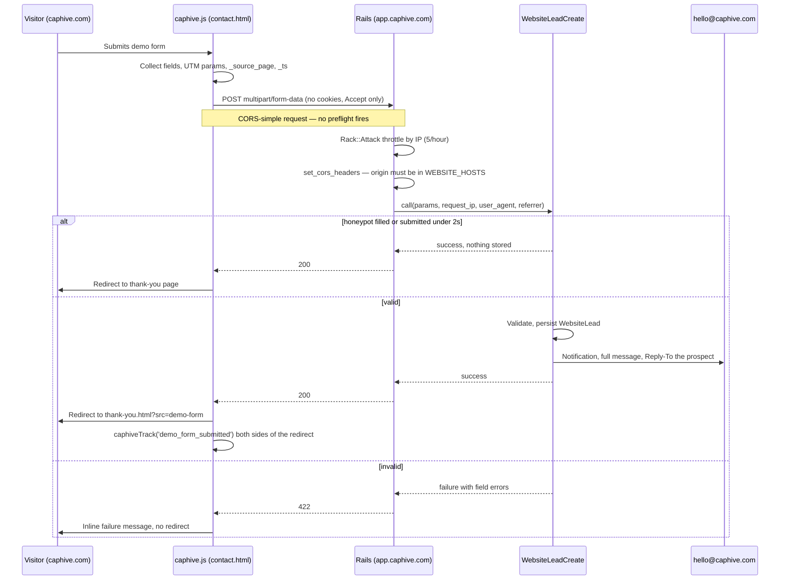

# Website Lead Capture

**Status:** Built. Migration applied, 24 Cucumber scenarios passing.
**What it does:** Captures demo requests from the public website into our own database, with no login and no third-party form processor.
**Prerequisite row:** A1 in [`docs/gtm/us_gtm_prerequisites.md`](../../gtm/us_gtm_prerequisites.md).

Before this, the demo form composed an email in the visitor's own mail client. Nothing reached us unless they then chose to send it, and anyone who abandoned at that step was invisible.

---

## 1. Why an App-Side Endpoint Works

`lib/middleware/website.rb:94-96` returns 405 for any non-GET request, and in production nginx serves the apex directly from `public/website` — but **both only apply to requests whose Host is in `WEBSITE_HOSTS`**. A POST to `app.caphive.com` is not such a request: the middleware never sees it and Rails handles it normally. No middleware change, no nginx change.

An earlier note in `docs/gtm/prerequisites/PROGRESS.md` recorded the opposite conclusion and sent the work towards Formspree. That reasoning missed the host scoping. Both documents have been corrected.

**CORS is still required.** `https://caphive.com` and `https://app.caphive.com` are different origins — the same-origin policy compares scheme + host + port, and a shared registrable domain only matters for cookies, which this endpoint deliberately does not use. Without `Access-Control-Allow-Origin` the POST would still arrive and the row would still be written, but `fetch()` would reject, the visitor would see a failure and no conversion would fire.

Origins, from each deployment's `.env`:

| Stack | `WEBSITE_HOSTS` | Posts to |
|---|---|---|
| Production IN | `caphive.com`, `www.caphive.com` | `https://app.caphive.com/website_leads` |
| Production US | `caphive.us`, `www.caphive.us` | `https://app.caphive.us/website_leads` |
| Staging IN | `altconnects.com`, `www.altconnects.com` | `https://dev.altconnects.com/website_leads` |
| Development | `caphive.localhost` | `http://localhost:3001/website_leads` |

Staging is deliberately not a `caphive.*` domain, which is why nothing hardcodes `caphive.com`: the controller derives its allowlist from `WEBSITE_HOSTS`, the same variable the middleware reads.

---

## 2. Flow

A discarded bot gets the same 200 and the same redirect as a real lead. Telling it which check it tripped is telling it what to change.

---

## 3. What Was Built

### Rails

| File | Role |
|---|---|
| `db/migrate/20260816120000_create_website_leads.rb` | The table. Not tenant-scoped — no `entity_id`. |
| `app/packs/core/base/models/website_lead.rb` | Validations, length caps, retention scopes. |
| `app/packs/core/base/models/website_lead_retention.rb` | The two retention windows, in one place. |
| `app/packs/core/base/services/website_lead_create.rb` | Trailblazer operation: `reject_bot` → `build` → `save` → `handle_errors` (left) → `send_notification`. |
| `app/packs/core/base/controllers/website_leads_controller.rb` | Public `create`/`options`; staff `index`/`show`. |
| `app/packs/core/base/policies/website_lead_policy.rb` | `:support` / `:super` only. |
| `app/packs/core/base/mailers/website_lead_mailer.rb` + view | The A2 alert, to `WEBSITE_LEADS_EMAIL_TO` (default `hello@caphive.com`). |
| `app/packs/core/base/views/website_leads/` | Read-only staff screens. |
| `app/assets/stylesheets/custom/website_leads.scss` | Message/payload block styling. |
| `config/routes.rb` | `resources :website_leads, only: %i[index show create]` plus the OPTIONS route. |
| `config/initializers/rack_attack.rb` | `website_leads/ip`, 5 per hour. |
| `lib/tasks/website_leads.rake` + `config/schedule.rb` | Daily retention purge. |

**One controller, two audiences.** The filter skips are scoped `only: %i[create options]`. A blanket skip would have opened the staff screens to the internet — the one mistake this file must not make. The `verify_authorized` after-action is re-added for `index`, because the app-wide declaration exempts `index` and the check would otherwise pass without consulting a policy at all.

**Why role, not tenancy.** A `WebsiteLead` is created by an anonymous visitor before any relationship exists, so it has no entity to scope to. `WebsiteLeadPolicy#staff?` checks `has_cached_role?` directly rather than `User#support?`, which is also true while a support user is impersonating a customer — impersonation must not carry the sales pipeline into a customer's session. Same reasoning as `InternalDocPolicy`.

### Website

| File | Change |
|---|---|
| `website_src/_partials/site_config.html.erb` | New. Resolves `formEndpoint` from `location.hostname`. |
| `website_src/_layout.html.erb` | Renders `site_config` before `analytics`. |
| `website_src/_partials/analytics.html` | Adds the `caphiveTrack` wrapper. |
| `website_src/pages/contact.html` | Honeypot, `_ts`, form id, isolated mailto-only sentence. |
| `website_src/pages/index.html` | Hero and CTA buttons link to `contact.html#demo-request`. The homepage no longer carries a form. |
| `website_src/_partials/index_scripts.html` | Homepage form handler removed along with the homepage form. |
| `public/website/assets/js/caphive.js` | The shared POST handler and the thank-you conversion event. |
| `public/website/assets/css/caphive.css` | `.hp-field` honeypot positioning; `#demo-request` scroll offset for the anchored jump from the homepage. |
| `website_src/pages/privacy.html` | Collection and retention wording. |
| `website_src/pages/cookies.html` | Corrected — no third-party form processor. |

**The endpoint is resolved in the browser, not at build time.** `public/website` is built once and committed, and both deployments serve the same files. A single baked-in URL would post every US lead into the India database. An unrecognised host resolves to an empty endpoint and the form falls back to a mail-client draft, so a preview deploy degrades instead of losing leads.

**There is one form, on `contact.html`.** The homepage used to carry a shortened copy of it (name, firm, email) with its own submit handler in `_partials/index_scripts.html`, because `index.html` renders that partial instead of `caphive.js` and so the conversion path had to exist twice. Both the short form and its handler are gone: the homepage's hero and CTA buttons now link to `contact.html#demo-request`. One form means one field set, one handler, and one thing to check after a deploy — and the short form collected neither the role nor the message that make a configure-first demo possible.

`index.html` still renders `index_scripts.html` instead of `caphive.js` — loading both would double-bind the nav, mobile menu, reveal, odometer and magnetic-button behaviours they each implement — so the booking-link swap is still duplicated there. Only the form handler was removed.

**The alert goes to the commercial mailbox, not to `SUPPORT_EMAIL_TO`.** That address is the support and exception firehose — ExceptionNotifier, CS escalations, entity alerts — and a prospect owed a five-minute reply must not arrive in it. `WEBSITE_LEADS_EMAIL_TO` is its own variable, set to `hello@caphive.com` in every `.env`, and the mailer falls back to that address if the variable is unset. `Reply-To` is the prospect, so replying to the alert answers them directly.

---

## 4. What Gets Captured

| Field | Source |
|---|---|
| `name`, `email` | form, both required; email is the only field that must be well-formed |
| `firm`, `role`, `message` | form; `message` is never truncated anywhere |
| `utm_source/medium/campaign/content/term` | JS, from `location.search` |
| `landing_page` | JS, as `_source_page` |
| `referrer` | server, from the `Referer` header — the client sends none |
| `submitted_at` | server clock, never client-supplied |
| `request_ip`, `user_agent` | server; abuse control only, purged on the short clock |
| `raw_payload` | server; everything received as JSON, minus `_hp` and `_ts` |

`raw_payload` exists because the website's form fields change without a deploy of this app. A field added there shows up on the staff screen even though no column exists for it.

---

## 5. Abuse, Spam and Data Protection

1. **Honeypot** (`_hp`) — positioned off-screen rather than `display:none`, because a bot that parses CSS skips what is obviously hidden. `aria-hidden` and `tabindex="-1"` keep humans away.
2. **Time-to-submit** (`_ts`) — under 2 seconds is discarded. A **missing or unparseable** stamp is accepted: a cached page or partially-blocked JS must never cost a real lead. A client clock ahead of ours is also accepted.
3. **Rack::Attack** — `website_leads/ip`, 5 per hour, exact path match and POST only, so the staff `show` page never shares a bucket with anonymous submissions.
4. **Length caps** on every field, enforced in the model so an oversized `message` is a clean 422 rather than a MySQL truncation or a 500.
5. **No CAPTCHA.** It adds friction to a low-volume, high-value form. Revisit only if spam actually arrives.
6. **Escaping.** The notification and both staff views render everything through ERB's default escaping; nothing uses `raw`, `html_safe` or `simple_format`. The mailer strips control characters from `firm` before it reaches the Subject header.
7. **Retention** — below.

### Retention

Defined once in `WebsiteLeadRetention` and enforced daily by `rake website_leads:purge`:

- **`request_ip` and `user_agent`: 90 days**, then nulled while the lead itself is kept. They exist only to spot a flood, and that purpose is served in days.
- **The lead record: 24 months** after submission, then deleted. A two-year sales cycle is normal in this market; past that, keeping it is hoarding rather than pipeline.

Both numbers are published verbatim in `website_src/pages/privacy.html` §7. **Changing one without the other makes the privacy policy false.** The staff `show` screen labels a purged field "— (past retention window)" so an older lead reads as the system working, not as data loss.

---

## 6. Tests

`features/core/website_leads.feature`, 24 scenarios, all passing. They drive Rack::Test through the full middleware stack rather than Capybara, because the Origin header is the thing under test, the body must be real `multipart/form-data`, and the throttle scenario needs `X-Forwarded-For` (127.0.0.1 is deliberately safelisted).

Covered: valid submission stored and announced; **notification addressed to `hello@caphive.com` with the prospect as `Reply-To` and every submitted field in the body**; full message in the notification; UTM persistence; landing page; IP recorded; malformed email; missing name; oversized message; honeypot; too-fast submission; **missing `_ts` accepted**; throttle on the sixth submission; allowed origin echoed; credentials never allowed; `Vary: Origin`; unlisted origin refused; **the other stack's origin refused**; unset `WEBSITE_HOSTS` trusting nothing; preflight; staff index and show; ordinary user denied; anonymous denied.

Cucumber runs the `:inline` ActiveJob adapter, so `deliver_later` has already run when the response returns — assertions are on `ActionMailer::Base.deliveries`. The `@website_leads` Around hook restores `WEBSITE_HOSTS`, which `.env.test` does not define.

---

## 7. Verifying After Deploy

The only step a human still owns (`HUMAN_ACTIONS.md` §A1/A2). From an incognito window on the deployed site:

1. Submit the form on `contact.html`. It is the only demo form on the site; the homepage's "Setup a Demo" and CTA buttons should land you on it, scrolled to the form.
2. It should leave the browser on `thank-you.html?src=demo-form` with no mail client involved.
3. The lead appears under **Website Leads** in the app (`:support` / `:super` only).
4. An email reaches `WEBSITE_LEADS_EMAIL_TO` (`hello@caphive.com`) within five minutes, with the full message and the prospect's address as `Reply-To`.

If the browser console shows a CORS error, the site's hostname is missing from `ENDPOINTS` in `site_config.html.erb`, from `WEBSITE_HOSTS` on the app host, or the two disagree.

---

## 8. Deliberately Not Done

- **No downstream automation.** A lead creates no CRM record and no task. The public write path stays as small as possible.
- **No pooling across stacks.** India and US each keep their own leads; nothing crosses.
- **No edit or destroy on the staff screens.** They are read-only.
- **The ad tags (B2/B3) were rejected, not deferred.** Branch `gtm/website-prereqs` carries an `analytics.html.erb` that adds LinkedIn Insight and Google Ads tags and has **no Consent Mode at all** — it loads GA4 the moment an id is set. `main`'s partial denies `analytics_storage` by default, replays the stored choice before `config`, and states that no advertising tags run; `cookies.html` is an accurate inventory built on that. Adding those tags is a privacy and cookie-policy decision that belongs in its own change, built inside `main`'s consent-gated partial. Do not resurrect the branch's file for it.

The booking-link work (A3/A4) **has been cherry-picked** — see §9. Once that landed, nothing of value remains on `gtm/website-prereqs`: what is left is the rejected analytics file, a `mobile_menu.html` that predates `main`'s submenu fix, and comment-wording differences. The branch can be deleted.

---

## 9. Booking Link (A3/A4)

Cherry-picked from `gtm/website-prereqs`, not merged.

`window.CAPHIVE.bookingUrl` in `site_config.html.erb` drives four CTAs. Elements marked `data-booking` stay hidden until it is set; `data-booking-cta` elements additionally have their `href` replaced, which is what lets the header button point at the contact form until a scheduling account exists.

| Where | Element |
|---|---|
| Header (all 64 pages) | `_partials/nav.html.erb` — `data-booking-cta` |
| Mobile menu | `_partials/mobile_menu.html` — `data-booking-cta` |
| Contact form | `.booking-alt` block, "or / Pick a time directly" |
| Thank-you page | `.booking-alt` block, "or skip the wait / Pick a time now" |

**The homepage needed its own copy of the swap.** `nav.html.erb` is shared by every page, so `index.html` carries `data-booking-cta` — but it renders `_partials/index_scripts.html` instead of `caphive.js`, so nothing would have rewritten it. As inherited, the booking link would have gone live on all 63 other pages and silently kept pointing at the contact form on the busiest one. The block is duplicated into `index_scripts.html`, flagged in both files.

**Two conversion paths, both covered.** A redirect-based setup sends the visitor to `thank-you.html?src=booking`, which fires `booking_completed`; an embedded Calendly widget posts a `calendly.event_scheduled` message instead. The message listener matches the origin's **host** exactly (`calendly.com` or `*.calendly.com`) rather than the substring check the branch used — an `indexOf` test would also accept `https://calendly.com.attacker.example`, letting any page that can open a window fire a fake conversion into the analytics property.

`bookingUrl` is currently `https://calendly.com/caphive-support`. Blank that one line and rebuild to retire it; nothing else needs touching.
