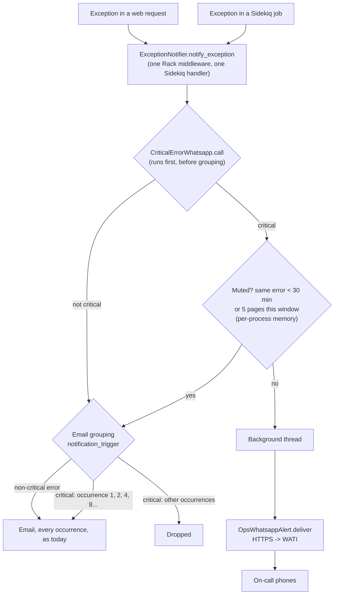
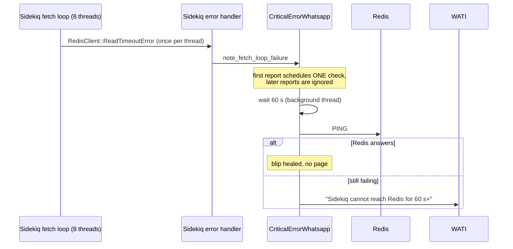
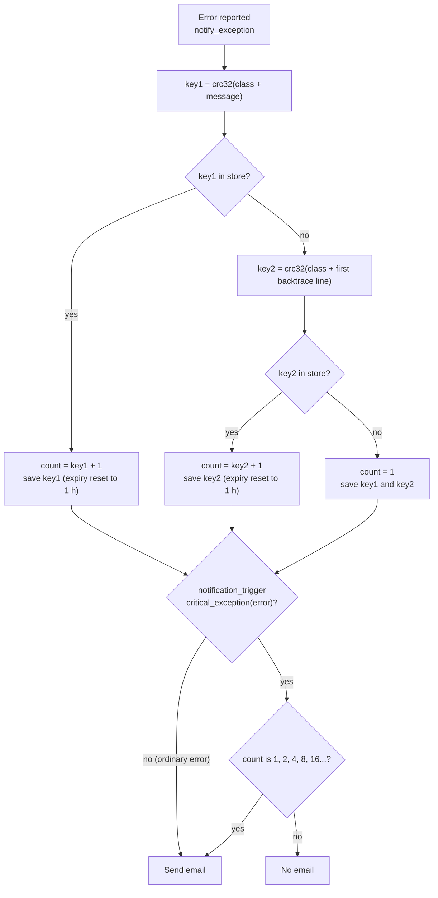
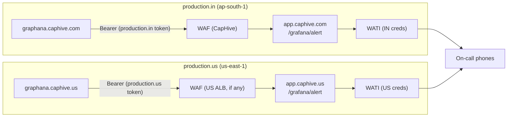

# Critical error WhatsApp alerts

Pages the on-call phones on WhatsApp when the production app hits an infrastructure
failure (database, Redis, disk), and stops a single outage from flooding the error inbox.

## Why

On 2026-09-27 the IN database host's disk filled up and Redis went down with it.

- The app emailed about **1000 identical** errors:
  `[Error] production:(caphive.com)sessions#new (ActiveRecord::StatementInvalid) "Mysql2::Error: Error writing file '/tmp/MY...' (Errcode: 28 - No space left on device)"`.
  MySQL writes temporary files for sorts and temp tables to `/tmp` on the DB host. With the
  disk full, every login-page request failed, and every failure sent one email.
- Grafana fired `Disk Critical (>90%)` at 08:02 UTC (disk at 99.96%) and routed it to the
  **Caphive WhatsApp** contact point, but the webhook (Grafana -> `app.caphive.com/grafana/alert`
  -> ALB/WAF -> Rails -> WATI) was refused with **403 Forbidden** at the WAF, so no
  WhatsApp arrived. The same 403 happened on 2026-08-22 (see
  `infra/waf/ap-south-1/check_sampled_requests.sh`).

Nobody was paged. The email that did arrive was buried under 999 copies of itself.

A follow-up test through Grafana's test-notification API found a second, independent break
on the same path: once past the WAF, every alert was refused **401** by the app (see
[Grafana webhook path](#grafana-webhook-path)).

## Goals

- A WhatsApp page within seconds when the app sees a DB, Redis or disk failure.
- The page must not depend on anything that lives on the DB host (MySQL, Redis) or on
  Grafana's webhook path.
- One outage produces a handful of emails, not one per failing request.
- Ordinary application bugs keep emailing exactly as they do today, and never page.

## Non-goals

- **A dead app server.** If Puma/Sidekiq are not running, no exception is raised and
  nothing pages. That needs an outside uptime check (separate work).
- Fixing the WAF 403 on Grafana's webhook (separate work; Grafana stays the pager for
  host-level metrics like disk %).

## How it fits together



Sidekiq's own Redis poll loop is handled separately, because those errors are never emailed
(`SidekiqRedisFetchError` suppresses them):



## Design decisions

### 1. What counts as critical

`CriticalErrorWhatsapp.critical_exception` walks the exception and up to 4 causes. An
exception is critical when:

| Rule | Examples |
|---|---|
| Class is a connection failure | `ActiveRecord::ConnectionNotEstablished` (includes `DatabaseConnectionError`, pool `ConnectionTimeoutError`), `Mysql2::Error::ConnectionError`, `RedisClient::CannotConnectError`, `Redis::CannotConnectError` |
| Class is a resource exhaustion | `Errno::ENOSPC` (disk full), `Errno::EMFILE` (out of file handles) |
| A **Redis** error reply saying the server cannot serve (`RedisClient::CommandError` / `Redis::CommandError` starting with `MISCONF`, `OOM`, `READONLY`, `LOADING`) | a Redis whose disk is full stays up and answers writes with `MISCONF ... unable to persist to disk` — it never refuses the connection |
| A **MySQL/ActiveRecord** error whose message says the server is in trouble | "No space left on device", "Errcode: 28", "Got error 28 from storage engine", "Error writing file", "Incorrect key file for table" (MySQL's usual symptom of its tmpdir filling mid-query), "The table 'x' is full", "MySQL server has gone away", "Lost connection to MySQL server", "Can't connect to MySQL server", "Too many connections", "--read-only option" |

Why the message check is limited to MySQL/ActiveRecord errors: Rails wraps every MySQL
error in the same `ActiveRecord::StatementInvalid`, whether the disk is full or someone
typed a bad column name, so only the message tells them apart. But the same phrases
appear elsewhere, e.g. an SMTP server answering `421 Too many connections`, and those
must not page as a database failure.

Redis **timeouts** (`ReadTimeoutError`, `WriteTimeoutError`, `CheckoutTimeoutError`) are
deliberately not critical. They are subclasses of `RedisClient::ConnectionError` and usually
heal on their own. Only `CannotConnectError` (connection refused) pages.

### 2. Pager runs before email grouping

The gem runs grouping first and only calls notifiers when grouping lets the error through.
With the pager as a notifier, a 1000-errors-an-hour outage would page again at occurrence
1024, hours later. So the pager hooks `ExceptionNotifier.notify_exception` itself (a
prepended module) and sees every reported error; its own 30-minute mute decides repeats.

### 3. Throttle state is per-process memory

Production `Rails.cache` is `solid_cache_store`, which lives in **MySQL**, and Redis sits on
the same host. Neither can hold the throttle during the outages we page for: a failed read
looks like "never sent", so it would page on every error; a write can hang on a full disk
inside the failing request.

Rules, per process:

- the same error pages at most once per **30 minutes**. "Same" ignores digits, quoted
  text and file paths, so `'/tmp/MYfd=81'` and `'/tmp/MYfd=92'` are one error, as are
  `Errno::ENOSPC` failures on different files;
- at most **5 pages per 30 minutes** across all errors, so a cascade (DB, then pool
  timeouts, then Redis) cannot flood the phones.

Trade-off: every process pages once. With 2 app servers × (Puma workers + 1 Sidekiq), one
incident can send ~6 near-identical WhatsApps. We accept duplicates over a throttle that
fails exactly when it is needed.

### 4. Email grouping only for critical errors

`config.error_grouping = true` with a `notification_trigger` that applies the gem's
1st/2nd/4th/8th... schedule **only to critical errors**. Every other error returns `true`
and emails on every occurrence, as before.

Why not group everything: the gem keys groups by class + first backtrace line. All MySQL
errors are raised from the same adapter line, so different SQL bugs would share a group
and hide each other. Health-check jobs (`ReplicationHealthJob`, `DbBackupFreshnessJob`,
`S3CheckJob`) report exceptions they never raise, which have no backtrace at all, so they
would all share *one* group, and "replication is broken" could be dropped because an
unrelated warning came first.

How the gem counts an occurrence (exception_notification 5.0.1,
`ExceptionNotifier::ErrorGrouping.group_error!`), then how our trigger decides:



Worked example, today's error in one Puma worker. Each message names a different temp file
(`'/tmp/MYfd=81'`, `'/tmp/MYfd=92'`, ...), so key1 never repeats; key2 does, because every
occurrence is raised from the same line in the MySQL adapter:

| Occurrence | key1 | key2 | count | Email? |
|---|---|---|---|---|
| 1 (`MYfd=81`) | miss | miss | 1 | yes |
| 2 (`MYfd=92`) | miss | hit (1) | 2 | yes |
| 3 | miss | hit (2) | 3 | no |
| 4 | miss | hit (3) | 4 | yes |
| 5–7 | miss | hit | 5–7 | no |
| 8 | miss | hit | 8 | yes |
| … | | | 16, 32, …, 512 | yes |

So 1000 occurrences in one process send 10 emails (1, 2, 4, …, 512) instead of 1000. The
counts are per process, so with 6 processes sharing the load (~170 each) expect ~8 emails
each, ~50 in total. Every hit resets the key's 1-hour expiry, so the count keeps climbing
while the outage lasts and only starts again from 1 after an hour with no occurrences.

The grouping counters use an in-process `MemoryStore` (`CriticalErrorWhatsapp::GROUPING_CACHE`).
It is **re-asserted before every notification** by the hook, not just set at boot: every
`ExceptionNotification::Rack.new` (exception_notification 5.0.1, `rack.rb:18`) resets the
store to `Rails.cache` (MySQL) unless given one, and the gem's Engine adds that middleware
with no options. Setting it once in `after_initialize` only works until something rebuilds
the middleware; an end-to-end check that rebuilt it sent all 10 emails for 10 disk-full
errors instead of 4.

### 5. One reporting middleware

`ExceptionNotification::Rack` was in the stack twice: once from the gem's Engine
(`require 'exception_notification/rails'`) and once from `config/application.rb`. Every
failing request was reported twice. The `application.rb` copy is removed and its email
settings (the `[Error] production:(caphive.com)` prefix and the comma-separated
`ERROR_EMAIL` list) move into `config/initializers/exception_notification.rb`, so the
emails look exactly as they do today.

### 6. Delivery

- Straight to WATI over HTTPS, via `OpsWhatsappAlert.deliver`, on a background thread. Not a
  Sidekiq job (Redis may be down), not inline (a slow WATI must not slow the failing
  request further).
- `OpsWhatsappAlert` is shared with `GrafanaAlertsController`: phone parsing
  (`grafana_alert_phones`, list or CSV, stripped to digits), the template call, and the
  acceptance check. A send counts as delivered only on WATI's explicit `"success": true`
  with no per-recipient errors — not merely the absence of a known failure shape, because
  `WhatsappGeneralNotification.parse_response` returns the JSON body whatever the HTTP
  status, so a 401/429/5xx answering `{"message": "Unauthorized"}` used to read as
  delivered. A rejected send is logged at error level and the mute is released, so the
  next occurrence retries. If the send thread cannot even start (e.g. `ThreadError` on an
  exhausted host), the mute is released too.
- A "sending page" line is logged before the call. If the process is killed mid-send, the
  page is lost, but the log shows one was attempted.

### 7. Production only

Development, staging and test never page (`enabled?` is `Rails.env.production?`).

## Message

One line, because WhatsApp rejects newlines, tabs and runs of 4+ spaces in template
parameters. Template `caphive_notification_6` (`CAPHIVE_NOTIFICATION`), button linking to
the region's Grafana (`grafana/in` / `grafana/us`).

```
[IN] CRITICAL on app-in-1: ActiveRecord::StatementInvalid: Mysql2::Error: Error writing file '/tmp/MYfd=81' (OS errno 28 - No space left on device) · at sessions#new · repeats muted 30 minutes per process
```

## Files

| File | Role |
|---|---|
| `lib/critical_error_whatsapp.rb` | classification, throttle, fetch-loop check, pager hook |
| `lib/ops_whatsapp_alert.rb` | phones, WATI send, rejection check (shared) |
| `config/initializers/exception_notification.rb` | email notifier, grouping, pager hook, Sidekiq handler |
| `config/application.rb` | duplicate middleware removed |
| `app/packs/core/base/controllers/grafana_alerts_controller.rb` | uses `OpsWhatsappAlert` |
| `features/core/critical_error_whatsapp.feature` | pager scenarios, WATI replaced by a recorder |
| `lib/tasks/grafana_provision.rake`, `config/initializers/observability/grafana_provision.yml` | per-region webhook URL + Bearer token, strict placeholders |
| `features/core/grafana_alert_webhook.feature` | webhook token scenarios, WATI stubbed |

## Grafana webhook path

Grafana stays the pager for host-level metrics (disk %, CPU, exporters down) — things no
exception reports. On 2026-09-27 that path had three faults:

| Fault | Effect | Fix |
|---|---|---|
| AWS WAF `AWSManagedRulesCommonRuleSet#EC2MetaDataSSRF_BODY` matched the alert body | real alerts blocked **403** at the ALB | WAF Allow rule for the region's Grafana IP + `POST /grafana/alert` (separate, rake task) |
| Token provisioned as `httpHeaders: {"X-Webhook-Token": ...}` | Grafana **9.3.2** has no custom-header setting (its webhook options: url, httpMethod, basic auth, `authorization_scheme`/`authorization_credentials`, maxAlerts, title, message), so the header was never sent | contact point uses `authorization_scheme: Bearer` + `authorization_credentials`; `GrafanaAlertsController` accepts `Authorization: Bearer` (and still `X-Webhook-Token`) with a constant-time compare |
| `${GRAFANA_WEBHOOK_TOKEN}` expanded from an unset ENV var to `""` | even a supported header would have carried an empty token → **401** | the provisioner resolves it from the target region's credentials and **aborts** on a missing value (contact points only; viewer users still skip when their password is unset) |

Also found: the US Grafana was provisioned to post to the **IN** app (`app.caphive.com`),
because the contact-point spec hardcoded one URL for both.

### IN and US are independent

Each Grafana alerts through its own region's app with that app's token and WATI account;
nothing crosses regions. The provisioner derives both from the Grafana it is pointed at
(`GRAFANA_URL` host → `REGION_BY_HOST` → `REGION_TARGETS`):



The same holds for the in-app pager: each process pages with its own environment's
credentials, and `AWS_REGION` only picks the `[IN]`/`[US]` tag and Grafana link.

### Rollout order

1. Deploy the app to both regions first: it must accept `Bearer` before Grafana sends it.
2. Re-provision each Grafana's contact points. The admin password defaults to that
   region's own credentials (`GRAFANA_PASS` in ENV overrides), so IN's password can never
   be tried on US. The webhook URL and token are **always** taken from the target region —
   an exported `GRAFANA_WEBHOOK_TOKEN`/`GRAFANA_WEBHOOK_URL` is ignored with a warning, so a
   token left in the shell from one region's run cannot reach the other:
   `GRAFANA_URL=https://graphana.caphive.com rake grafana:provision:contact_points`, then
   `GRAFANA_URL=https://graphana.caphive.us rake grafana:provision:contact_points`.
   The task reads the webhook contact point back from Grafana and **fails** unless the URL,
   `httpMethod`, `authorization_scheme` and a stored `authorization_credentials` all match —
   the HTTP helpers ignore status codes, so without this a rejected update printed
   "Updated" and changed nothing.
3. Send a test through Grafana's test-notification API
   (`POST /api/alertmanager/grafana/config/api/v1/receivers/test`, contact point `Caphive WhatsApp`):
   expect a "TEST ONLY" WhatsApp and the contact point to turn **OK**.
4. Add the WAF Allow rule so real alert bodies pass (`EC2MetaDataSSRF_BODY`).

## Checking it in production

After deploy, from a production console (a fresh one: each process mutes after it sends):

```ruby
CriticalErrorWhatsapp.call(Errno::ENOSPC.new('test page'))
```

A WhatsApp should arrive within seconds. If not, `production.log` has a
`[CriticalErrorWhatsapp]` line with WATI's response.
