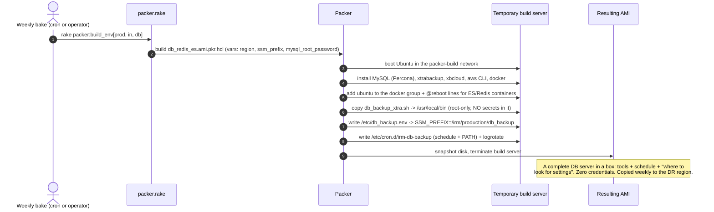
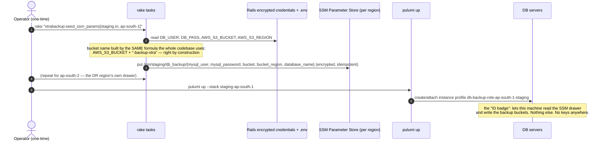
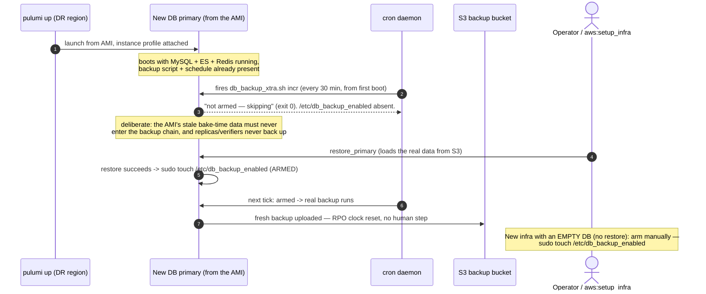

# How the Database Backup System Gets Its Credentials and Buckets

A ground-up explanation of how `db_backup_xtra.sh` on a DB server always ends
up with the right AWS access, bucket, and MySQL credentials — **without any of
those secrets ever being stored in the script, the AMI, or the repo**.
Written for newcomers: AWS concepts are explained as they appear.

Companion docs: `docs/operations/dr/dr_guide.md` (what to do in a disaster),
`lib/tasks/Caphive infra setup.md` (full setup runbook).

---

## 0. AWS concepts used here (newcomer glossary)

| Term | What it is, in plain words |
|---|---|
| **S3** | AWS's file storage. Files live in named "buckets" (globally unique names). Our backups are uploaded to a bucket named `<app-bucket>-backup-xtra`, e.g. `docs.altx.com.staging-backup-xtra`. |
| **AMI** (Amazon Machine Image) | A frozen snapshot of a whole server's disk — OS, installed software, files. Launching an "instance" (a server) from an AMI gives you an exact copy of that disk. We build AMIs with **Packer**. |
| **Packer** | A HashiCorp tool that builds AMIs from a recipe file (`.pkr.hcl`): it boots a temporary server, runs install commands on it, snapshots the result as an AMI, and throws the temporary server away. Our recipe: `config/deploy/templates/packer/db_redis_es.ami.pkr.hcl`. |
| **IAM Role / Instance Profile** | An identity **attached to a machine** instead of a person. Think of it as an ID badge glued to the server: any program on that server automatically acts with the badge's permissions — no access keys, no passwords. Ours is `db-backup-role-<region>-<stack>` and it may only touch the backup buckets and our SSM parameters. |
| **SSM Parameter Store** | A small key–value store in AWS ("SSM" = Systems Manager). Like a shared, encrypted settings drawer: you put named values in (`/irm/staging/db_backup/mysql_password`), and authorised machines read them at run time. Values marked *SecureString* are encrypted at rest. **Parameters are per-region** — ap-south-1's drawer and ap-south-2's drawer are separate. |
| **cron / `/etc/cron.d/`** | The standard Linux scheduler. Files in `/etc/cron.d/` list "at this time, run this command as this user". The cron daemon reads them and fires the commands — no other service needed. |
| **xtrabackup / xbcloud** | Percona's MySQL backup tools. `xtrabackup` copies a live database without stopping it; `xbcloud` streams that copy straight into S3. |
| **Pulumi** | Our infrastructure-as-code tool (Python). `pulumi up` creates/updates the AWS resources a stack describes — servers, network, and the IAM role above. Repo: `../IRM-Infra`. |

## 1. The cast — six pieces, and which secrets each contains

| Piece | Lives | Contains secrets? |
|---|---|---|
| `db_backup_xtra.sh` | baked into the AMI at `/usr/local/bin/` | **No** — placeholders only |
| `/etc/cron.d/irm-db-backup` | baked into the AMI | No — just the schedule |
| `/etc/db_backup.env` | baked into the AMI | No — one line: *which SSM path to read* |
| `/etc/db_backup_enabled` | created at restore time (the "armed" switch) | No — an empty file; its existence means "this host may back up" |
| SSM parameters `/irm/<env>/db_backup/*` | AWS, per region | **Yes** — MySQL user/password, bucket name+region, DB name (encrypted) |
| Instance profile `db-backup-role-…` | attached to the server by Pulumi | Is the AWS identity itself — nothing stored anywhere |

Everything secret lives in exactly one place (SSM), sourced from the same
encrypted Rails credentials the app already uses. Everything baked is
secret-free, so an AMI can be copied across regions and kept for months
without ever being a leak risk.

## 2. Phase 1 — Build: baking the AMI (weekly)

`rake "packer:build_env[prod, in, db]"` runs the Packer recipe. The relevant
provisioning steps:



Key point: the **only environment-specific thing baked in is the SSM path**
(`/irm/production/...` vs `/irm/staging/...`). The AMI never needs re-baking
when a password or bucket changes.

## 3. Phase 2 — One-time environment setup (per env, per region)

Two commands, run from a laptop, repeated for each region that will ever host
DB servers (including the DR region — do it **before** an incident):



Why values are "right": the seed task copies from the **same source of truth
the app runs on** (the env's encrypted credentials). There is no second place
to keep in sync and no hand-typing.

## 4. Phase 3 — Launch and arming (DR or new infra)



## 5. Phase 4 — Every backup run (the answer to "how does it get the right values")

```mermaid
sequenceDiagram
    autonumber
    participant Cron as cron (23:00 full / every 30 min incr)
    participant Sh as db_backup_xtra.sh
    participant Env as /etc/db_backup.env
    participant IMDS as Instance metadata (my region?)
    participant SSM as SSM /irm/<env>/db_backup/*
    participant S3 as S3 bucket

    Cron->>Sh: run (as root, PATH set so the aws CLI is found)
    Sh->>Env: read SSM_PREFIX (baked; the only "config" in the AMI)
    Sh->>IMDS: which region am I in? (SSM drawers are per-region)
    Sh->>SSM: get bucket, bucket_region, mysql_user, mysql_password, database_name
    Note over Sh,SSM: authenticated by the instance profile —<br/>no keys on disk, ever
    alt any value missing
        Sh-->>Cron: HARD STOP, naming it: "BUCKET: not resolved — set in SSM /irm/staging/db_backup/bucket"
        Note over Sh: it can never silently use a wrong bucket —<br/>real values or refusal
    else all resolved
        Sh->>Sh: armed? (/etc/db_backup_enabled) — no -> exit 0 quietly
        Sh->>S3: xtrabackup -> xbcloud upload (auth again = instance profile)
    end
```

Priority order if several sources define the same value (highest wins):

1. `BUCKET_OVERRIDE` / `AWS_REGION_OVERRIDE` on the command line — used to
   restore **from the DR-region replica bucket** when the primary region's S3
   is unreachable
2. Values substituted directly into the file — only in the *generated* legacy
   variant (see §8)
3. `/etc/db_backup.env` — operator override on one box, rarely used
4. **SSM** — the normal case

## 6. The safety net — how misconfiguration gets caught

Even with all of the above, something could drift (a deleted parameter, a
detached role). Two independent checks:

- **The script fails loudly** at the first cron tick, into
  `/var/log/db_backup.log`, naming the missing piece.
- **`DbBackupFreshnessJob`** (hourly, staging + production) watches the S3
  *end* of the pipe: if the newest backup in the bucket — primary or
  cross-region replica — is older than the schedule allows, it emails an
  alert. Whatever the cause, staleness cannot stay silent for more than ~2
  hours. (Lesson learned: staging backups once died silently for a month.)

## 7. Verification cookbook (run on any DB box)

```bash
# THE one-command health check — safe on any host, armed or not:
sudo /usr/local/bin/db_backup_xtra.sh incr
#   "Backups not armed on this host — skipping."  -> config chain FULLY healthy
#   "<X>: not resolved — set in SSM ..."          -> exactly what is broken
#   (on an armed primary it simply performs a real incremental)

aws sts get-caller-identity        # ID badge attached? shows db-backup-role-...
cat /etc/db_backup.env             # right env's SSM path?
aws ssm get-parameter --name /irm/staging/db_backup/bucket \
    --region $(curl -s http://169.254.169.254/latest/meta-data/placement/region) \
    --query Parameter.Value --output text
ls -l /etc/db_backup_enabled       # armed? (should exist ONLY on the primary)
tail /var/log/db_backup.log        # what the last runs actually did
```

## 8. Rotating a credential (password, etc.)

1. Change it in the env's encrypted Rails credentials (as usual).
2. Re-run `rake "xtrabackup:seed_ssm_params[<env>, <region>]"` for each DB
   region — idempotent, overwrites in place.
3. Done. The script reads SSM fresh on every run; the next backup uses the
   new value. **No server visits, no AMI re-bake, no deploys.**

## 9. Legacy note: instances from pre-bake AMIs

Servers launched from AMIs built before this system (or the current live
staging box) don't have the baked script. For them,
`rake xtrabackup:generate_backup_script` produces a variant with the values
**substituted directly into the file** (from the same credentials source),
which is uploaded to the box — the DR restore tasks do this automatically as
a fallback. Functionally identical; the difference is embedded-at-generation
vs resolved-at-runtime. Each weekly bake shrinks this category until it
disappears.

## 10. Why it's built this way (design rationale, one line each)

- **No keys in AMIs/repos**: AMIs are copied across regions and stored for
  months; anything inside them is effectively public to your future self.
- **SSM per region**: a DR-region server must find its settings *in its own
  region* even when the home region is down.
- **Instance profile over keys**: keys leak and expire; a badge glued to the
  machine does neither and is scoped to exactly two buckets + one SSM path.
- **Fail-loudly config**: a backup to the wrong place is worse than no backup —
  the script refuses to guess.
- **The armed marker**: one AMI boots primaries, replicas and verifiers; only
  the true primary may write to a backup chain, and "truth" is established by
  the restore itself.

## 11. Proposed enhancement: backup size sanity checks (not yet implemented)

`DbBackupFreshnessJob` (§6) only asks "did *something* land on schedule?" —
it never opens a backup to see what's inside. That misses a distinct failure
mode: a backup that runs on time and lands in S3, but is truncated, empty, or
corrupt (disk full mid-upload, xtrabackup crashing after writing only
metadata, a source read failure producing a near-empty dump). A 0-byte or
dramatically undersized "full" backup currently passes the freshness check
with a green ✓.

**Evidence this is checkable in practice** — sizes pulled directly from both
prod buckets (listing objects under a single backup's prefix):

| | Full backups (3 most recent) | Incrementals (3 most recent) |
|---|---|---|
| IN | 1370.0 / 1369.6 / 1371.5 MB | 3.0 / 5.1 / 6.0 MB |
| US | 23.1 / 23.1 / 23.2 MB | 1.1 / 1.1 / 1.1 MB |

Full backups are remarkably stable day-to-day (±0.2%) — a relative-drop check
on fulls would have very low false-positive risk. Incrementals are noisier
(activity-dependent), so they need a looser check.

**Plan when this gets picked up:**

1. **What to check** — extend `check_bucket` (primary bucket only; the
   replica mirrors primary, so checking it too would double the cost and the
   alerts for no new signal) with two checks alongside the existing age
   check:
   - **Absolute floor**: fail if the latest full or incremental totals near-
     zero (e.g. <1MB) — catches a fully failed/empty upload regardless of
     history, no baseline needed.
   - **Relative drop**: compare the latest backup's total size against the
     **median** (not mean, to resist one anomalous data point skewing the
     baseline) of the last N same-type backups — full-vs-full,
     incr-vs-incr, never mixed.
2. **How to get sizes cheaply** — today's job only lists common *prefixes*
   (delimiter-scoped `list_objects_v2`, deliberately cheap — see the class
   comment on object layout). Getting a size means listing objects *within*
   one prefix (no delimiter, paginated) for just the N most recent full/incr
   prefixes — bounded cost. IN's full backups run ~790 objects each; a few
   extra paginated list calls per run is negligible next to S3 list pricing.
   No persistent state file is needed — recompute the baseline fresh from S3
   each run, matching this job's existing "derive everything live" design
   (self-healing, nothing to get out of sync between runs).
3. **Thresholds** (needs sign-off before implementing, not yet decided):
   - Fulls: N=3 for the baseline (matches the stability observed above) —
     WARN below ~70% of median, FAIL below ~40%.
   - Incrementals: start with **just the absolute floor**, not a relative
     check — a relative threshold tight enough to be useful would also be
     tight enough to false-positive on a quiet traffic hour.
4. **Rollout** — ship as WARN/log-only first (not wired into the same
   `ExceptionNotifier.notify_exception` path that pages someone) for a week
   or two, to see real-world noise before it can page anyone. A false alarm
   on "size looks small" is worse than a slightly delayed real catch.
5. **Open questions**: whether to check incrementals at all in v1, and
   whether 70%/40% are the right thresholds once observed against more days
   of real data.
