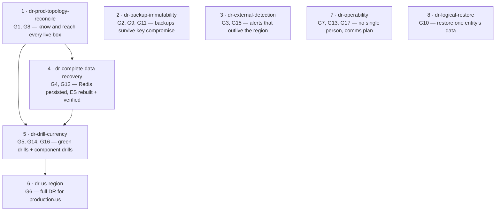

# DR Gap Review — November 2026

**Date:** 2026-11-08 · **Scope:** production.in, production.us, staging.in ·
**Method:** read the DR docs, the drill log and run reports, and the DR rake/cap code,
then checked their claims against the code and against what is recorded about the live boxes.
Nothing on a live box was changed.

## Verdict

- **The rebuild engine is strong.** One command rebuilds IN in ap-south-2 in ~10 min.
  It was proven against production on 2026-08-29 (42/44 checks passed, data 0.5 h old).
- **The gaps are around the engine, not in it:**
  - live prod boxes the tools don't know about
  - backups that one set of keys can delete
  - alerts that die along with the region they watch
  - a "successful" recovery that comes back with empty search and lost jobs
  - no full DR for US
  - drills and component repairs that have gone stale or were never run

```mermaid
flowchart LR
    subgraph Detect["1 · Detect"]
        D1["Freshness / S3 / replication jobs<br/>run in prod Sidekiq"]:::gap
        D2["Grafana on the observability box<br/>in the same region"]:::gap
    end
    subgraph Decide["2 · Decide"]
        R1["dr:assess / dr_readiness"]:::ok
        R2["One operator, one laptop,<br/>personal Pulumi login"]:::gap
    end
    subgraph Recover["3 · Recover"]
        S1["aws:setup_infra — 10 min, drilled"]:::ok
        S2["dr:fix:* — never drilled"]:::gap
        S3["Live IN/US data boxes<br/>not described in deploy files"]:::gap
    end
    subgraph Data["4 · Data comes back"]
        B1["MySQL from xtrabackup, RPO 30 min"]:::ok
        B2["Redis queue + ES index:<br/>not backed up, not rebuilt"]:::gap
        B3["Backups deletable by prod keys"]:::gap
    end
    subgraph Live["5 · Go live"]
        L1["dns_cutover (manual)"]:::ok
        L2["No comms plan / status page"]:::gap
    end
    Detect --> Decide --> Recover --> Data --> Live
    classDef ok fill:#d1e7dd,stroke:#198754;
    classDef gap fill:#f8d7da,stroke:#dc3545;
```

## Key concepts

| Term | Meaning here |
|---|---|
| **RPO** | Recovery Point Objective — the most data we can lose. Today: age of the newest backup (design 30 min). |
| **RTO** | Recovery Time Objective — time until users are served again. The drills measure *rebuild* only (~10 min). They leave out detection, the decision to declare DR, and the DNS cutover. |
| **Full DR** | Rebuild the whole environment in the backup region (`aws:setup_infra`). |
| **Component recovery** | Repair one broken box or service in place (`dr:assess`, `dr:fix:*`). |
| **Immutable backup** | A backup nobody can delete before its retention ends, including an admin. On S3 this is *Object Lock*. Versioning alone is not enough. |
| **Logical corruption** | The infra is healthy but the data is wrong: a bad migration, a bad deploy, or a user deleting a fund. The most likely real "disaster" for a SaaS. |

## Gaps

Severity: **P0** = would hurt in a real incident now · **P1** = real risk, cheaper to fix than to suffer · **P2** = hygiene.

### P0

| # | Gap | Evidence (where) | Why it matters / example |
|---|---|---|---|
| G1 | **Live prod data tier differs from what the tools describe** | IN data tier is private `10.0.3.182`. It is in no deploy file. `production_in.rb` gives the `db` role to an app box. It lacks `start_data_containers.sh` and starts ES from raw `@reboot` cron with no volume and no memory cap (verified 2026-09-27). The **US data box `10.0.3.214` accepts no key we hold** (2026-10-23). | `dr:fix:promote_replica` / `partial:restore_primary` need SSH to the DB box. On US we cannot reach it at all. Drills always build *fresh* boxes in ap-south-2, so they never exercise the live ones. Example: US primary corrupts → no in-place restore or promotion → the only path is a full rebuild, and US has none (G6). |
| G2 | **Backups can be deleted by one set of keys** | `s3_ensure_bucket!` (`lib/tasks/aws_utils.rb:1465`) turns on versioning and encryption. **No Object Lock anywhere** (repo + IRM-Infra). The primary and replica buckets sit in the **same AWS account**. | Anyone holding the prod admin keys (the ones the DR operator exports) can `DeleteObjectVersion` in *both* buckets: a leaked laptop key, ransomware, or a fat-finger. Not replicating delete markers only stops *soft* deletes. Then both MySQL and documents are gone with no way back. |
| G3 | **Detection runs inside what it monitors** | `DbBackupFreshnessJob`, `S3CheckJob` and `ReplicationHealthJob` are Sidekiq-cron jobs (`config/initializers/sidekiq.rb:222-248`). They need the data box's Redis. Grafana is on the observability box in the same VPC. No Route 53 health checks, CloudWatch alarms or external uptime monitor exist. | If the data box or the region dies, every alert dies with it. Example: the 2026-09-27 Redis MISCONF ran for 17 days of log lines. A region loss would raise *no* alert at all, so the RTO clock starts only when a customer calls. |
| G4 | **"Successful" recovery returns empty search and lost jobs.** 🛠 *Search half fixed in code 2026-11-08 (OpenSpec `fix-dr-search-index-after-restore`): blocking reindex of 29 indexes plus a verify count check. The printed `deploy:chewy_reset` did not exist, and `rake chewy:reset` finds 0 indexes in this app. Redis/Sidekiq queue loss remains open.* | Full DR never runs `chewy:reset`: no `chewy` in `aws.rake` / `aws_utils.rb`. Only `dr_fix_db.rake` *prints* it as a follow-up. `elastic_check` is `Folder.search("Test", 1)` (`health_check_controller.rb:84`), which passes on an empty index. Redis runs `--rm` with **no volume and no AOF** (`start_data_containers.sh:46`). | After DR every search screen is empty, yet verification is green. Queued, scheduled and retrying Sidekiq jobs (doc generation, emails, allocations) are silently lost. A plain reboot of the data box already did this once (2026-09-27). |
| G5 | **Drills are stale; component repair never drilled** | `dr_drills.md`: the last staging runs (2026-09-12) **failed 3×** with no pass since. The last production pass was 2026-08-29. Since then: systemd Sidekiq, monit retired, Ruby 4.0.6. `dr_component_recovery.md` Phase 6: "Nothing here has been exercised against a live environment." | An untested DR plan is a hypothesis. The 09-12 failures are unexplained in the log. The next real run may hit whatever broke them. |
| G5a | **Update 2026-11-08:** staging drill **PASSED**: 12.1 min rebuild, 42/44 checks, data 0.4 h old, torn down (46 resources). The new systemd Sidekiq path works on fresh boxes. The production drill and the component drills are still outstanding. | `docs/operations/dr/runs/dr_drill_in_2026_11_08_1039.md` | — |
| G19 | **Backups do not resume after a DR, even though the run says they do.** 🛠 *Fixed in code 2026-11-08 (OpenSpec `fix-dr-backup-cron-after-restore`): the restore strips cloned old jobs and installs the schedule, and `dr:verify` now fails on a missing schedule or a second writer. Awaiting a staging drill as proof.* Also found: the cloned live box carries an old `backup_db.sh` job that ignores the marker, so it is a second writer on DR primary + replica | The restore prints "✓ Backups armed … cron schedule is now live", but `dr:verify` warns `no /etc/cron.d/irm-db-backup` on the primary. That happened in **both** the 2026-08-29 prod drill and the 2026-11-08 staging drill. The restore also had to upload a generated script (`db_backup_xtra.sh not on 10.0.3.88 (pre-bake AMI)`). Root cause: the weekly `aws:create_and_copy_ami[DB-Redis-ES]` (`config/schedule.rb:71`) **snapshots the live DB box** (`create_ami_from_snapshot`). The live box predates the Packer bake, so the baked script and cron (`db_redis_es.ami.pkr.hcl:309`) never reach the DR AMI. | After a real DR the new primary is "armed" but no schedule runs, so no new backups are taken. The freshness alert would fire about 2 h later, if anyone is watching. Until then the actual RPO grows without limit. **Not yet verified:** whether the cloned box carries a legacy root-crontab backup job instead. If it does, that job ignores the armed marker and could write into the backup chain from the replica too. |
| G6 | **production.us has no full DR** | `.env.production.us` names `us-east-2`, but no `production-us-east-2` Pulumi stack exists (`dr_component_recovery.md` and the IRM-Infra stack files). Only the S3 replica exists. | If us-east-1 is lost, US customers are down until someone hand-builds a region: days, not minutes. |

### P1

| # | Gap | Evidence | Why it matters |
|---|---|---|---|
| G7 | **Single-person dependencies** | Pulumi state: **staging is on the S3 backend** (`s3://irm-pulumi-state-staging-primary-ap-south-1`, confirmed by `dr_readiness` on 2026-11-08). `IRM-Infra/PULUMI_STATE.md` still says "Not yet migrated", so the production backend is unconfirmed and the doc is stale. Every run so far was "Executed by thimmaiah@thimmaiah-laptop". Recovery needs local `.env.*`, master keys, `.pem` keys and sibling repos. Their escrow location is not documented. | If that person or laptop is unavailable, nobody can run `pulumi up` or decrypt credentials. |
| G8 | **Leaked secrets not rotated** | `point_03_committed_secrets.md`: the MySQL root password in git history has rotation **pending**. The US data box was never checked for the old SSH key. | A compromise of a git clone turns into DB root on live boxes. |
| G9 | **Backup integrity is checked for *age* only** | `db_backup_system.md` §11: the size sanity check is designed, not built. No scheduled restore test exists outside drills. | A truncated or empty "full" backup passes as ✅ until the day we need it. |
| G10 | **No logical / tenant-level restore** | `dr_guide.md` §2: "Bad deploy or application-level data damage — Not covered." | The most likely incident is "customer deleted a fund / bad migration hit one entity". Today the only tool is a whole-DB restore, which loses everyone else's changes since then. |
| G11 | **NAT is a single point of failure for backups** | Component guide, finding #3: no S3/SSM VPC endpoints. | A dead NAT silently stops backups and blocks restores. An S3 gateway endpoint is free. |
| G12 | **Unpinned data images** | `redis/redis-stack-server:latest` (`db_redis_es.ami.pkr.hcl:172`) and the ES image are re-pulled on every weekly bake. | A DR box can come up on a different major version than prod. Redis-stack and ES upgrades are not always data-compatible. |
| G13 | **No incident comms / roles** | No contacts, escalation path, customer notice template or status page in any DR doc. | Recovery done, customers still in the dark. Contracts may also require notice within N hours. |

### P2

| # | Gap | Evidence |
|---|---|---|
| G14 | Known component-guide findings left unfixed: Prometheus config never pushed (#4), live stacks lack an `alb` output so `dns_cutover`/`dr_verify_edge` fail on existing stacks (#7), `server_id` set with `SET GLOBAL` (#6), observability box not in its target group (#2) | `dr_component_recovery.md` "Known findings" |
| G15 | `dr_readiness` is on-demand only, never scheduled, so drill recency and AMI age go unwatched | not in `config/schedule.rb` or the sidekiq cron |
| G16 | Staging "replicates" to its own region (`AWS_S3_REPLICA_REGION=ap-south-1`). The drill environment never rehearses cross-region bucket DR, and `dr_readiness` reports a **false ✓**: its "replica (cross-region copy)" check reads the *primary* bucket `docs.altx.com.staging-backup-xtra` in ap-south-1 (seen 2026-11-08) | `.env.staging.in` |
| G20 | 🛠 *Fixed in code 2026-11-08 (`fix-dr-drill-hygiene`).* `aws:dr_drill` does not check for an existing Pulumi lock. A concurrent or stale lock is logged as a FAILED drill with "0.1 min rebuild" (three 2026-11-08 10:40–10:41 rows, since removed), which pollutes the drill log | `lib/tasks/aws.rake` `dr_drill` |
| G21 | 🛠 *Fixed in code 2026-11-08 (`fix-dr-drill-hygiene`): stop drill services before teardown, tag drill mail, no WhatsApp pages from drill stacks (a production drill would have paged).* **Drill floods the ops inbox with error emails.** Example: `RedisClient::CannotConnectError … 10.0.3.88:6379` from host `ip-10-0-2-46` (a drill app server) at 10:51:54 IST on 2026-11-08. That is 37 s after the drill PASSED (05:21:17 UTC), so the likely cause is `pulumi destroy` removing the DB/Redis box while Sidekiq on the drill app servers is still running. Not yet confirmed. Fix idea: stop puma/sidekiq on the drill hosts *before* teardown, while still on the drill branch's deploy config (switching back to `main` first would point cap at live staging). Tag drill-stack emails `[DR DRILL]`. **Logged for later, 2026-11-08.** | `aws.rake` `dr_drill` teardown (after `git checkout`) |
| G22 | **Drill reports need a redesign** (user request 2026-11-08): light theme, more explanation, better icons, help text in the `.md` and `.html` evidence reports. A separate OpenSpec change (`openspec-propose`) with HTML mocks for approval | `aws_utils.rb` report renderers (~L618–1120) |
| G23 | **Live search is stale for six indexes.** `AmlReportIndex`, `CapitalCallIndex`, `CommitmentAdjustmentIndex`, `FundRatioIndex`, `KpiReportIndex` and `PortfolioInvestmentIndex` have no `update_index` callback (their models' `chewy_callbacks` are empty). The only thing that refreshed them, `ElasticImporterJob`, is referenced nowhere. So searching capital calls, KPI reports and the like on live returns whatever was last imported. Not a DR issue (a DR rebuilds them fresh), but found by it, 2026-11-08 | `Dr::SearchIndexes.maintained?`; `app/packs/misc/elastic/elastic_importer_job.rb` |
| G24 | **A drill stack can email real users.** A drill runs the full app on restored data: Sidekiq, sidekiq-cron and the whenever crontab (`config/schedule.rb`: weekly emails, task digests, reminders) all run while the drill is up, and nothing on a drill stack stops outgoing mail. In a **production** drill, customers could receive duplicate reminders or digests from the copy. `DR_DRILL_STACK` (from `fix-dr-drill-hygiene`) now marks drill processes, so a mail interceptor and a cron/sidekiq-cron off-switch keyed on it is the natural fix. **Resolve before the next production drill.** Logged 2026-11-08 | `lib/drill_stack.rb`; `config/schedule.rb`; `config/initializers/sidekiq.rb` |
| G18 | The Observability AMI in ap-south-2 is 122 days old: the weekly bake/copy is not reaching it | `dr_readiness` warning, 2026-11-08 |
| G17 | Doc drift: `dr_guide.md` says "Last verified by drill: 2026-07-10"; the run report links `docs/dr_runs/…` (moved); `prod_restore.md` relies on `tmp/` scripts | the docs themselves |

## Recommendations — proposed OpenSpec changes

Grouped so each change ships and verifies on its own. Order = dependency + risk.

| # | Change | Fixes | What it would do (to be designed in OpenSpec) |
|---|---|---|---|
| 1 | `dr-prod-topology-reconcile` | G1, G8 | Read-only audit of IN + US: are the live data boxes the Pulumi DB resources? Get access to the US data box back. Install `start_data_containers.sh`. Describe the data boxes in the deploy files. Rotate the leaked root password. |
| 2 | `dr-backup-immutability` | G2, G9, G11 | Object Lock (or a copy into a separate AWS account) for the replica backup and document buckets. Backup size checks. S3 gateway endpoint. Monthly automated restore test into a throwaway box. |
| 3 | `dr-external-detection` | G3, G15 | Route 53 health checks + CloudWatch alarms → SNS/WhatsApp, run from outside the app's own region and Sidekiq. Backup-freshness check as a Lambda/alarm instead of a Sidekiq job. Scheduled `dr_readiness`. |
| 4 | `dr-complete-data-recovery` | G4, G12 | Redis with a volume + AOF. Full DR runs a reindex. `dr:verify` checks that the index is **populated**, not just reachable. Pin the Redis/ES image versions. |
| 5 | `dr-drill-currency` | G5, G14, G16 | Diagnose the 09-12 failures. Green staging + prod drills. Run the Phase 6 component drills. Fix the known findings that block cutover tooling. |
| 6 | `dr-us-region` | G6 | `production-us-east-2` stack, AMI copy, SSM seed, readiness, first US drill. |
| 7 | `dr-operability` | G7, G13, G17 | Run the Pulumi state migration. Escrow of keys and credentials. A second operator rehearses a drill. Roles, contacts, customer comms template. Doc refresh. |
| 8 | `dr-logical-restore` | G10 | Restore a backup into a side DB and extract one entity's rows, with a runbook and a rake task. |

## Open decisions (for the owner)

- **Target RPO/RTO.** Is 30 min RPO acceptable to customers? Shipping binlogs to S3 would get it to ~5 min. That is a business call.
- **Immutability style.** Object Lock *governance* (an admin can override with a special permission), *compliance* (nobody can, not even root), or a cross-account copy.
- **Alert channel for external detection.** WhatsApp via the existing webhook, email, or both.
