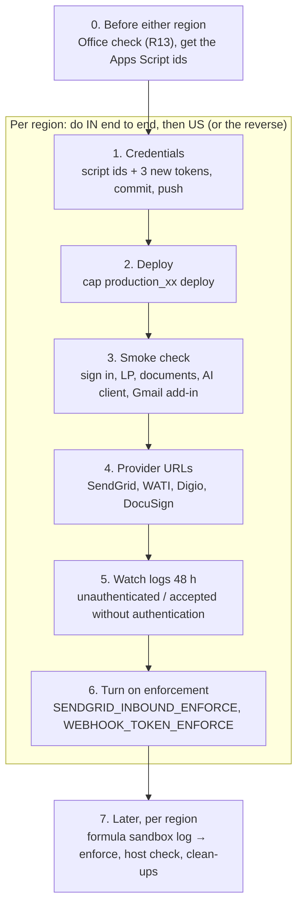

# Deploy checklist: security review 2026-10 (PR #1891), production IN and US

What is being deployed: `main` at the merge of PR #1891 (`1455753a06`). The findings, fixes and the
reasons behind each step are in [the security review](../security/security_review_2026_10.md)
(section "Rollout and ops steps", R1–R13). This page is the order to do them in.

**Do staging first:** [the staging runbook](security_review_2026_10_staging_runbook.md) runs every
step below as a paste-ready command, on staging IN and staging US.

**The one rule:** IN and US are independent environments. Every token, script id and URL below is
made **separately** for each one. Never copy a value from one region to the other, and never point
one region's provider at the other's host.

## The order, in one picture



## What was found before writing this (2026-11-01)

| Check | Result | What it means |
|---|---|---|
| Database migrations in the merge | **None** (only a `schema.rb` nullability fix that matches the live column) | The deploy's automatic `db:migrate` has nothing to run |
| New credential keys (`gmail_addin.script_ids`, `sendgrid_inbound.tokens`, `whatsapp.webhook_token`, `esign.webhook_token`, `esign.docusign_connect_key`) | **Missing** in production.in, production.us, staging.in and staging.us | Step 1 has to add them. Without `gmail_addin.script_ids`, new Gmail add-in sign-ins fail |
| Enforcement flags in `.env.production.in` / `.env.production.us` | **None set** | Everything deploys in "log only" mode, as intended |
| Production Apps Script project files (`addons/gmail/.clasp.<env>.json`) | Only `.clasp.staging.json` is on this machine | Get the production script ids from whoever publishes the Gmail add-in |
| `INCOMING_EMAIL_DOMAIN` | `prod.caphive.app` in **both** IN and US | Open problem R4 (below). It affects the US SendGrid step |

## Values per region

| | Production IN | Production US |
|---|---|---|
| App host | `app.caphive.com` | `app.caphive.us` |
| Capistrano stage | `production_in` | `production_us` |
| Credentials environment | `production.in` | `production.us` |
| Env file (flags) | `.env.production.in` | `.env.production.us` |

Credentials and env files are committed to the repo and travel with the release (the deploy links
the release's `config/credentials/production.<region>.yml.enc` and `.env.production.<region>`). A
change to either only reaches a server **after it is committed, pushed and deployed**.

---

## Step 0: before either region (once)

- [ ] **R13: Office opens generated files.** rubyzip 3 writes ZIP files in the Zip64 format, and
      DOCX and PPTX files are ZIP files. On `main` (locally or on staging), generate one Word
      document (doc gen or a portfolio report in Word) and one PowerPoint (a portfolio report in PPT).
      Open both in desktop Word and PowerPoint, on Windows if possible. Also download a document ZIP
      and open it in Windows Explorer.
      *If Office complains:* stop. The fix is `suppress_extra_fields: true` on the DOCX/PPTX
      `Zip::OutputStream` writers; it needs a code change and a new deploy.
- [ ] **R1 input: get the Apps Script ids.** One id for the IN Gmail add-in and one for the US one:
      the `scriptId` field of each region's `addons/gmail/.clasp.<env>.json`, from whoever publishes
      the add-in. Two different ids. If one region has no Gmail add-in, it gets no id.
- [x] **R10: extra vendor callbacks** in `config/mcp_clients.yml` (Claude and ChatGPT). Confirmed
      2026-10-31; nothing to do.

---

## Production IN

### Step 1: credentials (IN)

- [ ] Generate three **new** random tokens, for IN only (run the command three times):
      `ruby -rsecurerandom -e 'puts SecureRandom.hex(32)'`
- [ ] Edit the IN credentials: `EDITOR=vim bin/rails credentials:edit --environment production.in`,
      and add:
      ```yaml
      gmail_addin:
        script_ids: ["<IN Apps Script id>"]      # R1
      sendgrid_inbound:
        tokens: ["<IN token 1>"]                 # R2
      whatsapp:
        webhook_token: "<IN token 2>"            # R7
      esign:
        webhook_token: "<IN token 3>"            # R7
        # docusign_connect_key: "<IN DocuSign Connect HMAC key>"   # R7, optional
      ```
      If `whatsapp:` or `esign:` already exists, add the key under it rather than creating a second
      block.
- [ ] Keep the three tokens somewhere safe for step 4 (the password manager, not a file in the repo).
- [ ] Do **not** touch `.env.production.in` yet. All enforcement flags stay unset.
- [ ] Commit `config/credentials/production.in.yml.enc` and push to `main`.

### Step 2: deploy (IN)

- [ ] `bundle exec cap production_in deploy`
- [ ] The deploy finishes without errors. No migrations run.

### Step 3: smoke check (IN), on `https://app.caphive.com`

- [ ] A fund-side user signs in and opens a fund, its capital calls and its documents.
- [ ] An LP signs in, sees their own commitments and documents, and **no** staff-only lists.
- [ ] Generate one document from a template (it downloads and opens).
- [ ] An existing AI client (Claude or ChatGPT connector) still answers a question. Existing tokens
      are re-stored in hashed form the first time they're used; see "Rollback" below.
- [ ] A **new** Gmail add-in sign-in works. A `400` here means step 1's `gmail_addin.script_ids` is
      missing or wrong.
- [ ] Incoming email still arrives (send one to a fund's owner address).
- [ ] No new error spike in the logs or the error tracker.

### Step 4: provider URLs (IN)

- [ ] **R3, SendGrid Inbound Parse.** Set the IN host's URL to
      `https://sendgrid:<IN token 1>@app.caphive.com/incoming_emails/sendgrid`.
      The Basic-auth form keeps the token out of access logs.
- [ ] **R7, WATI (WhatsApp).** Webhook URL
      `https://app.caphive.com/users/whatsapp_webhook?webhook_token=<IN token 2>`
- [ ] **R7, Digio.** The platform account **and every entity with its own Digio account**:
      `https://app.caphive.com/documents/signature_progress?webhook_token=<IN token 3>`
- [ ] **R7, DocuSign Connect** (HMAC on), if used:
      `https://app.caphive.com/documents/signature_progress?webhook_token=<IN token 3>`
- [ ] Mask query strings in the IN nginx access log, so the WATI, Digio and DocuSign tokens aren't
      written to disk.

### Step 5: watch for 48 hours (IN)

- [ ] `[SendgridInbound] unauthenticated` stops appearing for real SendGrid traffic.
- [ ] `[WebhookToken] … accepted without authentication` stops appearing for WATI, Digio and DocuSign.
- [ ] Any line still appearing after the URL change points to a provider (or a Digio entity) that
      wasn't updated. Fix it before step 6.

### Step 6: turn on enforcement (IN)

- [ ] In `.env.production.in` add `SENDGRID_INBOUND_ENFORCE=1` and `WEBHOOK_TOKEN_ENFORCE=1`.
- [ ] Commit, push and `bundle exec cap production_in deploy`.
- [ ] Repeat step 3's incoming-email check, and sign one document through e-sign. The status still
      updates.

---

## Production US

Exactly the same steps, with **new US values**. Nothing from IN is reused.

### Step 1: credentials (US)

- [ ] Generate three **new** tokens for US: `ruby -rsecurerandom -e 'puts SecureRandom.hex(32)'`
- [ ] `EDITOR=vim bin/rails credentials:edit --environment production.us`, and add the same five keys
      as IN with the **US** Apps Script id and the three **US** tokens.
- [ ] `.env.production.us` stays unchanged.
- [ ] Commit `config/credentials/production.us.yml.enc` and push to `main`.

### Step 2: deploy (US)

- [ ] `bundle exec cap production_us deploy`, no errors, no migrations.

### Step 3: smoke check (US), on `https://app.caphive.us`

- [ ] Fund-side sign-in and fund pages; LP sign-in sees only their own data; one document generates;
      an existing AI client still works; a new Gmail add-in sign-in works (no `400`); no error spike.

### Step 4: provider URLs (US)

- [ ] **R4 first.** US uses the same inbound mail domain as IN (`INCOMING_EMAIL_DOMAIN=prod.caphive.app`),
      and the inbound-parse setup shows one host routing to `app.caphive.com`. So US owner addresses
      may be arriving at IN today. Confirm where US mail actually lands **before** changing the US
      SendGrid URL. If US has no inbound-parse route of its own, skip the SendGrid line here and
      raise R4 as its own task.
- [ ] **R3, SendGrid** (only if US has its own inbound-parse host):
      `https://sendgrid:<US token 1>@app.caphive.us/incoming_emails/sendgrid`
- [ ] **R7, WATI:** `https://app.caphive.us/users/whatsapp_webhook?webhook_token=<US token 2>`
- [ ] **R7, Digio** (platform and every entity with its own account) and **DocuSign Connect**:
      `https://app.caphive.us/documents/signature_progress?webhook_token=<US token 3>`
- [ ] Mask query strings in the US nginx access log.

### Step 5: watch for 48 hours (US)

- [ ] Same log lines as IN: `[SendgridInbound] unauthenticated` and
      `[WebhookToken] … accepted without authentication` stop for real traffic.

### Step 6: turn on enforcement (US)

- [ ] `.env.production.us`: `WEBHOOK_TOKEN_ENFORCE=1`. Add `SENDGRID_INBOUND_ENFORCE=1` only if US
      SendGrid was switched to its own tokened URL in step 4.
- [ ] Commit, push, `bundle exec cap production_us deploy`, then repeat the e-sign and email checks.

---

## Step 7: later, per region (IN and US each)

These don't block the deploy. Each one is done separately in each region.

| # | What | How | IN | US |
|---|---|---|---|---|
| R6 | **Formula sandbox**, in three stages | 1. On the primary app box (`/home/ubuntu/IRM/current`): `RAILS_ENV=production bundle exec rails formula_sandbox:audit`. It is a report only and changes nothing. `EXECUTE=1` rewrites stored formulas, so it needs its own approval. 2. Set `FORMULA_SANDBOX=log` in the env file and deploy. Run through **one month-end and one quarter-end**, watching for `[formula_sandbox] would_reject`. 3. Once that's clean, set `FORMULA_SANDBOX=enforce` and deploy | ☐ ☐ ☐ | ☐ ☐ ☐ |
| R12 | **Host check** | Smoke-check on staging first. Then set `ENFORCE_HOST_AUTHORIZATION=1` (and `EXTRA_ALLOWED_HOSTS` for any extra hostname the region serves) and deploy. Watch `[csp_report]` lines before ever making CSP blocking | ☐ | ☐ |
| R8 | **Impostor OAuth apps** | Read-only first: `SELECT id, name, redirect_uri, confidential, created_at FROM oauth_applications WHERE name = 'CapHive Mail Add-in' OR name LIKE '%Claude%' OR name LIKE '%ChatGPT%' ORDER BY id;` The real "CapHive Mail Add-in" is the **earliest id**, with redirect `urn:ietf:wg:oauth:2.0:oob` and `confidential = 1`. Delete any other row with that name, and review Claude / ChatGPT rows whose redirect isn't the vendor callback. Deleting is a prod write: get it approved | ☐ | ☐ |
| R9 | **Saved "Allowed AI Clients" lists**, **by 2027-01-31** | `SELECT entity_id, mcp_allowed_clients FROM entity_settings WHERE mcp_allowed_clients IS NOT NULL AND mcp_allowed_clients NOT IN ('', '[]');` Each listed entity re-saves Entity → MCP → Allowed AI Clients, which stores the list as client kinds. That includes the ops demo entity's `["Paperclip"]`. After 2027-01-31 the old saved names stop matching | ☐ | ☐ |
| R5 | **Two broken dashboard widgets** | `dashboard_widgets` #143 and #156 (ids from the prod copy) have an unterminated quote in their metadata. Close the quote through the widget form. Check whether the other region has the same widgets | ☐ | ☐ |
| R11 | **Live tokens in dev restores** | The prod-to-dev restore must blank `oauth_access_tokens.token/refresh_token`, `oauth_access_grants.token` and `devise_api_tokens.access_token/refresh_token`. Owner to be decided | ☐ | ☐ |
| R4 | **US inbound mail routing** | Give US its own inbound mail domain and SendGrid route, so US owner addresses stop sharing `prod.caphive.app` with IN. Then do the US SendGrid step 4 and the `SENDGRID_INBOUND_ENFORCE` part of step 6 | n/a | ☐ |

---

## Rollback: read this before running `cap deploy:rollback`

**Short version:** don't use `cap … deploy:rollback` once the new release has served traffic. Instead,
revert what's broken on `main`, **keep the token-hashing lines**, and deploy forward.

**Why:** this release turns on Doorkeeper token hashing (finding L2) in `config/initializers/doorkeeper.rb`:

```ruby
hash_token_secrets fallback: :plain
hash_application_secrets fallback: :plain
```

When an AI client or the mail add-in uses an old plain-text token, the server accepts it and
**rewrites the stored row as a hash**. The previous release doesn't hash, so it compares the client's
token with the stored hash, finds no match, and refuses it.

**Example:** deploy Monday. Monday afternoon a user's Claude connector makes a request, and its
token is re-stored hashed. On Tuesday, `cap production_in deploy:rollback` puts the old code back.
That user's connector now gets "unauthorised" and must be connected again. The same happens to every
token used between the deploy and the rollback.

**If a rollback is unavoidable:** expect AI-client and mail add-in users to reconnect, and tell
support first. Nothing else in this release changes stored data, so the rest of a rollback is safe.

**Turning off one protection doesn't need a rollback:** remove its flag from the region's env file
and deploy. The flags are `SENDGRID_INBOUND_ENFORCE`, `WEBHOOK_TOKEN_ENFORCE`, `FORMULA_SANDBOX` and
`ENFORCE_HOST_AUTHORIZATION`.

## What users may notice after the deploy

The release tightens access checks in every part of the app. Users who had more access than their
role allows lose it. That's intended, but support may hear about it. For example:

- LPs no longer see staff-only lists.
- Read-only employees can no longer run bulk actions.
- Bulk approve needs the approver role (company admin alone isn't enough).
- Ten wrong two-factor codes within an hour, across any number of sign-ins on the website or the
  mobile app, lock the account. It unlocks itself after 5 minutes, or through the unlock email. The
  existing lock after 6 wrong passwords is unchanged.

When someone says "I could do X last week", first check whether their role should allow X. The
review's "Decisions taken" table lists each rule that was chosen.
