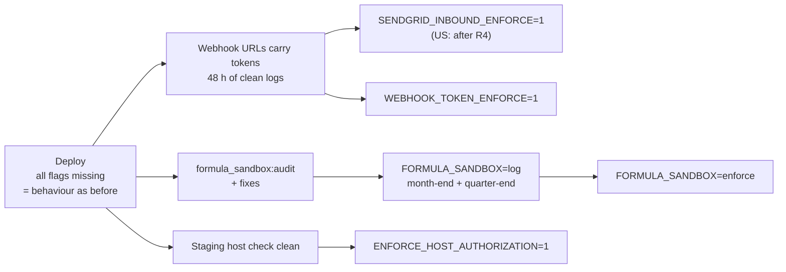
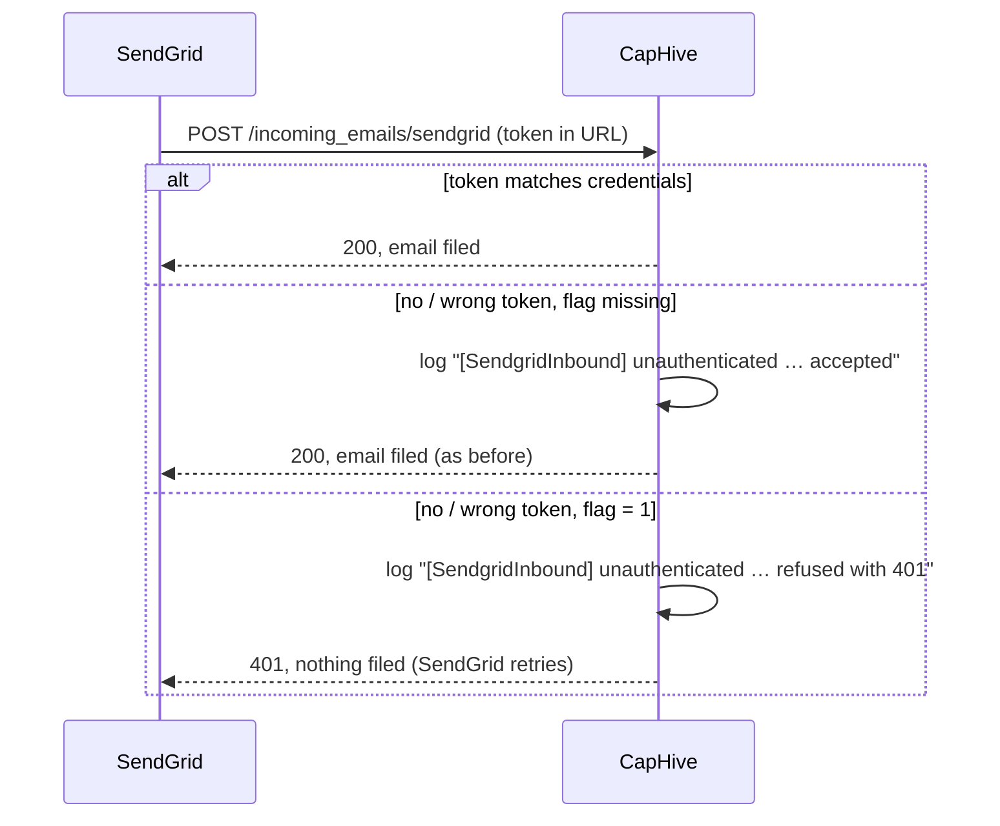
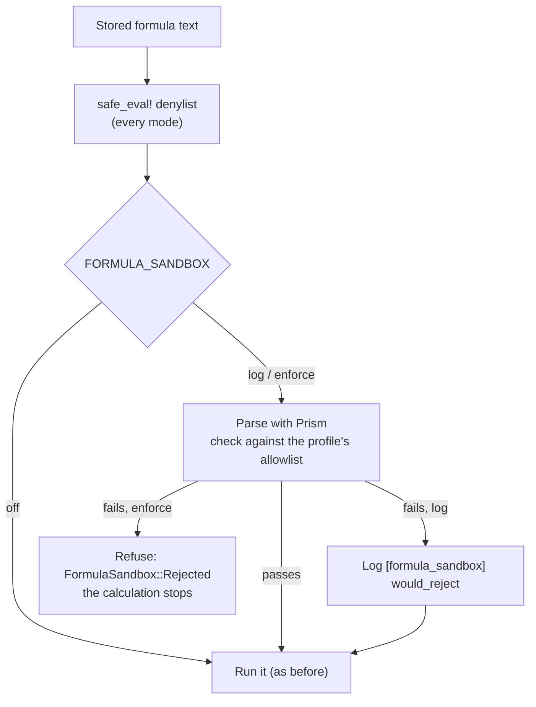

# Enforcement and sandbox flags: security review 2026-10

The security review release ships four protections switched **off**. Each one is turned on per
region with a flag, once the setup it depends on is in place. This page explains, for each flag,
the problem it fixes, how the check works, what changes when it's on, and the steps to turn it on.

Related: [deploy checklist](security_review_2026_10_deploy_checklist.md) ·
[staging runbook](security_review_2026_10_staging_runbook.md) ·
[security review](../security/security_review_2026_10.md) (findings H2, M1, C2, L5).

## How all four flags work

- **Where they live:** each flag is a line in the region's env file: `.env.staging.in`,
  `.env.staging.us`, `.env.production.in` or `.env.production.us`. The file is committed and deployed
  with the code.
- **When a change takes effect:** only after you commit, push and deploy. The app reads the env
  file when it starts, so editing the file changes nothing until the deploy restarts the app.
- **What happens when a flag is missing:** the app behaves exactly as it did before this release.
  Every flag starts missing, which is why the deploy itself changes nothing.
- **How to undo one:** delete the line, then commit, push and deploy. You never need a code rollback
  to switch a protection off.
- **IN and US are separate:** each region has its own flags, its own tokens and its own timing.

| Flag | Protects | Values |
|---|---|---|
| `SENDGRID_INBOUND_ENFORCE` | Incoming email | missing (log only) or `1` (refuse) |
| `WEBHOOK_TOKEN_ENFORCE` | WhatsApp and e-sign status updates | missing (log only) or `1` (refuse) |
| `FORMULA_SANDBOX` | Fund formulas | `off` (default), `log` or `enforce` |
| `ENFORCE_HOST_AUTHORIZATION` | Which hostnames the app answers on | missing (off) or `1` (on) |



---

## 1. `SENDGRID_INBOUND_ENFORCE`: incoming email

### The problem it fixes (H2)

When someone emails a fund's owner address, SendGrid receives the mail and posts it to
`https://<host>/incoming_emails/sendgrid`. The app then files it against the right fund or record.

Before this release, that address accepted a post from **anyone**. Someone who knew the URL could
post a fake "email" and the app would file it as if it were real.

### How the check works now

1. Each region has its own secret token, stored in `sendgrid_inbound.tokens` in its credentials.
2. You put that token in the URL SendGrid posts to:
   `https://sendgrid:<token>@app.caphive.com/incoming_emails/sendgrid`.
   The token goes in the Basic-auth part of the URL, so it doesn't appear in access logs.
3. For every post, the app compares the token it received with the token in its credentials
   (`IncomingEmailsController#verify_sendgrid_token`).



### What happens to a post without the right token

| Flag | Result | Log line |
|---|---|---|
| **missing** (today) | **Accepted** and filed, as before | `[SendgridInbound] unauthenticated (no token) … accepted, SENDGRID_INBOUND_ENFORCE is off` |
| **`1`** | **Refused with 401.** Nothing is filed | `[SendgridInbound] unauthenticated (no token) … refused with 401` |

A post with the right token is accepted in both cases and logs nothing.

### Why it starts in log-only mode

If enforcement were on at deploy, before SendGrid's URL carried the token, **every incoming email
would be refused**. Log-only mode lets you switch the URL first and use the log to confirm it's right.

### Steps to turn it on (per region)

1. **Token in the credentials,** as `sendgrid_inbound.tokens: ["<token>"]`.
2. **Deploy.** Nothing changes for users.
3. **Change the URL in SendGrid** (Settings → Inbound Parse) to the tokened form shown above.
4. **Send a test email** to a fund's owner address. It arrives, and no `[SendgridInbound]` line is
   logged for it.
5. **Watch for 48 hours.** No more `unauthenticated` lines should appear for real mail.
6. **Add `SENDGRID_INBOUND_ENFORCE=1`** to the env file, then commit, push and deploy.
7. **Check:** a post without the token gets 401, and real email still arrives.

### If something is wrong after you turn it on

SendGrid retries any post that doesn't get a 2xx answer, so mail is **delayed, not lost**. Remove the
flag and deploy, and the retries go through.

### Changing the token later

`tokens` is a list, so you can rotate without downtime. Add the new token next to the old one, change
the SendGrid URL, then remove the old token.

### US only

R4 is still open. US uses the same inbound domain as IN (`INCOMING_EMAIL_DOMAIN=prod.caphive.app`), so
US mail may be arriving at IN. Don't turn this on for US until US has its own inbound route.

---

## 2. `WEBHOOK_TOKEN_ENFORCE`: WhatsApp and e-sign updates

### The problem it fixes (M1)

Three providers post updates to the app:

| Provider | Posts to | What it tells the app |
|---|---|---|
| WATI (WhatsApp) | `/users/whatsapp_webhook` | "This phone number sent this message." The app's WhatsApp agent then acts for that user |
| Digio (e-sign) | `/documents/signature_progress` | "This document was signed / completed / voided" |
| DocuSign Connect | `/documents/signature_progress` | The same, for DocuSign |

Before this release, none of these posts was checked. A forged post could mark a document as signed,
or drive a user's WhatsApp agent just by naming their phone number.

### How the check works now

1. Each region has two secrets: `whatsapp.webhook_token` (for WATI) and `esign.webhook_token` (for
   Digio and DocuSign).
2. You add the right one to each provider's callback URL as `?webhook_token=<secret>`.
3. The app compares it with the credentials in constant time (`WebhookToken.accept?`), and strips it
   from the parameters before anything is queued or logged.
4. For DocuSign there's an optional extra: if `esign.docusign_connect_key` is set and HMAC signing is
   on in DocuSign Connect, a valid DocuSign signature is accepted even without the URL token. A forged
   signature is refused once enforcement is on, whatever the URL says.

Zoho Sign posts to the same e-sign address but is checked by its own signature, as before. This flag
doesn't affect it.

### What happens to a post without the right token

| Flag | Result | Log line |
|---|---|---|
| **missing** | **Accepted**, as before | `[WebhookToken] WhatsApp webhook accepted without authentication (no webhook_token in the callback URL); set WEBHOOK_TOKEN_ENFORCE=1 …` |
| **`1`** | **Refused with 401** | `[WebhookToken] WhatsApp webhook refused: no webhook_token in the callback URL` |

The log line names the source (WhatsApp webhook, eSign webhook or DocuSign Connect webhook) and the
reason (no token in the URL, a wrong token, or no token configured for this environment). That's how
you see which provider still needs its URL updated.

### Important: one flag covers all three providers

Turning on `WEBHOOK_TOKEN_ENFORCE=1` refuses untokened posts from WATI, Digio and DocuSign **at the same
time**. So every one of them must have the new URL first. That includes:

- the platform Digio account,
- **every entity that has its own Digio account.** These are easy to miss, and their signature updates
  would stop.

### Credentials shape (a real mistake to avoid)

The keys must be **sections**, not plain values:

```yaml
whatsapp:
  webhook_token: "…"
esign:
  webhook_token: "…"
```

A flat `whatsapp: "…"` or `esign: "…"` makes the app's `credentials.dig(:whatsapp, :webhook_token)`
raise `TypeError: String does not have #dig method`, so **every** WATI or e-sign post returns 500,
even with the flag off. This happened on staging IN on 2026-11-01 and was fixed before production.

### Steps to turn it on (per region)

1. **Tokens in the credentials,** in the shape above.
2. **Deploy.** Nothing changes for users.
3. **Update the callback URLs:**
   - WATI: `https://<host>/users/whatsapp_webhook?webhook_token=<whatsapp token>`
   - Digio (platform and every entity's own account) and DocuSign Connect (HMAC on, if used):
     `https://<host>/documents/signature_progress?webhook_token=<esign token>`
4. **Mask query strings in the nginx access log,** so the tokens aren't written to disk.
5. **Watch for 48 hours.** No more `accepted without authentication` lines. Any line that still
   appears names the provider that's missing the token.
6. **Add `WEBHOOK_TOKEN_ENFORCE=1`,** then commit, push and deploy.
7. **Check:** sign a test document, and its status updates. Send a WhatsApp message to the agent, and
   it answers.

---

## 3. `FORMULA_SANDBOX`: fund formulas

### The problem it fixes (C2)

Fund formulas are stored as text and run as Ruby code during allocations and other calculations. The
sandbox covers fund formulas, run checks, call-fee formulas, Calculation custom fields and the expense
filter. Before this release, the only guard was a **denylist** (`ApplicationRecord.safe_eval!`) that
blocked known-dangerous words. Anything not on that list ran. Someone who could edit a formula could
make it read another firm's data, or run arbitrary code on the server.

### How the sandbox works

1. **Parse, don't run.** Before a formula runs, the app reads it with Ruby's own parser (Prism) and
   gets its structure without running anything.
2. **Check against an allowlist.** Every element of the formula must be on that formula type's
   allowlist in `config/formula_sandbox.yml`: each operation, method name, constant and data lookup.
   The types are `fund_formula`, `custom_field`, `run_check`, `call_fee`, `form_custom_field` and
   `expense_filter`.
3. **Query pinning.** A formula that queries data must start from its own fund, as `@fund.id` or
   `@fund.entity_id`. A formula that queries some other firm's records fails the check.
4. **Then run it,** exactly as before. A formula that passes gives the same result it always did.

`safe_eval!` keeps running in every mode, as an extra layer. The code is in
`app/packs/core/base/services/formula_sandbox.rb`.



### The three modes

| Value | What happens to a formula that fails the check |
|---|---|
| **`off`** (default, today) | No check at all. Behaviour is exactly as before |
| **`log`** | Checked. A failure logs `[formula_sandbox] would_reject profile=… context=… reasons=… text=…`, **and the formula still runs**. Nothing breaks |
| **`enforce`** | Refused. The calculation stops with an error for that formula |

A misspelt value, such as `FORMULA_SANDBOX=enforced`, is treated as **`log`**, never as `enforce`. A
typo can't break allocations, and the mistake shows up in the logs.

### What the prod copy showed

Of 4,241 formulas checked:

- **4,157 pass already.**
- **66 more pass** after a mechanical rewrite. They pin to their fund through
  `capital_commitment.fund_id`; the rewrite changes that to `@fund.id`, with identical results.
- **18 need a hand edit:** 10 read a master fund in entity 6349, 2 use computed ids in entity 6051,
  and 6 are already broken today.

### Steps to turn it on (per region)

1. **Audit (changes nothing).** On the primary app box (`/home/ubuntu/IRM/current`):
   `RAILS_ENV=production bundle exec rails formula_sandbox:audit`.
   This lists every formula that would fail, grouped by entity, with the reason. Add
   `ENTITY_ID=<id>` to look at one entity.
2. **Mechanical rewrite.** Run `formula_sandbox:audit EXECUTE=1`, which rewrites the 66 formulas. It
   writes to production data, so it needs its own approval.
3. **Hand edits.** Fix the 18 with their owners.
4. **Log mode.** Set `FORMULA_SANDBOX=log`, then commit, push and deploy.
5. **Run through one month-end and one quarter-end.** Those runs use the most formula types, so
   they're the real test. Watch for `[formula_sandbox] would_reject` lines.
6. **Enforce.** Once the log shows nothing new, set `FORMULA_SANDBOX=enforce`, then commit, push and
   deploy.

### Why log mode lasts that long

In enforce mode, a single rejected formula stops a fund's allocation run. Log mode tells you about
every such formula while the runs keep working.

---

## 4. `ENFORCE_HOST_AUTHORIZATION`: which hostnames the app answers on

### The problem it fixes (L5)

Every web request carries a `Host` header naming the site the browser asked for. Rails uses it to
build redirects and full URLs. Today the app answers whatever `Host` is sent, so a forged header can
make it produce links and redirects pointing at another site.

### How the check works

When the flag is on (`config/initializers/security_headers.rb`, `lib/middleware/host_allowlist.rb`),
the app accepts a request only if its `Host` is one of these:

1. **The region's own domain and its subdomains,** from `BASE_DOMAIN`. Production IN uses
   `caphive.com` (so `app.caphive.com` passes) and production US uses `caphive.us`. Staging uses
   `altconnects.com` and `altconnects.us`.
2. **Hosts listed in `EXTRA_ALLOWED_HOSTS`,** a comma-separated list of exact hostnames for anything
   else routed to this app.
3. **A tenant's custom domain,** looked up from the database and cached for 5 minutes.

Any other host gets **403**. `/health_check` is never checked, so the load balancer keeps working.

### Unlike the other flags, this one has no log-only stage

It's either on or off. A hostname you forgot to allow gets 403 **for real users**. That's why it
comes last and starts on staging.

### Steps to turn it on (per region)

1. **List every hostname** that reaches the region: the main host, any tenant custom domains, and
   anything else routed there.
2. **Add any that aren't covered** by `BASE_DOMAIN` or a tenant's custom domain to
   `EXTRA_ALLOWED_HOSTS`.
3. **On staging first,** set `ENFORCE_HOST_AUTHORIZATION=1` and deploy.
4. **Check:** the region's own host gives 200, a made-up host gives 403, and `/health_check` gives 200.
   The commands are in the [staging runbook](security_review_2026_10_staging_runbook.md), step 9.
5. **Browse** the main pages and any custom domain. Nothing comes back as a blank 403.
6. **Repeat in production,** one region at a time.

---

## The order, all together

| When | `SENDGRID_INBOUND_ENFORCE` | `WEBHOOK_TOKEN_ENFORCE` | `FORMULA_SANDBOX` | `ENFORCE_HOST_AUTHORIZATION` |
|---|---|---|---|---|
| Deploy day | missing | missing | `off` | missing |
| After the URL changes + 48 h of clean logs | `1` (US: after R4) | `1` | — | — |
| After the audit and fixes | — | — | `log` | — |
| After a month-end and a quarter-end | — | — | `enforce` | — |
| After a clean staging check | — | — | — | `1` |

## CSP is not one of these flags

The Content Security Policy ships in **report-only** mode (`config.content_security_policy_report_only = true`).
The browser **reports** scripts and styles that break the policy to `/csp_reports`, which logs them as
`[csp_report] directive=… blocked=… page=…`, but nothing is blocked. Making it blocking would be a later
code change, after those reports have been reviewed and the policy adjusted.

## FAQ

**Q: If I deploy without setting any flag, does anything change for users?**
A: Not for these four. With every flag missing, email, webhooks, formulas and hostnames behave as
before. The rest of the release (the access-check fixes, the security headers) does apply.

**Q: I turned a flag on and something broke. What's the fastest way back?**
A: Delete that line from the region's env file, then commit, push and deploy. Don't use
`cap deploy:rollback`: it also undoes token hashing, and AI-client and mail add-in users would have to
reconnect (see the [deploy checklist](security_review_2026_10_deploy_checklist.md), "Rollback").

**Q: Can I turn on `WEBHOOK_TOKEN_ENFORCE` for WhatsApp only?**
A: No. The one flag covers WATI, Digio and DocuSign together. Update every provider's URL first,
including entities with their own Digio account, and use the 48-hour log to confirm.

**Q: The log says "no webhook token configured for this environment". What does that mean?**
A: The region's credentials have no `whatsapp.webhook_token` or `esign.webhook_token`. Add it, in the
section shape shown above, and deploy. With the flag on, every post would be refused until then.

**Q: Why does a misspelt `FORMULA_SANDBOX` value mean `log` and not `off`?**
A: So a typo never silently drops the check, and never breaks allocations either. `log` checks and
reports but always lets the formula run.

**Q: Does the formula sandbox change any calculated numbers?**
A: No. A formula that passes runs exactly as before. In `log` mode even a failing formula runs as
before. Only `enforce` stops a failing formula, and it stops it rather than changing its result.
