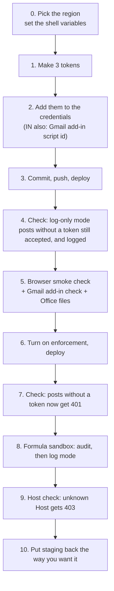

# Staging runbook: security review 2026-10 (PR #1891)

Run this on **staging IN** and **staging US** before production. Every step is a command to paste,
followed by what you should see. Production then follows
[the deploy checklist](security_review_2026_10_deploy_checklist.md), and the reasons behind each
step are in [the security review](../security/security_review_2026_10.md) (R1–R13).

**The one rule:** staging IN and staging US are separate. Generate new tokens for each one, and
never paste a value from one into the other.

## The run, in one picture



Each step takes a few minutes, except step 8, which depends on running one allocation.

---

## Step 0: pick the region (run in your IRM checkout, on `main`)

```bash
cd ~/work/IRM && git checkout main && git pull
```

Then paste **one** of these two blocks. Every later command uses these variables, so run the whole
runbook in the same terminal.

**Staging IN**

```bash
export REGION=in STAGE=staging_in HOST=dev.altconnects.com BOX=52.66.163.132 KEY=~/.ssh/altxdev.pem
```

**Staging US**

```bash
export REGION=us STAGE=staging_us HOST=dev.altconnects.us BOX=13.222.236.84 KEY=~/.ssh/altx.us.pem
```

Check that you can reach the box and see its log:

```bash
ssh -i $KEY ubuntu@$BOX "ls -la /home/ubuntu/IRM/shared/log/staging.log"
```

**Expect:** one line showing the log file. If ssh asks for a password or is refused, the key or
address is wrong; stop here.

---

## Step 1: make three new tokens for this region

```bash
export SG_TOKEN=$(ruby -rsecurerandom -e 'puts SecureRandom.hex(32)')
export WA_TOKEN=$(ruby -rsecurerandom -e 'puts SecureRandom.hex(32)')
export ES_TOKEN=$(ruby -rsecurerandom -e 'puts SecureRandom.hex(32)')
echo "staging-$REGION  sendgrid=$SG_TOKEN  whatsapp=$WA_TOKEN  esign=$ES_TOKEN"
```

**Expect:** three different 64-character values. Save that line in the password manager (not in a
file in the repo). Later steps read them from these variables.

---

## Step 2: add them to this region's credentials

Print the block to paste. For IN it includes the staging Gmail add-in's script id. Staging US has
no Gmail add-in, so it gets no script id.

```bash
if [ "$REGION" = in ]; then SCRIPT_ID=$(ruby -rjson -e 'puts JSON.parse(File.read("addons/gmail/.clasp.staging.json"))["scriptId"]'); fi
cat <<EOF

# ---- paste into staging.$REGION credentials ----
$( [ "$REGION" = in ] && printf 'gmail_addin:\n  script_ids: ["%s"]\n' "$SCRIPT_ID" )
sendgrid_inbound:
  tokens: ["$SG_TOKEN"]
whatsapp:
  webhook_token: "$WA_TOKEN"
esign:
  webhook_token: "$ES_TOKEN"
# ---- end ----
EOF
```

Open the credentials and paste the block at the end:

```bash
EDITOR=vim bin/rails credentials:edit --environment staging.$REGION
```

If a `whatsapp:` or `esign:` section already exists, put the new key **inside** it instead of
adding a second section with the same name. A second one silently replaces the first.

Check that the keys are there. This prints key names only, never the values:

```bash
bin/rails credentials:show --environment staging.$REGION \
  | grep -nE '^(gmail_addin|sendgrid_inbound|whatsapp|esign):|^ +(script_ids|tokens|webhook_token):' \
  | sed -E 's/(:).*/\1/'
```

**Expect:** for IN, `gmail_addin:`, `script_ids:`, `sendgrid_inbound:`, `tokens:`, `whatsapp:`,
`webhook_token:`, `esign:`, `webhook_token:`. For US, the same without the two `gmail_addin` lines.

---

## Step 3: commit, push, deploy

```bash
git add config/credentials/staging.$REGION.yml.enc
git commit -m "Staging $REGION: security review 2026-10 credentials (Gmail add-in, webhook tokens)"
git push origin main
bundle exec cap $STAGE deploy
```

**Expect:** the deploy ends without errors. There are no migrations in this release, so the migrate
step does nothing.

---

## Step 4: check log-only mode (nothing is refused yet)

Enforcement is still off, so a post with no token must still be **accepted**, and logged.

The WhatsApp webhook is the safe one to test with: an empty post is accepted and then ignored,
because it isn't a "message" event.

```bash
curl -s -o /dev/null -w '%{http_code}\n' -X POST "https://$HOST/users/whatsapp_webhook" \
  -H 'Content-Type: application/json' -d '{}'
```

**Expect:** `200`.

```bash
ssh -i $KEY ubuntu@$BOX "grep -h '\[WebhookToken\]' /home/ubuntu/IRM/shared/log/staging.log | tail -3"
```

**Expect:** a line like
`[WebhookToken] WhatsApp webhook accepted without authentication (no webhook_token in the callback URL); set WEBHOOK_TOKEN_ENFORCE=1 …`.
That line is what step 6's "watch the log" relies on in production.

Now the same post **with** the token:

```bash
curl -s -o /dev/null -w '%{http_code}\n' -X POST "https://$HOST/users/whatsapp_webhook?webhook_token=$WA_TOKEN" \
  -H 'Content-Type: application/json' -d '{}'
ssh -i $KEY ubuntu@$BOX "grep -h '\[WebhookToken\]' /home/ubuntu/IRM/shared/log/staging.log | tail -1"
```

**Expect:** `200`, and **no new** `[WebhookToken]` line: the last line is still the one from the
first post. A new line here means the token in the credentials doesn't match `$WA_TOKEN`; go back
to step 2.

---

## Step 5: smoke check in the browser, on `https://$HOST`

```bash
echo "https://$HOST"
```

- [ ] A fund-side user signs in and opens a fund, its capital calls and its documents.
- [ ] An LP signs in, sees only their own commitments and documents, and no staff-only lists.
- [ ] A read-only employee doesn't get bulk actions. A company admin without the approver role
      can't bulk approve.
- [ ] On a test user with 2FA, enter ten wrong codes within an hour. A sign-in ends after 3 wrong
      codes, so this takes four sign-ins. The account locks, and unlocks itself after 5 minutes.
- [ ] An AI client (Claude or ChatGPT connector) connected to staging still answers.

### Gmail add-in check (staging IN only)

While signed in, open the two links this prints:

```bash
ruby -rcgi -e 'h=ENV["HOST"]; [ENV["SCRIPT_ID"], "NotOurScript123"].each { |id| puts "https://#{h}/gmail_addin/oauth_start?redirect_uri=" + CGI.escape("https://script.google.com/macros/d/#{id}/usercallback?state=test") }'
```

- [ ] **The first link** (the staging add-in's own id) shows the **confirm page**. Don't click the
      button; it would mint a token for a fake state.
- [ ] **The second link** (a made-up id) shows **"Invalid sign-in callback address."** This is the
      H12 fix: before it, any Apps Script project could collect a user's token.
- [ ] If you have the "CapHive Filing (Staging)" add-in installed in Gmail, sign in through it once.
      It works end to end.

On **staging US** both links show "Invalid sign-in callback address.", because US has no add-in id.
That is correct.

### Office files (R13), staging IN is enough

- [ ] Generate one Word document (doc gen from a template, or a portfolio report in Word) and one
      PowerPoint (a portfolio report in PPT). Download both and open them in **desktop** Word and
      PowerPoint, on Windows if possible.
- [ ] Download a document ZIP (several documents at once) and open it in Windows Explorer.

**Expect:** everything opens with no "repair" or "corrupt" message. If Office complains, stop and
report it before production; the fix is a code change (`suppress_extra_fields: true` on the
DOCX/PPTX zip writers).

---

## Step 6: turn on enforcement

```bash
printf '\nSENDGRID_INBOUND_ENFORCE=1\nWEBHOOK_TOKEN_ENFORCE=1\n' >> .env.staging.$REGION
tail -3 .env.staging.$REGION
git add .env.staging.$REGION
git commit -m "Staging $REGION: enforce SendGrid and webhook tokens"
git push origin main
bundle exec cap $STAGE deploy
```

**Expect:** `tail` shows the two new lines, and the deploy succeeds.

---

## Step 7: check that posts without a token are now refused

Run the whole block:

```bash
code() { curl -s -o /dev/null -w '%{http_code}' -X POST "$1" -H 'Content-Type: application/json' -d '{}'; }
echo "whatsapp, no token     : $(code "https://$HOST/users/whatsapp_webhook")              (expect 401)"
echo "whatsapp, wrong token  : $(code "https://$HOST/users/whatsapp_webhook?webhook_token=wrong")  (expect 401)"
echo "whatsapp, right token  : $(code "https://$HOST/users/whatsapp_webhook?webhook_token=$WA_TOKEN")  (expect 200)"
echo "esign, no token        : $(code "https://$HOST/documents/signature_progress")         (expect 401)"
echo "sendgrid, no token     : $(code "https://$HOST/incoming_emails/sendgrid")             (expect 401)"
echo "sendgrid, wrong token  : $(curl -s -o /dev/null -w '%{http_code}' -X POST -u "sendgrid:wrong" "https://$HOST/incoming_emails/sendgrid")  (expect 401)"
```

**Expect:** every line shows the number in its brackets. The log explains each refusal:

```bash
ssh -i $KEY ubuntu@$BOX "grep -hE '\[WebhookToken\].*refused|\[SendgridInbound\].*refused' /home/ubuntu/IRM/shared/log/staging.log | tail -6"
```

The esign and SendGrid tests send no right token on purpose. A right token with an empty body
would reach the real handlers and log an error. Test those two for real instead:

- [ ] **SendGrid** (only if staging has an Inbound Parse route). In the SendGrid dashboard, set
      staging's Inbound Parse URL to the line this prints:
      ```bash
      echo "https://sendgrid:$SG_TOKEN@$HOST/incoming_emails/sendgrid"
      ```
      Then email a staging fund's owner address. It arrives under Incoming Emails, and the log shows
      no `[SendgridInbound]` line for it.
- [ ] **E-sign** (only if staging has a Digio or DocuSign account). Set its webhook URL to:
      ```bash
      echo "https://$HOST/documents/signature_progress?webhook_token=$ES_TOKEN"
      ```
      Then sign one test document. Its status updates on the document page.

**To undo enforcement** at any point, delete the two lines from `.env.staging.$REGION`, commit, push
and deploy.

---

## Step 8: formula sandbox (C2)

First the audit. It is a report and changes nothing:

```bash
ssh -i $KEY ubuntu@$BOX "cd /home/ubuntu/IRM/current && RAILS_ENV=staging bundle exec rails formula_sandbox:audit" | tee /tmp/formula_audit_staging_$REGION.txt | tail -40
```

**Expect:** a list of the stored formulas the sandbox would reject, grouped by entity. Don't run it
with `EXECUTE=1`; that rewrites formulas.

Then log mode:

```bash
printf '\nFORMULA_SANDBOX=log\n' >> .env.staging.$REGION
git add .env.staging.$REGION && git commit -m "Staging $REGION: formula sandbox in log mode" && git push origin main
bundle exec cap $STAGE deploy
```

- [ ] On staging, run one allocation on a fund that has allocation formulas, ideally one the audit
      listed.
- [ ] It completes with the same numbers as before.

```bash
ssh -i $KEY ubuntu@$BOX "grep -h '\[formula_sandbox\]' /home/ubuntu/IRM/shared/log/staging.log | tail -10"
```

**Expect:** either nothing (every formula passed), or `[formula_sandbox] would_reject …` lines for
formulas the audit already listed. Log mode only reports; nothing is blocked.

---

## Step 9: host check (L5)

```bash
printf '\nENFORCE_HOST_AUTHORIZATION=1\n' >> .env.staging.$REGION
git add .env.staging.$REGION && git commit -m "Staging $REGION: enforce host authorization" && git push origin main
bundle exec cap $STAGE deploy
```

```bash
echo "own host     : $(curl -s -o /dev/null -w '%{http_code}' https://$HOST/users/sign_in)  (expect 200)"
echo "unknown host : $(curl -s -o /dev/null -w '%{http_code}' -H 'Host: not-ours.example' https://$HOST/users/sign_in)  (expect 403)"
echo "health check : $(curl -s -o /dev/null -w '%{http_code}' -H 'Host: not-ours.example' https://$HOST/health_check)  (expect 200)"
```

**Expect:** 200, 403, 200. If the unknown-host line shows `404` or `444` instead of 403, nginx
dropped the request before Rails saw it; that's also fine.

- [ ] Browse a few pages, including a tenant's custom domain if staging has one. No page comes back
      as a blank 403.

Then look at what the browser's security policy reported while you browsed:

```bash
ssh -i $KEY ubuntu@$BOX "grep -h '\[csp_report\]' /home/ubuntu/IRM/shared/log/staging.log | sort | uniq -c | sort -rn | head -20"
```

**Expect:** a short list of `directive=… blocked=…` lines. Nothing is blocked, because CSP is
report-only. Keep the list: it's what has to be allowed before CSP can ever block.

---

## Step 10: put staging back the way you want it

Staging now runs every protection switched on. You can leave it like that; it's a good place to
find problems before production does. To go back to log-only:

```bash
grep -nE 'SENDGRID_INBOUND_ENFORCE|WEBHOOK_TOKEN_ENFORCE|FORMULA_SANDBOX|ENFORCE_HOST_AUTHORIZATION' .env.staging.$REGION
```

Delete the lines you want off, then commit, push and `bundle exec cap $STAGE deploy`.

Finally, clear the tokens from the terminal:

```bash
unset SG_TOKEN WA_TOKEN ES_TOKEN SCRIPT_ID
```

---

## Then the other region

Go back to **step 0**, paste the other region's block, and run steps 1 to 10 again. Step 1 makes new
tokens for that region.

## If something goes wrong

| What you see | Where to look | Likely cause |
|---|---|---|
| Step 4's token post still writes a `[WebhookToken]` line | `credentials:show` keys (step 2) | Token pasted into the wrong section, or a duplicate `whatsapp:` block replaced it |
| Step 7 shows `200` where it expects `401` | `tail .env.staging.$REGION`, then the deploy output | The env file wasn't committed, pushed or deployed |
| Step 7 shows `302` or `422` | The log line for that request | The endpoint is behind sign-in or CSRF on this box: report it, don't change it |
| Gmail add-in confirm link shows "Invalid sign-in callback address." on IN | The `gmail_addin` keys (step 2) | The script id wasn't added, or doesn't match `.clasp.staging.json` |
| Users signed in to an AI client must reconnect | — | Expected only after a rollback (see the deploy checklist's "Rollback" section) |
