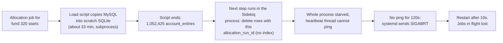

# 2026-10-05 — Sidekiq restarted by the systemd watchdog during a large-fund allocation

**One-line summary:** an allocation run for fund 320 (about 1.05M account entries) froze the whole
Sidekiq process for more than two minutes right after its scratch SQLite DB finished loading. The
systemd watchdog (`WatchdogSec=120`) took that as a hang, killed Sidekiq with SIGABRT and restarted
it, so every job in flight on that process was lost. Fix: skip a pointless full-table delete (the
suspected cause) and raise the watchdog to 600s. Tracked in the OpenSpec change
`skip-redundant-scratch-run-delete`.

**Confidence:** the restart mechanism is certain (systemd logs). The *cause of the freeze* is the
best-fitting hypothesis from the logs and code, not proven. See [How sure are we](#how-sure-are-we).

All times UTC, server `ip-10-0-1-56`, unit `sidekiq_IRM_production`, release `20261002021814`.

---

## What happened



| Time | Event |
|---|---|
| Before 11:55 | Allocation load for funds 320 and 319 runs for about 1976s ("Cumulative: 1976s" in the script output). Process used 40 min CPU in total |
| Last log lines | Script prints per-table counts ending `Table investor_kycs: 174 records` then `----- end script output -----` |
| Immediately after | Next Sidekiq log line is Ruby's crash report. No "loaded N account_entries" line was ever written |
| 11:55:51 | `Watchdog timeout (limit 2min)!`, systemd sends SIGABRT to pid 262813 |
| 11:55:52 | `Main process exited, code=dumped, status=6/ABRT`, `Failed with result 'watchdog'` |
| 11:56:02 | Scheduled restart (restart counter 1), 10s after exit as `RestartSec=10` |
| 11:56:36 | New process (pid 321627) started. A load for the same funds was already running under it, as shown by `irm_data_320_319_321627.sqlite3` |

---

## How the watchdog works

The unit is `Type=notify` with `WatchdogSec=120` ([config/deploy/services/sidekiq_IRM_env.service.erb](../../../config/deploy/services/sidekiq_IRM_env.service.erb),
background in [process_supervision.md](../process_supervision.md)).

- Sidekiq 8 sees `WATCHDOG_USEC` and pings `WATCHDOG=1` to systemd every `WatchdogSec/2` (60s) from a dedicated thread.
- If systemd gets no ping for `WatchdogSec`, it logs the timeout, sends SIGABRT (Ruby prints its crash report) and `Restart=always` brings it back.
- It was added on 2026-09-15 (commit `482cce2bf`, PR #1696) to replace monit and catch a process that is wedged outright. The unit comment says the limit is meant to be generous so "a GVL-holding native call can't kill in-flight jobs". 120s turned out not to be enough.

### Why a busy job can silence the heartbeat

Ruby (MRI) runs Ruby code in only one thread at a time, guarded by the GVL (global VM lock). Threads
normally take turns about every 100ms, so a heartbeat thread keeps pinging even while a job is busy.
That stops if a thread is inside a native (C or Rust) call that does not release the lock. The
sqlite3 gem is one: while a query runs, no other Ruby thread in the process can run.

The crash report fits that: the main thread was in `thread_sched_wait_running_turn`, which means it was
waiting to get the GVL back, so another thread was holding it.

---

## Why it killed more than the allocation

- Sidekiq is one process with 8 worker threads. The restart takes down everything on it, not just the allocation.
- `AccountEntryAllocationJob` has `retry: 0` ([account_entry_allocation_job.rb](../../../app/packs/funds/capital_commitments/jobs/account_entry_allocation_job.rb)), so a killed run is not retried by Sidekiq. A SIGABRT is not a graceful shutdown, so in-flight jobs are not pushed back to Redis either.

---

## Suspected cause

After the load script finishes, `RunFormulas#load_sqlite_db` runs, inside the Sidekiq process:

1. `AccountEntrySqlite.where(allocation_run_id: ctx[:allocation_run_id]).delete_all`
2. two `count` queries
3. the "loaded N account_entries" log line (never reached)

`account_entries` in the scratch DB has no index on `allocation_run_id` ([load_sqlite3_from_mysql.sh](../../../script/load_sqlite3_from_mysql.sh), `INDEX_account_entries`), so step 1 scans all 1.05M rows of a multi-GB, freshly written file. For a brand-new run it deletes nothing: the load script does `rm -f "$SQLITE_DB"` and rebuilds, and the run id did not exist in MySQL. It does matter in two cases: a reused scratch copy (development only), and a **re-run into an existing `AllocationRun`** (`AllocationRun#rerun!`, a supported ops path). In a re-run, `delete_existing_primary_entries` only clears formulas still in scope, so live rows of a since-disabled or deleted formula keep the run id, are copied into the scratch DB and would be migrated twice. The first version of the fix skipped the delete unless the copy was reused and reproduced exactly that (810 entries grew to 820 or 816, totals wrong), caught in review.

### How sure are we

| Claim | Status |
|---|---|
| Watchdog killed Sidekiq | Certain (systemd log) |
| The freeze began right after the load script ended | Certain (no log lines between `end script output` and the crash report) |
| The freeze was inside the `with_scratch_sqlite` block | Strong inference (the "loaded N account_entries" line, written after it, never appeared) |
| The unindexed delete is what blocked the heartbeat | Likely, **not proven**. A scan of 1M rows is normally seconds; it needs a cold, large file and a native call that holds the GVL to reach 2 minutes |

If the restarts continue after the fix, this hypothesis was wrong and needs another look before adding anything else.

---

## What was ruled out

| Check | Result |
|---|---|
| OOM kill | `journalctl -k` grep for oom/swap/blocked/hung found nothing |
| Swap thrash | Swap used 390M of 4G |
| Memory | 7.6G total, 4.1G available after the restart, Sidekiq 4.4G (peak 4.5G) |
| Disk full | 81% used, 11G free |
| Core dump | `coredumpctl` is not installed, so only the in-log Ruby crash report exists |

---

## What we are changing

| # | Change | Why |
|---|---|---|
| A | Run the `allocation_run_id` delete only for a reused scratch copy, or when the primary DB already holds rows for this run id (`run_id_in_primary?`, indexed lookup) | New runs match nothing, and the delete is the suspected stall. Re-runs into an existing run still need it |
| D | `WatchdogSec` 120 to 600 (Sidekiq then pings every 300s) | Margin for any other long GVL-holding call. Cost: a genuinely wedged Sidekiq stays down up to 10 minutes instead of 2 |

Rejected: an index on `allocation_run_id`. Once the delete is skipped nothing on a fresh copy queries by that column alone, the migration queries already use existing indexes (per formula `index_account_entries_on_fund_formula_id`; the once-per-run catch-all `idx_ae_fund_gen_date_formula`, checked with `EXPLAIN QUERY PLAN` on a synthetic table; `migrated` is scratch-only and 0 for every loaded row so it does not narrow), and an extra index slows a 33-minute load and grows scratch files on a disk at 81%. Revisit only if the "Migrating N entries" step shows slow gaps.

Full reasoning: `openspec/changes/skip-redundant-scratch-run-delete/` (proposal, design, lld, tasks).

---

## Future update (not being done now): a separate Sidekiq process for allocations

**Status:** planned as a possible future update only. It is **not** part of the current change (A and the 600s watchdog), and nothing is scheduled.

**How it would help.** The watchdog and its heartbeat thread are per process. If allocations ran in their own process, a stall there would only restart that process; reports, imports and notifications on the main process would keep running. It would also let the two processes have different watchdog limits and memory limits.

**What it would not do.** The allocation job itself would still die on a stall, and with `retry: 0` it would still not be retried. It limits the damage, it does not prevent the freeze.

| Pros | Cons |
|---|---|
| A stall or crash in an allocation no longer takes out other jobs | The deploy and monitoring assume **exactly one** worker: `sidekiq:ensure_clean_restart` proves one worker on the current release, `kill_stray_sidekiqs` sweeps anything systemd does not own, and there are duplicate-worker alerts and a canary. A second unit has to be added to all of these or they will flag or kill it |
| Separate memory limit (`MemoryMax=`), so an allocation cannot starve the main process | Another Rails process: the main one is already 4.4G on a 7.6G box |
| Own concurrency and watchdog tuning | Jobs need routing: `AccountEntryAllocationJob` is on the `:high` queue shared with other jobs, so it needs its own queue, and the main process must stop listening to it. Anything that enqueues to `:high` expecting it to run on the main process changes |
| | A second unit file, install and restart steps, and docs to maintain |

Recommendation: not now. Revisit if stalls recur after A and D, or if allocations keep growing. If it is picked up later, it needs its own change covering the new unit, the queue split, and the deploy and monitoring updates above.

---

## If it happens again

```bash
# was it the watchdog?
systemctl status sidekiq_IRM_production
journalctl -u sidekiq_IRM_production --since "2 hours ago" | grep -i -E "watchdog|SIGABRT|start|stop"

# OOM or memory pressure?
sudo journalctl -k --since "2 hours ago" | grep -i -E "oom|killed process"
free -h; df -h /home/ubuntu

# what was running: the crash report is in the Sidekiq log, and the lines just before it show the last job activity
grep -n -E "\[BUG\]|SIGABRT" /home/ubuntu/IRM/shared/log/sidekiq.log | tail
sed -n '<line-60>,<line+3>p' /home/ubuntu/IRM/shared/log/sidekiq.log | cut -c1-200

# did the fix take effect (after the deploy)?
systemctl show sidekiq_IRM_production -p WatchdogUSec     # expect 10min
grep "loaded .* account_entries" /home/ubuntu/IRM/shared/log/sidekiq.log | tail -3
```

If a restart shows `Failed with result 'watchdog'` again, look at what the log said last before the crash report. The Ruby backtrace in the report only shows the thread that printed it (here the idle main thread), so it will not name the culprit by itself.

---

## Open items

- [ ] Implement and deploy the change `skip-redundant-scratch-run-delete` (A and the 600s watchdog).
- [ ] After deploy, confirm `WatchdogUSec` is `10min` and a large-fund allocation logs "loaded N account_entries" with no watchdog restart.
- [ ] Check whether the allocation re-run that started under pid 321627 completed, and whether anyone was waiting on the interrupted run.
- [ ] Future update, not now: revisit the dedicated allocation Sidekiq process if stalls recur (see [Future update](#future-update-not-being-done-now-a-separate-sidekiq-process-for-allocations)).
