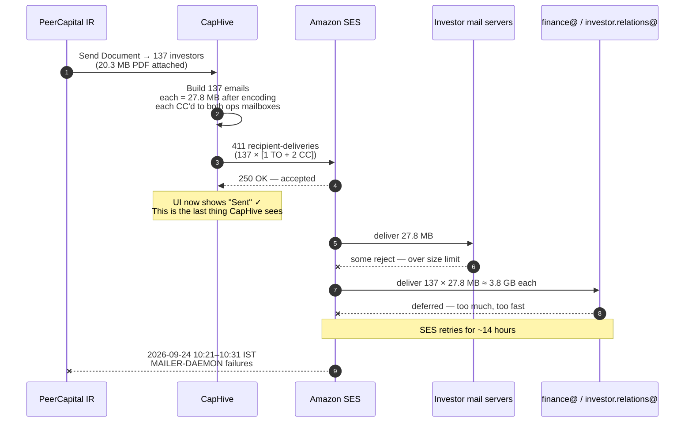
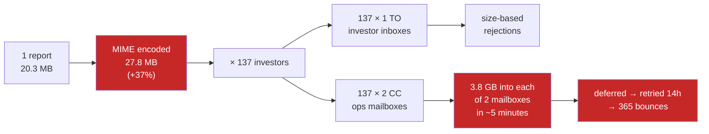

# Annual Investor Report emails — bounce incident (PeerCapital, 23–24 Sep 2026)

**Status:** root cause confirmed · fixes not yet implemented
**Tenant:** PeerCapital (entity 3610) · **Custom Notification:** 413 · **Document:** 121265
**Send:** 2026-09-23 20:21 IST · **Bounces observed:** 2026-09-24 10:21–10:31 IST

---

## 1. Summary for the client

On 23 September we sent the *PeerCapital I (CIIFO) Annual Investor Report FY 2025-26*
to 137 investors, with the 20.3 MB report attached to every email.

CapHive handed all 137 emails to Amazon (our email provider) successfully, which is
why the Sent Notifications screen shows them as sent. Amazon accepted them. The
failures happened afterwards, at the **receiving** mail servers, and CapHive had no
visibility of that at the time.

Two things went wrong, and the second is the bigger one:

1. **The attachment was too large for many recipients.** A 20.3 MB PDF becomes about
   **27.8 MB** once encoded for email — email attachments always grow by roughly 37%.
   Many corporate mail systems reject anything above 10–25 MB outright.

2. **Your own team's mailboxes were flooded.** Every one of the 137 emails was
   automatically copied to `finance@peercapital.in` and `investor.relations@peercapital.in`.
   That meant each of those two mailboxes received **137 copies of a 27.8 MB email —
   about 3.8 GB each — within a few minutes.** Google deferred them, retried for
   around 14 hours, then gave up and returned the "Delivery Status Notification
   (Failure)" messages you saw at 10:21–10:31 the next morning.

**What this means in practice:** the bounce messages your team received are
overwhelmingly about *your own CC copies*, not about investors. A CC failing does not
stop the investor's copy. However, a meaningful number of investors on corporate mail
systems will also not have received it, because of the attachment size.

**Your Amazon sending reputation is not damaged.** We checked it directly: status
**Healthy**, historic bounce rate **0.01%**. There is no risk to your ability to send
email. (See §5 — the short-term spike looks alarming but is not the number Amazon
judges the account on.)

**What we are doing:** stopping large files being attached at all — above a safe size
the email will carry a secure download link instead — and sending your team a single
summary copy rather than one copy per investor. Details in §6.

> **Please do not re-send this notification with the attachment until the fix is in
> place.** Each re-send repeats the mailbox flooding.

---

## 2. What happened, in sequence



### The amplification

The size problem and the CC problem multiply each other:



---

## 3. Evidence

From CloudWatch (`AWS/SES`, ap-south-1), via `rake "ses:bounce_stats[production.in]"`:

| Time (UTC) | Time (IST) | Metric | Count |
|---|---|---|---|
| 09-23 14:51 | 09-23 20:21 | Send | 228 |
| 09-23 14:56 | 09-23 20:26 | Send | 183 |
| | | **subtotal** | **411** = 137 × 3 |
| 09-24 04:56 | 09-24 10:26 | Bounce | 240 |
| 09-24 05:01 | 09-24 10:31 | Bounce | 125 |
| | | **subtotal** | **365** |

- The 411 sends match 137 recipients × 3 addresses (1 TO + 2 CC) **exactly**.
- The bounce timestamps match the client's screenshot of MAILER-DAEMON messages
  (10:31 / 10:33 IST) **exactly**.
- **Scale of the failure.** The blast was 411 recipient-deliveries. The bounce spike
  immediately before the next day's sends totals **372** (7 + 240 + 125), and no other
  send of scale precedes it inside the window. So **at most ~39 of the 411 deliveries
  succeeded.** If both CC addresses failed on all 137 messages (274 failures), then
  ~98 of the 137 investors did not receive it, and only ~39 did.
- That split is **inferred, not measured** — CloudWatch has no recipient dimension, so
  the CC/investor division cannot be confirmed from AWS. What is firm is the total:
  roughly nine in ten deliveries from this send failed. Only the DSNs can name them.
- The **~14-hour gap** between send and bounce is the signature of a *transient*
  failure — the receiving server deferred and retried before giving up. A hard size
  rejection is immediate. This is what distinguishes mailbox flooding from a pure
  size problem.

From the database (CN 413):

| | |
|---|---|
| Notifications created | 138 |
| Handed to SES (`email_sent = 1`) | 137 |
| Never sent | 1 |
| Skipped | 0 |
| **Bounces recorded in CapHive** | **0** |
| Document size | 20,302,644 bytes (19.4 MiB) |
| From | `investor.relations@peercapital.in` |
| CC (every message) | `finance@peercapital.in, investor.relations@peercapital.in` |

---

## 4. Why CapHive showed "Sent"

`email_sent = true` is written by `ApplicationMailer#mark_delivered`, an `after_deliver`
hook. It records only that **SES's SMTP endpoint returned 250 OK**. Delivery to the
recipient happens asynchronously, minutes to hours later, and is reported back by SES
over SNS — a channel that is **not currently connected**.

The in-app bounce pipeline exists and is complete (`EmailBounceEvent`,
`ProcessSesNotificationJob`, `POST /ses_notifications`), but the AWS-side wiring was
never done: `SES_CONFIGURATION_SET` is absent from `.env.production.*`, so
`tag_for_bounce_tracking` never adds the `X-SES-CONFIGURATION-SET` header, SES never
publishes the events, and `email_bounce_events` is empty account-wide — 0 rows, and
`bounced_at` NULL on all 6,413 notifications that carry a tracking id.

**Consequence:** CapHive cannot currently tell a client that an email bounced. That is
the standing gap, independent of this incident. See
[`ses_bounce_handling.md`](../../modules/notifications/ses_bounce_handling.md) §2 for the
AWS steps.

---

## 5. On the bounce rate — why the alarming number is not the real one

The windowed CloudWatch figure for this period is **36%** (381 bounces / 1,049 sends).
The SES console's Reputation metrics page reads **0.01%, Healthy**.

Both are correct; they measure different things:

- **CloudWatch `Bounce`** is a raw count in whatever window you query. Soft bounces are
  included once SES stops retrying — which is exactly what happened here, 14 hours later.
- **Historic bounce rate** is computed over a long trailing *"representative volume"* of
  mail and updates with a lag of hours. A single day's spike barely moves it.

The account is **not** at risk today. But sustained windows like this are what eventually
drag the historic number upward, and the console's own thresholds on that chart are
**Warning at 5%** and **Account at risk at 10%**. So this is a "fix it before repeating
it" situation, not an emergency.

`rake ses:bounce_stats` now prints this caveat rather than an "account at risk" warning.

---

## 6. Recommended fixes

Ordered by impact on this incident.

### 6.1 Cap attachment size and fall back to a link — *primary fix*

**Recommendation: cap the total encoded message at 10 MB, i.e. ~7 MB of raw
attachments. Above that, attach nothing and send a secure expiring download link.**

Why 7 MB raw:

| Raw attachment | MIME-encoded (×1.37) | Outcome |
|---|---|---|
| 5 MB | 6.9 MB | safe everywhere |
| **7 MB** | **9.6 MB** | **under SES throttling; clears 10 MB corporate caps** |
| 10 MB | 13.7 MB | SES bandwidth-throttles; fails 10 MB corporate caps |
| 18 MB | 24.7 MB | near Gmail's 25 MB practical ceiling |
| 20.3 MB | 27.8 MB | **this incident** |
| 29.2 MB | 40 MB | SES hard limit — rejected outright above this |

Two AWS-documented facts drive this:

- MIME encoding costs **~137%** of the original file size — AWS's own figure, and it
  matches this incident exactly (20.3 MB → 27.8 MB).
- **Messages over 10 MB are subject to bandwidth throttling**, as low as 40 MB/s. At
  27.8 MB each, our 137 messages were throttled on the way out, which stretched the
  blast and contributed to the receiving-side deferrals.

Three implementation points that matter:

1. **Measure the encoded size of the whole message, not each file.**
   `attach_custom_notification_documents` can attach several documents; a per-file cap
   does not bound the total. Shrine exposes the size via `document.file.size` without
   downloading the object, so the check is cheap.
2. **Put the guard in `ApplicationMailer#pw_protect_attach_file` / `#attach_doc`**, not
   in `DocumentMailer`. Every mailer that attaches goes through those two methods, so
   one guard covers all of them.
3. **Reuse the existing fallback.** `send_document.erb` already renders a "View Document"
   button when `show_link` is set (CN 413 has it on), and `DocumentMailer#email_link`
   already builds a presigned URL with an expiry. Nothing new needs designing —
   an oversized send should degrade to that path and say so in the body.

There is precedent in the codebase: `WorkflowMailer::MAX_ATTACHMENT_BYTES = 10.megabytes`
(`app/packs/core/workflow_templates/mailers/workflow_mailer.rb:6`) already does exactly
this, skipping attachments and flagging the template to show a link. It should be
**lowered to the shared 7 MB raw threshold and moved onto `ApplicationMailer`** — 10 MB
raw is 13.7 MB encoded, already inside SES's throttling band.

### 6.2 Stop the CC amplification — *equal priority*

`ApplicationMailer#setup_cc` applies `entity_setting.cc` to **every** message, and only
drops an address that matches that message's own recipient. There is no dedup across a
batch, so an N-recipient send delivers N copies to each CC address.

For a bulk notification the ops mailboxes should receive **one summary**, not one copy
per investor. Even with the size fix in place, 137 copies of any email is wrong.

### 6.3 Finish the bounce wiring — *so this is visible next time*

SES configuration set → SNS topic → confirmed HTTPS subscription to
`POST /ses_notifications`, "include original headers" enabled, and the set name in
`SES_CONFIGURATION_SET`. Without it CapHive will keep showing "Sent" for mail that
never arrived.

### 6.4 Grant SES read permissions to the ops IAM user

The `dev` user (account 825199636520) lacks `ses:GetAccount`,
`ses:ListSuppressedDestinations` and `ses:ListConfigurationSets`, so three sections of
`rake ses:bounce_stats` are skipped. Adding these read-only actions makes the
diagnostic complete without console access.

### 6.5 Make `attachment_mandatory` actually work for "Send Document"

CN 413 has `attachment_mandatory = 1`, but for a `DocumentNotifier` the
`custom_notification_documents_owner` is the `Document` itself, which has no `documents`
association — so `missing_mandatory_attachment_names` hits its `respond_to?(:documents)`
guard and always returns `[]`. The safeguard the client configured never ran. It should
resolve to the document's owner (Fund 108 here) instead.

---

## 7. Investigating a repeat

```
CN=413 bundle exec rake "ses:bounce_stats[production.in]"
```

Derives the AWS window from the notification's own send times, reports CloudWatch
Send/Bounce spikes in both UTC and IST, lists suppressed addresses, audits configuration
sets, and names which recipients are suppressed. See
[`lib/tasks/ses_bounce_stats.rake`](../../../lib/tasks/ses_bounce_stats.rake).

A bounce spike with **nothing** in the suppression list means transient bounces —
flooding or size — and only the DSN in the sender's mailbox carries the SMTP diagnostic:

| Code | Meaning |
|---|---|
| `5.3.4` / `5.2.3` | message too large for the receiving server |
| `4.2.2` / `5.2.2` | recipient mailbox over quota |
| `4.7.28` | receiving server rate-limiting the sender |

---

## Sources

- [Amazon SES now supports emails with a message size of up to 40MB](https://aws.amazon.com/about-aws/whats-new/2021/09/amazon-ses-emails-message-40mb/)
- [Working with email attachments in SES](https://docs.aws.amazon.com/ses/latest/dg/attachments.html) — MIME encoding overhead (~137%), >10 MB bandwidth throttling
- [Service quotas in Amazon SES](https://docs.aws.amazon.com/ses/latest/dg/quotas.html)
- [Monitor Amazon SES soft bounces](https://repost.aws/knowledge-center/ses-understand-soft-bounces) — soft bounces counted once SES stops retrying
- [Monitoring your Amazon SES sending activity](https://docs.aws.amazon.com/ses/latest/dg/monitor-sending-activity.html)
