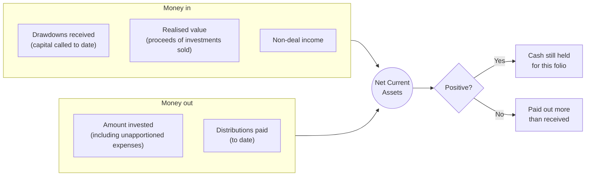
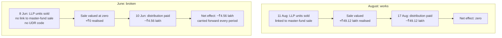
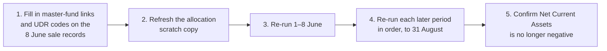
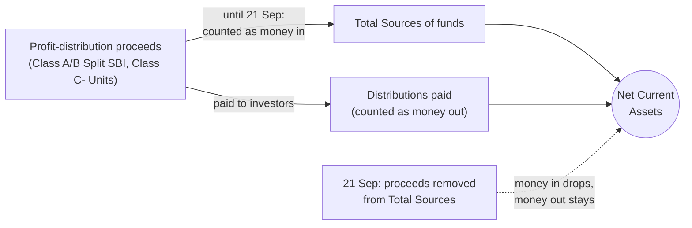
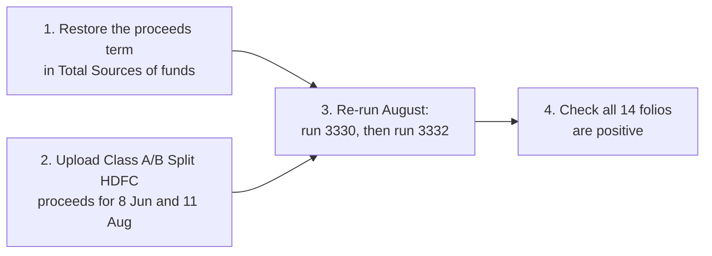

# Fund 320: Negative Net Current Assets

**Fund:** True North Fund VI Trust (fund 320), a feeder into True North Fund VI LLP (fund 319)
**Investigated:** 19–21 Sep 2026, on the local copy of production data
**Status:** Cause found. The fix needs data corrections and re-runs, listed under [What to do](#what-to-do).

## Summary

On 31 Aug 2026, **"Net Current Assets before profit distribution to GP" is negative for 13 of the
fund's 14 folios.** Only VI-01-A is positive. A negative figure means a folio has been paid out more
than it has taken in.

No formula is miscalculating. The cause is missing data:

- On **8 June 2026** the fund sold units of True North Fund VI LLP.
- On **10 June 2026** it paid investors the "10 June 2026" distribution out of that sale.
- The **sale was never valued** in the folios' accounts, but the **distribution was recorded**.

So every folio shows cash going out with no matching cash coming in. The gap first appears on
10 June and has carried forward into every period since.

The most likely reason the sale was valued at zero: the 8 June sale records have no link to the
matching sale in the master fund, and no UDR code. The August sale has both, and it was valued
correctly.

## How the number is built

Net Current Assets compares what a folio has received with what it has used or been paid.

Reinvested (non-cash) distributions are counted on both sides, so they cancel out.

### The figures for one folio: VI-01-BGP-3, 31 Aug 2026

| | Item | Amount (₹) |
|---|---|---|
| In | Drawdowns received to date | 34,23,064.00 |
| In | Realised value from investments sold | 1,53,65,705.40 |
| In | Non-deal income | 0.00 |
| Out | Amount invested, including unapportioned expenses | 74,02,266.47 |
| Out | Distributions paid to date | 1,16,36,259.78 |
| | **Net Current Assets** | **−2,49,756.85** |

## What went wrong

### The folio history shows exactly when

| Date | Net Current Assets (₹) | Distributions paid (₹) | Realised value (₹) | What happened |
|---|---|---|---|---|
| 31 May | +2,08,490.18 | 62,67,848.59 | 1,04,53,418.51 | Normal |
| 10 Jun | **−2,47,634.12** | 67,23,972.89 | 1,04,53,418.51 | Distribution paid, **no sale value** |
| 30 Jun | −2,48,582.03 | 67,23,972.89 | 1,04,53,418.51 | Gap carried forward |
| 31 Jul | −2,48,582.03 | 67,23,972.89 | 1,04,53,418.51 | Gap carried forward |
| 11 Aug | +46,63,704.86 | 67,23,972.89 | 1,53,65,705.40 | August sale valued |
| 31 Aug | −2,49,756.85 | 1,16,36,259.78 | 1,53,65,705.40 | August distribution paid |

August works as expected. The 11 August sale added ₹49,12,286.89 of realised value, and the
"Distribution Aug 26" paid out exactly ₹49,12,286.89, so the two cancel.

June doesn't. The "10 June 2026" distribution paid this folio ₹4,56,124.30, but the 8 June sale
added nothing to its realised value. That ₹4.56 lakh shortfall is the whole swing from
+₹2.08 lakh to −₹2.48 lakh.

### June compared with August

### Why the June sale was valued at zero (likely, not yet proven)

A feeder fund's sale is valued by looking up the matching sale in the master fund. Each sale
record in fund 320 names that match in a field called **"Portfolio Investment Ids In Master
Fund"**. The "Portfolio Sold" formula uses it to find the master-fund sale and its value.

| Sale record | Date | Units | Master-fund link | UDR code | Valued? |
|---|---|---|---|---|---|
| 9820 | 11 Aug | −1,19,647.28 | 9770, 9774, 9771 | — | Yes |
| 9665 | 8 Jun | −1,45,176.25 | **empty** | **empty** | No |
| 9666 | 8 Jun | −36,027.09 | **empty** | **empty** | No |

Only one of the fund's 136 sale records has the master-fund link filled in, so older sales must
be valued another way. This explanation still needs one more confirmation: stepping through the
"Portfolio Sold" formula for sale 9665.

### The master-fund sales behind 8 June

A feeder sale links to the master sales that funded the master distribution it passes on. It
does not link by sale date. The August sale shows the pattern: fund 320's sale 9820 links to
master sales 9770, 9771 and 9774, which funded master distribution 1502. That distribution paid
fund 320 exactly its "Distribution Aug 26" amount, ₹16,42,08,232.53.

June works the same way. Master distribution 1482, "Distribution June 26" on 8 June, paid fund
320's commitments ₹18,57,42,343.01 gross. That exactly matches fund 320's "10 June 2026"
distribution. Nine master sales are tagged to it:

| Master sale | Date | Company | Amount (₹) |
|---|---|---|---|
| 9552 | 27 Mar | Shree Digvijay Cements | 10,90,87,140.00 |
| 9550 | 30 Mar | Shree Digvijay Cements | 45,02,42,755.00 |
| 9551 | 30 Mar | Shree Digvijay Cements | 3,90,63,229.00 |
| 9553 | 31 Mar | Shree Digvijay Cements | 42,66,89,123.93 |
| 9554 | 27 Mar | Fedbank Financial Services | 9,52,746.07 |
| 9609 | 11 May | Fedbank Financial Services | 22,02,05,380.58 |
| 9607 | 12 May | Fedbank Financial Services | 1,91,94,51,079.28 |
| 9611 | 12 May | Fedbank Financial Services | 1,92,03,90,525.25 |
| 9630 | 27 May | Fettle Tone (Niva Bupa) | 54,92,07,119.00 |

Suggested values for fund 320's link field, to be confirmed by the fund team:

| Fund 320 sale | Amount (₹) | "Portfolio Investment Ids In Master Fund" |
|---|---|---|
| 9665, True North Fund VI LLP | 14,51,76,245 | `9554, 9609, 9607, 9611, 9630` |
| 9666, True North Fund VI LLP, Shree Digvijay part | 3,60,27,093 | `9552, 9550, 9551, 9553` |

The split follows the June adjustment upload, which books ₹3.60 crore as "True North Fund VI LLP -
Shree Digvijay". The alternative copies August's pattern and puts all nine ids on 9665. The
Shree Digvijay share doesn't match exactly: 18.2% of the master sales, against 19.9% of the
feeder sales. "Portfolio Sold" reads the master links from the first sale of the period only, so
which record carries the ids matters. This needs a test run before the values are relied on.

### It isn't just one folio

On 31 Aug, every folio except VI-01-A is negative. That fits a fund-wide sale missing from every
folio, rather than a problem with any one investor.

| Folio | Net Current Assets (₹) |
|---|---|
| VI-01-A | +1,88,54,413.51 |
| VI-01-BGP-3 | −2,49,756.85 |
| VI-01-BGP-4 | −2,97,718.19 |
| VI-01-BGP1 | −11,13,383.62 |
| Vi-01-BGP2 | −14,038.69 |
| VI-01-BLP | −1,73,442.87 |
| VI-01-C | −1,08,46,602.04 |
| VI-03-BGP | −5,50,05,508.77 |
| VI-03-BGP-03 | −2,25,57,051.73 |
| VI-03-BGP-04 | −1,47,36,012.69 |
| VI-03-C | −53,15,42,899.49 |
| VI-03-D | −7,42,16,771.51 |
| VI-03-GP2 | −19,45,294.70 |
| VI-2-D | −68,78,427.74 |

The two Class C folios, VI-01-C and VI-03-C, are negative by far more than their share of the
June sale. They are probably also affected by the change to "Total Sources of funds" described
below. That has not been checked yet.

## What to do

1. **Correct the 8 June sale records.** Add the "Portfolio Investment Ids In Master Fund" link and
   the fund-level UDR code to records 9665 and 9666, and to the four adjustment records uploaded on
   18 Sep (9825 to 9828, from upload "Portfolio Investment June 26 distribution Adjustment"). The
   fund team has to supply the right values.
2. **Refresh the scratch copy.** In development, allocation runs reuse a saved copy of the data.
   Delete `tmp/allocation/irm_data_320_319_dev.sqlite3.complete` so the next run picks up the
   corrected records.
3. **Re-run 1–8 June.** This period currently holds almost no allocations. An attempted re-run on
   19 Sep (run 3331) cleared it and then stopped on the missing UDR codes.
4. **Re-run each later period in order**: 9–10 June, 11–30 June, July, 1–11 August, 12–31 August.
   Each period builds on the one before, so the gap only closes once all of them are re-run.
   These periods are locked and must be unlocked first.
5. **Check the result.** Net Current Assets should no longer be negative, and the folio's
   realised value should rise on 10 June by the June sale's value.

## Related findings from the same investigation

### Class C proceeds allocated twice (fixed)

The "Profit Distribution proceeds" formula decided which folios receive an entry by searching the
entry's name for a keyword, such as "ADB" or "Indium". The 11 August Class C entries, "Class C-
Units ADB" and "Class C- Units Indium", contain both "Class C" and a Class B GP keyword. So both
the Class C folios and the Class B GP folios received the full amount.

| Entry | Fund level (₹) | Allocated before fix (₹) | Allocated after fix (₹) |
|---|---|---|---|
| Class C- Units ADB | 35,39,22,923 | 70,78,45,846 | 35,39,22,923 |
| Class C- Units Indium | 3,40,26,54,226 | 6,80,53,08,452 | 3,40,26,54,226 |

The formula now sends Class C entries to Class C folios only. The 1–11 August re-run (run 3330)
confirms both totals now match. **This fix exists only in the local copy. Production still runs the
old formula.**

### Class C proceeds on 8 June never allocated (open)

An earlier version of the same formula had no Class C rule at all. The 8 June "Class C- Units"
entry of ₹46,86,40,952 reached no folio. The corrected formula handles it, but only after the
1–8 June re-run above.

### "Total Sources of funds" changed (21 Sep)

At the fund team's request, the since-inception profit-distribution proceeds were removed from
"Total Sources of funds" (formula 4044, sequence 325). This has no effect on VI-01-BGP-3, whose
proceeds are zero. It does affect folios that receive proceeds, mainly the two Class C folios, and
the two formulas built on this total: "Net Current Assets before profit distribution to GP" and
"Net Current Assets Feeder". This change is also local only.

### These errors would have been caught automatically

Fund 320 has no pre-run or post-run checks installed. The checks the system suggests for this fund
were tested against the affected runs:

| Problem | Check | Result |
|---|---|---|
| Class C proceeds allocated twice | Post-run: fund-level entries tie to folios | Fails, listing both entries |
| 8 June Class C entry never allocated | Post-run: fund-level entries tie to folios | Fails, ₹46.86 crore unallocated |
| 8 June sale records missing codes | Pre-run: portfolio investment custom fields | Fails, before any data is deleted |

We recommend installing the post-run tie-out check now. The pre-run custom-field check needs
narrowing first, because as suggested it also flags records that allocate correctly.

## Open questions

- Should the nine master-fund sale ids be split across 9665 and 9666 as suggested above, or all
  go on 9665? And which feeder-level UDR codes do these records take? The fund team needs to
  confirm both.
- Is the missing master-fund link alone enough to value the June sale at zero? This needs one more
  step through the "Portfolio Sold" formula for sale 9665.
- How much of the Class C folios' negative balance comes from the "Total Sources of funds" change,
  and how much from the June sale?
- When should the formula fixes be applied in production?

## Update, 21 Sep 2026: negatives remaining after re-running August

The missing fund entries were uploaded and August was re-run: 1–11 August (run 3330) and
12–31 August (run 3332). Eight of the 14 folios are now positive on 31 August. Six are still
negative. They fall into two groups with two different causes.

The master-fund links suggested above for sales 9665 and 9666 were applied and then reverted. The
June sale had been adjusted by hand on purpose. So the missing link may not explain the June gap
after all, and the suggested values should not be used.

### The six negative folios

| Folio | Class | Net Current Assets (₹) | If the proceeds term is restored (₹) |
|---|---|---|---|
| VI-01-BGP-4 | Class B GP- HDFC | −2,90,679.95 | −2,90,679.95 |
| VI-03-BGP-04 | Class B GP- HDFC | −1,43,92,358.56 | −1,43,92,358.56 |
| VI-01-BGP1 | Class B GP- SBI | −10,92,104.07 | +52,58,138.09 |
| VI-03-BGP | Class B GP- SBI | −5,39,63,830.49 | +25,71,98,035.35 |
| VI-01-C | Class C | −1,08,43,764.77 | +8,30,33,416.29 |
| VI-03-C | Class C | −53,14,04,549.08 | +4,06,85,77,322.86 |

### Cause 1: SBI and Class C folios, because proceeds were removed from "Total Sources of funds"

These folios receive profit-distribution proceeds, from the "Class A/B Split SBI" and "Class C-
Units" entries. They then pay those proceeds out to investors as distributions. On 21 Sep the
since-inception proceeds were removed from "Total Sources of funds" (formula 4044, sequence 325).
The payouts still count as money out, but the proceeds no longer count as money in.

Restoring the term makes all four folios positive, as the last column of the table shows.

### Cause 2: HDFC GP folios, because the HDFC split was never uploaded

The "Profit Distribution proceeds" formula has a branch for "Class A/B Split HDFC" entries, which
carry the Class B GP- HDFC folios' profit share. The fund has never had one. Its only splits are
for SBI, on 13 Mar, 8 Jun and 11 Aug. Yet the two HDFC GP folios were paid large distributions
for their size:

| Folio | Committed (₹) | Paid 10 Jun (₹) | Paid 17 Aug (₹) |
|---|---|---|---|
| VI-01-BGP-4 | 49,599 | 2,76,570.73 | 2,60,302.35 |
| VI-03-BGP-04 | 24,30,333 | 1,35,50,745.89 | 1,27,54,817.43 |

The two negatives are split exactly by the folios' Class B GP- HDFC commitments. VI-01-BGP-4
holds 2.0% of those commitments and carries 2.0% of the combined negative. That is exactly how the
formula would split an HDFC entry. So this points to one missing fund-level amount of at least:

| Folio | Shortfall (₹) |
|---|---|
| VI-01-BGP-4 | 2,90,679.95 |
| VI-03-BGP-04 | 1,43,92,358.56 |
| **Total** | **1,46,83,038.51** |

Restoring the proceeds term does not help these folios, because they have no proceeds at all.

### Folio VI-01-BGP-4 on 31 August, entry 32496647

| | Item | Amount (₹) |
|---|---|---|
| In | Drawdowns received | 49,599.00 |
| In | Realised value | 4,22,905.61 |
| In | Profit-distribution proceeds | 0.00 (none uploaded) |
| Out | Amount invested | 1,12,058.78 |
| Out | Distributions paid | 6,51,125.79 |
| | **Net Current Assets** | **−2,90,679.95** |

| Date | Net Current Assets (₹) | Distributions paid to date (₹) | Realised value (₹) |
|---|---|---|---|
| 31 May | +2,980.58 | 90,156.19 | 1,55,565.02 |
| 10 Jun | −2,97,686.67 | 3,90,823.44 | 1,55,565.02 |
| 11 Aug | −30,360.16 | 3,90,823.44 | 4,22,905.61 |
| 31 Aug | −2,90,679.95 | 6,51,125.79 | 4,22,905.61 |

It turns negative each time a distribution is paid, and never gets a matching proceeds entry.

### What to do

1. **Restore the since-inception proceeds term** in "Total Sources of funds" (formula 4044). This
   fixes the SBI and Class C folios. The term was removed at the fund team's request, so they need
   to confirm why before it goes back.
2. **Upload the "Class A/B Split HDFC" profit-distribution entries** for 8 June and 11 August,
   using amounts from the fund's carry workings. Together they should come to at least
   ₹1,46,83,038.51. This fixes the HDFC GP folios.
3. **Re-run August in order:** 1–11 August (run 3330), then 12–31 August (run 3332). If the
   8 June entry is uploaded, re-run from 1–8 June onward instead. In the console:
   `AllocationRun.find(3330).rerun!(now: true)`
4. **Check the result.** All 14 folios should be positive on 31 August.

### Open questions from this update

- Why was the proceeds term removed from "Total Sources of funds", and should it be restored?
- What are the "Class A/B Split HDFC" amounts for 8 June and 11 August?
- Are any other splits missing? The ADB and Indium GP folios are positive now, but they have also
  never had a split entry.
