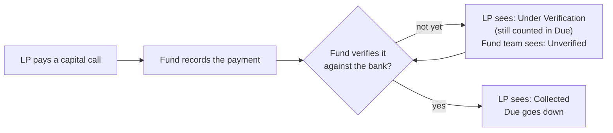

# Business Review — LP Fund Page, Stats Cards and Help Text
**Built: 14 October 2026** · Shipped to `main` via PR #1811, PR #1815 and four direct commits

This page lists every change made in this round, in plain terms, for business review before release.
Each item says **who sees it**, **what changed**, and **what to check**.

---

## The rules behind the numbers

Two decisions shape every figure below. Please confirm both.

1. **A card always equals the grid under it.** Every stats card is the total of a column in the table
   directly below it, to the paisa, including any search or filter the user has applied. If a card and
   the table ever disagree, that is a bug.
2. **Investors see payments on the *verified* basis; the fund team sees what was *recorded*.** A payment
   counts as "Collected" for an LP only once the fund has verified it against the bank. Until then the LP
   sees it as "Under Verification" and it stays in "Due". The fund team sees every recorded payment, plus
   an "Unverified" figure as their to-do.

**Example (fund 13, folio B603 on test data):** the LP has paid ₹2.01 Cr on Drawdown 1, recorded but not
yet verified. The LP now sees *Due ₹7.60 Cr* everywhere (dashboard and fund page), with *Under
Verification ₹2.01 Cr*, instead of two different Due figures (₹7.60 Cr and ₹5.59 Cr) on two screens.

---

## 1. What investors (LPs) see

### Fund page — Documents
- **Opens on "Latest Documents"**: every document shared with the LP anywhere in the fund's folders,
  newest first, with the folder each one sits in. Before, it opened on an empty root folder and LPs
  thought there were no documents.
- **Search box**: finds documents by name or tag, words in any order, not case-sensitive, as the LP
  types. It only searches this fund's folders and only documents the LP is allowed to see.
- The folder tree stays in its compact view (first level open).

*Check:* an LP with documents only in sub-folders sees them straight away; a search never shows another
fund's documents or a document the LP has no access to.

### Fund page — layout and navigation
- Clicking a section (Commitments, Calls, Distributions…) **scrolls it to the top** of the screen, also
  when arriving from a link.
- The page now uses the **full screen width**, so tables no longer scroll sideways.
- Links to the Commitments section no longer close it by mistake.

### Fund page — Calls (capital remittances)
- **Stats cards** above the table: Called · Collected · Under Verification (only when there is some) ·
  Due · Overdue (number of calls).
- New table column **Under Verification**; Collected and Due Amount now follow the verified basis.
- **Status shows as coloured badges**: Paid (green), Pending (amber), Overdue (red), Overpaid (blue),
  plus a **"Payment under verification"** badge when the LP has paid but the fund has not verified yet.

*Check:* an LP who has paid but is not yet verified sees the payment acknowledged (Under Verification),
not silently "due".

### Fund page — Distributions
- **Stats cards**: Total Distributions (= Received + Pending) · Received · Pending Payout (only when
  there is some) · Last Distribution (date and amount).
- Gross and tax are deliberately **not** cards (see Open points).

### Fund page — Units
- **Cards per unit type** ("Series A held", "Series C held"), never added together, plus Amount.
- A clear message when the LP has no units yet.

### Fund page — Ratios
- **Headline cards**: the fund's latest XIRR, TVPI, DPI, RVPI, MOIC and Gross Portfolio IRR (only those
  the fund has), each with a plain-language explanation, under "Latest ratios for *fund*, as of *date*".
- For a **feeder fund**, the LP sees the **master fund's** ratios (as before); the line names that fund.

### Fund page — help everywhere
- Each section header has an icon and a one-line description ("Payouts from the fund to you, and whether
  each one has been paid").
- Every stats card, most table columns, ratio names (TVPI, DPI, XIRR…), portfolio charts and the
  commitment card carry an ⓘ tooltip explaining the figure in plain language.

*Check:* the wording of these explanations — they are what an investor reads. The full list is in
`config/locales/en.yml` (section descriptions) and next to each table's column list.

### Investor dashboard
- **GP picker remembers the choice**: an LP with several GPs who picks one keeps it after pressing Back
  or returning to the dashboard (it used to jump back to the first GP).
- **Commitment card**: "See all →" links on Recent Documents, Fund Ratios and Due Amount open the matching
  section of the fund page; Due Amount uses the verified basis; figures and ratios carry tooltips.

### All stats cards (everyone)
- Cards in a row are the **same height**; long unit words are shortened (**Crores → Cr, Lakhs → L,
  Million → M**).

---

## 2. What the fund team (GP) sees

| Where | What changed |
|---|---|
| Commitment page → **Remittances** tab | Cards: Called · Collected (every recorded payment) · **Unverified** · Due · Overdue. Follow the table's search and filters. |
| Commitment page → **Distributions** tab | Cards: Total Distributions · Received · Pending Payout · Last Distribution |
| Commitment page → **Units** tab | Cards per unit type + Amount |
| Fund page → **Ratios** tab | Headline ratio cards (latest XIRR, TVPI, DPI, RVPI, MOIC, Gross Portfolio IRR) under an "as of" line; each card opens the ratio |
| Tables (remittances, distributions, ratios, portfolio, units) | ⓘ help on column headers; the remittance help explains that the fund team's Due/Collected count every recorded payment while LPs see the verified basis |
| Portfolio dashboard | ⓘ help on the stats cards, widget titles (FMV %, Bought %…) and the IRR / MOIC table |
| Remittance **Status** help | Corrected: a call shows **Paid** once the full amount is *recorded*, even if not yet verified |

---

## 3. Open points for the business

| # | Point | Why it matters | Suggested action |
|---|---|---|---|
| 1 | **Paid but not verified.** A remittance shows *Paid* once the full amount is recorded, even when unverified. LPs will now see "Paid · Payment under verification". | Correct, but some may read "Paid" as confirmed. | Confirm the wording is acceptable. |
| 2 | **Due can be negative** for an LP who has overpaid overall (it matches the commitment card). | An LP may query a negative Due. | Decide whether to show it as "Credit". |
| 3 | **Older distributions store Gross Payable as 0** (only Net filled in), so a Gross total would understate what was paid. | Why there is no "Gross Distributed" card. | Consider backfilling Gross on old payments. |
| 4 | **Ratio data quality is now prominent.** On test fund 13, TVPI and RVPI read **7618.03x**. | Headline cards put any bad ratio in front of investors. | Spot-check headline ratios on live funds before release. |
| 5 | **Some fund units have no Issue Date and $0.00 price** on test data. | Amount cards read $0.00. | Check typical live data. |
| 6 | **Section descriptions are English only.** Japanese users see English for these lines. | Japanese-locale entities. | Provide translations if needed. |
| 7 | **Portfolio table still scrolls sideways** (nine money columns inside a dashboard widget). | Minor. | Separate layout change if wanted. |
| 8 | **Ratio table order within a date is arbitrary**; older dates are listed below the latest. | The cards always pick the latest, so only the table is affected. | Optionally sort by name, or show latest only. |
| 9 | **Custom grid columns.** If a GP has configured its own remittance columns, its LPs would see those instead of the new verified-basis columns, and the cards could differ from the table. | No such setup exists in the test data. | Decide whether LPs should always get the standard LP columns. |

---

## 4. Verification status

- **Numbers checked against real (test-copy) data:** every card equals its table's total as displayed —
  9 LP × fund combinations, 30 commitments (remittances and distributions), 40 commitments (units).
- **Screens checked** as an LP and as a fund-team user, section by section.
- **Automated tests written but not yet run:** `features/fund/lp_fund_stats.feature` (S1–S29),
  `features/core/fund_documents_panel.feature`, `features/core/lp_gp_picker.feature`, plus the regression
  list in PR #1815. These should be run before release.
