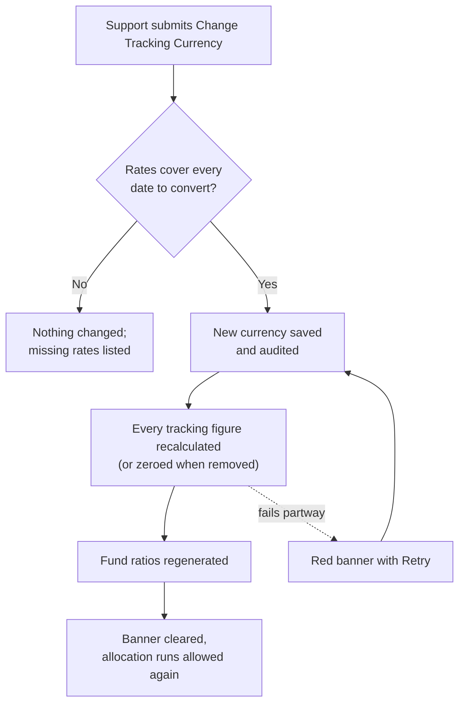

# Release Notes — V9.2.100
**Released: 27 September 2026**

---

## What's New

### Changing a fund's tracking currency now recalculates every figure
A fund's tracking currency could be changed on the fund's edit form, but only the currency label changed. Every tracking figure already stored stayed in the old currency and was simply shown under the new label, and the nightly conversion never corrected it, because it only fills figures that are still zero. The field is now locked on the edit form for everyone once a fund exists. The only way to change it is a new support-only action, **Actions → Misc → Change Tracking Currency**.

The change checks before it writes anything. It needs an exchange rate from the fund currency to the new currency dated on or before the earliest record of each kind. If any is missing, nothing is changed and support gets the list of rates to add. Otherwise it saves the new currency in the fund's audit history, recalculates every tracking figure at the rate for that record's own date, refreshes the fund and commitment totals, and regenerates fund ratios. Ratios labelled with the old currency are replaced. Choosing **None** removes the tracking currency and sets every tracking figure to zero instead. Documents already sent to investors and fund snapshots are not touched.

### The fund page shows when tracking figures are being recalculated
While a change runs, the fund page shows a banner saying the tracking figures may be inconsistent. New allocation runs, the nightly conversion and **Generate Tracking Numbers** leave the fund alone until the change finishes. If it stops partway, the banner turns red and support can **Retry**, which runs the change again to the same currency. Repeating it is safe.

---

## Improvements

- **Fund tracking totals now match their records.** Recalculating tracking figures now also refreshes the fund's tracking called, collected and distributed totals and each commitment's tracking collected and distributed amounts. It also fills the fund's **Tracking Committed** figure, which was previously never populated.
- **Force Regeneration is support-only.** **Generate Tracking Numbers (Force Regeneration)** used to appear for anyone who opened the fund page with a debug switch in the address. It is now shown to, and accepted from, CapHive support only.

---

## Bug Fixes

- **Changing a fund's base currency no longer fails at the tracking step.** When the fund also had a tracking currency, changing its base currency stopped with an error just as it began rebuilding the tracking figures. It now completes, and reports any tracking figures it could not convert.
