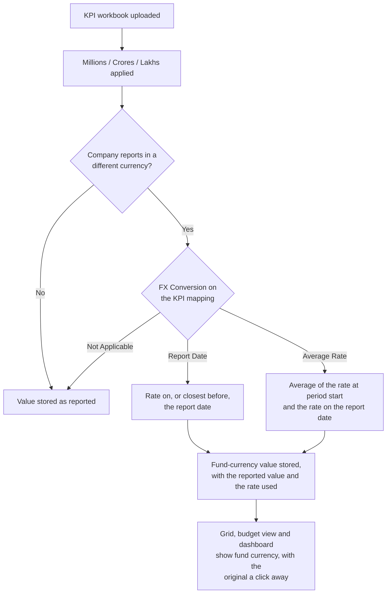
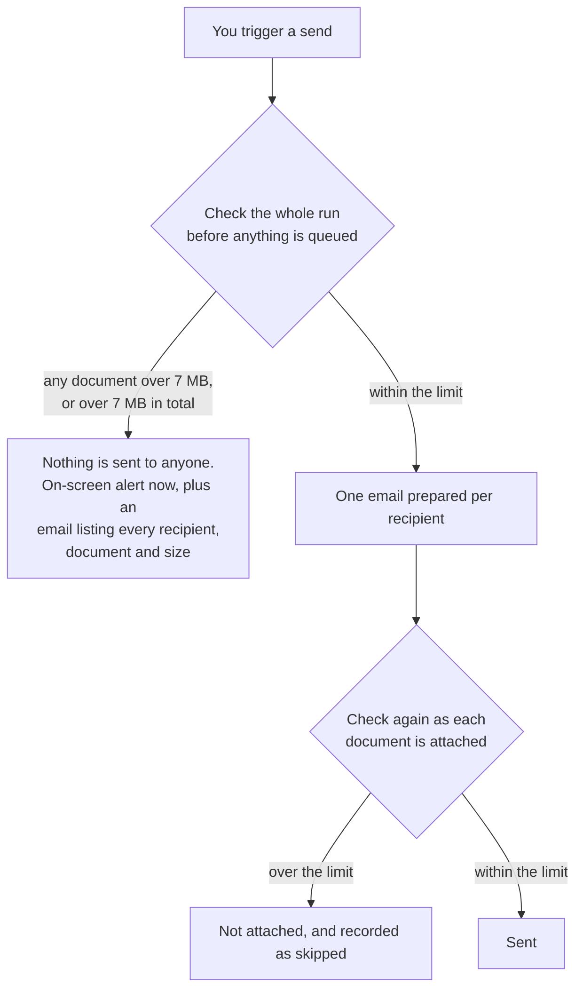

# Release Notes — V9.2.99
**Released: 26 September 2026**

---

## What's New

### KPI values now arrive in your fund's currency
A portfolio company that reports in its own currency no longer has to be converted by hand before you can compare it with the rest of the portfolio. Each KPI mapping now carries an **FX Conversion** setting — *Not Applicable*, *Report Date* or *Average Rate* — and uploaded values are converted with your entity's own exchange rates as they are read from the workbook. *Report Date* uses the rate on, or closest before, the report date, which suits balance sheet figures; *Average Rate* averages the rate at the start of the period and the rate on the report date, which suits income statement and cash flow figures. The period start follows the report's own period, so a monthly report averages from the start of that month, a quarterly one from the start of the quarter, and a year-to-date one from the start of your financial year.

New mappings are given a sensible setting to start from: income statement and cash flow categories default to *Average Rate*, balance sheet to *Report Date*, and operating metrics, ratios and anything recorded as a percentage to *Not Applicable* — a percentage is the same number in any currency, so it is never converted. The default applies when the mapping is created; changing the category later never overrides a choice you made yourself. The value as reported and the rate used are both kept, so every converted figure can be traced back. If a rate is missing the value is stored unconverted and reported, rather than being quietly scaled by the wrong number — add the rate and recompute. Portfolio companies that report in your own currency are untouched, and mappings left at *Not Applicable* behave exactly as before.

### See a portfolio company's KPIs in its own currency
Where a company reports in a different currency from your fund, the KPI grid header gains a toggle that reads **Viewing: INR (Fund)** or **Viewing: USD (KPI Currency)**. Switching it swaps every figure on screen between the converted value and the value the company actually reported, with no page reload and no round trip to the server, and your choice is remembered as you move between screens. The full grid, the simple grid, the compound table and the budget view all follow the toggle, and so do the Key Numbers dashboard widgets. Hovering a converted figure shows what was reported, the rate that was applied and which method produced it, so a number can be checked against the company's own statements during a call without leaving the page.

### Recompute KPI conversions after fixing an exchange rate
Exchange rates get corrected after the fact, and until now the only way to pick up a correction was to upload the workbook again. The KPI grid's actions menu has a new **Recompute FX Conversion**, which recalculates every converted figure for that portfolio company in the background from the values as reported and the rates as they now stand, and notifies you when it finishes. Figures you edited by hand are left alone, as are figures that were never converted. The dashboard widgets refresh with the rest, so a recompute no longer leaves stale tooltips behind for days. Recompute is always something you ask for — changing a rate never silently rewrites history.

### Oversized attachments are stopped before the send starts
A large report emailed to a full investor list can be rejected by the receiving mail servers while CapHive records every message as sent, because a send is recorded the moment our mail provider accepts it. Attachments are now held to **7 MB**, applied both to each document on its own and to everything attached to one email together. 7 MB of file becomes roughly 9.6 MB once encoded for email, which clears the 10 MB ceiling common on corporate mail systems — and close to half of investor contacts are on corporate domains.

The check runs in two places on purpose. Before anything is queued, the whole run is checked, so a single oversized document stops the batch as a unit instead of skipping investors one at a time; and at the moment a document is attached, so no send path can slip past the rule. **A blocked send is all-or-nothing**: nobody in that batch receives the notice, including recipients whose own attachments were fine. The report emailed to your admins now says so explicitly, and lists a row per affected recipient — email, investor and folio, document, size and why — so you can see exactly which file to shrink and who is waiting on it. The same message appears on screen straight away where the send was triggered from a page, rather than arriving by email minutes later. Measured against existing data, no capital call notice or distribution notice is affected by the new limit.

### Know an attachment is too big before you press Send
The limit is now visible everywhere a send begins, instead of being discovered afterwards. The Attachments step of a custom notification states the limit and warns that one oversized attachment stops the whole send. A custom notification whose own attached document already breaches it shows a red card and a disabled Send button, so it cannot be queued at all, and triggering that notification from the fund is refused on the spot with the reason — those documents are identical for every recipient, so there is nothing to wait and find out. The Send Document dialogs, single and bulk, warn when a document is over the limit or close to it. And the notifications list has a **View Skipped** link, so the record of what was skipped is reachable from the app instead of only from a link inside an email nobody may still have.

### The email preview now shows what will and won't be attached
Preview is where you answer "will this send the right file?", and it used to answer it incompletely. A document refused for being over the limit simply vanished from the attachment list — indistinguishable from an attachment rule that matched nothing, which sent admins hunting for a naming problem that did not exist. The preview now carries a warning above the email body naming each document that will not be attached and why, including the case where several documents each fit but together exceed the limit, with the document name as a link so you can open the file and see what is too big. Every attachment that *will* go out is a link too, which matters where the name alone cannot tell you which file was picked — a pattern that matches several documents, or two documents sharing a name. A document that fitted is never named in the warning. The preview itself has been redesigned, with a clear "this email has not been sent" badge and the recipient and subject set out above the body.

### Bounced investor emails are now recorded in CapHive
CapHive could already record bounces and complaints, but the connection to our mail provider had never been switched on, so the page stayed empty and a bounced notice was indistinguishable from a delivered one. That connection is now live in every region. Bounces and complaints flow back within seconds of the receiving server rejecting a message and appear under **Email Bounces & Complaints**, reachable from the notifications menu in the top bar, filterable by entity, event type, bounce type and date. Each event is tied back to the notification that produced it, so you can see which investor did not receive which notice. Permanent bounces — a closed mailbox, a wrong address — are distinguished from transient ones such as a full inbox. Support also has a new diagnostic that reads bounce and complaint rates directly from our mail provider for any past window, so an incident discovered weeks later can still be quantified.

### Advisor setups are checked, and broken ones refused
An investor advisor whose login already existed before they were made an advisor could end up with no company switcher in the top bar at all — the setup looked complete to whoever did it, and the problem only surfaced the next time the advisor signed in, far from anyone who could connect the two. Two things change. Adding an advisor now repairs that link where it can, and where it cannot — because the person sits in an ordinary company rather than an advisory firm — the save is **refused with the reason**, instead of creating an advisor who could never switch to your client. And a user page for an advisor account now shows an **Investor Advisor Health Check** for support: whether the switcher will appear, which clients they can switch into, and anything blocking them, each with what to do about it. It also catches the other easy mistake — an advisor record saved with no modules ticked, which shows the advisor an app with nothing in it and looks exactly like an access rights problem. Accounts already in a broken state stay editable, so they can be repaired rather than blocked. The Investor Advisor guide has been extended with each of these symptoms and its fix.

### Error emails now say which job failed and who triggered it
The error emails sent to your admins carried the error text and nothing else, which made a message such as "Missing rates: USD→INR on 1899-12-30" nearly impossible to act on — nothing said which run produced it, who started it, for which entity, or over what. Every error email now opens with a who, what and where block: the source, the person who triggered it, the entity, when it happened and the job's own details. Subject lines name the source too, so an inbox can be triaged without opening each message. Missing exchange rate lines from the tracking currency run now name the fund they belong to. Where a send was blocked by an oversized attachment, the email is the table described above and drops the diagnostic header, since it goes to your own admins rather than to support.

---

## Improvements

### Share price on the investor dashboard no longer reads zero
The "Valuation (Share Price)" figure on the investor dashboard was read from a stored copy that was only ever written under a condition almost no valuation met, so in practice it showed zero for everyone. It is now read from the entity's most recent valuation.

### Duplicate document folders, and the rename that could never succeed
Records whose folder was created while the record itself was still incomplete — a KYC saved before the PAN, address and bank details are filled in, for example — could end up owning several copies of the same folder. Once the record was complete it attached itself to one of them, and from then on every attempt to rename it failed with "Full path combination must be unique", permanently, on every edit. The cause is fixed: the link between a record and its folder is now written independently of whether the record passes validation, and an existing unused folder is reused rather than a new one created. A clean-up is available for entities already affected, which reports the duplicates before it repairs anything.

### A folder is no longer named from a form you did not save
A folder took its name from what was typed into the form rather than from what was stored, so an abandoned or failed edit could leave a folder named after a value that was never saved — a folder appearing a day before the record was actually renamed. Folder names now follow the saved record, and the rename is only queued once the edit really commits.

### Faster KPI screens, imports and approvals
Several KPI operations were failing or crawling on entities with a long history, all from the same cause: the database sorting more data than it could hold. The grid view now loads its reports once and sorts them in memory, and new indexes mean the underlying queries come back already in order. Approving all KPIs, the cumulative calculations behind it and the percentage-change run no longer pull wide report columns into the sort. Finding a portfolio company's latest report now asks the database for the latest date directly instead of ordering every report to read the first row.

### New and deleted records now appear in, and disappear from, search
Search indexing decided whether a record needed reindexing by looking at what had changed, which missed two cases. A newly created record could be saved a second time by follow-up processing, which erased the record of what had changed and left the new record out of the index; and a deletion is recorded in a way that the same check could not see, so deleted records lingered in search results. Creation and deletion are now recognised explicitly. As a bonus, a save that changed nothing no longer triggers a full reindex.

### Replies to notification emails go only to your reply-to address
Notification emails used to add the record's own CapHive inbound address to Reply-To alongside your configured address, so a reply went to both. They now use only the reply-to you configure on the entity — falling back to the CC address, then to the from address, as before.

### Guide answers are refreshed with every release
User guide FAQs are published from the guides that ship with a release, so the guide pages, the FAQ list and the Customer Support chatbot pick up corrected answers automatically instead of waiting for someone to import them. Answers edited in FAQ Manager are never overwritten, so support's own wording survives a release.

### Security scanning no longer competes with the rest of the app
The counters behind request throttling and the blocking of address scanners were kept in the main database, so a burst of scanning traffic turned into a flood of database writes that could lock each other out and slow down real work. Those counters have been moved onto their own fast store, leaving everything else unchanged.

### Millions and Crores now apply in the KPI currency view
Switching the grid to the portfolio company's own currency showed values in full — "USD 34,000,000.00" where the fund view read "34.00 Million". The denomination you have set now applies to both views. The KPI mapping import also accepts "NA" in the Denomination column to mean no denomination, instead of failing the row, and a wrong value now lists the ones that are valid.

### Workflow emails follow the same attachment limit as the rest
Workflow emails enforced their own, looser limit, so a file that every other email in CapHive would refuse could still go out from a workflow. All emails now apply the one rule.

---

## What to Do

| If you use...   | Action                              |
|------------------|-------------------------------------|
| Portfolio company KPIs in another currency | Set **FX Conversion** on each KPI mapping — or download the mapping template, which now has the column — then upload your workbook as usual. Make sure the exchange rates for the period are loaded first. |
| The KPI grid | No action needed. Use the currency toggle in the table header to see the company's reported figures, and hover a value to see the rate that was applied. |
| Corrected exchange rates | Use **Recompute FX Conversion** in the KPI grid's actions menu instead of re-uploading the workbook. Figures you edited by hand are not touched. |
| Emailing documents to investors | Keep each attachment, and everything attached to one email, under **7 MB**. Share anything larger from the portal instead. Check the preview before a large send — it now names anything that will not be attached. |
| Custom notifications with attachments | Review any notification whose attached documents total more than 7 MB; its Send button is disabled until the documents are within the limit. |
| Investor notices that were blocked | Open **View Skipped** from the notifications list, or the emailed table, to see which recipients received nothing and which document caused it. Then reduce the file and send again. |
| Tracking whether investors received an email | No action needed. Check **Email Bounces & Complaints** from the notifications menu after a large send; permanent bounces mean the address needs correcting. |
| Investor advisors | No action needed. If an advisor reports no company switcher, or an empty app after switching in, send support their email address — the health check on their user page names the cause. When adding an advisor who already has a login, their firm must be an entity of type Investor Advisor, or the save will be refused with that reason. |
| Error emails to your admins | No action needed. The new who/what/where block sits above the error list. |
| Replies to notification emails | Check the reply-to address on your entity settings is the one you want replies going to, since it is now the only one used. |
| Document folders | If a record cannot be renamed because a folder path is not unique, ask support to run the folder clean-up for your entity. |
| The investor dashboard | No action needed. The share price now reflects your latest valuation. |
