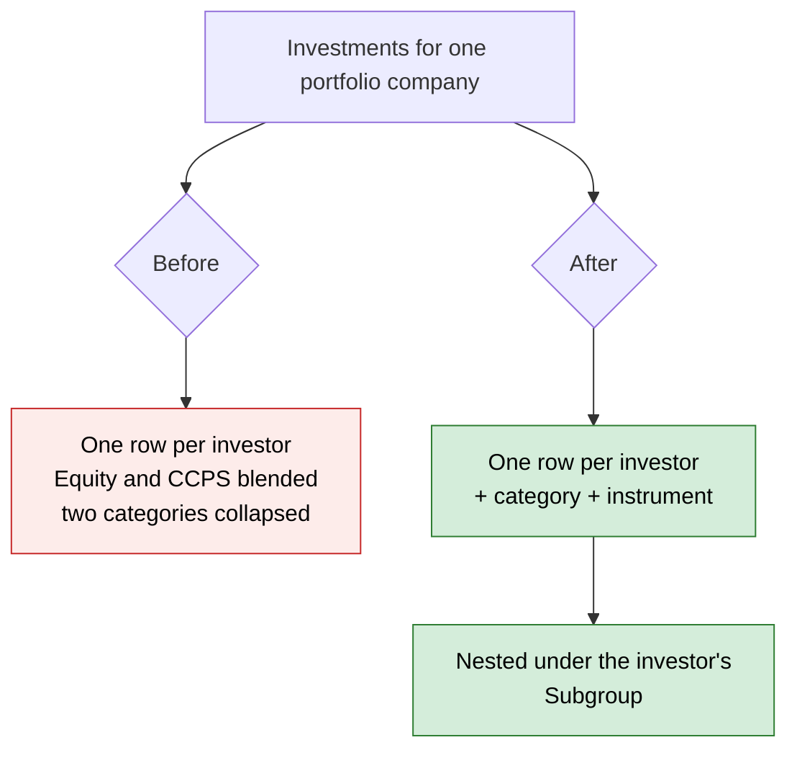
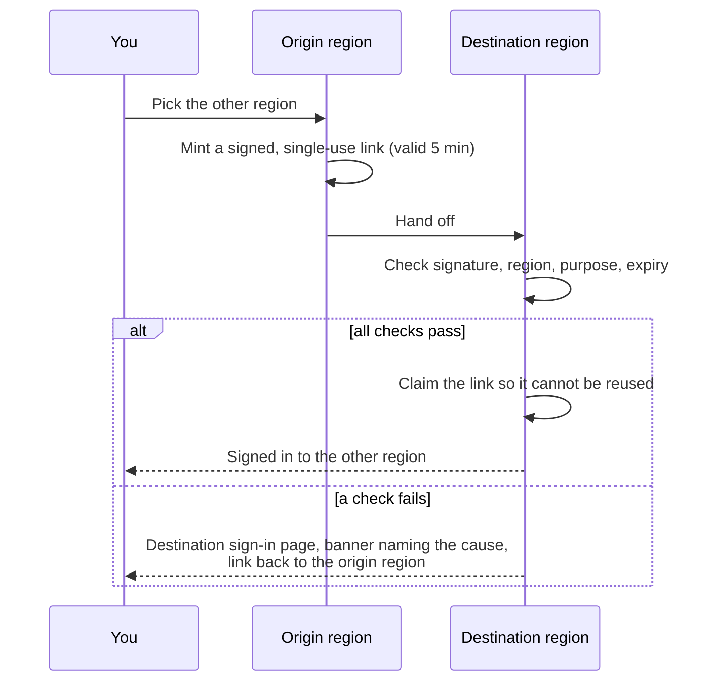

# Release Notes — V9.3.00
**Released: 2 October 2026**

---

## What's New

### Cap tables now separate instruments, categories and subgroups
An investor's holdings are no longer blended into a single row. Investments carry a **Subgroup**
(for example "Institutional" or "Angel"), entered next to the **Instrument Type** field on the
investment form and shown on the investment page, and the cap tables group by what an investor
actually holds rather than by the investor alone. The funding round cap table groups by investor
and instrument; the horizontal cap table groups by investor, category and instrument, so the same
investor appearing under two categories gets a row for each, nested under the first subgroup found
on any of their investments. An Equity investment's instrument simply reads "Equity".

The investment upload reads three more columns — **Subgroup** (also accepted as `SubGroup` or
`Sub Group`), **Instrument Name** and **Instrument Quantity**. None of them is turned into a custom
field any more. Instrument name and quantity belong to Convertibles only: the form shows them for a
Convertible, and saving an Equity investment clears them.

**Convertible quantities now split the way shareholder positions already did.** A Convertible's
Instrument Quantity counts as held; only the remainder of its quantity counts as dilution. This
happens inside the cap table calculation itself, so the changed Quantity and Percentage figures
flow through to everything built on it — fund portfolio reports in Word and PDF, the AI assistant's
portfolio answers, and the Ownership Trend chart. There is no separate recompute step: entering or
editing a Convertible's Instrument Quantity changes those figures too.

### Create and import tasks without leaving the board
The task board used to be a read-only view — creating or importing a task meant switching back to
the list. The board and the list now render the same header: a **New Task** button, and an
**Actions** menu holding **Show All**, **Incomplete** and **Import Tasks**. Show All and Incomplete
keep you on the board rather than dropping you into the list, and the filter selects still scroll
horizontally on a narrow screen while the buttons stay put, so the Actions menu opens over the board
instead of being clipped to a few pixels.

### Switching region works again, and says why when it doesn't
Picking the other region from the top-bar dropdown could land on a bare white page reading "Invalid
or expired link". The credential that carries your identity across regions was valid for 30 seconds
but had to survive four network round trips between Mumbai and Virginia, and it was checked against
the destination region's clock — so any drift between the two came straight out of that budget.
Three things caused it, and the error message named none of them.

The link now lives for five minutes and can only be used once — the longer window is safe precisely
because the link dies on first use, where before it was replayable for its whole life. Region codes
are compared consistently, so a profile recorded as `IN, us` can switch. A failed switch lands on the
destination region's own sign-in screen with a banner naming the cause and a link back, rather than a
blank page. Behind that, clock drift between the regions is now alerted on rather than merely charted,
and the two regions publish a non-reversible fingerprint of their shared secret so a mismatch is
detected hourly and reported as a mismatch — instead of inviting you to retry something that cannot
work.

Two separate access bugs were found while tracing this and fixed with it: a single-region user could
hand-craft a link for a region they have no access to (the destination you ask for is now what gets
authorised), and the region selector produced broken entries and a 500 for profiles whose regions
were stored as a JSON list.

### Deleting a KPI now removes it for good
Deleting a KPI or a KPI report used to hide it and keep an audit record that nobody reviewed — and
the hidden row still pointed at its KPI mapping, so deleting that mapping later failed with a
database error. Deletes are now permanent: a deleted KPI is gone, a deleted KPI report takes its
KPIs, documents and import records with it, and a mapping can be deleted whenever no live KPI uses
it. A mapping still in use is still refused, exactly as before. The delete buttons, confirmations
and messages are unchanged.

**This is a breaking change.** There is no audit history for KPI values and KPI reports any more,
and nothing can restore a deleted KPI or report — the recovery path is to re-upload the workbook.
Rows hidden by earlier soft deletes are cleaned out once, as this release is installed, so they stop
blocking mapping deletion.

---

## Improvements

### Previewing bulk portfolio reports by fund no longer errors
On the "Bulk generate portfolio reports" page, picking a Fund and clicking Preview returned an error
page instead of pre-selecting that fund's portfolio companies. The query behind it was only rejected
by the production database, which is why the automated tests never saw it. Preview now works: the
companies holding investments in the chosen funds are pre-selected, a company with several
investments in the same fund is selected once, and combining Fund with Tag or Sector narrows the
selection as before. The company list itself is unchanged — it still shows every portfolio company.

### Row action buttons no longer stack or disappear
On the investments index and other tables, the Show / Edit buttons could stack on top of each other
in a column too narrow for them, or the whole action column could be folded into the expandable row.
Reloading fixed it, which made it hard to pin down; it was mostly seen on Windows at 90% or 110%
browser zoom. Action buttons now stay on one line, the action column is the last to collapse rather
than the first, and each table re-measures itself once web fonts and the sidebar have settled and
whenever its container is resized. Fractional browser zoom no longer makes a table that fits look
too wide.

### Cap table entry points only offer what exists
The cap table page labels its buttons **Upload Investments** and **Download Investments**, and
**View Investments** now sits with the other investment actions. A portfolio company with neither
investments nor approved shareholder positions no longer shows download buttons for data it does not
have.

### Sample upload files match the current import formats
`investments.xlsx` and `shareholder_positions.xlsx` were out of date and did not import as-is
against the current format; both have been regenerated. The Capital Remittance Payments sample had an
incorrect spreadsheet validation on the Folio No cell, which is also fixed.

### Task board cards name the owner the way the list does
A board card showed its owner's full composite name — folio id, instrument and date for Commitment,
portfolio investment and aggregate portfolio investment owners — where the list's "For" column deliberately shows just
the stakeholder or company. Cards now use the same short name, and drop a database lookup per card
while doing it.

### Recurring tasks appear in search as soon as they are generated
Tasks created by the recurring task generator were not reaching the search index — the job had no
indexing strategy, so creating a task from a recurrence rule raised an error instead. The job now
queues its index updates, so generated tasks are searchable like any other.

### The region selector can no longer take a page down
A configuration problem with the region list used to raise while the page was being drawn, taking
the whole screen with it. A page that merely shows a region selector now degrades to "no region
selected" instead.

### New insight on the website
"Fund administrators, AI and the underlying infrastructure" is published under Insights on
caphive.com, and linked from the home and resources pages.

---

## What to Do

| If you use...   | Action                              |
|------------------|-------------------------------------|
| Cap tables with Convertibles | Review the Quantity and Percentage figures for companies holding Convertibles. A Convertible's Instrument Quantity now counts as held rather than as dilution, and the same change shows up in portfolio reports, the AI assistant's portfolio answers and the Ownership Trend chart. |
| Investment uploads | Download the latest `investments.xlsx` and `shareholder_positions.xlsx` samples. Add a **Subgroup** column if you want investors grouped, and use **Instrument Name** / **Instrument Quantity** for Convertibles. |
| Capital remittance payment uploads | Download the latest sample if your Folio No column was being rejected. |
| KPIs and KPI reports | No action needed, but be aware deletes are now permanent and have no audit trail. Delete a KPI report only when you are ready to re-upload the workbook. |
| KPI mappings | No action needed. Mappings blocked by previously deleted KPIs can now be deleted — the leftovers are cleaned up as this release installs. |
| Task boards | No action needed. New Task and the Actions menu are now on the board as well as the list. |
| Bulk portfolio reports | No action needed. |
| Cross-region sign-in | **Deployment step required:** `SITES` changes from a Ruby hash to HTTPS JSON, and both regions must deploy together — a region running new code against an old value refuses to boot, deliberately. After deploying, compare the two regions' secret fingerprints, provision the clock-drift Grafana rules, and run `rake users:normalize_regions` in each region. The two-region rollout is tracked in `openspec/changes/fix-cross-site-login-expiry/tasks.md`. |
