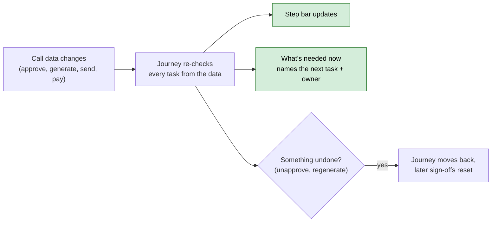

# Release Notes — V9.3.01
**Released: 3 October 2026**

---

## What's New

### Capital calls show which step they're on and what's next
Each new capital call now has a journey: a step bar across the top of the call, and a
**What's needed now** panel naming the task in front of you, who owns it, and a button that runs
the page's own control for it. The journey works out the current step from the call's own data —
remittances generated, notices approved, emails sent, payments recorded — so there is nothing to
tick by hand except the review steps, which take a single **Mark reviewed**. A call follows the
**Full** journey (11 tasks) or, if it was imported, the **Light** one (4 tasks).

Undoing something — unapproving, regenerating notices, unverifying a remittance, editing the
figures — moves the journey back and asks for any later sign-off again, so an approval always
refers to the figures you are looking at. Warnings before Approve and Send Notification are advice
only; nothing is blocked. Owners of a stalled review step get a reminder, and a call's journey
folds itself away a day after it finishes — the green route icon in the breadcrumb bar brings it
back.

### Distributions get the same step-by-step journey
Capital distributions now carry the same step bar and **What's needed now** panel: a **Full**
journey of 10 tasks and a **Light** one of 3, including generating and approving notices,
reviewing the email and marking payments complete. Both the call and distribution Full journeys
include a **CFO sign-off** step. It has no approver until you pick one on the template; until then
it is shown as not applicable rather than holding the journey up.

A few distribution rules were tightened along the way: approving needs the Approver role, and
**Mark Payments Completed** needs the distribution to be approved first (imported distributions are
exempt).

### Investor KYCs get a journey, starting with the email check
KYCs now have their own journey of 11 tasks, from setting up the KYC email through document
upload, document validation, AML screening, review, Compliance sign-off and verification. The first
two tasks ask you to look at the email before it goes to your investors: **Set up KYC email** names
the template that will actually be sent (or warns that CapHive's default text will go out), and
**Preview the email** shows this investor's rendered copy. Neither blocks sending.

Editing the company's KYC-required email withdraws both confirmations on KYCs that haven't been
emailed yet, so a changed template is always looked at again. The "Upload required documents" step
also now recognises documents named after the form's fields ("Upload Tax ID", "Upload Address
Proof"), which it used to report as missing.

### Document Checks replace Doc Questions for KYC documents
Under **Settings → Document Checks** you set up, per KYC document, what the AI should check: fill
in a KYC field from the document, compare the document with what the investor entered, or answer a
yes/no question. Each document is a tile with a plain summary of its checks, edited in a side panel;
suggested checks for common documents (CML, PAN, Aadhaar, Passport) can be added in one step, and
**Try on a KYC** shows the result without leaving the page. Checks can be exported to and imported
from a spreadsheet.

On each KYC, the **Document checks** tab sorts results by what needs doing: a summary bar, a
**Needs your decision** card per document showing the two values side by side with the AI's reason,
one grouped **Missing documents** card, and an **All good** list. You can use the document's value,
mark a result as OK (with Undo), or check again. The KYC journey's **Validate documents** step reads
these results. The tab updates in place as each document finishes rather than blanking and jumping.

Your existing Doc Questions were converted automatically as this release installed. Any question
that could not be converted — usually because its document is not on the fund's KYC document list —
has been listed for Support to set up with you. Earlier AI answers stay visible on each KYC.

### Workflow templates can be turned off, and show as a graph
A workflow template can now be **disabled**. A disabled template is never auto-assigned, launched
or offered in the Launch Workflow picker, while workflows already running on it carry on to the
end. This is also the way to retire a template that can no longer be deleted because it has
history. The confirmation names the template that will take over, because a disabled template's
rules step aside and the next matching rule applies; they come back as soon as you re-enable it.

The rules table gains a **Status** column (Active, Dormant, Shadowed, No template), and a rule that
can never be reached names and links the rule blocking it. Template and run pages have a
**List / Graph** switch that lays long templates out left to right so they fit on one screen.

---

## Improvements

### Build auto-assignment rule conditions without writing JSON
The rule form's JSON box is replaced by rows of field / operator / value, with your company's form
custom fields included and a **View as JSON** toggle. A condition that could never match is refused
on save with a numbered message, and the template page describes conditions in words.

### Custom-field filters show only your company's fields
List filters could show another company's custom fields, and a field you un-ticked from "Show in
Filter" lingered. Number and money custom fields also compared as text, so "greater than 10" missed
9. Filters now show only your fields and compare numbers as numbers.

### Workflow emails for reviews and finished journeys
The owner of a review step gets a **Needs your review** email when it becomes current, and a
**Complete** email goes out when a journey finishes. Templates have **Send email** (on) and
**Send WhatsApp** (off) switches; WhatsApp only ever messages your own team.

### Reorder workflow steps by typing a step number
Adding a step from the template form failed with "position can't be blank", and the drag handle did
nothing. Each step now has a number you can type; the rest renumber around it, and deleting a step
closes the gap.

### KYC uploads no longer loop or hang
Submitting the document upload with no files sent you round the upload and processing pages forever;
it now returns you to the form with a message. The processing page could also wait forever if the
documents were read before it opened — it now checks back every few seconds.

### KYC forms save once per click
Clicking Save, Save Draft or Submit more than once could save the form and its files several times.
The buttons now lock on the first click.

### Bulk Unverify only touches verified KYCs
Bulk Unverify marked every selected KYC as submitted, including ones the investor never sent. It now
changes only verified KYCs.

### Workflows and Help are easier to find in the top bar
**Workflows** is in the Company menu, and the **?** icon opens a Help menu with FAQs, User Guides and
Release Notes.

---

## What to Do

| If you use...   | Action                              |
|------------------|-------------------------------------|
| Capital calls and distributions | No action needed for existing records — journeys apply to new calls and distributions only. To use CFO sign-off, pick an approver on the journey template. |
| Investor KYCs | Before sending KYC forms, use the first two journey tasks to check the KYC email and preview it. |
| Doc Questions | Open **Settings → Document Checks** and review the converted checks. Support will contact you about any questions that could not be converted. |
| Workflow templates | Disable retired templates instead of deleting them, and check the rules table's **Status** column for rules that can never be reached. |
| Auto-assignment rules | No action needed. Existing conditions keep working. A condition that stops being valid (for example, it names a deleted field) now makes its rule match nothing. |
| Custom-field filters | No action needed. |
| Deployment | Run `bin/rails capital_call_journeys:rollout`, `capital_distribution_journeys:rollout` and `investor_kyc_journeys:rollout` in each region — dry run first, then `EXECUTE=1`. Doc Questions are converted and retired by the migrations; keep the deploy output, it lists what didn't convert and why. |
