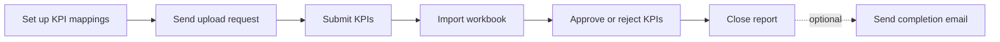

# Release Notes — V9.3.03
**Released: 7 October 2026**

---

## What's New

### KPI reports get a journey — from KPI mappings to the completion email
Every KPI report you request now shows a step bar and a **What's needed now** panel, just like
capital calls, distributions and KYCs. The journey works out which step the report is on from the
report's own data:

- Only reports you **request** get a journey — from the New screen, a portfolio company
  notification, or the report a workbook is uploaded on. The per-period reports an import creates
  do not.
- When the fund uploads the workbook itself, the portfolio company steps show as **n/a**.
- Approval is counted per portfolio company. **Close report** approves all of the report's pending
  KPIs and marks it reviewed in one go.
- **Send completion email** is optional — admins add it to the template and choose who sends it.
  Undoing a step clears the completion email.
- Investors can now have a **Managed by** employee, who becomes an owner of their journeys.
  Owners on the KPI journey default to your KPI-tagged team.

See the KPI upload guide, section *Tracking a Report: the Journey Step Bar*, for details.

---

## Improvements

### Resend a sign-off email from the journey panel
When a sign-off step is stuck waiting on an approver, the journey panel now offers **Resend
email**. It re-emails the pending approvers and keeps you on the record's page.

### Deleting a KPI mapping that is in use
Deleting a KPI mapping that already has KPIs now warns you first and deletes those KPIs with it,
instead of showing an error page. A mapping that other mappings depend on cannot be deleted.

### Investor advisors are notified about KYCs they can see
Investor advisors who have access to a KYC now receive the **KYC submitted** and **Updates
requested** emails. The KYC submitted email also now uses its intended default text. Nobody is
emailed twice for the same KYC.

### Faster fund allocations
Allocation runs are substantially quicker — on one large fund, a full run of 345 formulas went
from about 22 minutes to about 9 minutes. Results are identical to before.

The **account entries Excel export** no longer adds explanation columns at the end of each row.

### Tables no longer break at browser zoom or display scaling
On a browser zoomed to a level like 90% or 110%, or on Windows with display scaling of 125% or
150%, tables such as the account entries list could fail to load or misbehave on reload. They now
load normally at any zoom level.

### Capital call remittances no longer stuck on a spinner
If the remittances list refreshed while it was still loading, the Remittances tab on a capital
call could keep showing its spinner. It now finishes loading and then refreshes.

---

## What to Do

| If you use...   | Action                              |
|------------------|-------------------------------------|
| KPI reports | No action needed. Open a requested report to see its journey. Add **Send completion email** to your KPI journey template if you want it. |
| Investor relationships | Optionally set **Managed by** on investors so the right employee owns their journeys. |
| Investor advisors with KYC access | No action needed — they will now receive KYC notifications. |
| Fund allocations | No action needed. If you relied on explanation columns in the account entries Excel export, note they are no longer included. |
| Tables at non-100% zoom | No action needed. |
