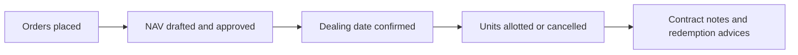
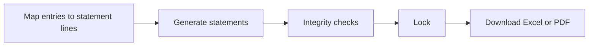
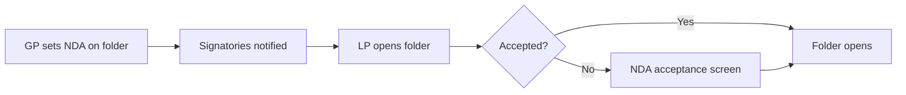

# Release Notes — V9.3.04
**Released: 15 October 2026**

---

## What's New

### Evergreen (open-ended) funds
CapHive now runs evergreen funds — funds with no fixed size or end date, where investors subscribe
and redeem on set dealing dates at the fund's NAV per unit.

- **Switch it on per entity.** Ask CapHive support to turn on **Evergreen funds** for your entity,
  then use **Make this fund evergreen** on a fund page and pick a preset (Indian Cat III AIF, US
  tender-offer fund, US interval fund or hedge-fund style).
- **NAV with maker-checker.** Draft the NAV from the ledger and valuations, override or upload it,
  and have a second person with the approver role approve it.
- **Orders from investors and admins**, with cut-offs, notice periods, minimums, lock-ups and
  early-redemption fees, and optional per-order journeys.
- **Dealing dates** price every order at the approved NAV per unit, apply the redemption gate
  (FIFO or pro-rata), roll or cancel orders that are not ready, and can be undone until anything
  settles.
- **Automatic units.** Units are allotted and cancelled at the dealing date's NAV per unit — no
  manual allocate or redeem buttons.
- **Fees on NAV.** A ready-made NAV-based management-fee formula, and a class-level
  high-water-mark performance fee with crystallisation.
- **Evergreen screens.** GPs get Overview, Dealing, Orders, NAV, Investors and Fees tabs; investors
  see value, units and NAV per unit, their request timelines and NAV history — never committed or
  called amounts.

See the [Evergreen Funds User Guide](../user_guides/evergreen_funds_user_guide.md) for details.

### What closed-end funds will not notice
Nothing changes for closed-end funds. Their fund pages, capital calls, remittances, distributions,
unit allocation, journeys and statements behave exactly as before; every evergreen screen and rule
applies only to funds that have been made evergreen, and only when the entity switch is on.

### Fund financial statements, built from your account entries
You can now produce a fund's Balance Sheet, Profit & Loss and Statement of Changes in Partners'
Capital straight from the account entries the fund already keeps — no spreadsheet rebuild.

- **Mapping.** Map entry types (and optionally names) to statement accounts, arrange the layout
  with subtotals, and start from a ready-made layout. Anything unmapped is listed for you.
- **AI-assisted setup.** Upload last year's printed statements and AI proposes the lines and
  mapping for you to review and approve.
- **Checks before you lock.** Balance, NAV tie-out, partners' capital tie-out and roll-forward
  checks, plus warnings for stale balances and accounts nothing feeds.
- **Lock and compare.** Locking keeps a frozen copy with comparatives; you are warned if entries
  change afterwards. Unlocking explains what will happen and notifies your fund accounting team.

Find it under the fund's **Actions → Account Entries → Financial Statements**. See the
[Financial Statements User Guide](../user_guides/financial_statements_user_guide.md).

### NDAs on data room folders
You can now require investors to accept an NDA before they open a data room folder.

- **Set it on a folder** with **NDA Settings** — upload the NDA, choose how long acceptance is
  valid, and whether sub-folders inherit it or a sub-folder sets its own.
- **One acceptance per investor.** When one authorised signatory of an investor accepts, everyone
  at that investor can open the folder. Signatories are picked automatically when an investor gets
  access, and you can change them.
- **NDA status dashboard.** See who has accepted, who is pending, expired or revoked, export it to
  Excel, revoke an acceptance or exempt an investor.
- **Versions and expiry.** Uploading a new NDA version can ask investors to accept again; NDAs
  can expire after a set period or on a date, with reminders before they do.
- **Emails** for acceptance, new versions, reminders, expiry and revocation, addressed to the
  investor by name.

### Market data: FX rates, market prices and derivatives per fund
Funds in the same company can now use different market data. CapHive support switches a feature
on for your company, and you then choose, fund by fund, what each fund uses.

- **FX rates** — each fund chooses its sources: hand-entered, a daily public rate feed, derived
  rates or rates specific to the fund. Gains are split into price and currency effect.
- **Market prices** — a daily NSE/BSE/AMFI price feed for fair values, with suggested corporate
  actions.
- **Derivatives** — listed contracts, FX forwards and OTC swaps, with ledger posting, valuations
  and expiry reminders.
- All fund switches, including the existing **Show … to LPs** ones, now sit together in the fund's
  **Features** section.

See the [Market Data User Guide](../user_guides/market_data_user_guide.md).

### Headline ratio cards on the Ratios tab
The fund's Ratios tab — for your team and on the investor's fund page — now shows the latest XIRR,
TVPI, DPI, RVPI, MOIC and Gross Portfolio IRR as cards above the list, each with a plain-language
tooltip and a link to its row. The list now sorts newest first, then by name.

### Fund unit cards
Above the fund units list (investor fund page and the commitment's Units tab), new cards show the
units held for each unit type and the total amount, matching the list below.

### KPIs fill in their quarter, year-to-date and year values on approval
When you approve KPIs, the quarterly, year-to-date and yearly figures are now worked out straight
away — no need to click **Recompute Cumulative**. This now also works for Budget and IC reports,
not just Actuals, and balance-sheet KPIs (such as Assets and Liabilities) get a value for every
month's YTD and for the full year.

---

## Improvements

### Investor fund page: figures that agree everywhere
Investors saw different numbers under the same label on different screens. Now:
- **Called** always means the call amount; fees show separately in a new **Fees** card and grid
  column.
- **Distributed** always means what was actually paid out, net — the same figure as the
  Distributions **Received** card.
- **Received** (for investors) and **Paid** (for your team) are used consistently for completed
  distributions.
- The commitment card's ratios now match the fund page's Ratios section.

### Investors see when a payment is being verified
A payment the investor has recorded but your team has not yet verified now shows as **Payment
under verification**, in its own column and card, and still counts as due. Remittance statuses
show as coloured badges.

### Feeder funds show their own ratios
An investor in a feeder fund now sees the feeder's own ratios. Only if the feeder has none are the
master fund's ratios shown — with a note saying so.

### Fund documents: latest documents and search for investors
The investor's fund page now opens the Documents panel on **Latest Documents** — everything they
can see in the fund, newest first — instead of an empty folder. Investors and your team can search
the whole fund's documents by name or tag.

### Fewer tabs on crowded pages
Pages with many tabs (fund, commitment, stakeholder, portfolio company, deal, investment
opportunity) now group related screens into dropdown tabs, so the tab bar fits on one line. Links
to a specific tab still work. The stakeholder's KYC now sits under **Investment Details**, and a
fund's **Portfolio** is its own tab again.

### Clearer filter panel
The filter panel shows how many filters are applied, offers **Clear**, and makes **Search** the
main button.

### Portfolio investment page explains its figures
Every figure in a holding's Financials has a tooltip saying how it is worked out, and tabs and
buttons describe what they do.

### Fund units list loads page by page
The fund units list now pages, searches and sorts on the server, so it opens quickly even for
funds and investors with thousands of units. Downloads still include every unit.

### Account entries list opens faster
The Account Entries list now opens on your first fund instead of all funds at once, which makes it
much faster on large ledgers. Choose **All Funds** in the Fund filter to see every fund.

### Faster page loads
Pages now load only the screen code they use, rather than everything on every page.

### Portfolio Investment Report from the portfolio investments list
Your team can open the **Portfolio Investment Report** directly from the portfolio investments
list's download menu.

### A capital call needs commitments to collect from
A new capital call is refused if no commitment in the fund applies to it, with a message telling
you to add commitments first. This also applies to imported calls.

### Notification emails follow the right folio's settings
Investors with more than one folio in a fund could get — or miss — document emails and WhatsApp
messages based on another folio's settings. Each notification now follows the settings of the
folio it is about.

### KYC visibility tightened
A KYC not yet linked to a commitment is now visible only to company admins and employees with KYC
access, and only they are emailed about it.

### Investor ratios removed with the investor
Ratios belonging to a deleted investor no longer linger on the dashboard; they are deleted with the
investor.

### Smaller fixes
- The fund card fits on phone screens, with short units (Cr / L / M).
- Picking a GP on the investor dashboard is remembered, and Back returns to it.
- Stray import archives are hidden from investors' document lists.

---

## What to Do

| If you use...   | Action                              |
|-----------------|-------------------------------------|
| Evergreen funds | Ask CapHive support to switch on **Evergreen funds** for your entity, then make a fund evergreen. |
| Closed-end funds | No action needed. |
| Financial statements | Open **Actions → Account Entries → Financial Statements** on a fund to set up its mapping. |
| Data room NDAs | Use **NDA Settings** on a data room sub-folder to add an NDA; check signatories on the NDA status dashboard. |
| Market data | Ask CapHive support to switch on the features you need, then choose each fund's sources in its **Features** section. |
| KPI reports | No action needed — approved KPIs now fill in their quarter, YTD and year values automatically. |
| Account entries | Choose **All Funds** in the Fund filter if you want every fund's entries. |
| Capital calls | Add commitments before creating a call; import commitments before calls. |
| Investors with several folios | No action needed — notification switches now apply per folio. |
| Everything else | No action needed. |
