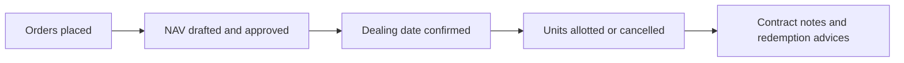

# Release Notes — V9.3.04
**Released: 8 October 2026**

---

## What's New

### Evergreen (open-ended) funds
CapHive now runs evergreen funds — funds with no fixed size or end date, where investors subscribe
and redeem on set dealing dates at the fund's NAV per unit.

- **Switch it on per entity.** Ask CapHive support to turn on **Evergreen funds** for your entity,
  then use **Make this fund evergreen** on a fund page and pick a preset (Indian Cat III AIF, US
  tender-offer fund, US interval fund or hedge-fund style).
- **NAV with maker-checker.** Draft the NAV from the ledger and valuations, override or upload it,
  and have a second person with the approver role approve it.
- **Orders from investors and admins**, with cut-offs, notice periods, minimums, lock-ups and
  early-redemption fees, and optional per-order journeys.
- **Dealing dates** price every order at the approved NAV per unit, apply the redemption gate
  (FIFO or pro-rata), roll or cancel orders that are not ready, and can be undone until anything
  settles.
- **Automatic units.** Units are allotted and cancelled at the dealing date's NAV per unit — no
  manual allocate or redeem buttons.
- **Fees on NAV.** A ready-made NAV-based management-fee formula, and a class-level
  high-water-mark performance fee with crystallisation.
- **Evergreen screens.** GPs get Overview, Dealing, Orders, NAV, Investors and Fees tabs; investors
  see value, units and NAV per unit, their request timelines and NAV history — never committed or
  called amounts.

See the [Evergreen Funds User Guide](../user_guides/evergreen_funds_user_guide.md) for details.

### What closed-end funds will not notice
Nothing changes for closed-end funds. Their fund pages, capital calls, remittances, distributions,
unit allocation, journeys and statements behave exactly as before; every evergreen screen and rule
applies only to funds that have been made evergreen, and only when the entity switch is on.
