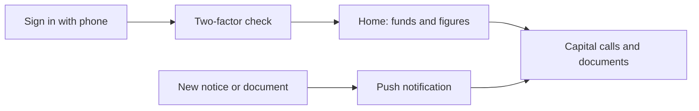

# Release Notes — V9.3.05
**Released: 20 October 2026**

---

## What's New

### CapHive investor app for iPhone and Android
Investors can now follow their funds from their phone with the CapHive app.

- **Secure sign-in.** Every sign-in needs two-factor verification, and the app can be locked with
  Face ID or fingerprint.
- **Four tabs** — Home, Documents, Alerts and Profile — with screens for each fund, capital call
  and document.
- **Push notifications** follow the same rules as emails, and investors can choose which kinds
  they receive.
- **Manage devices from the website.** **Profile → Mobile Devices** lists every phone signed in to
  the account; removing one signs it out. Signing out, changing the password or deactivating the
  user does the same.

### Investors see the holdings allocated to their own folio
A fund can now show investors only the portfolio holdings allocated to their folio — optionally
with their own cost, FMV and multiple — instead of the whole fund or nothing.

- **One fund setting, "LP portfolio view":** Hidden, Whole fund, Allocated to their folio, or
  Allocated with their own share. Pick the allocation formula and the "Your FMV" formula it uses.
- **Company pages for investors.** Switch on **Show to LPs** for a portfolio company and investors
  can open a curated company page built from your Portfolio Company Dashboard. Choose which
  widgets they see with LP layouts, and check it with **Preview as LP**.
- The old holding preview page is retired; existing links redirect, and any holdings you had shown
  carry over to their companies.

### Fund settings get their own Features step
On the fund form, the fund's switches now sit on their own **Features** step after Other details,
as on/off toggles grouped with icons and help text.

### Stats cards on the fund's Calls and Distributions tabs
- **Calls:** Called, Collected and Due, plus **Not Approved** when any call is still unapproved.
- **Distributions:** Net Payable and Distributed (now also columns in the list), plus
  **Not Approved**.

Each card is the total of its column across every page of the list.

### Summary cards on investor and portfolio company pages
A row of cards above the tabs now summarises the record, each linking to the tab it comes from.

- **Investors:** Committed, Called / Collected and Distributed (per fund currency), KYC Verified,
  Users Approved and Open Tasks.
- **Portfolio companies:** Bought Amount, FMV, Income, Last Valued and Open Tasks.

### Notes, Tasks and Emails under one Activity tab
On investor and portfolio company pages, Notes, Tasks and Emails now sit together under an
**Activity** tab, each with its own **New** button.

### API tokens for scripts and integrations
Under **Profile → API tokens** you can create named tokens that last 90 days and can be revoked
at any time — including for users with two-factor sign-in. Scripts can then use the same fund,
call, distribution, commitment, KYC and KPI data the website uses, and run bulk actions such as
approving calls or allocating units, with the same permissions as the buttons on screen.

---

## Improvements

### Fresher look for stats cards
Stats cards across CapHive now have a coloured top border and lighter icons, matching the fund
manager dashboard.

### Stronger separation between firms
We reviewed how investor advisors, fund advisors and users who work across more than one firm
reach data, and tightened access so every record, search result, document list and import stays
inside the firm it belongs to. Fields on edit forms that tie a record to its fund or parent can no
longer be changed and now show as read-only text.

### Advisors keep access to their own investments
A user who is also an investor advisor could stop receiving capital call notices for their *own*
investment, and be refused its fund screens. They now get both, as any investor contact would.
When access is refused because they are looking at another client's page, the Access Denied
screen names that client and offers a **Switch** button that brings them back to the page.

### Add an advisor as a contact of their own firm
You can now add an investor advisor as a user on the stakeholder record that is their own firm.
Advisors for your clients are still added through **Add Investor Advisor**.

### KPI workbook reading handles more layouts
KPI uploads now read quarter headings that carry a note underneath (such as "Q1 FY27 (Apr–Jun)"),
take a period's figure from its Total column when it is split into segments, and let a mapping
apply to one named sheet only.

### Payments list opens much faster
The capital remittance payments list loads about ten times faster on large funds.

### Show-password button on the login page
The eye icon on the login page was invisible. It now shows, and works with a keyboard and screen
readers.

### Smoother tab switching
Switching tabs no longer flickers, fades twice or makes the page jump while the new tab loads.

### Smaller changes
- **Boards** has been removed from the left menu.
- Marking all notifications as read works reliably again.

---

## For CapHive support

### Support Console
CapHive support staff can now ask, in plain English, why something looks the way it does for a
client they support. The assistant reads CapHive's code and looks up that client's data
read-only, and shows the code and lookups behind its answer. Every lookup is recorded and kept
inside the chosen client's data. Support staff can start and stop the console from its header;
it stops by itself after 15 minutes without questions.

---

## What to Do

| If you use...                     | Action                                                                                  |
|-----------------------------------|-----------------------------------------------------------------------------------------|
| Investor mobile app               | Tell your investors the app is available; they sign in with their usual CapHive login.  |
| Portfolio sharing with investors  | Review each fund's **LP portfolio view** on its Features step. Existing settings carry over. |
| Scripts or integrations           | Create a token under **Profile → API tokens**; renew it before it expires after 90 days. |
| Investor advisors                 | No action needed.                                                                       |
| Everything else                   | No action needed.                                                                       |
