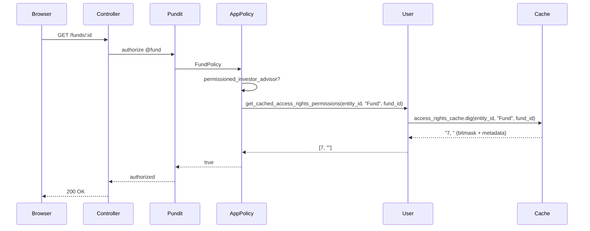
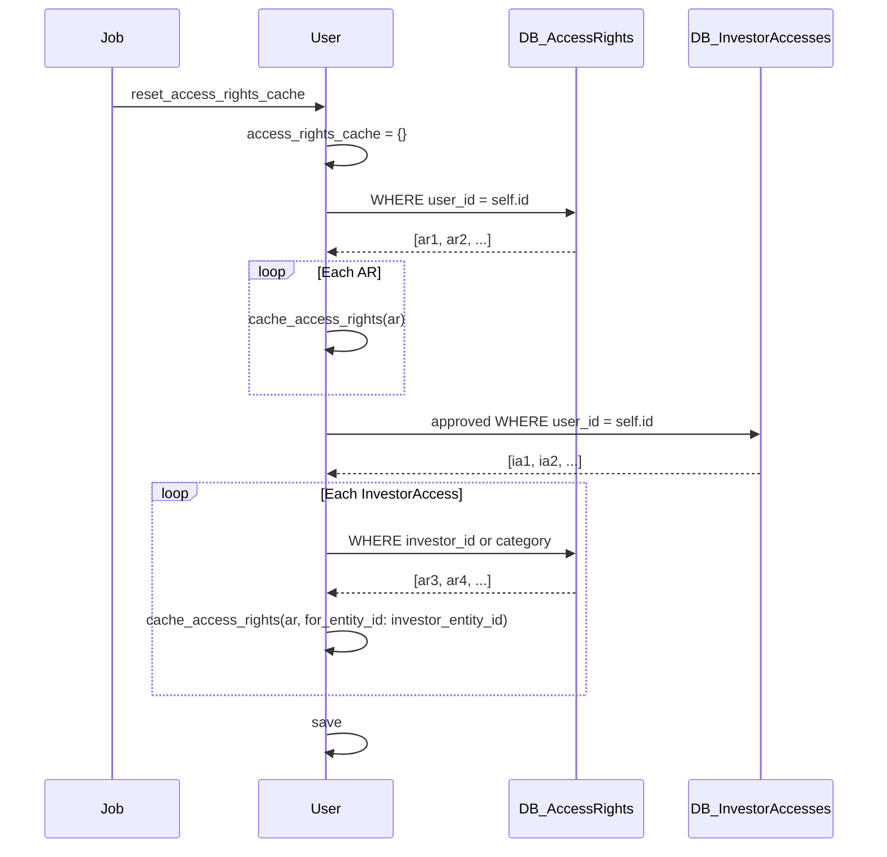

# Access Rights Review: Employee, Investor & Investor Advisor

**Date:** 2026-05-25  
**Scope:** How access rights are granted, enforced, and cached for the three primary non-admin roles.

---

## Table of Contents

1. [Overview & Role Matrix](#overview--role-matrix)
2. [Data Model](#data-model)
3. [The Three Roles In Detail](#the-three-roles-in-detail)
4. [Access Rights Caching](#access-rights-caching)
5. [Policy Enforcement (Pundit)](#policy-enforcement-pundit)
6. [Query-Layer Enforcement (ForInvestor)](#query-layer-enforcement-forinvestor)
7. [Notification & Lifecycle Callbacks](#notification--lifecycle-callbacks)
8. [Current Issues & Suggested Improvements](#current-issues--suggested-improvements)

---

## Overview & Role Matrix

Access rights answer "which records can this user see / mutate?" for every non-admin user. There are four roles that interact with access rights:

| Role | Access Rights Required | InvestorAccess Required | Visibility |
|---|---|---|---|
| `company_admin` | No | No | All records in entity |
| `employee` | Yes (by `user_id`) | No | Only explicitly granted records |
| `investor` | Yes (by `investor_id` or `category`) | Yes (must be approved) | Own investor's records |
| `investor_advisor` | Yes (by `user_id` from advised entity) | Yes (from fund entity) | Explicitly granted records across advised entity |

The `investor_advisor` role is the most complex because its entity context switches at runtime — the same user can look like an employee to one entity and an investor to another.

---

## Data Model

### `access_rights` Table

```
id                       bigint PK
entity_id                bigint NOT NULL  -- entity that owns the resource
owner_id                 bigint NOT NULL  -- polymorphic FK to Fund / Deal / Document / etc.
owner_type               string NOT NULL  -- polymorphic type
access_type              string(25)       -- mirrors owner_type; "Investment", "Document", etc.

# Who this right is for (exactly one of these is populated):
user_id                  bigint           -- specific user (employee or advisor)
access_to_investor_id    bigint           -- specific investor
access_to_category       string(20)       -- investor category (e.g. "LP", "RM")

permissions              bigint           -- bitmask: [create, read, update, destroy]
metadata                 string           -- e.g. "ReadOnly", "Investor", "Investor Advisor"
notify                   boolean          -- send notification on creation
cascade                  boolean          -- propagate to child folders/documents
parent_access_right_id   integer          -- FK to parent AR for cascade deletions/updates
granted_by_id            bigint           -- user who created this AR
deleted_at               datetime         -- soft-delete
```

**Key design decision:** a single `access_rights` row targets *either* a specific user, a specific investor, or an entire investor category. This three-way OR is the source of most complexity in the caching and query logic.

### `investor_accesses` Table

The bridge between a user account and an investor record. Required for investors and investor advisors to see fund data. Key fields:

- `approved` — only approved accesses unlock fund visibility
- `email_enabled` — controls email notification subscription
- `is_investor_advisor` — set when user has the `investor_advisor` role

### `users` Table (access-rights fields)

- `access_rights_cache` — serialized `Hash` caching which records the user can see (see [Caching section](#access-rights-caching))
- `access_rights_cached_permissions` — bitmask temporarily set during a single policy check
- `advisor_entity_id` — the user's home entity (only set when user is an advisor)
- `advisor_entity_roles` — comma-separated roles to restore on revert

---

## The Three Roles In Detail

### Employee

Employees belong to the managing entity (fund manager, GP, etc.).

**Granting access:**  
An access right is created with `user_id = employee.id`. It is scoped to a specific `owner` (Fund, Deal, Document, etc.) within the entity.

**Checking access:**  
At query time, `ForInvestor#for_employee` reads `user.get_cached_ids(entity_id, owner_type)` and filters to only those IDs. At policy time, `permissioned_employee?` checks `user.get_cached_access_rights_permissions(entity_id, owner_type, owner_id)`.

**`company_admin` short-circuit:**  
Company admins bypass all access right checks — `permissioned_employee?` returns `true` immediately, and `for_company_admin` returns all records for the entity.

**Mutations:**  
`AccessRightPolicy#create?` requires `belongs_to_entity?` AND that the user has `update?` permission on the owner. This means a company admin or an employee with write access to the Fund can grant access to that Fund.

**Missing index for employees:**  
There is no index on `(entity_id, user_id)` in `access_rights`. For entities with many access rights, `AccessRight.where(user_id: id)` in `reset_access_rights_cache` hits a full scan filtered only by `user_id`.

---

### Investor

Investors are external LPs. They have their own `Entity` (the `investor_entity`) and are linked to the managing entity via an `Investor` record.

**Two-part gating:**  
An investor user needs *both*:
1. An `InvestorAccess` row for their investor, with `approved: true`
2. An `AccessRight` pointing at the resource, scoped to their investor_id or category

If either is missing, visibility is blocked.

**Access right targeting:**  
An AR can target an investor in two ways:
- `access_to_investor_id` — grants access to one specific investor
- `access_to_category` — grants access to all investors of that category (e.g. `"LP"`)

**Cache keying:**  
Investor cache entries are stored under `investor_entity_id` (the investor's own entity), not the fund entity. This is intentional — the investor is "from" their own entity.

**Policy method:**  
`permissioned_investor_non_advisor?` requires:
- `curr_role == "investor"` — checks the *current UI persona*, not the underlying role
- `!belongs_to_entity?` — investor must NOT be in the managing entity
- Metadata match if specified (e.g. `"ReadOnly"`)
- For child records (commitments, etc.): `record.investor.investor_entity_id == user.entity_id`

**Issue — `curr_role` vs `has_cached_role?` inconsistency:**  
`permissioned_investor_non_advisor?` checks `user.curr_role == "investor"` (UI persona) while the cache rebuild in `reset_access_rights_cache` correctly uses `has_cached_role?(:investor)`. This creates an edge case where a user with both employee and investor roles can lose investor access depending on which persona they last had active when the cache was written. See [Improvement #2](#2-normalize-the-role-check-in-permissioned_investor_non_advisor).

---

### Investor Advisor

An advisor is a user from an advisory firm who has been granted permission to act on behalf of an investor within a managing entity. This is the most complex role.

**Setup workflow:**
1. The managing entity admin creates an `InvestorAdvisor` record linking the advisor's email and their own entity.
2. The advisor user must already have the `investor_advisor` rolify role on their account.
3. Access rights (`user_id = advisor.id`, `entity_id = managed_entity.id`) are created by the managing entity for specific funds, deals, etc.
4. The advisor logs in, switches entity context via `InvestorAdvisor#switch`, and now appears as an employee-like user within the managed entity.

**Two advisor modes:**

| `user.investor_advisor?` | Meaning |
|---|---|
| `true` | User has *switched* — `entity_id` is currently the advised entity |
| `false` (but has role) | User is in their home advisory entity, browsing their own investors |

The `investor_advisor?` method checks `advisor_entity_id.present? && advisor_entity_id != entity_id`.

**Access scopes used when switched:**  
`AccessRight.investor_granted_access_filter` — filters to `user_id = advisor.id AND entity_id = advisor.entity_id`. This ensures the advisor only sees what the advised entity explicitly gave them.

**Access scopes used when NOT switched (home entity):**  
`AccessRight.access_filter` — falls into the `has_cached_role?(:investor_advisor) && !investor_advisor?` branch, which joins only on investor category/id, not user_id. This shows the advisor their own investors' data.

**Cross-entity email flow:**  
When sending emails, `across_all_entities: true` is passed to `for_investor` — this uses `investor_granted_access_filter(user, across_all_entities: true)` which drops the `entity_id` constraint, finding all funds across all entities the advisor has been granted access to.

**Switch atomicity:**  
`InvestorAdvisor#switch` wraps role deletion and re-assignment in `ActiveRecord::Base.transaction`, preventing partial role state on failure.

**Revert:**  
`InvestorAdvisor.revert` restores `advisor_entity_id` and re-applies `advisor_entity_roles`. If roles are empty after revert (e.g. advisor_entity_roles was blank), it falls back to adding `investor_advisor` to avoid a lockout.

**Cleanup on deletion:**  
`after_destroy :remove_access_rights` destroys all `AccessRight` rows for the advisor in that entity and deletes their `InvestorAccess` rows.

---

## Access Rights Caching

Because policy checks are called on every request and page load, access rights are denormalized into a hash on the `User` model to avoid N+1 queries.

### Cache Structure

```ruby
# user.access_rights_cache
{
  entity_id_int => {
    "Fund"  => { fund_id_int => "7, ReadOnly",    # "bitmask, metadata"
                 other_fund  => "15, " },
    "Deal"  => { deal_id_int => "1, " }
  },
  other_entity_id => { ... }
}
```

The top-level key is the entity the record belongs to. For investor users the key is their `investor_entity_id` (their own entity), not the fund entity. This means `get_cached_access_rights_permissions` can be called with `entity_id = user.entity_id` for both employees and investors.

### Cache Lifecycle

| Event | Method | Note |
|---|---|---|
| AccessRight created | `add_to_user_access_rights_cache` (AR callback) → `cache_access_rights` on User | Saves immediately |
| AccessRight destroyed | `remove_from_user_access_rights_cache` (AR callback) → `remove_access_rights_cache` | Uses `with_deleted` for soft-deleted |
| InvestorAccess approved/unapproved | `refresh_access_rights_cache` on User | Adds or removes all related ARs |
| Full reset needed | `reset_access_rights_cache` | Called by `ResetAccessRightsCacheJob` and on InvestorAdvisor creation |

### `reset_access_rights_cache` Logic

The method was refactored from `elsif` to additive `if` blocks to support dual-role users (e.g. an employee who is also an investor):

```
1. Employee / investor_advisor with role → add ARs where user_id = self.id
2. Investor / investor_advisor with role → for each approved InvestorAccess:
   a. add direct user_id ARs (across entity and investor_entity)
   b. add investor-specific ARs
   c. add category ARs
3. Investor advisor only → also add ARs for each InvestorAdvisor entity
```

**Cache efficiency caveat:**  
The cache only stores records user has access to. It is intentionally **not** populated for users who have neither employee/investor_advisor role nor an InvestorAccess, keeping the hash lean.

---

## Policy Enforcement (Pundit)

### Method Decision Tree

```
show?/update?/etc. in a specific policy
  └─ company_admin?          → true (unconditional for entity)
  └─ permissioned_employee?  → true if in entity AND has cached AR for this record
  └─ permissioned_investor?  → dispatches to:
       └─ permissioned_investor_advisor? (if has_cached_role?(:investor_advisor))
       └─ permissioned_investor_non_advisor? (otherwise)
  └─ permissioned_rm?        → true if rm role AND has cached AR AND rm_mapping approved
```

### `permissioned_employee?(perm, owner:)`

1. `belongs_to_entity?` — checks entity hierarchy (supports group companies)
2. `company_admin?` → true
3. `get_model_with_access_rights` — resolves the record that actually holds ARs (e.g. Fund for a CapitalCommitment)
4. `get_cached_access_rights_permissions(entity_id, owner_type, owner_id)` — reads cache
5. Returns true if permissions present AND (`perm.nil? || perm == :read || bitmask.set?(perm)`)

### `permissioned_investor_non_advisor?(metadata, owner:)`

1. `curr_role == "investor"` — UI persona check (see issue below)
2. `!belongs_to_entity?` — investor must be external
3. Cache lookup with `user.entity_id` as key
4. Metadata match if provided
5. For non-root records: validates `record.investor.investor_entity_id == user.entity_id`

### `permissioned_investor_advisor?(metadata, owner:, as_entity_id:)`

1. `has_cached_role?(:investor_advisor)` — role check (not UI persona)
2. Cache lookup with `as_entity_id.presence || user.entity_id`
3. Note: cache is searched **without** entity_id constraint if none provided (scans all entities)
4. For non-root records: validates `record.investor.investor_entity_id == user.entity_id` unless `as_entity_id` override

### `AccessRightPolicy`

Controls CRUD on `AccessRight` records themselves:

- `show?` — entity member OR support OR own user_id AR OR investor entity match
- `create?/update?` — `belongs_to_entity?` AND user has `update?` on the **owner** resource
- `destroy?` — same as create, plus support users
- **Gap:** `create?` does not check the grantor's access level within the owner. A fund employee with write access to a Fund could theoretically grant access for that Fund to any user. See [Improvement #4](#4-restrict-who-can-grant-access-to-whom).

---

## Query-Layer Enforcement (ForInvestor)

Policies prevent unauthorized single-record access. `ForInvestor` scopes filter list queries to avoid exposing existence of records in index views.

### Scope Selection (ApplicationController / policy_scope)

Each policy's `Scope` class calls the appropriate `ForInvestor` scope based on user role:

```ruby
# Conceptual (actual logic is in each policy's Scope)
if company_admin?  → Model.for_company_admin(user)
if employee?       → Model.for_employee(user)
if investor/advisor → Model.for_investor(user)
if rm?             → Model.for_rm(user)
```

### `for_employee(user)`

Reads `user.get_cached_ids(entity_id, parent_class_type.name)` — a direct hash lookup into `access_rights_cache`. No DB join needed. Fast.

### `for_investor(user, across_all_entities:)`

Complex joins:
1. Joins parent model with `access_rights`
2. Applies `access_filter` or `investor_granted_access_filter` depending on advisor mode
3. Joins with `investor_accesses` filtered by `approved_for_user` to enforce approval gate
4. For non-across_all: `WHERE investors.investor_entity_id = user.entity_id`

### `for_rm(user)`

Most complex scope — joins access_rights AND rm_mappings AND investor_accesses. Handles both models that have a direct `investor` association and those that don't.

### `model_with_access_rights` Instance Method

Returns the ancestor model that actually holds the `AccessRight` (the access rights are stored on Fund, not CapitalCommitment):

```
CapitalCommitment → Fund
ExpressionOfInterest → InvestmentOpportunity
Offer/Interest/Allocation → SecondarySale
DealInvestor → Deal
Kpi → KpiReport
everything else → self
```

This mapping must be kept in sync between `ForInvestor#model_with_access_rights` (instance) and `ForInvestor#parent_class_type` (class method). Currently these are two separate lists that can drift.

---

## Notification & Lifecycle Callbacks

### On Access Right Creation

`after_create_commit :send_notification` — sends `AccessRightNotifier` in-app notification to all affected users (`AccessRight#users`). Skipped for Document/Folder unless `owner.send_email` is set, to avoid spam from cascade replication.

### On Cascade / Replication

`AccessRight#replicate_to(new_owner)` copies an AR to a child folder or document. Sets `parent_access_right_id` for cascade tracking and `notify: false`. Called when a folder's access rights are inherited by newly created child documents.

`AccessRightsDeletedJob` — when a Document/Folder AR is destroyed, this job removes cascaded child ARs that share the same `parent_access_right_id`.

### On InvestorAccess Approval Change

`InvestorAccess` callbacks call `user.refresh_access_rights_cache(investor_access, add: true/false)`, which rebuilds the cache for the intersection of that investor's ARs and the user's direct ARs.

---

## Current Issues & Suggested Improvements

### 1. `access_rights_cache` is a Serialized Hash on Users (Scalability Risk)

**Problem:** The entire cache is serialized into a single column on the `users` row. As entities grow (many funds, deals, investors, documents), this hash grows unboundedly. Each save re-serializes the entire blob. With many concurrent requests updating the same user row, this is a write hotspot.

**Suggestion:** Move the cache to Redis (or a dedicated `user_access_right_caches` table keyed by `(user_id, entity_id, owner_type, owner_id)`). This enables atomic per-entry updates instead of full-row rewrites and removes the in-memory deserialization cost on every request.

---

### 2. Normalize the Role Check in `permissioned_investor_non_advisor?`

**Problem:** `permissioned_investor_non_advisor?` checks `user.curr_role == "investor"` (UI persona, can change) while the cache rebuild uses `has_cached_role?(:investor)` (persistent role). If a user has both investor and employee roles, switching persona drops investor access in policy checks even though the cache contains investor entries.

**Suggestion:** Change to `user.has_cached_role?(:investor)` for consistency with how the cache is built and with how `permissioned_investor_advisor?` works.

```ruby
# Current
if %w[investor].include?(user.curr_role) && !belongs_to_entity?(user, record)

# Suggested
if user.has_cached_role?(:investor) && !belongs_to_entity?(user, record)
```

---

### 3. Dual `model_with_access_rights` Lists Can Drift

**Problem:** There are two parallel lists mapping model names to their AR-holding ancestor: `ForInvestor#parent_class_type` (class method used in scopes) and `ForInvestor#model_with_access_rights` (instance method used in policies). They are manually maintained and can diverge. Currently `ApprovalResponse → approval` appears only in the instance method but not in `parent_class_type`.

**Suggestion:** Extract a single constant (or a class method) that both use:

```ruby
PARENT_CLASS_MAP = {
  "CapitalCommitment" => :fund,
  "FundUnit" => :fund,
  # ...
  "DealInvestor" => :deal,
  "ApprovalResponse" => :approval  # add here AND in both methods
}.freeze
```

---

### 4. Restrict Who Can Grant Access to Whom

**Problem:** `AccessRightPolicy#create?` only checks `belongs_to_entity? && owner.update?`. A fund-level employee with write access to a Fund can create access rights pointing to any user or investor — including granting themselves access rights on other owners, or granting advisor-level access to an arbitrary user_id.

**Suggestion:** Add a check that the granting user either is a company_admin or has a role that justifies granting the specific type:

```ruby
def create?
  belongs_to_entity?(user, record) &&
  Pundit.policy(user, record.owner).update? &&
  (user.has_cached_role?(:company_admin) || user_id_is_self_or_nil?)
end

private

def user_id_is_self_or_nil?
  record.user_id.blank? || record.user_id == user.id
end
```

---

### 5. Missing Composite DB Index for Cache Rebuild

**Problem:** `reset_access_rights_cache` calls `AccessRight.where(user_id: id)` which only has a single-column index on `user_id`. For entities with high AR counts, category-based adds (`where(entity_id: ..., access_to_category: ...)`) are also unindexed on the combination.

**Suggestion:** Add indexes:

```ruby
add_index :access_rights, [:entity_id, :user_id]
add_index :access_rights, [:entity_id, :access_to_category]
```

---

### 6. `access_to_email` Field Is Unused

**Problem:** The schema has an `access_to_email` column (length 30) that is validated but never queried in any scope, and no code path populates it from the controller. It exists as a vestige from an earlier design.

**Suggestion:** Drop the column in a migration to reduce confusion about how ARs are targeted. If email-based invitations are needed in future, model them separately.

---

### 7. Soft-Delete on `access_rights` Is Inconsistent

**Problem:** `access_rights` has a `deleted_at` column (used with `acts_as_paranoid` or similar), but the `after_destroy_commit` callback is triggered on hard delete. The `remove_from_user_access_rights_cache` callback uses `User.with_deleted` and `Investor.with_deleted` to handle soft-deleted parents, but there is no mechanism to restore cache entries when a soft-deleted AR is undeleted.

**Suggestion:** If soft-delete is needed, add `after_update :handle_soft_delete_cache` checking `saved_change_to_deleted_at?`. If not needed, remove `deleted_at` from the `access_rights` table.

---

### 8. `InvestorAdvisor#switch` Does Not Rebuild Cache

**Problem:** `InvestorAdvisor#switch` changes the user's entity and roles but does not call `reset_access_rights_cache`. The cache is only built `after_create` of the `InvestorAdvisor` record. If access rights for the advisor change after the advisor record is created, a manual switch will use a stale cache until the next `ResetAccessRightsCacheJob`.

**Suggestion:** Call `user.reset_access_rights_cache` at the end of `switch`:

```ruby
def switch(user)
  user.entity = entity
  user.investor_advisor_id = id
  user.setup_defaults
  user.save
  ActiveRecord::Base.transaction do
    user.roles.delete_all
    allowed_roles.each { |role| user.add_role(role) }
    user.add_role(:investor_advisor)
  end
  user.reset_access_rights_cache  # <-- add this
end
```

---

### 9. `AccessRight#show?` Policy Has Loose Investor Entity Check

**Problem:**
```ruby
def show?
  belongs_to_entity?(user, record) || support? ||
  record.user_id == user.id ||
  record.investor.investor_entity_id == user.entity_id
end
```
The last clause `record.investor.investor_entity_id == user.entity_id` allows any user in the investor's entity to see the AR, including users who are not approved `InvestorAccess` holders. An unapproved investor who shares the investor entity can view access right details.

**Suggestion:** Add an approval check:

```ruby
record.investor.present? &&
  record.investor.investor_accesses.approved.exists?(user_id: user.id)
```

---

## Sequence Diagram: Investor Advisor Access Check



## Sequence Diagram: Employee Cache Rebuild


