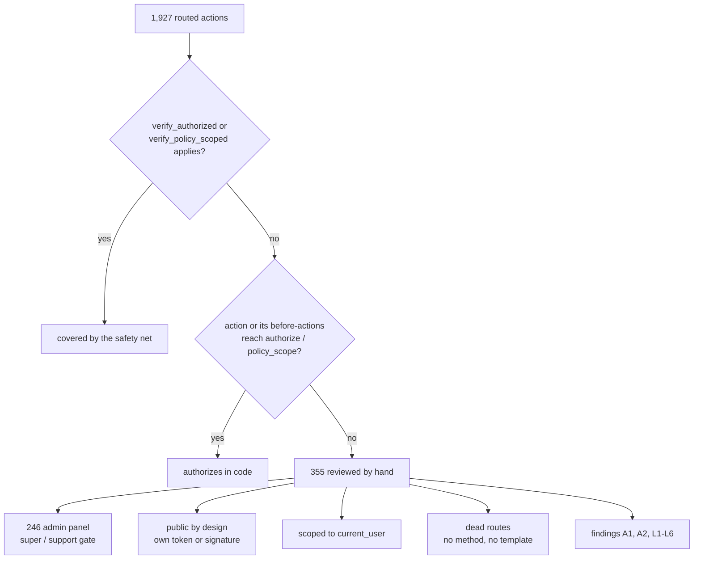
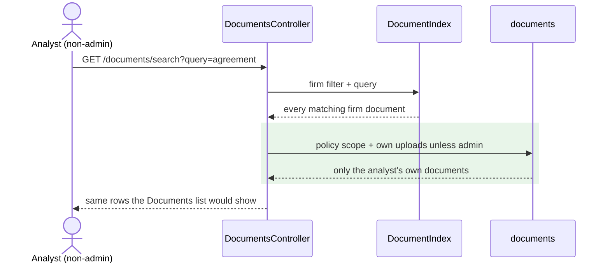
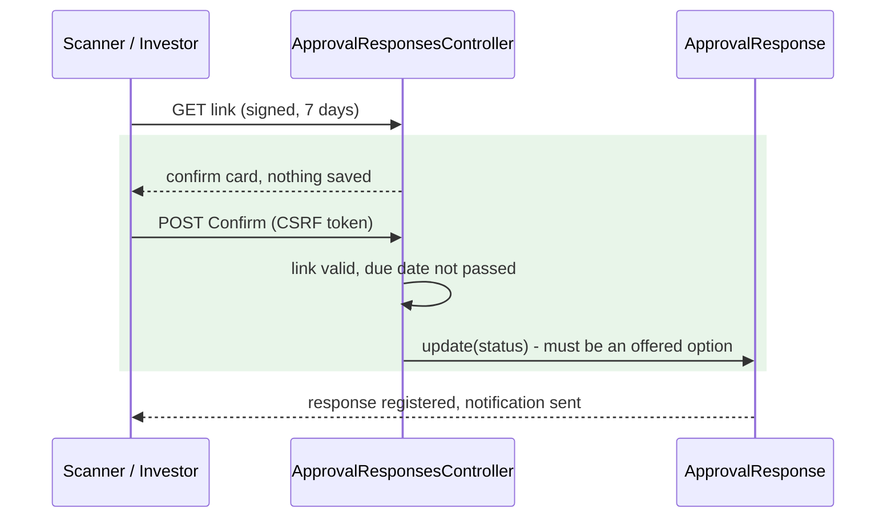
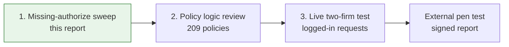

# Authorization Sweep — November 2026

> **Scope:** every routed controller action, checked for actions that can run without an
> authorization decision. Focus: cross-tenant (firm) and within-firm data leakage.
> **Method:** a read-only `rails runner` pass over the real callback chains of all routed actions,
> Prism parsing of each action and its before-actions, then a hand review of every action left
> uncovered. Nothing was run against a live app or a production-like database.
> **Baseline:** items in `security_review_2026_07.md`, `security_review_2026_10.md` and
> `openspec/changes/fix-tenant-isolation-batch{1,2}/` are not repeated.
> **Line numbers** are as of `29d9b09939` (before the fixes). **Fixes:** commit `215bbcfcf3` on branch
> `fix-doc-search-and-approval-email-authz`.

## Contents

- [Summary](#summary)
- [Key concepts](#key-concepts)
- [Method](#method)
- [Findings — fixed](#findings--fixed)
- [Findings — open, low](#findings--open-low)
- [Checked and found safe](#checked-and-found-safe)
- [Not covered by this sweep](#not-covered-by-this-sweep)
- [FAQ](#faq)

---

## Summary

| # | Finding | Severity | Status |
|---|---|---|---|
| A1 | Document search shows non-admin employees every firm document, with downloads | High | ✅ Fixed |
| A2 | Approval email links record an answer on a plain GET (mail scanners answer for the investor) | Medium | ✅ Fixed |
| A3 | Approval answers accept any status string, on every path | Medium | ✅ Fixed (with A2) |
| L1–L6 | Crash bugs, a name list and a folder-name lookup | Low | Open |
| — | `WEBHOOK_TOKEN_ENFORCE` rollout flag (known, from the October review) | Medium | Open (ops) |

- Of 1,927 routed actions, 355 neither run `verify_authorized` / `verify_policy_scoped` nor reach an
  `authorize` call. All 355 were reviewed by hand.
- The global safety net exists: `WithAuthentication` adds `after_action :verify_authorized, except: %i[index search]`
  to every controller. **`search` actions are exactly where it is off**, and that is where A1 was.

---

## Key concepts

| Concept | What it is, in one line | Example | Stored in |
|---|---|---|---|
| Firm (entity) | A tenant; every record belongs to one | "Artha Capital" | `entities`, `*.entity_id` |
| Company admin | Firm user who sees every firm record | Fund CFO | `roles` (`company_admin`) |
| Non-admin employee | Firm user limited to own uploads / granted funds | Analyst | `roles` (`employee`) |
| `verify_authorized` | After-action that raises if the action never called `authorize` | — | `WithAuthentication` |
| Policy scope | The rows a user may list for a model | Firm's own documents | `*Policy::Scope#resolve` |
| `PolicyScopedSearch` | Re-checks Elasticsearch hits against the policy scope (fix B4-4) | Notes, tasks, deals search | `app/packs/core/base/services` |
| Response options | Answers a firm offers on an approval | `Approved,Pending,Rejected` | `approvals.response_status` |
| Link scanner | Mail-security service that opens every link in an incoming email | Microsoft Safe Links | — |

- **`verify_authorized` is a developer guard, not a gate.** It runs *after* the action, so a missing
  `authorize` still executes the action; it only turns the response into an error.
- **A GET is a read.** Browsers, proxies and mail scanners assume opening a link changes nothing.

---

## Method

- **Callback chains read at runtime.** Rails 8.1 stores `only:` / `except:` / `skip_*` as `ActionFilter`
  conditions on each callback, so whether a check applies to an action is computed, not guessed.
  `unless: :devise_controller?` is resolved per class.
- **Code reachability by parsing.** Each action and each before-action that applies to it is parsed
  with Prism, following same-controller helper calls up to 5 levels, looking for `authorize`,
  `policy_scope`, `policy(...)`, `skip_authorization`.
- **Limit:** "reaches `authorize`" means *some* path calls it — not that it authorizes the right record
  with the right rule. That is the policy review (see [Not covered](#not-covered-by-this-sweep)).

---

## Findings — fixed

### A1 — Document search ignores the Documents list's visibility rule (High)

**Where:** `app/packs/core/documents/controllers/documents_controller.rb:150` (`search`)

- The Documents list (`fetch_rows`, `:607`) shows a non-admin employee **only the documents they uploaded**.
- `search` filtered Elasticsearch hits by firm only (`:156-162`) and is excluded from `verify_authorized` (`:12`).
- Each result row shows a direct S3 download icon gated by `not_generated_or_approved`, not `show?`
  (`views/documents/_document.html.erb:11-12`).
- `search.json` returns `s3_url`, presigned for **7 days** (`views/documents/_document.json.jbuilder:3`).
- Every other search action (notes, tasks, deals, secondary sales, KYC data) had received the B4-4
  re-check; documents was missed. `PolicyScopedSearch.restrict` alone would not have fixed it —
  `DocumentPolicy` inherits the firm-wide `BaseScope`, and the own-uploads rule lives only in `fetch_rows`.

**Worked example:**
- Analyst at Artha, not an admin, uploaded 3 files.
- `GET /documents/search.json?query=side+letter` → 14 results, including a colleague's
  "Side letter agreement" from a private folder, each with a 7-day download URL.

**Fix:** the rule is now one method, `own_uploads_unless_admin`, used by the list and by search.
Search re-reads its hits through it as a relation, in the search's order. Support searching a client
firm (S4) is unchanged.
**Tests:** `features/security/tenant_isolation_batch1.feature` — S4-H, S4-X1, S4-X2.

### A2 — Approval email links answer on a plain GET (Medium)

**Where:** `config/routes/core.rb:181`, `app/packs/misc/approvals/controllers/approval_responses_controller.rb:87-109`

- The approval email has one signed link per option (valid 7 days); opening a link saved that answer
  (`:97`).
- Corporate mail scanners open every link in an email. The response was recorded as the investor,
  and with two links **whichever the scanner fetched last won**.
- The email path never applied the due-date rule that the in-app path enforces
  (`approval_response_policy.rb:47-48`).

**Worked example:**
- Investor's Outlook pre-scans the email: opens `…?status=Approved`, then `…?status=Rejected`.
- Response saved as **Rejected**, by the investor's user, before they read the email.

**Fix:** GET shows a confirm card; only its POST saves. The email path refuses after the due date.
Links in emails already sent keep working (same URL, now lands on the card).
**Tests:** `features/misc/approval.feature` — scanner-open, option-not-offered, past-due scenarios;
the existing "Provide approval response" outline now clicks Confirm.

### A3 — Any status string accepted as an answer (Medium)

**Where:** `app/packs/misc/approvals/models/approval_response.rb:42` (length check only);
in-app `approve` (`approval_responses_controller.rb:69`) and mobile `PATCH approve.json` had the same gap.

- A link holder could set `status=Whatever`, an option the firm never offered.
- **Fix:** `validate :status_is_offered_option, if: :will_save_change_to_status?` — the status must be
  one of `approval.offered_statuses` (or the starting `Pending`). Checked only when status changes, so
  old rows whose option was later removed still save.
- **Found in review:** two views split `response_status` without stripping, so options typed
  `Approved, Rejected` produced `" Rejected"`. `normalizes :status` strips it, and the email links and
  quick-response select now use `offered_statuses`.
- **Found by the tests:** a step set `status: "Accepted"` on an approval offering
  `Approved,Rejected,Pending` — now refused, as intended; the step was corrected.

---

## Findings — open, low

| # | Where | What | Impact |
|---|---|---|---|
| L1 | `documents_controller.rb:139` `investor` | No `entity_id` → `nil.order` → 500 | Crash, no leak |
| L2 | `deals_controller.rb:32` `search` | Empty query → `redirect_to` then `render` → `DoubleRenderError` | Crash, no leak |
| L3 | `boards_controller.rb:53` `owner_ids` | Lists names of every fund/deal in the firm, whatever the employee's access rights | Within-firm name list |
| L4 | `documents_controller.rb` `fetch_rows` | `Folder.find(params[:folder_id])` unscoped; another firm's folder name may reach the page title | Name only; unverified |
| L5 | All Elasticsearch search actions | `pagy` gets Chewy's paginated array and counts it as 0 → pagination links never appear | Usability |
| L6 | `users_controller.rb:163` `cross_site_login` | Signs in without the 2FA step | Likely intended (2FA done on the origin region); confirm |
| — | `WEBHOOK_TOKEN_ENFORCE` | Until `=1` on the servers, unauthenticated e-sign and WhatsApp webhooks are accepted (logged) | Known — `docs/operations/security_review_2026_10_flags.md` |

- Dead routes with neither method nor template (e.g. `capital_calls#search`, `capital_commitments#generate_esign_link`)
  return 404 — clutter, not risk.

---

## Checked and found safe

| Area | Why it is safe |
|---|---|
| Admin panel (246 actions) | `Admin::ApplicationController#authenticate_admin` requires `super` or `support` |
| `faq_threads` | Every lookup through `current_user.faq_threads` |
| `notes`, `tasks`, `deals`, `secondary_sales`, `kyc_datas` search | `PolicyScopedSearch.restrict` (B4-4) |
| `investment_opportunities#search` | Matches its list scope (both firm-wide) |
| `validation_rules#evaluate` | Model allowlist; record found by id **and** `entity_id` |
| `investor_kycs#edit_my_kyc` | Investor resolved through the user's own investor access |
| Zoho, SES, Grafana, SendGrid, users-sync webhooks | HMAC / SNS signature / `secure_compare` token |
| `no_password_login`, `magic_link`, `cross_site_login` | Purpose-bound signed ids, single-use nonces, no email-enumeration oracle |
| `doc_shares#view`, `investment_opportunities#no_password_show` | Signed, verified tokens |
| `health_check#cross_site_trust` | Exposes an HMAC fingerprint, not the secret |
| `users#set_persona` | Role must already be held (`User#set_persona`) |

---

## Not covered by this sweep

- **Policy logic (209 policies).** Whether each `show?` / `update?` / `Scope#resolve` checks the right
  owner with the right rule — e.g. a bare `record.entity_id` taken from params, a missing
  `parent_in_users_firms?`.
- **Live, logged-in testing.** Nothing here was proven against a running app. A two-firm test (firm A
  users requesting firm B ids on every route) catches what reading misses: a `find` inside a
  before-action, a partial that renders too much, a JSON view that serializes extra fields.
- **Scanner checks.** Headers, cookie flags, reflected XSS — an OWASP ZAP baseline covers these.
- **External pen test.** Clients and auditors (SOC 2, ISO 27001, LP due diligence) usually want an
  independent firm's report; internal work reduces what it finds but does not replace it.

---

## FAQ

**Q: Why did the global `verify_authorized` not catch A1?**
It is declared `except: %i[index search]` in `WithAuthentication`, so search actions are deliberately
outside it. Any search action has to apply its own scope — which is why every other search got the
B4-4 re-check, and why the one that was missed went unnoticed.

**Q: Why not just call `PolicyScopedSearch.restrict` on document search, like the others?**
Because `DocumentPolicy` has no scope of its own — it inherits `BaseScope`, which is firm-wide. The
own-uploads rule is a line in `fetch_rows`, not in the policy. Restricting to the policy scope would
still have shown an analyst every firm document.

**Q: What happens to approval emails sent before the fix?**
The link URL is unchanged, so an old link opens the confirm card and the Confirm button saves the
answer as before — one extra click. A link older than 7 days, or used after the due date, shows an
error and saves nothing.

**Q: Can an investor still answer from the mobile app or the website?**
Yes. Both call `approve`, which is unchanged except that the status must be one of the approval's
options — which is all those screens offer.

**Q: Why is a one-time link not enough to stop the scanner?**
The scanner would use it first, burning it with its own answer. Only a deliberate POST from a page a
person saw separates a human answer from an automated fetch.
