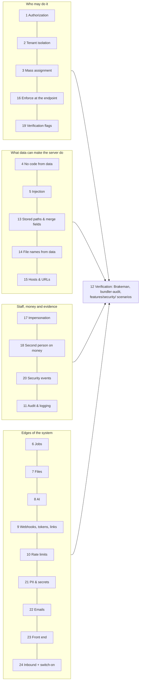

# Feature security checklist

- **What it is:** the security items every new feature and bug fix must cover.
- **Where it applies:** every OpenSpec design fills a **Security** table with one row per item (how the design meets
  it, where, and which test proves it). A bug fix's report says which items the fix touches.
- **Where it comes from:**
  - the October 2026 review: items 1–12, in `docs/security/security_review_2026_10.md`, "Recurring root causes";
  - the November 2026 OWASP review: items 13–24, in `docs/security/owasp_2026_11_changes.md`.
- **Where the rules are enforced:** the OpenSpec schemas (`openspec/schemas/spec-driven/schema.yaml`,
  `openspec/schemas/bugfix/schema.yaml`) and templates point here, so this file is the one list to keep current.

## How to fill the Security table

- **One row per item, all 24.**
  - An item that genuinely doesn't apply says why in one line, e.g. `N/A — no uploads`. Never leave it blank.
  - "How this design meets it" names the **real** class, policy method or helper.
  - "Test" names the H/E/X row or the `features/security/` scenario that proves it.
- **Every new or changed item must appear somewhere in the table:**
  - controller action, job, policy method, upload or import;
  - AI call, token, email or webhook;
  - stored path, PII column, privileged action.
- **The LLD's Security detail** gives, per new action or job, the exact policy method, the scope used to load, the
  permitted params, and the scenario that covers it.

---

## Items 1–12 (October 2026 review)

| # | Item | The rule |
|---|---|---|
| 1 | Authorization (Pundit) | Every action calls `authorize`; records load through `policy_scope(...)` then authorize, never a bare `Model.find(params[:id])`. Every allow/refuse rule lives in the policy (parent-policy delegation); no predicate that is just a feature flag or `true` |
| 2 | Tenant isolation | Queries are scoped to the user's entity and fund access; `entity_id` is `attr_readonly`; every other parent id is validated as same-firm; LP paths use ForInvestor and never its "all rows of an accessible fund" branch |
| 3 | Mass assignment | Strong params permit only what the form edits: never `entity_id`, owner or parent ids, approval flags, status, `approved_by` or role fields |
| 4 | No code from data | No `eval`, `instance_eval`, `send`, `public_send` or `constantize` on user- or AI-supplied strings; use an allowlist; stored expressions only through FormulaSandbox profiles |
| 5 | Injection | SQL only through bound parameters / Arel / `sanitize_sql`; Ransack attributes allowlisted; no `html_safe` / `raw` on user or document text; file names and template paths never from params |
| 6 | Background jobs | Jobs take ids, reload through the entity and re-check the acting user's access; idempotent on retry |
| 7 | Files and documents | Uploads validated for type and size; served through authorized, expiring URLs; document text is untrusted |
| 8 | AI / LLM | Document and user text is data (prompt injection); no write tools; structured, validated output that never authorizes anything; context only from the requesting entity; minimum PII |
| 9 | Webhooks, tokens, links | Provider signatures verified; tokens have a purpose and an expiry; no open redirects |
| 10 | Rate limiting and cost | Expensive or AI endpoints behind rack-attack or a per-entity cap |
| 11 | Audit and logging | Sensitive changes recorded with who, when and before → after; secrets only in credentials |
| 12 | Verification | Brakeman and bundler-audit clean; a `features/security/` scenario per new action: other firm refused, owner allowed, direct request that bypasses the UI refused |

---

## Items 13–24 (November 2026 OWASP review)

### 13. Stored paths, column keys and merge fields are read safely
- **Rule:**
  - A dotted path a user saved (grid column key, report field, PDF password field) is read with
    `SafeAttributePath.read` / `read!`, never `send` / `public_send`, and validated **when saved**.
  - Word-template merge fields can't call anything on a class or drop a relation's scope.
- **Bad → good:** `record.public_send(key)` with `key = "class.delete_all"` → `SafeAttributePath.read(record, key,
  context: "grid column")`, which refuses anything that isn't a plain field read. The key is also refused when the
  admin saves it.
- **Check:** a scenario saves a key like `class.delete_all` and is refused; a real key still renders.

### 14. File names that come from data stay inside their folder
- **Rule:**
  - A "File Name" column in a spreadsheet, or an entry in a zip, is resolved with `ImportUtil#import_file_path`, which
    returns nothing outside the upload folder.
  - Symlinks that escape the folder are removed after unzipping (`remove_escaping_symlinks`).
- **Bad → good:** `File.join(dir, row["File Name"])` → `import_file_path(dir, row["File Name"])`, so
  `../../config/master.key` reads "file not found in zip".
- **Check:** a scenario imports `../`-style names and a symlink; neither escapes.

### 15. Hosts and URLs built from stored values go through safe readers
- **Rule:**
  - Links built from stored values use `Entity#safe_sub_domain` (one DNS label, or the main site).
  - Server-side fetches (the PDF printer, previews) only use our own hosts (`WithTrustedPdfHost`).
  - The request's `Host` header never decides where the server fetches from.
  - A new rule on a stored value applies when it is **changed**, so legacy rows keep saving.
- **Bad → good:** `"https://#{entity.sub_domain}.#{BASE_DOMAIN}/..."` → `entity.safe_sub_domain`.
- **Check:** a scenario saves `evil.example?` (refused) and sends a link for a legacy odd value (main site).

### 16. A hidden button is not a rule: enforce at the endpoint, import and job
- **Rule:**
  - If a role can't see a button, the controller action, the import type and any job behind it check the **same**
    policy rule.
  - An upload records who made it (and the support person behind it), so the import job can apply that person's
    rights.
- **Bad → good:** an Upload button hidden for non-support, but `ImportUploadsController` only checks "may import" →
  the import type's policy asks `support?`, and `import_uploads.support_user_id` carries it to the job.
- **Check:** a scenario posts directly to the endpoint, bypassing the UI, and is refused.

### 17. Support signed in as a client: no lasting powers, the real person recorded
- **Rule:** while CapHive support is impersonating a client user:
  - no long-lived credentials (API tokens, OAuth / MCP approvals);
  - no password resets and no region switches;
  - every record and event names the real person (`support_user_id`);
  - staff roles that can impersonate must use two-factor (`RequiredTwoFactor::REQUIRED_2FA_ROLES`).
- **Bad → good:** "New token" works during Login as → the policy refuses it while `support_user_id` is set; the
  button is disabled with a tooltip saying why and what to do instead.
- **Check:** a scenario runs the action during a real Login as session and is refused.

### 18. Anything that moves money or payout details has a second person
- **Rule:**
  - The person who prepares (creates, imports or changes) money figures or payout details can't also approve or
    verify them.
  - A change after approval withdraws the approval.
  - Where only one approver exists, the fallback is explicit, warned and recorded ("only approver").
  - Distributions and payouts are flagged, not silently blocked.
- **Bad → good:** an approver edits an LP's bank account and re-ticks Bank Verified → the change clears Bank
  Verified, emails the LP and the other approvers, and Verify is greyed for the maker.
- **Check:** scenarios for maker refused, checker allowed, change-after-approval withdraws, and the only-approver
  fallback.

### 19. Verification and approval flags are accepted only from whoever may press that button
- **Rule:**
  - Fields such as `verified`, `bank_verified`, `approved` and check results are in `permitted_attributes` only when
    the same policy method that shows the button holds **for that record**.
  - Results written by background checks are never accepted from a request.
- **Bad → good:** any employee could send `verified: true` in a KYC PATCH → `verified` is permitted only if
  `toggle_verified?` holds for the record; bank / PAN check results are never permitted.
- **Check:** a scenario has a non-approver send the flag through the JSON API; the rest saves and the flag doesn't.

### 20. Privileged actions leave a security event, and the right people are told
- **Rule:**
  - Role grants and removals, credential and 2FA changes, support access, data exports and deactivations call
    `SecurityEvents.record` with a catalogued kind (`SecurityEventCatalogue`: label and advice).
  - Decide the alert: email the firm's admins, bell only, or none.
  - Recording never fails the user's action (it runs after commit).
  - New counters for denials or abuse go into the security metrics.
- **Bad → good:** a new "export all investors" action with no trace → `SecurityEvents.record("data.exported",
  user:, details:)`, plus a catalogue entry with "when this is normal" and "if it wasn't expected".
- **Check:** a scenario performs the action and finds the event, its label and its "What to do" advice.

### 21. New personal data or secrets: filtered, encrypted or masked, and scrubbed
- **Rule:**
  - A new PII column (PAN, account number, date of birth, ID numbers) or secret (API key, token):
    - is added to `filter_parameters`, **case-insensitively**;
    - never appears in error emails (cookies, `Authorization` and session are already filtered);
    - is stored encrypted when it is a secret (`encrypts`) and shown masked;
    - is covered by `DevPiiScrubber`, so restored development copies don't hold real values.
- **Bad → good:** `filter_parameters += [/\Apan\z/]` misses the real `PAN` column → `/pan/i`.
- **Check:** a scenario or log assertion shows `[FILTERED]`; the dev scrub feature covers the column.

### 22. Emails that carry access are short-lived; attachments are size-guarded
- **Rule:**
  - A link in an email that gives access to data (downloads, dumps, magic links) expires quickly, for example 1 hour
    for a database dump.
  - It never opens a sensitive page without sign-in.
  - Attachments go through `ApplicationMailer#attach_doc` / `#pw_protect_attach_file`, so the size guard applies; a
    generated export that can't is added to the known-exempt list with its reason.
- **Bad → good:** a 7-day signed link to a full database dump → a 1-hour link, plus an in-app "Download Link" that
  works after sign-in.
- **Check:** the attachment-size drift guard (`notification_attachment_size.feature`) stays green.

### 23. Front end: no injected markup, pinned scripts, no outside images in AI output
- **Rule:**
  - Names and user text are never put into `innerHTML` unescaped; use `textContent`, or DOMPurify where markup is
    intended.
  - CDN scripts are pinned to exact versions with integrity hashes (the M9 drift guard).
  - AI or markdown output can't load images from outside sites.
- **Bad → good:** a confirm popup builds `innerHTML = "Delete " + name` → DOMPurify-sanitised template; a KPI called
  `<b>Revenue</b>` shows as text.
- **Check:** a scenario with an HTML-bearing name; the CDN pin and outside-image guards stay green.

### 24. Inbound messages are verified, and protections are actually switched on
- **Rule:**
  - Inbound email is accepted only when SPF or DKIM passes; webhooks are verified by signature or token.
  - A protection shipped behind a log-only or off flag gets a **post-deploy step** that switches it on per region
    (`post_deploy_steps/<change>.md`), so it doesn't stay off.
- **Bad → good:** an enforce flag merged "log only" and forgotten → a post-deploy step `enforce-flags` that each
  production region must answer `done`.
- **Check:** a scenario for an unverified sender refused; the post-deploy steps file lists the switch-on.

---

## For a bug fix

- **The report** names which items the bug broke and which the fix touches. Usually 1–4 items, not all 24.
- **Tests:** each touched item gets its check, the same as for a feature.
- **Security bugs:** the report also says whether the same mistake exists elsewhere, with a grep or a drift guard,
  and whether a post-deploy step is needed.
