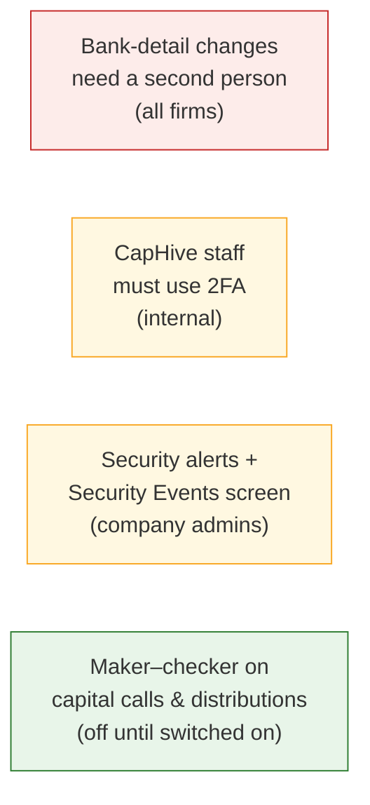
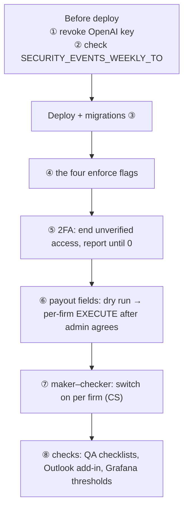

# Security release, November 2026: note for the business and ops teams

- **Release:** PR #1918, branch `fix/owasp-top10-2026-11`.
- **What it is:** the fixes from the November 2026 security review (OWASP Top 10), plus four new security controls.
- **Full detail:**
  - `docs/security/owasp_2026_11_changes.md` (technical, with worked examples)
  - `tmp/owasp_branch_changes_and_user_impact.md` (impact by role)

---

## Part 1: for the business, customer success and support

### In one paragraph

This release closes every Critical and High issue the review found, and adds four controls. For almost all users
nothing changes: screens, imports, reports, formulas and links work as before. Four things are **meant** to be
noticed. Each is designed so that nobody is stuck and no existing work is blocked.



### 1. Bank-detail changes need a second person (every firm, from the deploy)

This is the change client KYC teams will notice most.

- **What happens.** When someone changes an LP's **bank account number**, **IFSC**, or a field marked as a payout
  field (e.g. SWIFT, IBAN):
  - **Bank Verified** is cleared, and a verified KYC goes back to *completed*.
  - **The LP is emailed** that their bank details changed, with what to do if they didn't ask for it.
  - **The firm's other KYC approvers are emailed** to review it.
  - **The person who made the change can't verify it themselves.** Another approver verifies it, through a short
    confirm popup.
- **Firms with only one approver aren't stuck.** That approver can verify their own change after a warning, and it's
  recorded as "only approver".
- **Distributions are flagged, not blocked.** The distribution checks and the payments download show unconfirmed
  bank changes.
- **What stays the same:**
  - KYCs that are verified today stay verified until their bank details change.
  - Other edits (branch name, phone, address) are unaffected.
- **Also new:**
  - Fund staff **without the KYC Approve permission** can no longer mark a KYC verified through the API or the form.
  - About 3% of bank name checks will now show **"Name needs review"** instead of passing automatically.
- **Why:** today one person can change where an LP's money goes and mark it verified, with nobody else seeing it.

**Example.**
1. Meera changes Anil's account from …4821 to …7310.
2. Anil gets an email. Ravi (another approver) gets a "please review" email.
3. Meera's Verify button is greyed, and its tooltip explains why.
4. Ravi opens the KYC, checks the new account and verifies it.

### 2. Company admins get security alerts, and a new Security Events screen

- **New emails.** Company admins get an email when:
  - someone is given or loses an **admin or approver** role in their firm;
  - the **"Enable support"** switch changes.
- **No email when CapHive support signs in as one of their users** or switches into their firm. That shows in their
  **notification bell** and on the screen only.
- **New "Security Events" screen.** It lists sign-ins, failed sign-ins, role changes, 2FA changes, API tokens,
  support access and more.
  - Each row has a 💡 button that explains when the event is normal and what to do if it isn't.
  - Clicking an event's name filters the list to that kind.
- **Retention:** events are kept for **13 months**.

### 3. Maker–checker for capital calls and distributions (off until a firm asks for it)

- **Nothing changes on deploy.** It's off for every firm, new firms included.
- **When a firm switches it on** (entity form, Approvals block):
  - whoever prepared a call or distribution can't approve it;
  - they can press **Request approval** to email the other approvers;
  - a change to the figures after approval withdraws the approval.
- **Suggest it to firms with two or more approvers.** The design lists 7 firms whose users approve their own work
  today.
- **The only visible change for everyone:** an approved call or distribution shows a "Prepared by" row.

### 4. CapHive support and super users must use two-factor (internal)

- **Who:** the 11 CapHive support and super users. **Clients are not affected.** Company admins and LPs don't
  have to use 2FA (they still can).
- **What happens:**
  - Their next sign-in takes them through set-up. The authenticator app is offered, so no phone is needed.
  - "Login as" works again once set-up is done.

### Small differences users might mention

| What | Who | What to tell them |
|---|---|---|
| The direct link in the daily database-dump email expires after **1 hour** (was 7 days) | Firms that receive dumps | Use the email's "Download Link"; it still works after sign-in |
| One extra **"Connect"** click when signing in to the Outlook add-in | Outlook add-in users | Expected; it confirms they meant to connect |
| A name containing HTML, e.g. `<b>Revenue</b>`, shows the tags as text | Rare | Intended; names can't run code any more |
| CapHive support can't create API tokens while signed in as a client | Support only | Ask the client's user to create the token |
| A custom-field import with a **Calculation** field is refused unless CapHive support uploads it | Onboarding | The onboarding ops user needs the support role |

### Suggested message to client KYC teams

> **Changes to bank details now need a second approver.**
>
> From [date], when an investor's bank account number, IFSC or SWIFT/IBAN is changed in CapHive:
> - **Bank Verified** is cleared.
> - The investor is emailed.
> - Another KYC approver in your firm verifies the change.
>
> The person who made the change can't verify it themselves. If you are your firm's only approver, you can still
> verify it after a confirmation step. KYCs that are verified today are not affected until their bank details
> change.
>
> We made this change so that a payout account can't be changed and approved by the same person without anyone else
> seeing it.

---

## Part 2: for ops

Do each step on **production.in and production.us separately**. They are independent environments: never copy
URLs, tokens or settings between them.



### Before the deploy

1. **Revoke the old OpenAI key** at OpenAI (finding H1). It was in a public JavaScript file; the code using it has
   been removed.
2. **Check `SECURITY_EVENTS_WEEKLY_TO`** is set to `support@caphive.com` in each region's env file. It's already in
   `.env.production.in` and `.env.production.us`. If it's unset, the Monday security pack isn't sent.

### The deploy

3. **Run the migrations.** All of them only add things; none removes or rewrites existing data except M3, which
   encrypts the stored vendor keys:

   | Migration | What |
   |---|---|
   | `20261109120000` | `import_uploads.support_user_id` |
   | `20261109130000` | encrypt each firm's stored third-party keys (M3). Tested both ways; 0 blank keys in production |
   | `20261109150000` | `security_events` table |
   | `20261109160000` / `20261109160100` | maker–checker setting (default **off**) and `approval_makers` table |
   | `20261110090000` | `bank_detail_changes` table |

   **New scheduled jobs**, registered automatically by Sidekiq cron:
   - `SecurityEventWeeklyPackJob`, every Monday: IN 01:30 UTC, US 12:00 UTC.
   - `SecurityEventPurgeJob`, nightly 13-month purge: IN 21:15 UTC, US 07:15 UTC.

### Straight after the deploy

4. **Set the four enforce flags** on both regions (steps in `docs/operations/security_review_2026_10_flags.md`).
   Until they are set, several fixes only write log lines:

   | Setting | Switches on |
   |---|---|
   | `FORMULA_SANDBOX=enforce` | the real formula guard |
   | `SENDGRID_INBOUND_ENFORCE` | refusing forged inbound emails |
   | `WEBHOOK_TOKEN_ENFORCE` | refusing unsigned WhatsApp / e-sign webhooks |
   | `ENFORCE_HOST_AUTHORIZATION` | Rails' host check |

5. **Two-factor for CapHive staff (M8).**
   - **First,** tell the 11 support and super users that their next sign-in asks them to set up 2FA.
   - **Run** this, so remembered sessions can't skip set-up:
     ```
     bin/rails two_factor_required:end_unverified_access              # dry run: prints the count
     EXECUTE=1 bin/rails two_factor_required:end_unverified_access    # ends remember-me cookies + website tokens
     ```
   - **Then run** `bin/rails two_factor_required:report` until it shows **0 without a verified method**. It prints
     counts only, never names.

6. **Payout fields for bank-detail controls (M14).** This marks SWIFT/IBAN-type custom fields so that changes to
   them count as bank changes.
   ```
   bin/rails bank_detail_changes:propose_payout_fields                        # dry run: firm › form › field, counts only
   EXECUTE=1 FIRM_ID=<id> bin/rails bank_detail_changes:propose_payout_fields # one firm, only after its admin agrees
   ```
   - Send each listed firm's admin its list first.
   - Marking changes no KYC and sends no email.
   - Only CapHive support can unmark a field.

7. **Maker–checker (M13)** is for customer success, not ops. Switch it on per firm, in the entity form's Approvals
   block, for firms that ask and have two or more approvers.

8. **Onboarding (N1):** give the onboarding ops user the **support** role for clients whose forms include
   Calculation fields. Otherwise those custom-field imports are refused.

### In the first weeks

- **QA:** run the M13 and M14 QA checklists on staging_in:
  - `openspec/changes/archive/2026-11-10-capital-call-distribution-maker-checker/qa-checklist.md`
  - `openspec/changes/archive/2026-11-10-bank-detail-change-controls/qa-checklist.md`
- **Outlook add-in (M7):** try one real sign-in after the deploy. The Office dialog can't be tested automatically.
- **Grafana (M12):** tune the new alert thresholds for denied requests, throttles and failed sign-ins after a few weeks
  of real traffic.
- **Restoring a production copy for development (P1):** follow `docs/operations/prod_restore.md`. The new step 4b runs
  `dev:scrub_pii`, which removes PANs, bank accounts and other personal data from the copy.

### If something goes wrong

- **Rolling back:** the code reverts cleanly, and the new tables and columns can stay in place.
- **Emails can't be recalled:** security alerts to admins and bank-change emails to LPs that were already sent stay
  sent.
- **Most likely support calls in week one:**
  - KYC teams asking why Verify is greyed: another approver must verify, as in Part 1 §1.
  - Company admins asking about the new security alert emails, as in Part 1 §2.
